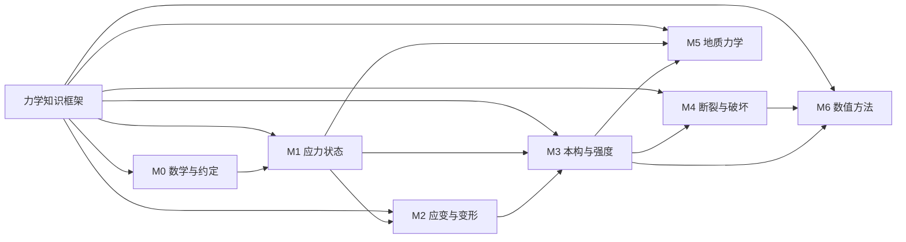

# geo-stress-study

**从"一个点的应力"到"地应力场"——面向课堂的力学知识库**

这个仓库把固体力学与地质力学中容易讲糊涂的概念，按国外教材的写法拆成可核对的小步骤：
每一个结论都给出前提、推导依据和数值检验；每一张图都有可复现的绘图脚本。

---

## 1. 这个库要解决什么

学生在学应力时通常卡在三个地方。它们看起来是三个问题，实际上是同一件事的三层：

| 学生常问 | 真正的症结 | 对应笔记 |
|---|---|---|
| "同一个点，为什么应力还要指定截面方向？" | 没分清**力**与**面力（traction）**；没接受应力是张量 | [面力与应力张量](docs/01-stress/01-traction-and-stress-tensor.md) |
| "主应力是不是另外加了一股力？" | 把**张量的分量**误当成**独立的物理量** | [主应力](docs/01-stress/03-principal-stress.md) |
| "等效应力凭什么能用一个数代表三个主应力？" | 没区分**体积部分**与**形状改变部分（偏量）** | [偏应力与等效应力](docs/01-stress/05-deviator-and-von-mises.md) |

一句话概括全库的主线：

> 力是矢量，只能作用在**面**上；  
> 一个点的受力状态是**张量**，它规定了任意方向截面上的面力；  
> 换方向不改变张量，只改变它的**分量**；  
> 主应力与不变量是张量本身的性质，与坐标系无关；  
> 等效应力是把张量压缩成一个标量，代价是丢掉方向信息。

---

## 2. 知识框架（先看图，再读书）

- 交互式知识图谱：[`knowledge-graph/index.html`](knowledge-graph/index.html)（浏览器直接打开，可点击节点跳到笔记）
- 图谱说明与扩展方法：[`knowledge-graph/README.md`](knowledge-graph/README.md)
- 机器可读节点表：[`knowledge-graph/graph.json`](knowledge-graph/graph.json)



---

## 3. 目录

| 路径 | 内容 | 状态 |
|---|---|---|
| [`docs/00-notation/`](docs/00-notation/) | 符号、单位、拉正/压正约定 | ✅ |
| [`docs/01-stress/`](docs/01-stress/) | 应力状态：张量、变换、主应力、莫尔圆、等效应力 | ✅ 6 篇 |
| [`docs/02-strain/`](docs/02-strain/) | 应变与几何：小应变张量、主应变、体积应变 | 🚧 提纲 |
| [`docs/03-constitutive/`](docs/03-constitutive/) | 本构与强度：弹性、塑性、Mohr–Coulomb、Hoek–Brown | 🚧 提纲 |
| [`docs/04-fracture/`](docs/04-fracture/) | 断裂与破坏：Griffith、应力强度因子、水力压裂 | 🚧 提纲 |
| [`docs/05-geomechanics/`](docs/05-geomechanics/) | 地质力学：原地应力、有效应力、断层类型 | 🚧 提纲 |
| [`docs/06-numerics/`](docs/06-numerics/) | 数值实现：FEM、cohesive、XFEM、CEL | 🚧 提纲 |
| [`knowledge-graph/`](knowledge-graph/) | 知识图谱：可点击页面、Mermaid 图与机器可读节点表 | ✅ 43 节点 |
| [`cases/`](cases/) | 文献/科普文章的拆解笔记（吸收来源） | ✅ 1 篇 |
| [`assets/figures/`](assets/figures/) | 教学图件（脚本生成，勿手改） | ✅ |
| [`tools/make_figures.py`](tools/make_figures.py) | 全部图件的生成脚本 | ✅ |
| [`tools/build_graph_data.py`](tools/build_graph_data.py) | 校验 `graph.json` 并生成页面数据 | ✅ |

---

## 4. 学习路线

**第一阶段｜把一个点的应力讲透（约 4 学时）**
`00-notation` → `01-traction-and-stress-tensor` → `02-stress-transformation` → `03-principal-stress` → `04-mohr-circle` → `05-deviator-and-von-mises`

**第二阶段｜从"状态"到"响应"（后续）**
应变张量 → 广义胡克定律 → 屈服准则 → Mohr–Coulomb（岩石最常用）

**第三阶段｜从"力学"到"地质"（后续）**
原地应力场与有效应力 → 断层类型与应力方位 → 断裂扩展与水力压裂 → 数值实现

---

## 5. 每篇笔记的固定结构

为了让"严谨"可执行，而不是一句口号，本库所有理论笔记都必须有下面 6 节：

1. **结论先行**：先给结论和适用范围，读者知道要推导什么。
2. **前提与符号**：列出用到的假设（连续介质、小变形、无体力偶……）与符号。
3. **推导**：编号步骤，每一步只做一件事，并写清依据（平衡方程、几何关系、张量变换律）。
4. **数值检验**：用可手算的算例核对结论（例如单轴 100 MPa 的 45° 斜截面）。
5. **常见误解**：明确写出"错的读法"和"为什么错"。
6. **自测**：3–5 题，答案放在文末。

写作规范细则见 [`docs/00-notation/writing-style.md`](docs/00-notation/writing-style.md)。

---

## 6. 符号与约定（摘要）

完整版见 [`docs/00-notation/symbols-and-conventions.md`](docs/00-notation/symbols-and-conventions.md)。

- **拉为正**（固体力学约定）：拉应力为正，压应力为负。地质学/岩石力学常反过来（压为正），
  在 [`06-from-solid-to-geomechanics.md`](docs/01-stress/06-from-solid-to-geomechanics.md) 给出完整换算表。
- 应力张量 $\sigma_{ij}$： $i$ 表示**作用面法向**， $j$ 表示**力的方向**。
- 主应力排序： $\sigma_1 \ge \sigma_2 \ge \sigma_3$（代数大小，考虑正负号）。
- 单位：SI 为 Pa；工程常用 MPa（ $1\ \mathrm{MPa} = 10^6\ \mathrm{Pa}$）。

---

## 7. 图件

所有图件由 [`tools/make_figures.py`](tools/make_figures.py) 生成，可复现：

```bash
pip install matplotlib numpy
python tools/make_figures.py
```

| 图 | 文件 | 用途 |
|---|---|---|
| 图 1 | `assets/figures/fig01-stress-cube.png` | 三维微元三个面上的正应力与剪应力分量 |
| 图 2 | `assets/figures/fig02-oblique-plane-45.png` | 单轴 100 MPa、45° 斜截面的 50/50 分解 |
| 图 3 | `assets/figures/fig03-mohr-circles-3d.png` | 三维三个莫尔圆与最大剪应力 |
| 图 4 | `assets/figures/fig04-yield-criteria.png` | Rankine / von Mises / Tresca 平面应力对比 |
| 图 5 | `assets/figures/fig05-stress-path-uniaxial.png` | 单轴加载在莫尔圆上的对应点移动 |
| 图 6 | `assets/figures/fig06-anderson-faults.png` | 三类断层与主应力方位 |

原始文献插图（仅作对照，版权归原作者，见 [assets/reference/README.md](assets/reference/README.md)）保存在 `assets/reference/`。

---

## 8. 来源与致谢

- 案例笔记 [`cases/2026-11-10-five-stress-concepts.md`](cases/2026-11-10-five-stress-concepts.md) 整理自公众号「科研干货」的
  《一文读懂应力、正应力、切应力、主应力和等效应力！》，原文引用的三张图分别来自：
  - `10.3390/ma17071498`（三维微元应力分量）
  - `10.3390/ma17143436`（三维莫尔圆）
  - `10.3390/applmech3010018`（三种强度准则对比）
- 本库正文为独立撰写，推导与算例均重新完成；图件为自绘，不复制原文图像。

---

## 9. 许可

- 文字、图件与知识图谱数据：[CC BY 4.0](LICENSE-docs)（保留署名与出处）
- 脚本代码：[MIT](LICENSE)

欢迎在课堂上直接使用；修改后请保留出处链接。
