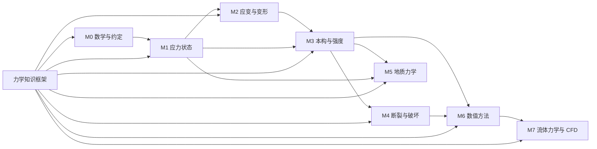

# geo-stress-study

**从"一个点的应力"到"地应力场"——面向课堂的力学知识库**

这个仓库把固体力学与地质力学中容易讲糊涂的概念，按国外教材的写法拆成可核对的小步骤：
每一个结论都给出前提、推导依据和数值检验；每一张图都有可复现的绘图脚本。

---

## 1. 这个库要解决什么

学生在学应力时通常卡在三个地方。它们看起来是三个问题，实际上是同一件事的三层：

| 学生常问 | 真正的症结 | 对应笔记 |
|---|---|---|
| "同一个点，为什么应力还要指定截面方向？" | 没分清**力**与**面力（traction）**；没接受应力是张量 | [面力与应力张量](docs/01-stress/01-traction-and-stress-tensor.md) |
| "主应力是不是另外加了一股力？" | 把**张量的分量**误当成**独立的物理量** | [主应力](docs/01-stress/03-principal-stress.md) |
| "等效应力凭什么能用一个数代表三个主应力？" | 没区分**体积部分**与**形状改变部分（偏量）** | [偏应力与等效应力](docs/01-stress/05-deviator-and-von-mises.md) |

一句话概括全库的主线：

> 力是矢量，只能作用在**面**上；  
> 一个点的受力状态是**张量**，它规定了任意方向截面上的面力；  
> 换方向不改变张量，只改变它的**分量**；  
> 主应力与不变量是张量本身的性质，与坐标系无关；  
> 等效应力是把张量压缩成一个标量，代价是丢掉方向信息。

---

## 2. 知识框架（先看图，再读书）

- 交互式知识图谱：[`knowledge-graph/index.html`](knowledge-graph/index.html)（浏览器直接打开，可点击节点跳到笔记）
- 图谱说明与扩展方法：[`knowledge-graph/README.md`](knowledge-graph/README.md)
- 机器可读节点表：[`knowledge-graph/graph.json`](knowledge-graph/graph.json)



---

## 3. 目录

| 路径 | 内容 | 状态 |
|---|---|---|
| [`docs/00-notation/`](docs/00-notation/) | 符号、单位、拉正/压正约定 | ✅ |
| [`docs/01-stress/`](docs/01-stress/) | 应力状态：张量、变换、主应力、莫尔圆、等效应力 | ✅ 6 篇 |
| [`docs/02-strain/`](docs/02-strain/) | 应变与几何：小应变张量、主应变、体积应变 | 🚧 提纲 |
| [`docs/03-constitutive/`](docs/03-constitutive/) | 本构与强度：弹性、塑性、Mohr–Coulomb、Hoek–Brown | 🚧 提纲 |
| [`docs/04-fracture/`](docs/04-fracture/) | 断裂与破坏：Griffith、应力强度因子、水力压裂 | 🚧 提纲 |
| [`docs/05-geomechanics/`](docs/05-geomechanics/) | 地质力学：原地应力、有效应力、断层类型 | 🚧 提纲 |
| [`docs/06-numerics/`](docs/06-numerics/) | 数值实现：FEM、cohesive、XFEM、CEL | 🚧 提纲（编程基础、雅可比、变分近似、单元类型已完成） |
| [`docs/06-numerics/fem-programming/`](docs/06-numerics/fem-programming/) | 有限元编程基础：从 $Ku=F$ 到手写 Q4、组装、约束荷载与求解器 | ✅ 5 篇 + 导读 |
| [`docs/06-numerics/jacobian-and-mapping.md`](docs/06-numerics/jacobian-and-mapping.md) | 雅可比矩阵：多变量映射的局部线性化、 $\det J$ 的几何、秩与奇异位形 | ✅ 1 篇 |
| [`docs/06-numerics/variational-approximation.md`](docs/06-numerics/variational-approximation.md) | 变分近似：弱形式↔能量极小、Ritz 与 Galerkin、正交投影与最佳逼近 | ✅ 1 篇 |
| [`docs/06-numerics/element-types.md`](docs/06-numerics/element-types.md) | 单元类型与降维：实体/壳/梁/杆、剪切锁死、沙漏、平面应力/应变/轴对称 | ✅ 1 篇 |
| [`docs/07-fluid/`](docs/07-fluid/) | 流体力学与 CFD：控制方程、状态与边界、面通量与时间推进、Sod 激波管 | ✅ 4 篇 + 导读 |
| [`knowledge-graph/`](knowledge-graph/) | 知识图谱：可点击页面、Mermaid 图与机器可读节点表 | ✅ 60 节点 |
| [`cases/`](cases/) | 文献/科普文章的拆解笔记（吸收来源） | ✅ 4 篇 |
| [`assets/figures/`](assets/figures/) | 教学图件（脚本生成，勿手改） | ✅ |
| [`tools/make_figures.py`](tools/make_figures.py) | 全部图件的生成脚本 | ✅ |
| [`tools/build_graph_data.py`](tools/build_graph_data.py) | 校验 `graph.json` 并生成页面数据 | ✅ |
| [`tools/verify_fem_notes.py`](tools/verify_fem_notes.py) | 复算 FEM 编程五章的全部数值（61 项断言） | ✅ |
| [`tools/verify_jacobian_note.py`](tools/verify_jacobian_note.py) | 复算雅可比笔记的全部数值（面积比、一阶误差、两连杆） | ✅ |
| [`tools/verify_variational_note.py`](tools/verify_variational_note.py) | 复算变分近似笔记的全部数值（能量极小、正交性、收敛阶、稀疏度） | ✅ |
| [`tools/element_lib.py`](tools/element_lib.py) | 二维平面应力有限元库：Q4/Q8/T3、等参刚度、特征值与沙漏、寄生剪切 | ✅ |
| [`tools/verify_element_notes.py`](tools/verify_element_notes.py) | 复算单元类型笔记的全部数值（挠度、锁死、零能模式、自由度账） | ✅ |
| [`tools/fluid_lib.py`](tools/fluid_lib.py) | 可压缩 Euler 参考实现：守恒量换算、Rusanov 通量、Sod 精确解与一维有限体积 | ✅ |
| [`tools/verify_fluid_notes.py`](tools/verify_fluid_notes.py) | 复算 M7 四篇笔记的全部数值（通量、星区、波位置、收敛阶、守恒审计） | ✅ |

---

## 4. 学习路线

**第一阶段｜把一个点的应力讲透（约 4 学时）**
`00-notation` → `01-traction-and-stress-tensor` → `02-stress-transformation` → `03-principal-stress` → `04-mohr-circle` → `05-deviator-and-von-mises`

**第二阶段｜从"状态"到"响应"（后续）**
应变张量 → 广义胡克定律 → 屈服准则 → Mohr–Coulomb（岩石最常用）

**第三阶段｜从"力学"到"地质"（后续）**
原地应力场与有效应力 → 断层类型与应力方位 → 断裂扩展与水力压裂 → 数值实现

**第四阶段｜把方程写成程序（约 8 学时）**
从 $Ku=F$ 的四步流程开始，依次是节点排序与雅可比、组装与稀疏存储、约束与荷载、线性方程组求解。
入口见 [`docs/06-numerics/fem-programming/`](docs/06-numerics/fem-programming/)，
所有算例可用 `py -3 tools/verify_fem_notes.py` 复算。
雅可比矩阵本身的几何与秩，见
[`docs/06-numerics/jacobian-and-mapping.md`](docs/06-numerics/jacobian-and-mapping.md)
（图 17–图 19，可用 `py -3 tools/verify_jacobian_note.py` 复算）。
最后回到「刚度矩阵凭什么长这样」：弱形式与能量极小的等价、Ritz 与 Galerkin 两路同归，见
[`docs/06-numerics/variational-approximation.md`](docs/06-numerics/variational-approximation.md)
（图 20–图 23，可用 `py -3 tools/verify_variational_note.py` 复算）。
最后回答"下拉菜单里的单元到底差在哪"：从实体、壳、梁、杆的运动学假设，
到剪切锁死、沙漏与二维降维，见
[`docs/06-numerics/element-types.md`](docs/06-numerics/element-types.md)
（图 34–图 40，可用 `py -3 tools/verify_element_notes.py` 复算）。

**第五阶段｜从固体到流体（约 6 学时）**
流体不是"另一种固体"：未知量从位移换成守恒量，离散从单元积分换成面上通量，
稳定性从锁定换成 CFL。入口见 [`docs/07-fluid/`](docs/07-fluid/)，
按"控制方程 → 状态与边界 → 面通量与时间推进 → Sod 激波管"四篇顺序读；
所有算例可用 `py -3 tools/verify_fluid_notes.py` 复算。
石油系统的接口（井筒气侵、管线水击、裂缝内高速流、超临界 CO2）写在模块导读的对照表里。

---

## 5. 每篇笔记的固定结构

为了让"严谨"可执行，而不是一句口号，本库所有理论笔记都必须有下面 6 节：

1. **结论先行**：先给结论和适用范围，读者知道要推导什么。
2. **前提与符号**：列出用到的假设（连续介质、小变形、无体力偶……）与符号。
3. **推导**：编号步骤，每一步只做一件事，并写清依据（平衡方程、几何关系、张量变换律）。
4. **数值检验**：用可手算的算例核对结论（例如单轴 100 MPa 的 45° 斜截面）。
5. **常见误解**：明确写出"错的读法"和"为什么错"。
6. **自测**：3–5 题，答案放在文末。

写作规范细则见 [`docs/00-notation/writing-style.md`](docs/00-notation/writing-style.md)。

---

## 6. 符号与约定（摘要）

完整版见 [`docs/00-notation/symbols-and-conventions.md`](docs/00-notation/symbols-and-conventions.md)。

- **拉为正**（固体力学约定）：拉应力为正，压应力为负。地质学/岩石力学常反过来（压为正），
  在 [`06-from-solid-to-geomechanics.md`](docs/01-stress/06-from-solid-to-geomechanics.md) 给出完整换算表。
- 应力张量 $\sigma_{ij}$： $i$ 表示**作用面法向**， $j$ 表示**力的方向**。
- 主应力排序： $\sigma_1 \ge \sigma_2 \ge \sigma_3$（代数大小，考虑正负号）。
- 单位：SI 为 Pa；工程常用 MPa（ $1\ \mathrm{MPa} = 10^6\ \mathrm{Pa}$）。

---

## 7. 图件

所有图件由 [`tools/make_figures.py`](tools/make_figures.py) 生成，可复现：

```bash
pip install matplotlib numpy
python tools/make_figures.py
```

| 图 | 文件 | 用途 |
|---|---|---|
| 图 1 | `assets/figures/fig01-stress-cube.png` | 三维微元三个面上的正应力与剪应力分量 |
| 图 2 | `assets/figures/fig02-oblique-plane-45.png` | 单轴 100 MPa、45° 斜截面的 50/50 分解 |
| 图 3 | `assets/figures/fig03-mohr-circles-3d.png` | 三维三个莫尔圆与最大剪应力 |
| 图 4 | `assets/figures/fig04-yield-criteria.png` | Rankine / von Mises / Tresca 平面应力对比 |
| 图 5 | `assets/figures/fig05-stress-path-uniaxial.png` | 单轴加载在莫尔圆上的对应点移动 |
| 图 6 | `assets/figures/fig06-anderson-faults.png` | 三类断层与主应力方位 |
| 图 7 | `assets/figures/fig07-single-element.png` | 单 Q4 算例：模型、 $u_x$、 $\lvert u\rvert$ 与 $\sigma_y$ 云图 |
| 图 8 | `assets/figures/fig08-fem-workflow.png` | 有限元程序的四步流程与数据结构 |
| 图 9 | `assets/figures/fig09-node-ordering-detj.png` | 三种节点顺序下的 detJ 符号 |
| 图 10 | `assets/figures/fig10-isoparametric-jacobian.png` | 母单元到实际单元的等参映射 |
| 图 11 | `assets/figures/fig11-assembly-scatter.png` | 两个 Q4 的组装与稀疏结构 |
| 图 12 | `assets/figures/fig12-sparse-storage.png` | Skyline / COO / CSR 三种存储格式 |
| 图 13 | `assets/figures/fig13-constraint-methods.png` | 消元、改行列、罚法三种约束写法 |
| 图 14 | `assets/figures/fig14-load-vector.png` | 三类荷载的等效节点力与组装后的 F |
| 图 15 | `assets/figures/fig15-solver-cost.png` | 直接法与迭代法的代价量级 |
| 图 16 | `assets/figures/fig16-cg-pcg-convergence.png` | CG 与 PCG 的真实残差曲线 |
| 图 17 | `assets/figures/fig17-jacobian-tangent-and-map.png` | 一阶近似：切线（一维）与平行四边形（多维） |
| 图 18 | `assets/figures/fig18-jacobian-det-cases.png` | 同一函数的四个工作点：放大、压缩、翻转、退化 |
| 图 19 | `assets/figures/fig19-jacobian-singular-arm.png` | 两连杆奇异位形：速度可达集压成线段 |
| 图 20 | `assets/figures/fig20-ritz-galerkin-two-roads.png` | 两条路径：能量极小化 vs 加权余量投影 |
| 图 21 | `assets/figures/fig21-energy-orthogonal-projection.png` | 子空间上的能量正交投影与勾股定理 |
| 图 22 | `assets/figures/fig22-galerkin-convergence.png` | 能量逼近与 $L^2$ 逼近：误差曲线与收敛阶 |
| 图 23 | `assets/figures/fig23-dense-vs-banded-stiffness.png` | 全域基（稠密、病态）vs 分片基（带状、良态） |
| 图 24 | `assets/figures/fig24-compressible-control-volume.png` | 可压缩控制体：单元里存五个守恒量，面上交换三组通量 |
| 图 25 | `assets/figures/fig25-ns-closure-map.png` | 封闭关系：守恒方程、状态方程与输运关系的依赖图 |
| 图 26 | `assets/figures/fig26-characteristic-boundaries.png` | 外法向下的特征线方向与四类边界的进入条数 |
| 图 27 | `assets/figures/fig27-subsonic-outlet-construction.png` | 亚声速出口：给静压，其余由内部信息补齐 |
| 图 28 | `assets/figures/fig28-face-flux-two-cells.png` | 一个共享面通量同时更新两个控制体 |
| 图 29 | `assets/figures/fig29-rusanov-flux.png` | Rusanov 通量：中心平均加数值扩散 |
| 图 30 | `assets/figures/fig30-explicit-vs-implicit.png` | 同一个空间算子，显式推进与隐式迭代 |
| 图 31 | `assets/figures/fig31-low-mach-timescales.png` | 低马赫数下声学与对流两个时间尺度 |
| 图 32 | `assets/figures/fig32-sod-shocktube.png` | Sod 激波管在 t=0.2 的数值解与精确解 |
| 图 33 | `assets/figures/fig33-shock-jump-control-volume.png` | 随激波移动的控制体与质量收支 |
| 图 34 | `assets/figures/fig34-element-family.png` | 单元家族与 Abaqus 命名编码 |
| 图 35 | `assets/figures/fig35-four-element-types.png` | 实体、壳、梁、杆的几何与未知量 |
| 图 36 | `assets/figures/fig36-cantilever-accuracy.png` | 同一根悬臂梁、同样 10 块的端部精度 |
| 图 37 | `assets/figures/fig37-shear-locking.png` | 直边弯成梯形、寄生剪切与长厚比 |
| 图 38 | `assets/figures/fig38-hourglass-modes.png` | 减缩积分的零能模式与沙漏 |
| 图 39 | `assets/figures/fig39-2d-reductions.png` | 平面应力、平面应变、轴对称的约束 |
| 图 40 | `assets/figures/fig40-element-selection.png` | 从几何到单元名的选型流程 |

原始文献插图（仅作对照，版权归原作者，见 [assets/reference/README.md](assets/reference/README.md)）保存在 `assets/reference/`。

---

## 8. 来源与致谢

- 案例笔记 [`cases/2026-11-10-five-stress-concepts.md`](cases/2026-11-10-five-stress-concepts.md) 整理自公众号「科研干货」的
  《一文读懂应力、正应力、切应力、主应力和等效应力！》，原文引用的三张图分别来自：
  - `10.3390/ma17071498`（三维微元应力分量）
  - `10.3390/ma17143436`（三维莫尔圆）
  - `10.3390/applmech3010018`（三种强度准则对比）
- 案例笔记 [`cases/2026-11-12-fem-programming-series.md`](cases/2026-11-12-fem-programming-series.md) 整理自公众号
  「有限元编程基础」11 篇系列（2026-11），逐篇对应本库
  [`docs/06-numerics/fem-programming/`](docs/06-numerics/fem-programming/) 的五章，
  并列出对该系列的三处订正。未复制原文图片与代码。
- 笔记 [`docs/06-numerics/jacobian-and-mapping.md`](docs/06-numerics/jacobian-and-mapping.md)
  整理自公众号文章《理论剖析 || 雅可比矩阵：连接多变量世界的数学桥梁》（2026-11）。
  原文公式为图片，本库逐式转写为 LaTeX 并重算数值；原文的四个算例点在本库按
  放大 / 压缩 / 翻转 / 退化重新分配（原文以奇异点演示"缩放"，见笔记 §4 误解 5）。
  未复制原文图片。
- 笔记 [`docs/06-numerics/variational-approximation.md`](docs/06-numerics/variational-approximation.md)
  整理自公众号文章《变分问题与变分方程的近似求解：从离散投影到现代有限元理论》（2026-11）。
  原文的 Ritz/Galerkin 两条路线在本库补齐了完整证明（对称情形等价、非对称 2×2 反例、
  能量正交投影与最佳逼近），并新增收敛阶与稠密/带状刚度矩阵的数值对照；
  公式逐式转写为 LaTeX，算例与图件全部重做，未复制原文图片。
- 笔记 [`docs/06-numerics/element-types.md`](docs/06-numerics/element-types.md) 与案例笔记
  [`cases/2026-11-14-element-types.md`](cases/2026-11-14-element-types.md)
  整理自公众号「嘎子科研助手」的《有限元单元类型》（2026-11-14）。
  原文约 8 780 字、35 张插图，以自行车零件讲解实体、壳、梁、杆与二维降维；
  本库补齐形函数、寄生剪切、沙漏秩计数、二维降维的应力状态与自由度账，
  并说明原文 Abaqus 实测数字的口径。35 张原图仅登记远程地址，未复制；
  本库图 34–图 40 为独立重绘。
- 笔记 [`docs/07-fluid/`](docs/07-fluid/) 整理自公众号「自由度FreeDof」的
  《从不可压缩到可压缩：N–S 方程与求解流程有哪些改变？》（2026-10-29）。
  原文约 2 万字、98 个独立公式、30 张插图；本库按 M7 四篇重组，补齐二维三维边界计数、
  单元平均偏差、网格收敛阶、扩散步长系数与低马赫步数代价，并新增 Sod 守恒审计。
  30 张原图仅在案例笔记中登记远程地址，未复制图片；本库图 24–图 33 为独立重绘。
- 本库正文为独立撰写，推导与算例均重新完成；图件为自绘，不复制原文图像。

---

## 9. 许可

- 文字、图件与知识图谱数据：[CC BY 4.0](LICENSE-docs)（保留署名与出处）
- 脚本代码：[MIT](LICENSE)

欢迎在课堂上直接使用；修改后请保留出处链接。
