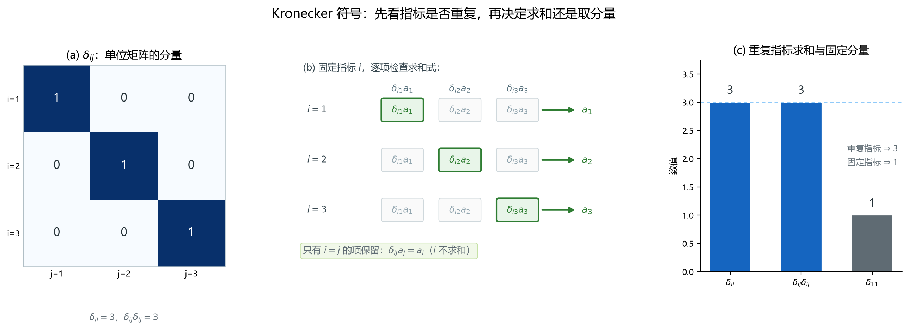
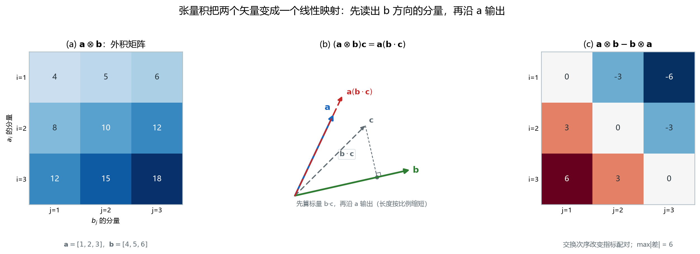
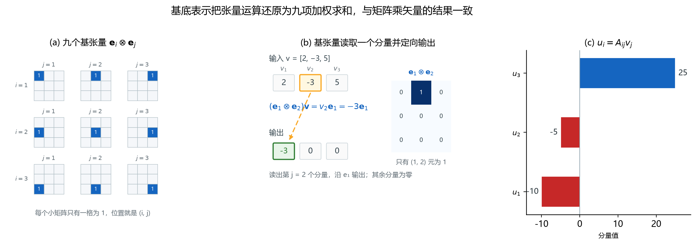
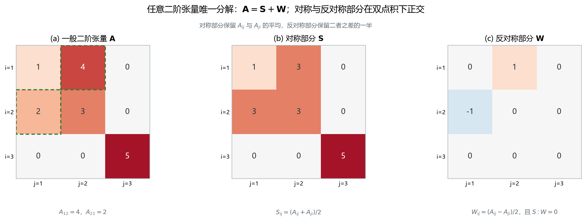
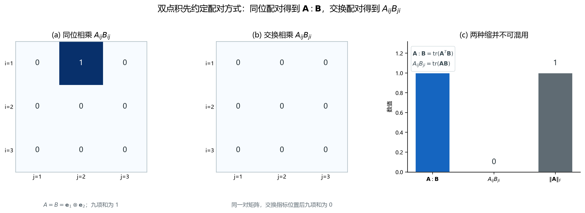

# Kronecker 符号与二阶张量：从指标替换到双点积

> 对应知识图谱节点：`M0-04`
>
> 前置：[符号、单位与约定](symbols-and-conventions.md)（基底、拉正/压正、 $\delta\_{ij}$ 的初步定义）
>
> 相关：[面力与应力张量](../01-stress/01-traction-and-stress-tensor.md)（应力张量 $\sigma\_{ij}$ 的指标写法）、[应力变换](../01-stress/02-stress-transformation.md)（正交变换下的分量变化）
>
> 原始文章：《连续介质力学（二）：Kronecker 符号与二阶张量运算》，公众号「学以远志」，2026-11-20（链接与版权说明见文末）

---

## 0. 结论先行

1. **指标记号不是装饰。** 一个表达式里有几类指标、哪些重复、哪些自由，决定了结果是标量、矢量还是高阶张量。重复指标默认求和；自由指标保留，并逐项取 $1,2,3$。
2. **Kronecker 符号是单位映射的分量。** 它做两件事：筛选（ $\delta\_{ij}a\_j=a\_i$ ）和计数（ $\delta\_{ii}=3$ ）。把 $\delta\_{11}$ 与 $\delta\_{ii}$ 混为一谈，是最常见的错误。
3. **张量积把两个矢量变成一个线性映射。** 分量是 $a\_i b\_j$，矩阵是外积 $\mathbf{a}\mathbf{b}^{\mathsf T}$；它作用在矢量上，先读出 $\mathbf{b}$ 方向的分量，再沿 $\mathbf{a}$ 输出。交换两个因子，映射一般改变（图 52）。
4. **二阶张量是线性映射，矩阵只是它在某组基下的分量表。** 九个基张量 $\mathbf{e}\_i\otimes\mathbf{e}\_j$ 给出九个"读一个分量、沿一个方向输出"的基本动作；任意二阶张量是这九个动作的加权和（图 53）。
5. **乘法是映射的复合，转置是交换输入与输出的配对。** 于是 $(\mathbf{A}\mathbf{B})^{\mathsf T}=\mathbf{B}^{\mathsf T}\mathbf{A}^{\mathsf T}$，且一般 $\mathbf{A}\mathbf{B}\ne\mathbf{B}\mathbf{A}$。
6. **任意二阶张量唯一分解为对称部分与反对称部分：** $\mathbf{A}=\mathbf{S}+\mathbf{W}$。两部分在双点积下正交， $\mathbf{S}:\mathbf{W}=0$（图 54）。
7. **双点积必须写明配对方式。** 同位配对给出 $\mathbf{A}:\mathbf{B}=A\_{ij}B\_{ij}=\mathrm{tr}(\mathbf{A}^{\mathsf T}\mathbf{B})$；交换配对给出 $A\_{ij}B\_{ji}=\mathrm{tr}(\mathbf{A}\mathbf{B})$。两者都是标量，但通常不相等（图 55）。
8. **适用范围：** 三维实矢量、实二阶张量、正交单位基底、列矢量约定。本文不涉及高阶张量、曲线坐标、协变导数与张量场求导；这些内容留到后续页面。本文的参考实现是 [`tools/tensor_lib.py`](../../tools/tensor_lib.py)，全部数字由 [`tools/verify_tensor_notes.py`](../../tools/verify_tensor_notes.py) 复算，末尾打印 `ALL CHECKS PASSED`。

---

## 1. 前提与符号

### 1.1 基底、分量与求和约定

取三维直角坐标系的右手正交单位基底 $\mathbf{e}\_1,\mathbf{e}\_2,\mathbf{e}\_3$。任意矢量写成

$$
\mathbf{a}=a_1\mathbf{e}_1+a_2\mathbf{e}_2+a_3\mathbf{e}_3=a_i\mathbf{e}_i.
$$

最后一步用了 **Einstein 求和约定**：同一项里出现两次的字母指标自动对 $1,2,3$ 求和。只出现一次的指标叫**自由指标**，它决定结果的类型：没有自由指标是标量，一个自由指标是矢量，两个自由指标是二阶张量。

| 名称 | 例子 | 是否求和 | 结果 |
|---|---|---|---|
| 哑指标（重复指标） | $a\_i b\_i$ 中的 $i$ | 是， $i=1,2,3$ | 标量 |
| 自由指标 | $a\_i$ 中的 $i$ | 否 | 矢量的第 $i$ 个分量 |
| 两个自由指标 | $A\_{ij}$ 中的 $i,j$ | 否 | 二阶张量的第 $(i,j)$ 个分量 |

**一条硬规则：同一项里同一个字母最多出现两次。** 出现三次时，指标归属有歧义，必须改写表达式或加括号。

如果不满足正交单位基底， $\mathbf{e}\_i\cdot\mathbf{e}\_j$ 不再是 $\delta\_{ij}$，下文的许多"筛选"会多出度规张量。本文全程使用正交单位基底。

### 1.2 张量与矩阵的记号

本库采用列矢量约定：二阶张量 $\mathbf{A}$ 的分量定义为

$$
A_{ij}=\mathbf{e}_i\cdot(\mathbf{A}\mathbf{e}_j).
$$

也就是说， $A\_{ij}$ 是"输入沿 $\mathbf{e}\_j$、输出取 $\mathbf{e}\_i$ 分量"的系数。把所有分量排成矩阵 $[A\_{ij}]$，第 $i$ 行第 $j$ 列就是 $A\_{ij}$。

**张量 $\mathbf{A}$ 与矩阵 $[A\_{ij}]$ 不是同一个东西。** 张量是线性映射，不依赖基底；矩阵是这组基下的分量表。换一组基，矩阵按相似变换改变，映射本身不变。本页为了计算方便，始终固定在同一组正交单位基底下，因此可以把两者暂时等同使用；但推导中要清楚哪一步用了"基底固定"。

### 1.3 符号表

| 符号 | 含义 | 说明 |
|---|---|---|
| $\delta\_{ij}$ | Kronecker 符号 | $i=j$ 时为 1，否则为 0 |
| $\mathbf{a}\otimes\mathbf{b}$ | 矢量张量积 | 二阶张量，分量为 $a\_i b\_j$ |
| $\mathbf{e}\_{ij}$ | 基张量 | 定义为 $\mathbf{e}\_i\otimes\mathbf{e}\_j$ |
| $\mathbf{I}$ | 单位张量 | 分量为 $\delta\_{ij}$ |
| $\mathbf{A}^{\mathsf T}$ | 转置 | 分量为 $A\_{ji}$ |
| $\mathrm{tr}\mathbf{A}$ | 迹 | 对角分量之和 $A\_{ii}$ |
| $\mathbf{A}:\mathbf{B}$ | 双点积 | 同位配对 $A\_{ij}B\_{ij}$ |
| $\Vert\mathbf{A}\Vert\_{\mathrm F}$ | Frobenius 范数 | $\sqrt{\mathbf{A}:\mathbf{A}}$ |

---

## 2. 推导

### 2.1 Kronecker 符号：筛选与计数

**第 1 步：定义。** Kronecker 符号（Kronecker delta）定义为

$$
\delta_{ij}=
\begin{cases}
1, & i=j,\\
0, & i\ne j.
\end{cases}
$$

它的分量矩阵就是单位矩阵：

$$
[\delta_{ij}]=
\begin{bmatrix}
1&0&0\\
0&1&0\\
0&0&1
\end{bmatrix}.
$$

**依据：** 这是定义，不是推导。它同时编码了基矢量的单位长度与两两正交： $\mathbf{e}\_i\cdot\mathbf{e}\_j=\delta\_{ij}$。

**第 2 步：指标替换。** 考虑 $\delta\_{ij}a\_j$。对 $j$ 求和，三项中只有 $j=i$ 的项非零，因此

$$
\delta_{ij}a_j=a_i.
$$

**依据：** 求和的筛选。 $i$ 是自由指标，不求和； $j$ 是哑指标，被 $\delta\_{ij}$ 筛到只剩一个值。同理

$$
\delta_{ij}A_{jk}=A_{ik},
\qquad
A_{ij}\delta_{jk}=A_{ik}.
$$

这两个式子的区别在于 $\delta$ 站在哪一侧：它替换的是与它共享哑指标的那个指标。

**第 3 步：两种缩并。** 在三维空间中，令 $i=j$ 并对 $i$ 求和：

$$
\delta_{ii}=\delta_{11}+\delta_{22}+\delta_{33}=3.
$$

再令两个 $\delta$ 共享一个指标：

$$
\delta_{ij}\delta_{jk}=\delta_{ik},
\qquad
\delta_{ij}\delta_{ij}=3.
$$

**依据：** 第一个式子是"单位矩阵乘单位矩阵还是单位矩阵"；第二个式子是"单位矩阵所有元素平方和等于维数"。

**必须区分 $\delta\_{11}=1$ 与 $\delta\_{ii}=3$。** 前者是一个指定分量，指标没有重复；后者对重复指标求和，结果是维数。三维是 3，二维是 2。图 51 把这两种情形并排画在一起。



> 图 51　(a) $\delta\_{ij}$ 的分量矩阵；(b) 固定 $i$ 后逐项筛选，只有 $i=j$ 的项保留；(c) 重复指标求和得 3，固定分量得 1。从图中可以看到， $\delta$ 的"筛选"和"计数"是两种不同的动作。
>
> 文件：`assets/figures/fig51-kronecker-index.png`，由 `tools/make_figures.py` 生成。

### 2.2 矢量的张量积

**第 1 步：定义。** 两个矢量 $\mathbf{a},\mathbf{b}$ 的张量积（tensor product，也叫并矢）记为 $\mathbf{a}\otimes\mathbf{b}$，其分量为

$$
(\mathbf{a}\otimes\mathbf{b})_{ij}=a_i b_j.
$$

这里 $i,j$ 都是自由指标，所以结果是二阶张量。写成矩阵就是外积：

$$
[\mathbf{a}\otimes\mathbf{b}]=
\begin{bmatrix}
a_1b_1&a_1b_2&a_1b_3\\
a_2b_1&a_2b_2&a_2b_3\\
a_3b_1&a_3b_2&a_3b_3
\end{bmatrix}
=\mathbf{a}\mathbf{b}^{\mathsf T}.
$$

**依据：** 分量的定义直接来自"把两个矢量的分量按行、列排开"。这也说明张量积不是点积：点积把两个矢量压成一个标量，张量积把它们展开成一个二阶张量。

**第 2 步：作用在矢量上。** 对任意矢量 $\mathbf{c}$，有

$$
(\mathbf{a}\otimes\mathbf{b})\mathbf{c}=\mathbf{a}(\mathbf{b}\cdot\mathbf{c}).
$$

分量推导为

$$
\big[(\mathbf{a}\otimes\mathbf{b})\mathbf{c}\big]_i
=a_i b_j c_j
=a_i(\mathbf{b}\cdot\mathbf{c}).
$$

**依据：** 先固定结果的分量 $i$，再对列指标 $j$ 求和。由于同一行的三个乘积都含公共因子 $a\_i$，可以把它提出来；括号里正是点积 $\mathbf{b}\cdot\mathbf{c}$。

这个式子是理解张量积的关键：**先算一个标量（投影），再沿一个方向输出。** 如果 $\mathbf{b}\cdot\mathbf{c}>0$，输出与 $\mathbf{a}$ 同向；如果小于零，输出反向；如果等于零，输出为零矢量。图 52(b) 画出了"先投影、再伸缩"的两步。

**第 3 步：通常不满足交换律。** 比较两个分量：

$$
(\mathbf{a}\otimes\mathbf{b})_{ij}=a_i b_j,
\qquad
(\mathbf{b}\otimes\mathbf{a})_{ij}=b_i a_j.
$$

虽然 $a\_i b\_j=b\_j a\_i$，但 $b\_j a\_i$ 与 $b\_i a\_j$ 的指标配对不同，一般不等。因此 $\mathbf{a}\otimes\mathbf{b}\ne\mathbf{b}\otimes\mathbf{a}$。这不是标量乘法交换律失效，而是**两个张量的分量表不同**。



> 图 52　(a) $\mathbf{a}=[1,2,3]$、 $\mathbf{b}=[4,5,6]$ 的外积矩阵；(b) 先算标量 $\mathbf{b}\cdot\mathbf{c}$，再沿 $\mathbf{a}$ 输出；(c) 交换因子后的差矩阵，最大元素绝对值为 6。从图中可以看到，张量积的非交换性来自行列配对的改变，而不是数值误差。
>
> 文件：`assets/figures/fig52-tensor-product.png`，由 `tools/make_figures.py` 生成。

### 2.3 二阶张量的基底表示

**第 1 步：九个基张量。** 记

$$
\mathbf{e}_{ij}:=\mathbf{e}_i\otimes\mathbf{e}_j.
$$

每个 $\mathbf{e}\_{ij}$ 的分量矩阵只有第 $(i,j)$ 个元素为 1，其余为 0。它们构成二阶张量空间的基底：任意二阶张量都可以写成

$$
\mathbf{A}=A_{ij}\mathbf{e}_{ij}.
$$

这里 $i,j$ 都出现两次，因此对两者分别求和，共九项。 $A\_{ij}$ 是第 $(i,j)$ 个基张量的权重。

**第 2 步：基张量的作用。** 对任意矢量 $\mathbf{v}=v\_k\mathbf{e}\_k$，

$$
(\mathbf{e}_i\otimes\mathbf{e}_j)\mathbf{v}
=v_j\mathbf{e}_i.
$$

**依据：** 用 2.2 的作用规则， $\mathbf{b}=\mathbf{e}\_j$、 $\mathbf{c}=\mathbf{v}$，于是 $\mathbf{e}\_j\cdot\mathbf{v}=v\_j$，输出沿 $\mathbf{e}\_i$。这里 $i,j$ 是基张量的标签，不求和；只有输入分量 $v\_j$ 的下标 $j$ 与基张量的第二个标签对应。

**第 3 步：从基底表示得到分量运算。** 令 $\mathbf{A}\mathbf{v}=\mathbf{u}$，则

$$
\mathbf{u}
=A_{ij}v_k(\mathbf{e}_i\otimes\mathbf{e}_j)\mathbf{e}_k
=A_{ij}v_k\mathbf{e}_i(\mathbf{e}_j\cdot\mathbf{e}_k)
=A_{ij}v_k\delta_{jk}\mathbf{e}_i
=A_{ij}v_j\mathbf{e}_i.
$$

因此 $u\_i=A\_{ij}v\_j$，与矩阵乘矢量完全一致。这一步把"张量的基底表示"和"矩阵乘法"接上了：矩阵乘法不是另一套规则，而是基底表示的分量写法。



> 图 53　(a) 九个基张量，每个只有一格为 1；(b) $\mathbf{e}\_1\otimes\mathbf{e}\_2$ 读出 $\mathbf{v}$ 的第 2 个分量，并沿 $\mathbf{e}\_1$ 输出；(c) 一般张量 $\mathbf{A}$ 作用在 $\mathbf{v}$ 上，分量由 $u\_i=A\_{ij}v\_j$ 给出。从图中可以看到，九个基张量就是九种"输入方向到输出方向"的基本动作。
>
> 文件：`assets/figures/fig53-basis-tensors.png`，由 `tools/make_figures.py` 生成。

### 2.4 单位张量

单位张量 $\mathbf{I}$ 定义为对任意矢量都满足 $\mathbf{I}\mathbf{a}=\mathbf{a}$。在正交单位基底下，其分量为 $I\_{ij}=\delta\_{ij}$，因此

$$
\mathbf{I}
=\delta_{ij}\mathbf{e}_i\otimes\mathbf{e}_j
=\mathbf{e}_1\otimes\mathbf{e}_1
+\mathbf{e}_2\otimes\mathbf{e}_2
+\mathbf{e}_3\otimes\mathbf{e}_3.
$$

**依据：** 九项中 $\delta\_{ij}$ 只在 $i=j$ 时非零，所以只剩三个对角项。直接检验它对任意矢量的作用：

$$
\mathbf{I}\mathbf{a}
=\sum_{i=1}^{3}\mathbf{e}_i(\mathbf{e}_i\cdot\mathbf{a})
=a_1\mathbf{e}_1+a_2\mathbf{e}_2+a_3\mathbf{e}_3
=\mathbf{a}.
$$

对任意二阶张量还有 $\mathbf{I}\mathbf{A}=\mathbf{A}\mathbf{I}=\mathbf{A}$：单位映射与任何线性映射复合都不改变对方。

### 2.5 二阶张量的乘法

**第 1 步：定义。** 设 $\mathbf{C}=\mathbf{A}\mathbf{B}$。这里的乘法定义为线性映射的复合：对任意矢量 $\mathbf{v}$，

$$
\mathbf{C}\mathbf{v}=\mathbf{A}(\mathbf{B}\mathbf{v}).
$$

先让 $\mathbf{B}$ 作用，得到中间结果 $\mathbf{w}=\mathbf{B}\mathbf{v}$；再让 $\mathbf{A}$ 作用，得到 $\mathbf{u}=\mathbf{A}\mathbf{w}$。

**第 2 步：分量。** 把两步写开：

$$
u_i=A_{ik}w_k=A_{ik}B_{kj}v_j.
$$

由于这对任意 $\mathbf{v}$ 都成立，比较系数得

$$
C_{ij}=A_{ik}B_{kj}.
$$

**依据：** 这是矩阵乘法的"行乘列"规则。 $i$ 指定结果的行， $j$ 指定结果的列， $k$ 遍历 $\mathbf{A}$ 的列与 $\mathbf{B}$ 的行。

**第 3 步：一般不可交换。** $\mathbf{A}\mathbf{B}$ 配的是" $\mathbf{A}$ 的行与 $\mathbf{B}$ 的列"， $\mathbf{B}\mathbf{A}$ 配的是" $\mathbf{B}$ 的行与 $\mathbf{A}$ 的列"。两种配对不同，结果一般不同。几何上，这对应两个线性映射的施加顺序不同：先旋转再拉伸，通常不等于先拉伸再旋转。

### 2.6 转置、对称与反对称

**第 1 步：转置。** 二阶张量 $\mathbf{A}$ 的转置 $\mathbf{A}^{\mathsf T}$ 满足

$$
(\mathbf{A}^{\mathsf T})_{ij}=A_{ji}.
$$

也就是说，转置交换分量矩阵的行与列。转置把"输入 $\mathbf{e}\_j$、输出 $\mathbf{e}\_i$"改成"输入 $\mathbf{e}\_i$、输出 $\mathbf{e}\_j$"。由此得到两条常用关系：

$$
(\mathbf{A}\mathbf{B})^{\mathsf T}=\mathbf{B}^{\mathsf T}\mathbf{A}^{\mathsf T},
\qquad
(\mathbf{a}\otimes\mathbf{b})^{\mathsf T}=\mathbf{b}\otimes\mathbf{a}.
$$

**依据：** 第一条来自"复合的逆序"：先 $\mathbf{B}$ 后 $\mathbf{A}$，转置后先 $\mathbf{A}^{\mathsf T}$ 后 $\mathbf{B}^{\mathsf T}$。第二条直接看分量： $(a\_i b\_j)$ 转置后是 $a\_j b\_i=(b\_i a\_j)$。

**第 2 步：对称与反对称。** 若 $\mathbf{A}^{\mathsf T}=\mathbf{A}$，即 $A\_{ij}=A\_{ji}$，称 $\mathbf{A}$ 为对称张量；若 $\mathbf{A}^{\mathsf T}=-\mathbf{A}$，即 $A\_{ij}=-A\_{ji}$，称为反对称张量。反对称张量的对角分量必须为零： $A\_{11}=-A\_{11}$ 推出 $A\_{11}=0$，其余对角分量同理。三维对称二阶张量有 6 个独立分量，反对称二阶张量有 3 个独立分量。

**第 3 步：唯一分解。** 对任意二阶张量，定义

$$
\mathbf{S}=\frac12(\mathbf{A}+\mathbf{A}^{\mathsf T}),
\qquad
\mathbf{W}=\frac12(\mathbf{A}-\mathbf{A}^{\mathsf T}).
$$

则

$$
\mathbf{A}=\mathbf{S}+\mathbf{W}.
$$

**依据：** 两部分相加， $\frac12\mathbf{A}^{\mathsf T}$ 与 $-\frac12\mathbf{A}^{\mathsf T}$ 抵消，只剩 $\mathbf{A}$。直接转置得 $\mathbf{S}^{\mathsf T}=\mathbf{S}$、 $\mathbf{W}^{\mathsf T}=-\mathbf{W}$，所以它们分别是对称与反对称的。

**唯一性：** 若 $\mathbf{A}=\mathbf{S}+\mathbf{W}$，转置得 $\mathbf{A}^{\mathsf T}=\mathbf{S}-\mathbf{W}$。两式相加得 $\mathbf{S}=(\mathbf{A}+\mathbf{A}^{\mathsf T})/2$，相减得 $\mathbf{W}=(\mathbf{A}-\mathbf{A}^{\mathsf T})/2$。不存在第二种选择。



> 图 54　(a) 一般张量 $\mathbf{A}$；(b) 对称部分 $\mathbf{S}$；(c) 反对称部分 $\mathbf{W}$。从图中可以看到， $\mathbf{S}$ 的 $A\_{12}$ 与 $A\_{21}$ 被平均成 3， $\mathbf{W}$ 的对应分量变成 $+1$ 与 $-1$；反对称部分的对角元全为零，且 $\mathbf{S}:\mathbf{W}=0$。
>
> 文件：`assets/figures/fig54-symmetric-decomposition.png`，由 `tools/make_figures.py` 生成。

### 2.7 迹与双点积

**第 1 步：迹。** 二阶张量的迹定义为对角分量之和：

$$
\mathrm{tr}\mathbf{A}=A_{ii}=A_{11}+A_{22}+A_{33}.
$$

指标 $i$ 被缩并，结果是标量。单位张量的迹是 $\mathrm{tr}\mathbf{I}=\delta\_{ii}=3$。

**第 2 步：基张量的双点积。** 规定两个基张量的内积为

$$
\mathbf{e}_{ij}:\mathbf{e}_{kl}
=(\mathbf{e}_i\cdot\mathbf{e}_k)(\mathbf{e}_j\cdot\mathbf{e}_l)
=\delta_{ik}\delta_{jl}.
$$

**依据：** 第一因子 $\mathbf{e}\_i$ 与 $\mathbf{e}\_k$ 配对，第二因子 $\mathbf{e}\_j$ 与 $\mathbf{e}\_l$ 配对，再把两个矢量内积相乘。只有行号、列号分别相同时，结果才为 1；否则为 0。

**第 3 步：一般双点积。** 将 $\mathbf{A}=A\_{ij}\mathbf{e}\_{ij}$ 与 $\mathbf{B}=B\_{kl}\mathbf{e}\_{kl}$ 代入，利用线性性：

$$
\mathbf{A}:\mathbf{B}
=A_{ij}B_{kl}(\mathbf{e}_{ij}:\mathbf{e}_{kl})
=A_{ij}B_{kl}\delta_{ik}\delta_{jl}
=A_{ij}B_{ij}.
$$

**依据：** $\delta\_{ik}$ 把 $k$ 筛成 $i$， $\delta\_{jl}$ 把 $l$ 筛成 $j$，所以按同一行、同一列配对。于是

$$
\mathbf{A}:\mathbf{B}
=\sum_{i=1}^{3}\sum_{j=1}^{3}A_{ij}B_{ij}
=\mathrm{tr}(\mathbf{A}^{\mathsf T}\mathbf{B}).
$$

**第 4 步：Frobenius 范数。** 特别地， $\mathbf{A}:\mathbf{A}=\sum\_{i,j}A\_{ij}^{2}\ge 0$。定义

$$
\Vert\mathbf{A}\Vert_{\mathrm F}
=\sqrt{\mathbf{A}:\mathbf{A}}
=\sqrt{\sum_{i=1}^{3}\sum_{j=1}^{3}A_{ij}^{2}}.
$$

这是把所有分量平方求和再开方，可以看作矢量欧氏长度的推广。在正交基之间变换坐标时，这个范数保持不变。

**第 5 步：两种缩并不能混。** 必须区分

$$
A_{ij}B_{ij}=\mathrm{tr}(\mathbf{A}^{\mathsf T}\mathbf{B}),
\qquad
A_{ij}B_{ji}=\mathrm{tr}(\mathbf{A}\mathbf{B}).
$$

两者都是标量，但配对方式不同，通常不相等。图 55 用一个只有单个非零元的矩阵把差别放大： $\mathbf{A}=\mathbf{B}=\mathbf{e}\_1\otimes\mathbf{e}\_2$ 时，第一种缩并得 1，第二种得 0。



> 图 55　(a) 同位配对 $\mathbf{A}:\mathbf{B}=A\_{ij}B\_{ij}$；(b) 交换配对 $A\_{ij}B\_{ji}$；(c) 同一对矩阵的三种标量结果。从图中可以看到，只有把配对方式写清楚，"双点积"才有确定的值。
>
> 文件：`assets/figures/fig55-double-dot.png`，由 `tools/make_figures.py` 生成。

### 2.8 例题：对称与反对称部分正交

设 $\mathbf{S}$ 对称、 $\mathbf{W}$ 反对称，证明 $\mathbf{S}:\mathbf{W}=0$。

**证明：** 交换哑指标名称不改变求和结果，因此

$$
S_{ij}W_{ij}=S_{ji}W_{ji}.
$$

利用 $S\_{ji}=S\_{ij}$ 与 $W\_{ji}=-W\_{ij}$，得

$$
S_{ij}W_{ij}=-S_{ij}W_{ij}.
$$

移项得 $2S\_{ij}W\_{ij}=0$，所以 $\mathbf{S}:\mathbf{W}=0$。

**依据：** 这里只用了三件事：哑指标可换名、对称性、反对称性。它说明对称子空间与反对称子空间在双点积意义下互相正交；这也是 2.6 节分解"没有交叉项"的原因。

---

## 3. 数值检验

以下数字全部由 [`tools/verify_tensor_notes.py`](../../tools/verify_tensor_notes.py) 复算。运行：

```bash
py -3 tools/verify_tensor_notes.py
```

末尾输出 `ALL CHECKS PASSED`。检验遵循"另一条独立路径"的原则：同一个量尽量用分量求和、矩阵运算与几何关系三种方法互相核对。

### 3.1 符号与指标替换

| 检查 | 结果 |
|---|---|
| $\delta\_{11}$、 $\delta\_{12}$ | 1、0 |
| $\delta\_{ii}$ | 3 |
| $\delta\_{ij}\delta\_{ij}$ | 3 |
| $\delta\_{ij}a\_j$（ $\mathbf{a}=[1,2,3]$ ） | $[1,2,3]$ |
| $\delta\_{ij}A\_{jk}$ 与 $A\_{ij}\delta\_{jk}$ | 都等于 $A\_{ik}$ |

### 3.2 张量积与作用

取 $\mathbf{a}=[1,2,3]$、 $\mathbf{b}=[4,5,6]$、 $\mathbf{c}=[-1,2,1]$。

外积矩阵为

$$
[\mathbf{a}\otimes\mathbf{b}]=
\begin{bmatrix}
4&5&6\\
8&10&12\\
12&15&18
\end{bmatrix}.
$$

点积 $\mathbf{b}\cdot\mathbf{c}=-4+10+6=12$，因此

$$
(\mathbf{a}\otimes\mathbf{b})\mathbf{c}
=\mathbf{a}(\mathbf{b}\cdot\mathbf{c})
=[12,24,36].
$$

与逐项矩阵乘法一致。差矩阵 $\mathbf{a}\otimes\mathbf{b}-\mathbf{b}\otimes\mathbf{a}$ 的最大元素绝对值为 6，不是 0，验证了非交换性。外积矩阵的秩为 1，迹为 $4+10+18=32$，恰好等于 $\mathbf{a}\cdot\mathbf{b}=32$。

基张量的作用：取 $\mathbf{v}=[2,-3,5]$，则

$$
(\mathbf{e}_1\otimes\mathbf{e}_2)\mathbf{v}=v_2\mathbf{e}_1=[-3,0,0].
$$

### 3.3 一般张量的分量运算

取

$$
[\mathbf{A}]=
\begin{bmatrix}
1&4&0\\
2&3&0\\
0&0&5
\end{bmatrix},
\qquad
[\mathbf{v}]=
\begin{bmatrix}
2\\-3\\5
\end{bmatrix}.
$$

则

$$
\mathbf{u}=\mathbf{A}\mathbf{v}
=[-10,-5,25].
$$

逐项核对： $u\_1=1\times2+4\times(-3)=-10$， $u\_2=2\times2+3\times(-3)=-5$， $u\_3=5\times5=25$。这与 $u\_i=A\_{ij}v\_j$ 完全一致。

### 3.4 对称/反对称分解

同一矩阵分解为

$$
[\mathbf{S}]=
\begin{bmatrix}
1&3&0\\
3&3&0\\
0&0&5
\end{bmatrix},
\qquad
[\mathbf{W}]=
\begin{bmatrix}
0&1&0\\
-1&0&0\\
0&0&0
\end{bmatrix}.
$$

直接计算双点积：非零贡献只有 $(1,2)$ 与 $(2,1)$ 两对， $3\times1+3\times(-1)=0$，所以 $\mathbf{S}:\mathbf{W}=0$。随机矩阵的数值检验中， $\mathbf{S}+\mathbf{W}$ 与原矩阵的最大差为 $2.22\times10^{-16}$，属于浮点舍入。

### 3.5 两种缩并

取 $\mathbf{A}=\mathbf{B}=\mathbf{e}\_1\otimes\mathbf{e}\_2$，即只有 $(1,2)$ 元为 1。则

$$
A_{ij}B_{ij}=1,
\qquad
A_{ij}B_{ji}=0,
\qquad
\Vert\mathbf{A}\Vert_{\mathrm F}=1.
$$

这说明"两个矩阵相同"并不能推出"两种缩并相同"；配对方式才是决定因素。另一组检验取

$$
[\mathbf{A}]=
\begin{bmatrix}
1&2&0\\
0&3&0\\
0&0&4
\end{bmatrix},
$$

得到 $\mathrm{tr}\mathbf{A}=8$、 $A\_{ij}A\_{ij}=30$、 $A\_{ij}A\_{ji}=26$。三者互不相等，正好对应"迹""同位缩并""交换缩并"三个不同的标量。

### 3.6 正交变换下的不变量

取转轴 $[1,2,-1]$、转角 37 度，构造旋转矩阵 $\mathbf{Q}$。数值检验给出：

| 检查 | 结果 |
|---|---|
| $\det\mathbf{Q}$ | 1 |
| $\mathbf{Q}^{\mathsf T}\mathbf{Q}-\mathbf{I}$ 的最大元素 | $7.99\times10^{-17}$ |
| $\mathrm{tr}(\mathbf{Q}\mathbf{A}\mathbf{Q}^{\mathsf T})$ 与 $\mathrm{tr}\mathbf{A}$ | 相等 |
| $\Vert\mathbf{Q}\mathbf{A}\mathbf{Q}^{\mathsf T}\Vert\_{\mathrm F}$ 与 $\Vert\mathbf{A}\Vert\_{\mathrm F}$ | 相等 |

这说明迹与 Frobenius 范数是正交变换下的不变量；分量会变，但这两个标量不变。注意：这条性质对正交变换成立，对一般的非正交坐标变换不成立。

---

## 4. 常见误解

**误解 1：" $\delta\_{ij}$ 就是 1。"**
错。 $\delta\_{ij}$ 是一个依赖两个指标的符号：对角为 1，非对角为 0。只有在 $i=j$ 时才是 1。更常见的混淆是 $\delta\_{11}=1$ 与 $\delta\_{ii}=3$：前者固定了指标，后者对重复指标求和。看到 $\delta$ 先问一句"这个指标重复了吗"。

**误解 2：" $\mathbf{a}\otimes\mathbf{b}=\mathbf{b}\otimes\mathbf{a}$，因为分量相乘可以交换。"**
错。标量分量确实满足 $a\_i b\_j=b\_j a\_i$，但张量积的分量是 $a\_i b\_j$ 与 $b\_i a\_j$，交换的是"哪个矢量的分量占行、哪个占列"。数值上， $\mathbf{a}=[1,2,3]$、 $\mathbf{b}=[4,5,6]$ 时两个外积矩阵的差最大为 6。正确说法是： $\mathbf{a}\otimes\mathbf{b}$ 与 $\mathbf{b}\otimes\mathbf{a}$ 互为转置，一般不相等。

**误解 3："张量就是矩阵。"**
不严谨。矩阵是张量在某一组基底下的分量表。换基底时，矩阵按相似变换改变，但线性映射本身不变。说"张量就是矩阵"会让人误以为转置、对称、特征值这些概念只与数组排列有关，而忘记它们背后是输入/输出的配对。本页为了方便，始终固定在同一组正交单位基底下，所以暂时可以把两者对应起来；一旦换基，必须回到映射的定义。

**误解 4：" $\mathbf{A}:\mathbf{B}$ 与 $A\_{ij}B\_{ji}$ 是同一个东西，反正都是标量。"**
错。两者都是标量，但配对方式不同：前者同位配对，后者交换配对。取 $\mathbf{A}=\mathbf{B}=\mathbf{e}\_1\otimes\mathbf{e}\_2$，前者为 1，后者为 0。写成迹的形式更清楚： $\mathbf{A}:\mathbf{B}=\mathrm{tr}(\mathbf{A}^{\mathsf T}\mathbf{B})$，而 $A\_{ij}B\_{ji}=\mathrm{tr}(\mathbf{A}\mathbf{B})$。只有在 $\mathbf{B}$ 对称等特殊情形下，两者才可能相等。

**误解 5："矩阵乘法总可以交换顺序。"**
错。 $\mathbf{A}\mathbf{B}$ 与 $\mathbf{B}\mathbf{A}$ 对应两个线性映射的不同施加顺序。数值例子：

$$
[\mathbf{A}]=
\begin{bmatrix}
1&2&0\\
0&3&0\\
0&0&4
\end{bmatrix},
\qquad
[\mathbf{B}]=
\begin{bmatrix}
0&1&0\\
1&0&0\\
0&0&1
\end{bmatrix}.
$$

计算得 $\mathbf{A}\mathbf{B}$ 的 $(1,2)$ 元为 1，而 $\mathbf{B}\mathbf{A}$ 的 $(1,2)$ 元为 3；两个乘积的最大差为 2。正确说法是：矩阵乘法满足结合律与分配律，一般不满足交换律。

**误解 6："只有对称矩阵才能分解成对称部分与反对称部分。"**
错。任意方阵都可以，而且分解唯一。反对称部分的定义不要求原矩阵有任何对称性；分解后反对称部分的对角元自动为零，这是反对称性的必然结果，不是额外假设。

**误解 7："迹和范数依赖坐标系，所以没有物理意义。"**
要分开说。迹与 Frobenius 范数在**正交变换**下不变，因此是张量本身的性质；但它们的**分量表达式**当然依赖基底。说"没有物理意义"过头了：迹对应特征值之和，Frobenius 范数对应所有特征值平方和（对称情形），都与坐标无关。只是它们不编码方向信息，不能代替完整的张量。

---

## 5. 自测

### 练习 1：化简指标表达式

化简以下四式，并判断结果是标量、矢量还是张量的分量：

1. $\delta\_{ij}b\_j$
2. $\delta\_{ij}A\_{ij}$
3. $\delta\_{ij}\delta\_{jk}$
4. $\delta\_{ij}\delta\_{ij}$

### 练习 2：张量积与作用

已知

$$
[\mathbf{a}]=
\begin{bmatrix}1\\2\\0\end{bmatrix},
\qquad
[\mathbf{b}]=
\begin{bmatrix}0\\1\\0\end{bmatrix},
\qquad
[\mathbf{c}]=
\begin{bmatrix}3\\4\\5\end{bmatrix}.
$$

求 $\mathbf{a}\otimes\mathbf{b}$ 的分量矩阵，以及 $(\mathbf{a}\otimes\mathbf{b})\mathbf{c}$ 的分量。

### 练习 3：两种缩并

已知

$$
[\mathbf{A}]=
\begin{bmatrix}
1&2&0\\
0&3&0\\
0&0&4
\end{bmatrix}.
$$

计算 $\mathrm{tr}\mathbf{A}$、 $A\_{ij}A\_{ij}$ 与 $A\_{ij}A\_{ji}$，并说明三个结果为什么不同。

### 练习 4：分解与正交性

已知

$$
[\mathbf{A}]=
\begin{bmatrix}
2&5&0\\
1&3&0\\
0&0&4
\end{bmatrix}.
$$

求对称部分 $\mathbf{S}$ 与反对称部分 $\mathbf{W}$，并验证 $\mathbf{S}:\mathbf{W}=0$。

### 练习 5：判断对错

判断以下说法，并说明理由：

1. 若 $\mathbf{A}:\mathbf{B}=0$，则 $\mathbf{A}=\mathbf{0}$ 或 $\mathbf{B}=\mathbf{0}$。
2. 若 $\mathbf{A}$ 反对称，则 $\mathrm{tr}\mathbf{A}=0$。
3. 若 $\mathbf{A}\mathbf{B}=\mathbf{A}\mathbf{C}$ 且 $\mathbf{A}\ne\mathbf{0}$，则 $\mathbf{B}=\mathbf{C}$。

---

## 练习答案

<details>
<summary>点开查看答案</summary>

**练习 1**　（1） $b\_i$，矢量分量；（2） $\mathrm{tr}\mathbf{A}$，标量；（3） $\delta\_{ik}$，单位张量的分量；（4） 3，标量。

**练习 2**　外积矩阵的第 1 行为 $(0,1,0)$，第 2 行为 $(0,2,0)$，第 3 行为 $(0,0,0)$； $\mathbf{b}\cdot\mathbf{c}=4$，所以作用结果是 $[4,8,0]$。

**练习 3**　 $\mathrm{tr}\mathbf{A}=8$； $A\_{ij}A\_{ij}=1+4+9+16=30$； $A\_{ij}A\_{ji}=1+0+0+9+16=26$。第一个只取对角元，第二个取所有元素的平方，第三个把 $A\_{12}$ 与 $A\_{21}$ 交叉配对，所以三个结果不同。

**练习 4**　 $\mathbf{S}$ 的第 1 行为 $(2,3,0)$，第 2 行为 $(3,3,0)$，第 3 行为 $(0,0,4)$； $\mathbf{W}$ 的第 1 行为 $(0,2,0)$，第 2 行为 $(-2,0,0)$，第 3 行为 $(0,0,0)$。非零双点积贡献为 $3\times2+3\times(-2)=0$。

**练习 5**　（1）错。双点积为零只说明两个张量在 Frobenius 内积下正交，不要求其中一个为零；例如 $\mathbf{e}\_1\otimes\mathbf{e}\_1$ 与 $\mathbf{e}\_2\otimes\mathbf{e}\_2$ 的双点积为零，但两者都非零。（2）对。反对称矩阵的对角元全为零，迹是它们之和。（3）错。矩阵乘法一般不可约， $\mathbf{A}\mathbf{B}=\mathbf{A}\mathbf{C}$ 只能推出 $\mathbf{A}(\mathbf{B}-\mathbf{C})=\mathbf{0}$；若 $\mathbf{A}$ 有非零零空间， $\mathbf{B}-\mathbf{C}$ 可以非零。

</details>

---

## 来源与延伸

- 原始文章：公众号「学以远志」，《连续介质力学（二）：Kronecker 符号与二阶张量运算》，2026-11-20 20:15。原文链接：<https://mp.weixin.qq.com/s/aqgMf6rpw3EGnYaSFg5P3Q>。文章按"适用范围 → Kronecker 符号 → 张量积 → 基底表示 → 单位张量 → 乘法 → 转置与分解 → 迹与双点积 → 例题 → 练习"展开，共 11 节、4 道练习。
- 本页只吸收其知识框架与例题类型；正文重新撰写，推导补齐依据，数值全部用 [`tools/verify_tensor_notes.py`](../../tools/verify_tensor_notes.py) 重算。原文没有独立技术插图（公式以图片形式嵌入，共 173 张），本页图 51–图 55 为独立绘制。
- 原文的公式图片丢失了部分单字母符号（例如"其中，□ 是哑指标"，□ 表示缺失处），本页按上下文补全为 $i,j$ 等；这类源格式问题记录在案例笔记 [`cases/2026-11-20-kronecker-tensor-algebra.md`](../../cases/2026-11-20-kronecker-tensor-algebra.md)。
- 延伸阅读：Gurtin, Fried & Anand, *The Mechanics and Thermodynamics of Continua*, 第 2–3 章（线性代数与张量）；Holzapfel, *Nonlinear Solid Mechanics*, 第 1 章（张量代数与基底表示）。两本书的指标顺序约定可能不同，读之前先核对。

