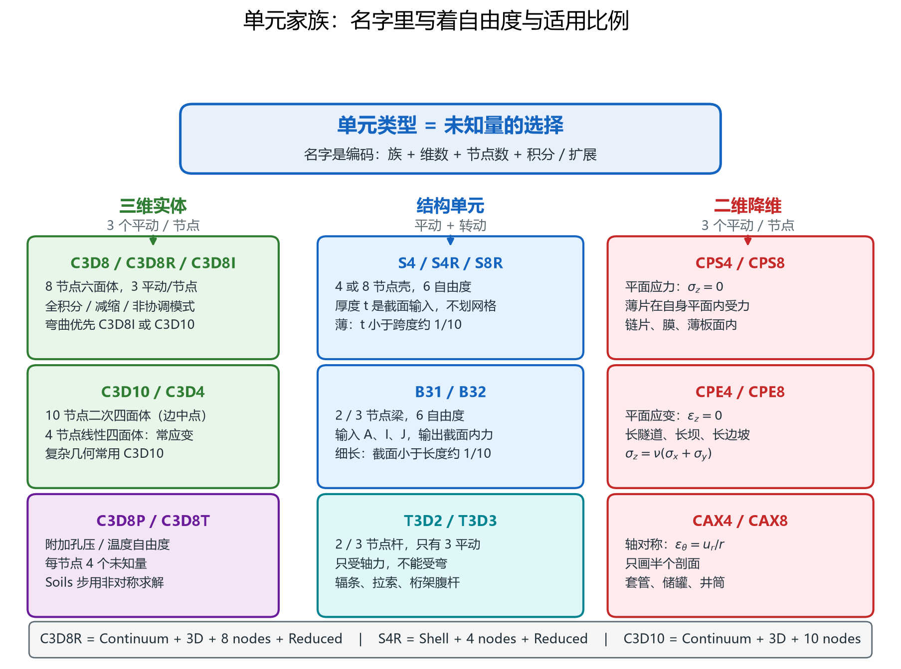
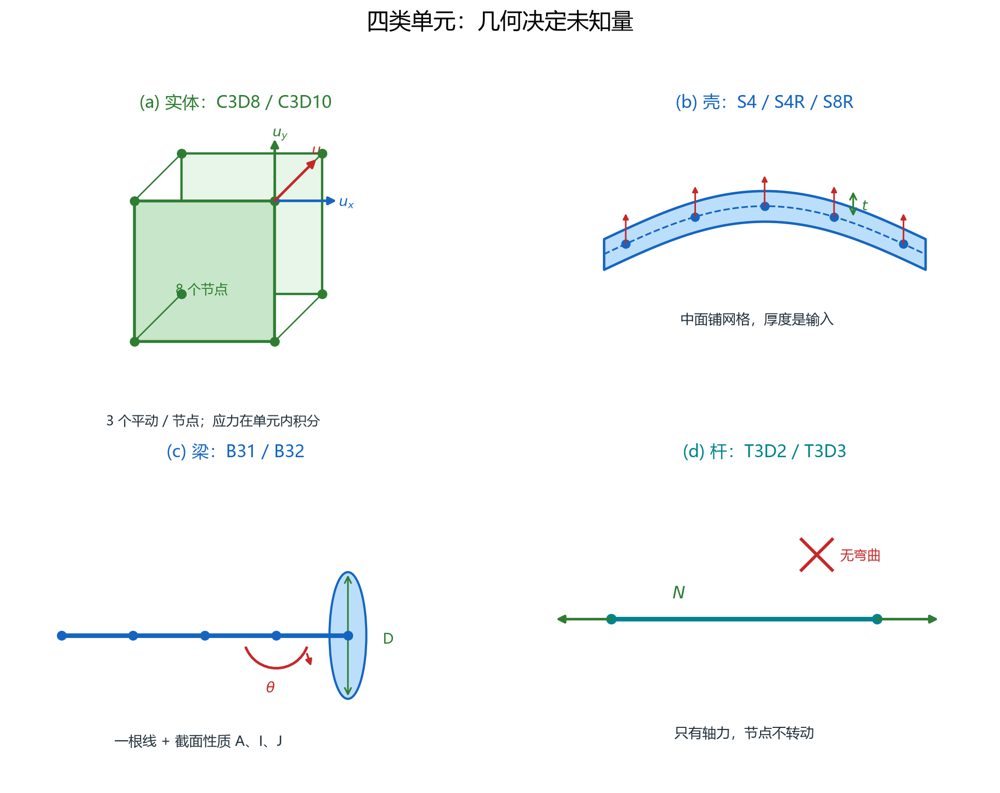
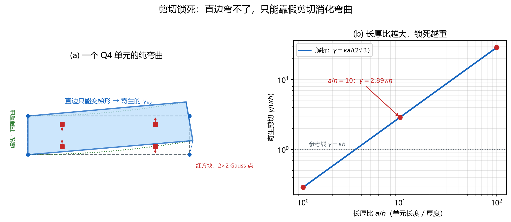
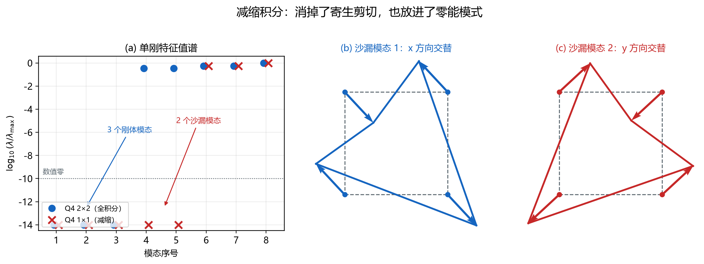
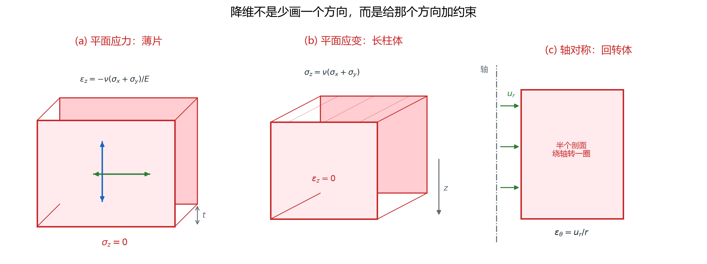
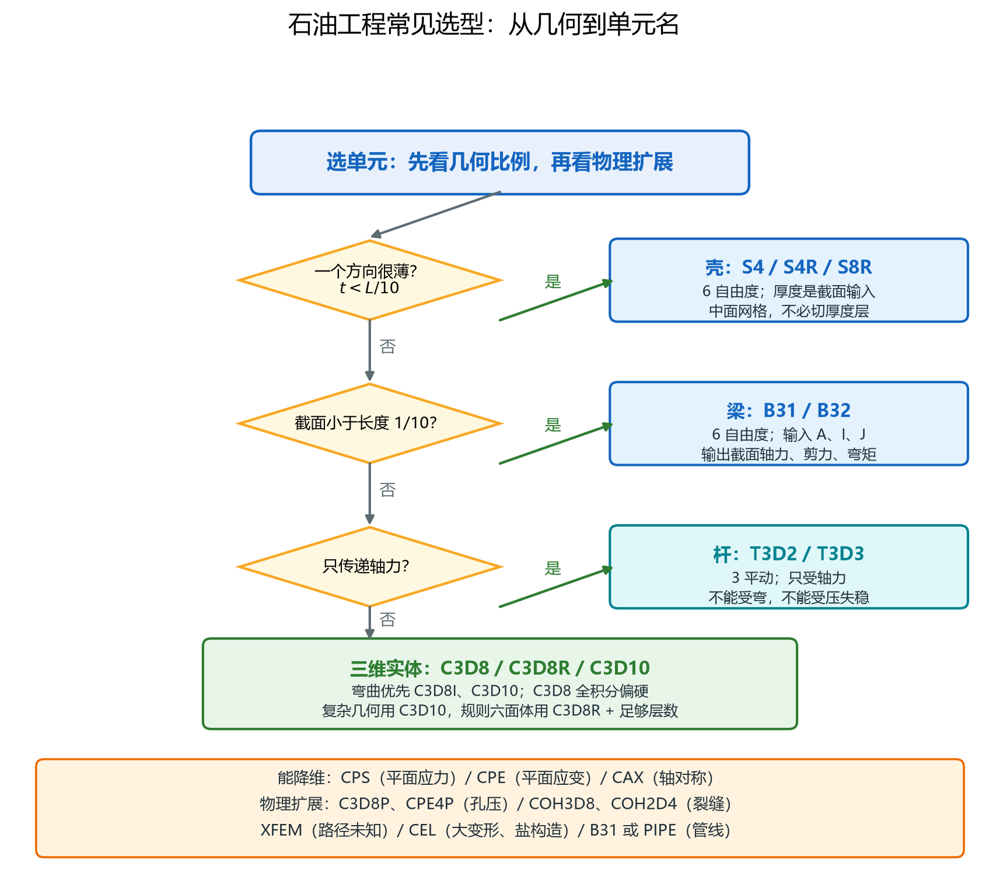
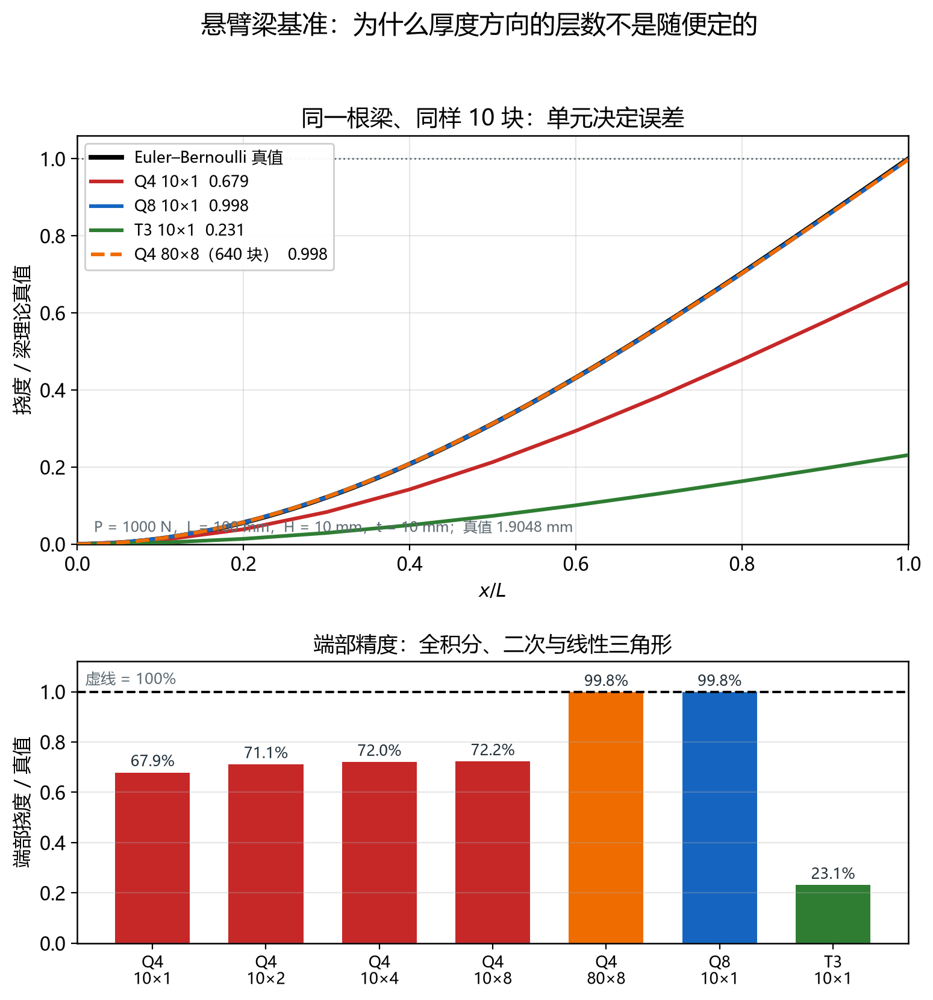

# 单元类型：几何、形函数与降维

> 对应知识图谱节点：`M6-08`
>
> 前置：[有限元编程基础](fem-programming/README.md)（四步流程、Q4 形函数、组装与约束）
>
> 相关：[雅可比矩阵](jacobian-and-mapping.md)（等参映射的局部线性化）、[变分近似](variational-approximation.md)（离散解为什么偏硬）
>
> 原始推文：《有限元单元类型》（公众号「嘎子科研助手」，链接见文末来源）

---

## 0. 结论先行

1. 单元类型不是名字游戏，而是**未知量放在哪里**。实体节点放 3 个平动；壳与梁放 3 个平动加转动；杆只放 3 个平动、没有转动。Abaqus 的名字只是把这套几何与积分方案编码：C 连续体、S 壳、B 梁、T 桁架；后面的 3D / 2D 是维度，数字是节点数，R 是减缩积分，I 是不协调模态，P 是孔压。
2. 所有单元共用同一个骨架：几何映射 → 形函数 → 应变矩阵 → 刚度积分。差别只在形函数与运动学假设。结构单元把厚度方向积分掉，用截面性质代替；实体单元保留厚度方向的网格。
3. 单元能不能算对，取决于它**能否表达目标变形模式**。Q4 的四条直边在弯曲后仍是直边，只能用"梯形"近似，于是被迫产生寄生剪应变；其幅值与单元长度成正比、与厚度无关。
4. 纯弯曲下，Q4 的寄生剪应变在 Gauss 点为 $\gamma=\kappa a/(2\sqrt{3})$。长厚比 10 时它达到同点弯曲应变的 10 倍；按能量密度粗估，剪切项约为弯曲项的 38 倍。这就是剪切锁死的定量来源（图 37）。
5. 减缩积分把寄生剪切"看不见"了，代价是把沙漏模式放进了零空间：Q4 单刚的零特征值从 3 个（刚体）变成 5 个（3 个刚体加 2 个沙漏）；三维 C3D8R 是 6 个刚体加 12 个沙漏。必须配沙漏控制（图 38）。
6. 二次单元能用抛物线边表达弯曲，纯弯曲下寄生剪切为零。同样 10 块，Q4 端部只有真值的 67.9 %，Q8 有 99.8 %，T3 只有 23.1 %。
7. "厚度方向至少 4 层"这条经验规则有明确适用范围：**一阶、弯曲主导、减缩积分实体**。它不能推广到全积分或二次单元。加密还必须加在能改善变形模式的方向上：单层 Q4 只沿长度加密到 160 块，端部也只到 91.5 %。
8. 降维不是"少画一个方向"，而是给该方向加约束：平面应力令法向应力为零，平面应变令法向应变为零，轴对称令环向应变等于径向位移除以半径。选错约束，网格再细也是在解另一道题。
9. 石油工程选型先看几何比例、再看物理扩展：薄壁套管与管线用壳，长细钻杆与井架用梁或杆，盐构造与大变形用 CEL，压裂用 cohesive 或孔压实体。图 40 是一张可直接用于课堂的判据图。

适用范围：本文以线弹性、小变形为主。几何非线性、材料非线性与接触只改变"该用哪个单元、哪种积分方案"，不改变形函数与锁死机制。除特别注明外，所有数值由 [`tools/element_lib.py`](../../tools/element_lib.py) 计算，[`tools/verify_element_notes.py`](../../tools/verify_element_notes.py) 断言。

---

## 1. 前提与符号

### 1.1 统一基准：一根悬臂梁

全文只用一个算例比较单元：长度 100 mm、高度 10 mm、厚度 10 mm 的悬臂梁，左端固定，右端受 1000 N 向下集中力。材料为钢，弹性模量 210 GPa，泊松比 0.3。

Euler–Bernoulli 梁的端部挠度是

$$
\delta=\frac{PL^{3}}{3EI},\qquad
I=\frac{tH^{3}}{12}=833.333\ \mathrm{mm}^{4}
$$

代入得 1.904762 mm。后续所有单元都给同一根梁、同一组荷载，只换单元类型与网格，因此比值可以直接比较。

这个基准有两个好处。第一，真值有封闭形式，不需要"凭感觉"判断谁对。第二，它是**弯曲主导**的问题：梁的变形主要来自上下缘的拉压，而不是剪切。后面会看到，一阶四边形的问题恰好出在"它分不清弯曲与剪切"。

严格的二维平面应力解比 Euler–Bernoulli 略大：横向剪切贡献约 $PL/(k_sGA)=0.0149$ mm，合计约 1.9196 mm，高 0.8 %。本文沿用推文与教材的 Euler–Bernoulli 真值作分母；Q8 的 99.8 % 与二维真值也相差不到 1 %。

### 1.2 Abaqus 的命名法

| 前缀 | 含义 | 典型单元 | 节点自由度 |
|---|---|---|---|
| C | Continuum，实体 | C3D8、C3D8R、C3D8I、C3D10、C3D20R | 每节点 3 个平动 |
| S | Shell，壳 | S4、S4R、S8R | 整体写 6 个；公式用 5 个 |
| B | Beam，梁 | B31、B32 | 每节点 6 个（3 平动 + 3 转动） |
| T | Truss，杆 | T3D2、T3D3 | 每节点 3 个平动 |

后缀的含义同样固定：

- 数字是节点数，例如 C3D8 是 8 节点六面体，C3D10 是 10 节点四面体；
- R 是 reduced integration（减缩积分），例如 C3D8R、S4R、C3D20R；
- I 是 incompatible modes（不协调模态），例如 C3D8I，用来改善弯曲；
- P 是 pore pressure（孔压自由度），例如 C3D8P、CAX4P；
- T 在实体后缀里还可能表示温度，例如 C3D8T，读名字时要看上下文。

同一族里还有二维版本：CPS4 是平面应力四边形，CPE4 是平面应变四边形，CAX4 是轴对称四边形。它们的数字规则与三维一致。

### 1.3 四类单元的几何与自由度

> 图 34：三列分别是实体、结构单元与二维降维。每一列给出 Abaqus 常用名字与节点自由度；
> 底部编码条说明 C3D8R 这个名字各段的含义。
>
> 读图要点：先认"几何"，再认"名字"。名字里的每个字母都能在编码条上找到出处，
> 不需要死记。

> 图 35：(a) 实体在三个方向都有网格，节点只有平动；
> (b) 壳只在中面铺网格，厚度是截面输入，节点多两个转动；
> (c) 梁是一根线加截面性质，节点有 6 个自由度；
> (d) 杆只有轴力，节点不转动。
>
> 读图要点：实体与结构单元的差别不在"画得像不像"，而在**厚度方向有没有未知量**。
> 壳与梁把厚度方向积分掉，所以单元数可以少两三个数量级，代价是厚度方向的应力分布只能按假设重构。

四类单元的运动学假设可以一句话概括：

- 实体：三个方向的位移都是独立未知量；
- 壳：中面位移加转动，厚度方向用直线假设；
- 梁：轴线位移加截面转动，截面内用平面假设；
- 杆：只有轴向位移，截面内没有独立未知量。

### 1.4 符号表

| 符号 | 含义 |
|---|---|
| $N_i$ | 形函数，满足单位和性与分片性 |
| $\mathbf{B}$ | 应变–位移矩阵，把节点位移变成应变 |
| $\mathbf{D}$ | 材料弹性矩阵 |
| $\mathbf{J}$ | 雅可比矩阵，等参映射的局部线性化 |
| $a$ | 单元面内长度 |
| $h$ | 单元厚度（二维问题中为梁高） |
| $\kappa$ | 弯曲曲率 |
| $\gamma$ | 工程剪应变 |
| $\lambda_i$ | 单元刚度矩阵的特征值 |
| $t$ | 板的物理厚度 |

---

## 2. 推导

### 2.1 所有单元共用的四步

第一步，几何映射。把标准单元（正方形、立方体、标准四面体）映到真实单元：

$$
\mathbf{x}(\xi,\eta)=\sum_{i=1}^{n}N_i(\xi,\eta)\mathbf{x}_i,\qquad
\mathbf{u}(\xi,\eta)=\sum_{i=1}^{n}N_i(\xi,\eta)\mathbf{u}_i
$$

第二步，求雅可比矩阵。按本文的行存放约定，

$$
\mathbf{J}=
\begin{bmatrix}
\partial x/\partial\xi & \partial y/\partial\xi\\
\partial x/\partial\eta & \partial y/\partial\eta
\end{bmatrix}
$$

形函数对物理坐标的导数用链式法则：

$$
\begin{bmatrix}\partial N_i/\partial x & \partial N_i/\partial y\end{bmatrix}
=
\begin{bmatrix}\partial N_i/\partial\xi & \partial N_i/\partial\eta\end{bmatrix}\mathbf{J}^{-1}
$$

第三步，组装应变–位移矩阵。二维平面问题是

$$
\mathbf{B}_i=
\begin{bmatrix}
\partial N_i/\partial x & 0\\
0 & \partial N_i/\partial y\\
\partial N_i/\partial y & \partial N_i/\partial x
\end{bmatrix}
$$

三维实体则在 6 行里按同样规则填入三个方向的导数。

第四步，积分得到单元刚度：

$$
\mathbf{K}^{e}=\int_{-1}^{1}\int_{-1}^{1}\mathbf{B}^{\mathsf T}\mathbf{D}\mathbf{B}\ \lvert J\rvert\ t\ \mathrm{d}\xi\mathrm{d}\eta
$$

数值上换成 Gauss 求和。矩形 Q4 的被积函数在每个方向是二次多项式，2×2 Gauss 精确；Q8 的应变是双线性，刚度被积函数次数更高，通常用 3×3。C3D8 用 2×2×2，C3D10 用 4 点。

这套流程与 [有限元编程基础](fem-programming/README.md) 完全一致。换单元，只是换形函数、换积分点；矩阵组装、约束处理、求解器都不变。

### 2.2 实体单元：三线性与二次

二维 Q4 的形函数是双线性：

$$
\begin{aligned}
N_1&=\tfrac14(1-\xi)(1-\eta),&
N_2&=\tfrac14(1+\xi)(1-\eta),\\
N_3&=\tfrac14(1+\xi)(1+\eta),&
N_4&=\tfrac14(1-\xi)(1+\eta)
\end{aligned}
$$

三维 C3D8 把它乘上第三方向：

$$
N_i=\tfrac18(1+\xi\xi_i)(1+\eta\eta_i)(1+\zeta\zeta_i),\qquad i=1,\dots,8
$$

Q8 是"角点加边中点"的 serendipity 单元。角点公式含一个修正项：

$$
N_i=\tfrac14(1+\xi\xi_i)(1+\eta\eta_i)(\xi\xi_i+\eta\eta_i-1),\qquad i=1,\dots,4
$$

边中点则只在一条边上非零，例如底边中点和右边中点：

$$
N_5=\tfrac12(1-\xi^{2})(1-\eta),\qquad
N_6=\tfrac12(1+\xi)(1-\eta^{2})
$$

其余两个边中点按 90 度旋转得到。C3D10 是二次四面体，用四个体积坐标表示，角点与边中点的形函数分别是

$$
N_i=L_i(2L_i-1)\quad(i=1,\dots,4),\qquad
N_{ij}=4L_iL_j
$$

二次单元的共同点是**边上可以是抛物线**，这正是它能表达弯曲的原因。

C3D8 与 C3D10 的差别不只是"节点多"。C3D8 是线性单元，位移三线性、应变随坐标线性变化，沿厚度只有两个积分点；C3D10 的位移是二次，应变也是线性，四面体内部有 4 个积分点，几何适应性更好，弯曲与应力集中也描述得更细。代价是同样网格尺寸下自由度更多，接触与显式分析也更贵。

### 2.3 壳：把厚度积分掉

壳的起点是三维实体，但假设厚度方向的位移按直线分布：

$$
\mathbf{u}(\xi,\eta,\zeta)=\mathbf{u}_0(\xi,\eta)+\zeta\ \boldsymbol{\theta}(\xi,\eta)\times\mathbf{n}
$$

式中，带下标 0 的量是中面位移， $\boldsymbol{\theta}$ 是截面转动， $\mathbf{n}$ 是中面法向， $\zeta$ 是厚度方向的归一化坐标。把这句话代入三维应变，就得到壳的膜应变、弯曲应变与横向剪应变。

Abaqus 的 S4 / S4R 是 Reissner–Mindlin 壳：横向剪应变不假设为零，因此厚壳也能用；S4R 在面内用 1×1 减缩积分，厚度方向默认 5 个截面点。S8R 是 8 节点二次减缩壳。节点在整体坐标里写 6 个自由度，但壳的公式只用 5 个：3 个平动加 2 个面内转动；绕法线的"钻转"由内部约束处理。

壳的适用条件是厚度远小于面内尺寸。推文给的工程判据是 $t<L/10$，其中 $L$ 是板的面内特征长度。超过这个比例，横向剪切与厚度方向的应力梯度都不能再忽略，应改用实体。

壳的真正优势是自由度账。推文的挡泥板例子：600 mm × 100 mm × 1 mm，若用 1 mm 实体，厚度方向 4 层，需要 600 × 100 × 4 = 240 000 个 C3D8R；若用 5 mm 壳网格，只需 120 × 20 = 2400 个 S4R。两者的自由度是 910 515 与 15 246，相差 59.7 倍，而单元数相差 100 倍。§3.6 给出完整账目。

### 2.4 梁：一根线加截面

梁把三维问题压成一条线。Euler–Bernoulli 梁只有弯曲，Timoshenko 梁再加横向剪切：

$$
\varepsilon_x=-y\frac{\mathrm{d}^{2}v}{\mathrm{d}x^{2}},\qquad
\gamma=\frac{\mathrm{d}v}{\mathrm{d}x}-\theta
$$

Abaqus 的 B31 是线性 Timoshenko 梁，B32 是二次 Timoshenko 梁。每个节点 6 个自由度：3 个平动加 3 个转动。用户输入截面面积 $A$、惯性矩 $I$、扭转常数 $J$，程序沿轴线积分：

$$
\mathbf{K}_b=\int_0^{L}\mathbf{B}^{\mathsf T}
\mathrm{diag}(EA,\ EI_y,\ EI_z,\ GJ)\ \mathbf{B}\ \mathrm{d}x
$$

梁的适用条件是截面尺寸小于长度的十分之一。它的输出是截面上的轴力、剪力、弯矩与扭矩，而不是截面内的应力分布。焊缝、螺栓、局部屈曲这些细节，梁单元看不见；需要这些细节时，必须在局部改用实体或壳。

### 2.5 杆：只有轴力

杆单元只保留轴向位移。两节点杆的刚度矩阵是

$$
\mathbf{K}_t=\frac{EA}{L}
\begin{bmatrix}
1 & -1\\
-1 & 1
\end{bmatrix}
$$

它没有转动自由度，因此不能承受弯矩；它也没有初始缺陷与屈曲模态，因此线性分析中不能判断"受压失稳"。

推文的辐条例子把这层限制说得很清楚。直径 2 mm、长 290 mm 的钢丝，截面惯性矩

$$
I=\frac{\pi d^{4}}{64}=0.7854\ \mathrm{mm}^{4}
$$

Euler 屈曲荷载

$$
P_{\mathrm{cr}}=\frac{\pi^{2}EI}{L^{2}}=19.36\ \mathrm{N}
$$

只相当于 1.97 kg 的重量。若把它当承压杆，约 2 kg 就会失稳；但同样的钢丝受 100 kg 拉力时，应力是

$$
\sigma=\frac{mg}{A}=312.2\ \mathrm{MPa}
$$

远低于钢丝强度。所以自行车辐条必须预张紧，让它始终受拉。建模时若用 T3D2 并允许受压，程序不会报错，结果却是错的：它把一根会屈曲的细杆当成了能承压的杆。

### 2.6 弯曲基准：Q4 为什么会锁死

取一个长度为 $a$、厚度为 $h$ 的 Q4 单元，受纯弯曲。取 $x$ 沿长度、 $y$ 从中面量起（ $-h/2\le y\le h/2$），精确位移场是

$$
u_x=-\kappa xy,\qquad u_y=\frac{\kappa x^{2}}{2}
$$

代入几何方程：

$$
\varepsilon_x=-\kappa y,\qquad
\varepsilon_y=0,\qquad
\gamma_{xy}=0
$$

也就是说，纯弯曲的剪应变处处为零，上下缘只有拉压。

Q4 只能用双线性函数表示位移。四个角点的 $u_y$ 是 $0,0,\kappa a^{2}/2,\kappa a^{2}/2$，双线性插值给出

$$
u_y=\frac{\kappa a x}{2}
$$

它对 $x$ 的导数是常数 $\kappa a/2$。同一组角点的 $u_x$ 恰好是双线性的，插值没有误差：

$$
u_x=-\kappa xy
$$

于是

$$
\gamma_{xy}=\frac{\partial u_x}{\partial y}+\frac{\partial u_y}{\partial x}
=\kappa\left(\frac{a}{2}-x\right)
$$

在 2×2 Gauss 点上， $x=a/2\pm a/(2\sqrt{3})$，所以

$$
\gamma_{xy}=\pm\frac{\kappa a}{2\sqrt{3}}
$$

这个剪应变**与厚度 $h$ 无关**。它不来自真实剪切，而来自"直边保持直边"的几何限制，因此称为寄生剪切。

弯曲应变在同一个 Gauss 点是

$$
\varepsilon_x=-\kappa y,\qquad y=\pm\frac{h}{2\sqrt{3}}
\quad\Longrightarrow\quad
|\varepsilon_x|=\frac{\kappa h}{2\sqrt{3}}
$$

取下面一排 Gauss 点，

$$
\left\lvert\frac{\gamma_{xy}}{\varepsilon_x}\right\rvert
=\frac{\kappa a/(2\sqrt{3})}{\kappa h/(2\sqrt{3})}
=\frac{a}{h}
$$

当 $a/h=10$ 时，这个比值是 10。按能量密度粗估，剪切项与弯曲项之比约为

$$
\frac{G}{E}\left(\frac{a}{h}\right)^{2}
=\frac{1}{2(1+\nu)}\left(\frac{a}{h}\right)^{2}
\approx 38.5
$$

也就是说，单元为了维持"直边"，把绝大部分变形能都存进了虚假的剪切里。结构表现为"太硬"：端部挠度远小于真值。这就是剪切锁死。

> 图 37：左图是一个 Q4 单元在纯弯曲下的变形。虚线是精确的弯曲形状，
> 实线是双线性插值能做到的形状：上下边倾斜、侧边仍直，于是出现寄生剪应变。
> 右图是解析式 $\gamma=\kappa a/(2\sqrt{3})$ 与数值点的对照，横轴是长厚比。
>
> 读图要点：锁死不是"单元太软"，而是"单元太硬"。寄生剪切把能量锁在错误的方向上，
> 长厚比越大，锁得越死。减缩积分与二次单元是两条不同的解锁路径。

### 2.7 减缩积分与沙漏

既然寄生剪切在 2×2 点上被"看见"，最简单的办法是只在中心点积分。Q4 用 1×1，C3D8 用 1 点，S4R 用 1×1——这就是减缩积分。

代价是零能模式。一个单元刚度矩阵的秩等于应变矩阵的秩。1×1 积分时，二维 Q4 有 8 个自由度，中心点的应变只有 3 个独立分量，所以刚度矩阵的秩最多是 3；零空间的维数是 8 − 3 = 5。其中 3 个是刚体模态（两个平动加一个转动），剩下 2 个是沙漏模态：

$$
u_x=\xi\eta,\qquad u_y=\xi\eta
$$

它们在中心点的应变恰好为零，因此不产生任何应变能。三维 C3D8R 更严重：24 个自由度，一个积分点提供 6 个应变分量，零空间维数是 18，其中 6 个刚体、12 个沙漏。

> 图 38：左图是 Q4 单刚的特征值谱。全积分有 3 个零特征值（刚体），
> 减缩积分有 5 个（3 个刚体加 2 个沙漏）；最小的正特征值也随积分方案改变。
> 右图是两个沙漏模态的振型：网格交替鼓胀，中心点不动。
>
> 读图要点：沙漏不是"数值噪声"，而是精确的零能模式。没有沙漏控制时，
> 这些模式可以被任意小的力激发，网格会呈现棋盘状振荡。

工程上的处理是加沙漏控制：在单元上附加一个与沙漏模态对应的刚度，或用人工应变、增强应变等办法。Abaqus 的 C3D8R、S4R 默认带沙漏控制。判断是否足够，最直接的办法是看能量：沙漏能应远小于内能，工程上常以 5 % 到 10 % 为警戒线。

### 2.8 二维降维：三种约束

二维单元不是"三维少画一个方向"，而是给第三方向加了一条运动学约束。

平面应力假设薄片在厚度方向自由收缩，法向应力为零：

$$
\sigma_z=0,\qquad
\varepsilon_z=-\frac{\nu(\sigma_x+\sigma_y)}{E}
$$

它的弹性矩阵是

$$
\mathbf{D}_{\mathrm{ps}}=\frac{E}{1-\nu^{2}}
\begin{bmatrix}
1 & \nu & 0\\
\nu & 1 & 0\\
0 & 0 & (1-\nu)/2
\end{bmatrix}
$$

平面应变假设长柱体在轴向被约束，法向应变为零：

$$
\varepsilon_z=0,\qquad
\sigma_z=\nu(\sigma_x+\sigma_y)
$$

弹性矩阵换成

$$
\mathbf{D}_{\mathrm{pe}}=\frac{E}{(1+\nu)(1-2\nu)}
\begin{bmatrix}
1-\nu & \nu & 0\\
\nu & 1-\nu & 0\\
0 & 0 & (1-2\nu)/2
\end{bmatrix}
$$

轴对称则假设绕轴旋转不变，位移只有径向与轴向两个分量，环向应变由径向位移除以半径得到：

$$
\varepsilon_r=\frac{\partial u_r}{\partial r},\qquad
\varepsilon_z=\frac{\partial u_z}{\partial z},\qquad
\varepsilon_\theta=\frac{u_r}{r},\qquad
\gamma_{rz}=\frac{\partial u_r}{\partial z}+\frac{\partial u_z}{\partial r}
$$

体积分要多乘一个 $2\pi r$。

> 图 39：(a) 平面应力是薄片，法向应力为零，厚度方向可以自由收缩；
> (b) 平面应变是长柱体，法向应变为零，于是产生法向应力；
> (c) 轴对称是回转体，环向应变由径向位移与半径之比决定。
>
> 读图要点：三种二维单元的自由度都只有两个平动，但约束不同、弹性矩阵不同、
> 适用对象也不同。选错约束，结果不是"精度差一点"，而是另一个物理问题。

一个数就能看出差别：取面内两个正应力均为 −10 MPa、泊松比 0.3。平面应变下法向应力是 −6 MPa；平面应力下法向应力为零，但法向应变是 $2.857\times10^{-5}$，即厚度方向膨胀。若把深部地层当成平面应力，等于允许它在第三个方向自由膨胀，算出的变形会偏大、应力会偏小。

### 2.9 默认设置与选型规则

Abaqus 的默认选择体现了它自己的经验：

- 实体默认减缩积分（C3D8R、C3D20R），并带沙漏控制；
- 壳默认 S4R，厚度方向 5 个截面点；
- 梁默认 B31，二次梁用 B32；
- 三角形与四面体默认二次（C3D10），因为线性三角形太硬。

选型时按下面的顺序问问题（图 40）：

1. 一个方向是否远小于另外两个？若是，先考虑壳；判据是厚度小于面内特征长度的十分之一。
2. 是否是长细构件？若是，考虑梁；判据是截面尺寸小于长度的十分之一。
3. 是否只传递轴力？若是，用杆；但受压构件必须另做屈曲分析。
4. 以上都不是，用实体。弯曲主导时优先 C3D8I 或 C3D10；复杂几何用 C3D10；规则六面体用 C3D8R，并保证厚度方向至少 4 层。

> 图 40：先按几何比例分流——薄壁、长细、只受轴力，分别对应壳、梁、杆；
> 都不满足则用实体。底部列出二维降维、孔压、裂缝、大变形与管线对应的扩展单元。
>
> 读图要点：这是一张"排除法"流程图。先排除不合适的，再在剩下的里面选积分方案；
> 不要一上来就按名字选单元。

石油系统的对应关系可以写得很具体：

- 套管、油管、地面管线：薄壁、内压加轴向力，用 S4 / S4R；长细段用 B31，注意内压产生的环向应力；
- 井架、桁架、自行车辐条：只受轴力，用 T3D2；受压杆必须另算稳定；
- 盐构造、软土大变形：用 CEL，欧拉区域用 EC3D8R，避免网格畸变；
- 水力压裂：cohesive 用 COH3D8 / COH2D4，孔压耦合用 C3D8P / CPE4P；
- 储层压实与地应力：用 C3D8P 或 CAX4P，配 Soils 分析步；
- 管道水击与流固耦合：用 B31 或壳单元加流体单元，时间步由声速决定（见 [M7 流体模块](../07-fluid/README.md)）。

---

## 3. 数值检验

全部数字由 `py -3 tools/verify_element_notes.py` 复算，脚本对每一项做断言，末尾打印 `ALL CHECKS PASSED`。

### 3.1 形函数与弹性矩阵

| 检查项 | 结果 |
|---|---|
| Q4 / Q8 单位和性，在三个随机点 | 与 1 的偏差小于 $10^{-14}$ |
| 形函数导数之和 | 小于 $10^{-13}$ |
| 平面应力弹性矩阵对称 | 最大不对称量 0 |
| 剪切模量 $E/(2(1+\nu))$ | 80 769.23 MPa |
| Euler–Bernoulli 真值 | 1.904762 mm |

### 3.2 端部挠度：同一根梁、同样 10 块

| 网格 | 单元数 | 节点数 | 端部挠度 (mm) | 与真值之比 |
|---|---|---|---|---|
| Q4 10×1 | 10 | 22 | 1.293122 | 0.678889 |
| Q4 10×2 | 20 | 33 | 1.354457 | 0.711090 |
| Q4 10×4 | 40 | 55 | 1.371711 | 0.720148 |
| Q4 10×8 | 80 | 99 | 1.376135 | 0.722471 |
| Q4 80×8 | 640 | 729 | 1.900873 | 0.997958 |
| Q8 10×1 | 10 | 53 | 1.901446 | 0.998259 |
| T3 10×1 | 20 | 22 | 0.440340 | 0.231178 |

这张表把推文的三个核心数字都复现了：Q4 的 10 块约为真值的三分之二，Q8 约为 99 %，T3 约为 23 %。640 块 Q4（8 层 × 80 列）达到 99.8 %，也与推文一致。

注意 Q4 从 10×1 加密到 10×8，单元数翻了 8 倍，精度只从 67.9 % 升到 72.2 %。这说明在弯曲问题里，**只沿长度加密几乎无用**；必须增加厚度方向的层数，让单元有机会表达线性弯曲应变。

> 图 36：上图是同一根梁的挠曲线，精确解为黑色虚线；Q4 10×1、Q8 10×1、T3 10×1
> 与 640 块 Q4 的曲线放在一起比较。下图是端部挠度与真值的比值。
>
> 读图要点：Q8 只用一层就贴住精确解，Q4 用八层仍差 28 %，T3 只有 23 %。
> 单元类型决定了"一层够不够"，而不是网格越密越好。

### 3.3 只沿长度加密的天花板

| 网格 | 单元数 | 端部挠度 (mm) | 与真值之比 |
|---|---|---|---|
| Q4 20×1 | 20 | 1.605255 | 0.842759 |
| Q4 40×1 | 40 | 1.708344 | 0.896881 |
| Q4 160×1 | 160 | 1.743331 | 0.915249 |

单层 Q4 的精度随长度加密而提高，但收敛到一个低于 1 的天花板（约 0.92）。原因不是程序错，而是单层单元在厚度方向只有上下两个节点，弯曲应变沿厚度只能取常值，无法表达精确解的线性变化；长度方向再细，厚度方向的欠表达仍在。

这条结果解释了一个常见现象：有人把网格加密十倍，误差只降了几个百分点，于是怀疑求解器。真正该加的是厚度方向的层数，或者换二次单元。

推文还给出了一组 Abaqus 减缩积分实体的实测：1 层时端部挠度 691 mm，约为真值的 363 倍；2 层时误差三十多个百分点；4 层时误差约 7 %。这组数依赖网格、沙漏控制与加载方式，本文的脚本不能逐位复现；本文复现的是同一机制的另外三个可复现量：全积分 Q4 的层数效应、Q8 的一层精度、T3 的 23 %。两类结果指向同一条结论：**一阶实体在弯曲中必须给足层数**。

### 3.4 寄生剪切的三个数

取 $a=10$、 $h=1$、 $\kappa=1$。

| 检查项 | 结果 |
|---|---|
| 解析寄生剪应变 $\kappa a/(2\sqrt{3})$ | 2.886751 |
| 下排 Gauss 点弯曲应变 | +0.288675 |
| 上排 Gauss 点弯曲应变 | −0.288675 |
| 剪应变在左右两列 Gauss 点反号 | 是 |
| 剪应变与弯曲应变之比（下排） | 10.000000 |
| Q8 纯弯曲下的寄生剪切 | $1.8\times10^{-15}$ |

Q8 的结果说明：二次单元的边可以是抛物线，纯弯曲时剪应变在机器精度内为零，不存在锁死。这不是"Q8 更聪明"，而是它的形函数空间里本来就包含二次位移场。

### 3.5 特征值：零能模式到底有几个

对单位正方形、 $E=210$ GPa、 $\nu=0.3$、厚度 1 mm 的单刚做特征分解：

| 单元与积分 | 零特征值个数 | 最小正特征值 |
|---|---|---|
| Q4 2×2（全积分） | 3 | 103 846.15 |
| Q4 1×1（减缩） | 5 | 161 538.46 |
| Q8 3×3（全积分） | 3 | 35 291.43 |
| Q8 2×2（减缩） | 4 | 63 346.22 |

Q4 的 3 个零特征值是两个平动加一个转动；减缩后多出的 2 个是沙漏。Q8 的 3×3 积分在扣除刚体后满秩；2×2 少一个约束，多出 1 个沙漏。脚本还验证了沙漏模态与刚体模态正交，且减缩刚度矩阵作用在沙漏模态上为零（ $8.5\times10^{-11}$，在容差内）。

### 3.6 自由度账：挡泥板与辐条

挡泥板：600 mm × 100 mm × 1 mm，实体方案用 1 mm 网格、厚度 4 层；壳方案用 5 mm 中面网格。

| 项目 | 实体 C3D8R | 壳 S4R | 比值 |
|---|---|---|---|
| 单元数 | 240 000 | 2 400 | 100 |
| 节点数 | 303 505 | 2 541 | 119.4 |
| 自由度数 | 910 515 | 15 246 | 59.72 |

辐条：直径 2 mm、长 290 mm、钢。

| 项目 | 数值 |
|---|---|
| 截面惯性矩 | 0.7854 mm⁴ |
| Euler 屈曲荷载 | 19.36 N |
| 折合重量 | 1.97 kg |
| 100 kg 拉力下的应力 | 312.2 MPa |

这两个例子一个说明"降维省多少"，一个说明"杆为什么只能受拉"。它们都不需要复杂模型，手算就能给结论；建模之前先手算，可以避免把单元用错。

### 3.7 平面应力与平面应变

取面内两个正应力均为 −10 MPa，弹性模量 210 GPa，泊松比 0.3：

| 项目 | 结果 |
|---|---|
| 平面应变法向应力 | −6.0 MPa |
| 平面应力法向应力 | 0（定义） |
| 平面应力法向应变 | $2.857\times10^{-5}$ |

同一组面内应力，两种约束给出完全不同的第三维状态。深部地层更接近平面应变；薄板、薄涂层更接近平面应力。选之前先问：第三个方向是自由的，还是被约束的？

---

## 4. 常见误解

**误解 1：单元名字里的数字是维度。**
C3D8 的 3D 是维度，8 是节点数；C3D10 的 10 也是节点数，不是"十维"。S4R 的 4 是节点数，R 是减缩积分。把名字拆成"前缀 + 维度 + 节点数 + 后缀"再读，就不会混。

**误解 2：网格越密越准。**
在弯曲问题里，只沿长度加密几乎不改善精度：单层 Q4 从 20 块加密到 160 块，端部比值只从 0.843 升到 0.915。加密必须加在**欠表达的方向**上；对一阶实体，这个方向通常是厚度。

**误解 3：减缩积分总比全积分好。**
减缩积分消掉了寄生剪切，但引入了沙漏。没有沙漏控制时，减缩单元可能比全积分更糟；有控制时，也要检查沙漏能占比。全积分在弯曲中偏硬，但在以压缩为主、网格畸变不大的问题里更稳。

**误解 4：二次单元一定更好。**
二次单元的弯曲精度更高，但自由度更多、接触搜索更贵、显式时间步更小。接触问题里，二次四面体的节点可能落在面外，接触力会振荡；此时 C3D8R 或 C3D10M 往往更合适。选单元是精度、成本、稳定性三者的折中。

**误解 5：壳就是"把实体变薄"。**
壳把厚度方向积分掉，厚度是截面输入，节点没有厚度方向的未知量。它能给出中面位移与截面内力，但不能给出厚度方向的真实应力梯度；需要后者时应改用实体。增加壳的截面点数只能改善应力输出，改变不了"厚度方向直线"的假设。

**误解 6：杆能受压。**
线性杆单元只有轴力，没有屈曲模态。受压时它会给出一个负轴力，看起来"没报错"，但真实细杆早已失稳。受压构件要么用梁加屈曲分析，要么用杆加初始缺陷做几何非线性分析。

**误解 7：平面应变就是平面应力加一个泊松比。**
两者的约束不同、弹性矩阵不同、第三维应力状态不同。平面应变下法向应力是 $\nu$ 乘以面内正应力之和；平面应力下法向应力为零、法向应变非零。把它们当成"差一个系数"，会在深部地层问题里系统性高估变形。

---

## 5. 自测

**题 1：** Q4 全积分单刚有几个零特征值？减缩积分呢？三维 C3D8R 呢？

**题 2：** 为什么 Q4 10×1 的端部挠度只有真值的 67.9 %，而 Q8 10×1 已经有 99.8 %？

**题 3：** 推导纯弯曲下 Q4 的寄生剪应变 $\gamma=\kappa a/(2\sqrt{3})$，并说明它为什么与厚度无关。

**题 4：** 一根直径 2 mm、长 290 mm 的钢辐条，受 100 kg 拉力。应该用什么单元？还要检查什么？

**题 5：** 深部地层中两个面内正应力均为 −10 MPa，泊松比 0.3。分别用平面应变与平面应力计算第三维状态，并说明哪一个更接近实际。

### 参考答案

**答 1：** Q4 全积分 3 个（两个平动、一个转动）；减缩 5 个（3 个刚体加 2 个沙漏）；三维 C3D8R 是 6 个刚体加 12 个沙漏，共 18 个零特征值。零空间的维数等于自由度数减去应变矩阵的秩。

**答 2：** Q4 的边只能是直线，纯弯曲时被迫产生寄生剪切，单元偏硬；Q8 的边可以是抛物线，纯弯曲下剪应变为零，位移场空间里本来就包含二次弯曲。Q8 的代价是节点数与带宽更大。

**答 3：** 精确场是

$$
u_x=-\kappa xy,\qquad u_y=\frac{\kappa x^{2}}{2}
$$

双线性插值把竖向位移变成 $\kappa ax/2$；水平位移 $-\kappa xy$ 本身就是双线性的，插值没有误差。于是剪应变是 $\gamma=\kappa(a/2-x)$。在 $x=a/2\pm a/(2\sqrt{3})$ 处取值为 $\mp\kappa a/(2\sqrt{3})$。以中面为中性轴，同点弯曲应变是 $\pm\kappa h/(2\sqrt{3})$，所以两者之比是 $a/h$。剪应变与厚度无关，因为插值只受面内节点值控制；厚度只影响弯曲应变的大小。

**答 4：** 用 T3D2 杆单元，因为辐条只受轴力、不承受弯矩。还要检查：拉力下的应力 312 MPa 是否低于材料强度；若预张紧不足或出现压力，必须做屈曲分析，Euler 荷载只有 19.36 N，约 2 kg。

**答 5：** 平面应变下法向应力是 −6 MPa，法向应变为零；平面应力下法向应力为零，法向应变是 $2.857\times10^{-5}$。深部地层横向受围岩约束，更接近平面应变；薄板与自由表面更接近平面应力。

---

## 来源

- 原文：《有限元单元类型》，微信公众号「嘎子科研助手」，作者 北工大-嘎子，2026-11-14。
  链接：[原文](https://mp.weixin.qq.com/s/jhRFROb_Cc7wdrebnnD5ig)
- 本文为原文的独立改写与补充：形函数、应变矩阵、寄生剪切、沙漏与二维降维的推导均为本库新增；
  原文的工程判据与 Abaqus 实测数字按原意转述，并在 §3.3 注明其不可逐位复现的部分。
- **未复制原文任何图片**。原文 35 张插图的主题与远程地址登记在
  [案例拆解](../../cases/2026-11-14-element-types.md)；
  本库图 34–图 40 由 [`tools/make_figures.py`](../../tools/make_figures.py) 生成，
  数值由 [`tools/verify_element_notes.py`](../../tools/verify_element_notes.py) 复算。
- 原文版权归原作者；链接仅作引用与出处标注。
