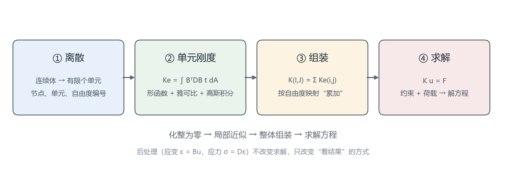

# 从语言到第一个程序：有限元只做四件事

> 对应知识图谱节点：`M6-P1`
> 前置：[M1 应力状态](../../01-stress/README.md)
> 后续：[节点顺序、形函数与雅可比](02-node-ordering-and-jacobian.md)
> 原始推文：第 01–03 篇（见 [案例笔记](../../../cases/2026-11-12-fem-programming-series.md)）

---

## 0. 结论先行

一个线弹性有限元程序，无论用什么语言写，都只有四步：

1. **离散**：把连续体切成有限个单元，给节点和自由度编号；
2. **单元刚度**：对每个单元算 $K_e=\int B^{\mathrm{T}} D B\ t\ \mathrm{d}A$；
3. **组装**：按自由度映射把 $K_e$ 累加进全局 $K$；
4. **求解**：施加约束与荷载，解 $K u=F$。

适用范围：小变形、线弹性、连续介质。语言（Fortran / C++ / Python）只影响"怎么写"，
不影响这四步的数学。第一个程序用 1 个 Q4 单元、8 个自由度就够，
它能把你从"公式"带到"能跑出数"。

---

## 1. 前提与符号

- **平面应力**： $\sigma_z=\tau_{xz}=\tau_{yz}=0$，厚度 $t$ 为常数。
  若换成平面应变，只需把弹性矩阵 $D$ 换掉，几何部分完全不变（见 [M3-02](../../03-constitutive/README.md)）。
- **小变形**：应变与位移梯度线性相关， $\varepsilon=B u$ 成立。
- **线弹性**： $\sigma=D\varepsilon$， $D$ 为常数矩阵。
- **单元类型**：四节点四边形（Q4），每个节点 2 个自由度（ $u_x,u_y$）。
- **节点顺序**：逆时针，从左下角起 1→2→3→4。顺序为什么重要，下一篇专门讲。

符号：

| 符号 | 含义 | 维数 |
|---|---|---|
| $d_e$ | 单元节点位移向量 | $8\times1$ |
| $B$ | 应变–位移矩阵 | $3\times8$ |
| $D$ | 平面应力弹性矩阵 | $3\times3$ |
| $K_e$ | 单元刚度矩阵 | $8\times8$ |
| $K,F,u$ | 全局刚度、荷载、位移 | $n\times n$、 $n$、 $n$ |

---

## 2. 推导

### 2.1 从虚功原理到 $K_e d_e=f_e$

**步骤 1｜写弱形式。**

对平衡方程 $\nabla\cdot\boldsymbol\sigma+\mathbf{b}=0$ 两边乘虚位移 $\delta\mathbf{u}$，
在区域 $\Omega$ 上积分，再用分部积分把导数移到 $\delta\mathbf{u}$ 上：

$$
\int_\Omega \delta\boldsymbol\varepsilon^{\mathrm{T}}\boldsymbol\sigma\ \mathrm{d}\Omega
=
\int_\Omega \delta\mathbf{u}^{\mathrm{T}}\mathbf{b}\ \mathrm{d}\Omega
+
\int_{\Gamma_t}\delta\mathbf{u}^{\mathrm{T}}\mathbf{t}\ \mathrm{d}\Gamma
$$

**依据**：虚功原理——外力在虚位移上做的功等于内力在虚应变上做的功。
左边是内力虚功，右边是体力与面力的虚功。

**步骤 2｜离散：单元内插值。**

在单元内令

$$
\mathbf{u}\approx N d_e,\qquad
\boldsymbol\varepsilon\approx B d_e
$$

其中 $N$ 是形函数矩阵， $B$ 由 $N$ 的导数组成。
**依据**：Galerkin 假设——用同一组形函数既插值试函数，也插值权函数。

**步骤 3｜代入，消去虚位移。**

$$
\delta d_e^{\mathrm{T}}\left(\int_\Omega B^{\mathrm{T}}D B\ \mathrm{d}\Omega\right)d_e
=
\delta d_e^{\mathrm{T}}\left(\int_\Omega N^{\mathrm{T}}\mathbf{b}\ \mathrm{d}\Omega
+\int_{\Gamma_t}N^{\mathrm{T}}\mathbf{t}\ \mathrm{d}\Gamma\right)
$$

对任意 $\delta d_e$ 成立，所以括号内相等：

$$
K_e d_e=f_e
$$

**依据**： $\delta d_e$ 任意，故系数必须相等。这一步把"微分方程"变成了"线性代数"。

**步骤 4｜写出 $K_e$ 的具体形式。**

$$
\boxed{K_e=\int_{A_e}B^{\mathrm{T}}D B\ t\ \mathrm{d}A}
$$

**依据**：平面问题厚度方向积分已并入 $t$； $B$、 $D$ 在单元内可随位置变化。
对 Q4，这个积分用 $2\times2$ 高斯积分精确算（被积函数是 $\xi,\eta$ 的双线性函数，
$2\times2$ 高斯对双线性多项式精确）。

> 一句话理解： $K_e$ 就是"多维弹簧常数"。 $d_e$ 是伸长量， $K_e d_e$ 是恢复力。

### 2.2 Q4 的形函数与 $B$

四个局部坐标 $(\xi_i,\eta_i)$ 依次为 $(-1,-1)$、 $(1,-1)$、 $(1,1)$、 $(-1,1)$。
形函数：

$$
N_i(\xi,\eta)=\tfrac14(1+\xi_i\xi)(1+\eta_i\eta)
$$

三条必须自己验证的性质：

1. **单位分解**： $\sum_i N_i=1$。所以常位移能被精确表示。
2. **Kronecker 性**： $N_i(\xi_j,\eta_j)=\delta_{ij}$。所以节点值就是系数。
3. **双线性**：沿每条边是线性函数，单元内是 $\xi\eta$ 双线性。

应变–位移矩阵按自由度 $[u_{1x},u_{1y},u_{2x},u_{2y},\dots]$ 排列：

$$
B=
\begin{bmatrix}
N_{1,x} & 0 & N_{2,x} & 0 & N_{3,x} & 0 & N_{4,x} & 0\\
0 & N_{1,y} & 0 & N_{2,y} & 0 & N_{3,y} & 0 & N_{4,y}\\
N_{1,y} & N_{1,x} & N_{2,y} & N_{2,x} & N_{3,y} & N_{3,x} & N_{4,y} & N_{4,x}
\end{bmatrix}
$$

其中 $N_{i,x}=\partial N_i/\partial x$。注意它**不是**直接把 $\partial N_i/\partial\xi$ 填进去：
局部导数要通过雅可比矩阵换成物理导数，这是下一篇的核心。

平面应力弹性矩阵：

$$
D=\frac{E}{1-\nu^2}
\begin{bmatrix}
1 & \nu & 0\\
\nu & 1 & 0\\
0 & 0 & \frac{1-\nu}{2}
\end{bmatrix}
$$

### 2.3 自由度编号：一次必须写对的映射

规则只有一条：

$$
\boxed{\mathrm{dof}(c,i)=2(i-1)+c,\qquad c=1\ (x),\ 2\ (y)}
$$

对 4 个节点展开：

| 节点 | $u_x$ | $u_y$ |
|---|---|---|
| 1 | 1 | 2 |
| 2 | 3 | 4 |
| 3 | 5 | 6 |
| 4 | 7 | 8 |

所以**节点 3 的 $y$ 方向是 6，节点 4 的是 8**。
原始推文第 03 篇正文写成"2 和 4"，与它自己的编号公式和荷载向量都矛盾；
按公式算是 6 和 8，本文以公式为准。

> 这个错误值得保留在讲义里：它说明"编号表"和"编号公式"必须互相核对。
> 程序中真正决定结果的是公式，不是正文那句话。

约束消去后，自由度会**重新编号**。原文把固定节点 1、2 的 4 个自由度删掉，
剩下 4 个自由度的局部编号为 1、2、3、4；这叫"活动自由度映射"，
是第 4 章消元法的雏形。

### 2.4 程序骨架

```
读网格：节点坐标 coords(2,nnode)、单元连接 connect(4,nelem)
读材料：E, nu, thickness
dof_id = [2*i-1, 2*i]                  # 每个节点两个自由度
K = 0 (ndof × ndof);  F = 0 (ndof)

for e in 1..nelem:
    Ke = form_q4_stiffness(coords(connect(e,:)), E, nu, t)
    for a in 1..8:
        for b in 1..8:
            I = dof_id(connect(e, ceil(a/2)), mod(a-1,2)+1)
            J = dof_id(connect(e, ceil(b/2)), mod(b-1,2)+1)
            K(I,J) += Ke(a,b)          # 注意是 +=，不是 =
    Fe = form_element_load(...)
    for a in 1..8:
        F(dof_of(a)) += Fe(a)

施加约束（第 4 章）
解 K u = F（第 5 章）
由 u 算应变、应力（后处理）
```

三个容易写错的地方，先记住：

1. `K(I,J) += Ke(a,b)` 必须是累加。共享节点处两个单元都有贡献，覆盖会丢掉一半。
2. 单元自由度 $a$ 到全局自由度 $I$ 的映射要用**连接表**，不能假设 $I=a$。
3. 约束要在组装**之后**施加，否则被约束的自由度还会收到别的单元的贡献。

### 2.5 为什么很多有限元程序用 Fortran

这不是数学问题，是工程问题：

- **数组与数值计算**：Fortran 天生按列存储多维数组，和 BLAS/LAPACK 的接口一致；
- **静态类型与编译优化**：循环容易被向量化，适合 $K$ 的组装与求解；
- **历史积累**：大量成熟的有限元库（如 FEAP、Code_Aster 的部分内核）是 Fortran；
- **并行**：MPI 绑定成熟，超算环境支持稳定。

但**语言不改变 $K u=F$**。教学用 Python/NumPy 更清楚，生产用 Fortran/C++ 更快，
两者算出的 $K$ 必须逐元素相同。把语言当成"有限元的难点"是错位。

---

## 3. 数值检验

### 3.1 一个 Q4 的刚度矩阵

取单位正方形， $E=300$ GPa， $\nu=0.3$， $t=1$ m。四个高斯点上 detJ 都是 $0.25$。
刚度矩阵的两个对角元：

$$
K_{11}=K_{33}=1.483516\times10^{11}\ \mathrm{N/m}
$$

两个独立核对：

- **对称性**： $K_{13}=K_{31}=-9.065934\times10^{10}$ N/m；
- **刚体平移**：把 $u=(1,0,1,0,1,0,1,0)$ 代入， $K u$ 应为零。
  数值上第一行元素之和为 $-1.9\times10^{-6}$ N/m，相对 $10^{11}$ 是舍入误差。✓

### 3.2 原始推文的完整算例

同一单位正方形，固定节点 1、2 的全部自由度，在节点 3、4 的 $y$ 方向各加 $-100$ N：

$$
F=[0,0,0,0,0,-100,0,-100]^{\mathrm{T}}\ \mathrm{N}
$$

解得：

| 自由度 | 位移 / m |
|---|---|
| $u_{3x}$ | $+1.338235\times10^{-10}$ |
| $u_{3y}$ | $-6.468137\times10^{-10}$ |
| $u_{4x}$ | $-1.338235\times10^{-10}$ |
| $u_{4y}$ | $-6.468137\times10^{-10}$ |

反力（约束处）：

$$
R=[+19.85,\ +100,\ -19.85,\ +100]^{\mathrm{T}}\ \mathrm{N}
$$

两个核对：

1. **竖向平衡**： $\sum R_y=200$ N，正好等于外载 $2\times100$ N。✓
2. **水平自平衡**： $\sum R_x=0$。两个 $19.85$ N 是泊松效应被底部约束"顶"出来的水平反力，
   不是外载。✓

### 3.3 与一维估算的偏差，正好是约束的物理

若试件能自由侧向收缩，单轴应变为

$$
\varepsilon_y=\frac{\sigma_y}{E}=\frac{200}{3.0\times10^{11}}=6.667\times10^{-10}
$$

有限元给出 $6.468\times10^{-10}$，**小 3.0%**。原因不是单元不准，而是：

- 底部两个节点 $x$ 方向被固定，泊松收缩被部分阻止；
- 被阻止的收缩产生水平反力（上面的 $\pm19.85$ N），使试件更"硬"。

**这 3% 是物理，不是误差。** 判断"网格够不够细"时，不能拿它当收敛误差；
要比较的是"同一模型加密一级后结果变化多少"。

### 3.4 复算

```bash
py -3 tools/verify_fem_notes.py
```

脚本对本篇的 $K_{11}$、四个位移、反力合力、3% 偏差逐项断言；
任何一项不通过都会以非零状态退出。

> 图 7：有限元的四步流程。注意"后处理"不在求解链上——它只改变"怎么看结果"，不改变 $u$。
> 文件：`assets/figures/fig07-fem-workflow.png`



---

## 4. 常见误解

**误解 1："Fortran 过时了，学有限元应该用 Python。"**

为什么错：语言解决的是"表达与性能"，不解决"离散与组装"。
用 Python 写错的组装，换成 Fortran 仍然是错的；用 Fortran 写的 $B$ 矩阵，
换成 Python 也不会自动正确。先核对数学，再选语言。

正确说法：教学阶段用 Python 看清每一步；生产阶段用 Fortran/C++ 换性能。
两者的 $K$ 必须可逐元素对照。

**误解 2："Q4 是常应变单元。"**

为什么错：常应变的是三节点三角形（CST），它的 $B$ 是常数。
Q4 的 $B$ 含 $\xi,\eta$，应变在单元内是双线性的；正因为如此才需要 $2\times2$ 高斯积分。
把 Q4 当成常应变，会低估弯曲变形，也会误判"加密网格没用"。

正确说法：Q4 是双线性单元，能表示线性应变场，但不能表示纯弯曲的二次位移场；
所以弯曲问题要么加密，要么换二次单元（Q8）。

**误解 3："程序跑通、位移不为零，就算对了。"**

为什么错：错位的连接表、漏加的共享节点项、错误的约束位置，
都可能给出"看起来合理"的位移场。程序不会替你检查物理。

正确说法：至少做三项核对——刚体平移给零力、合力平衡、对称性。
本库每一篇的"数值检验"都按这三类设计。

**误解 4："节点编号只是输入文件的格式，随便编。"**

为什么错：编号决定全局自由度的排列，进而决定矩阵带宽与求解代价；
编号错还会让"哪个形函数配哪个角点"错位，直接改变 $K_e$。
下一篇会看到：同一个网格，换个顺序，detJ 的符号都能变。

正确说法：编号是模型的一部分，必须与几何、连接表、边界条件三者一致。

---

## 5. 自测

1. 4 个节点、每个节点 2 个自由度，全局自由度总数是多少？节点 2 的 $y$ 方向编号是几？
2. 证明 Q4 的形函数满足 $\sum_i N_i=1$。这个性质保证了什么？
3. 单刚矩阵 $K_e$ 为什么必须对称？如果数值上不对称，最可能是什么写错了？
4. 本算例的竖向位移比一维估算小 3%。这 3% 是"网格误差"还是"物理效应"？说明判断依据。
5. 把底部两个节点只固定 $y$ 方向（允许水平滑动），预测 $u_{3x}$ 的符号会怎样变，并说明理由。

<details>
<summary>参考答案</summary>

1. 总数 $4\times2=8$；节点 2 的 $y$ 方向为 $\mathrm{dof}(2,2)=2(2-1)+2=4$。
2. 四个角点的 $(1+\xi_i\xi)(1+\eta_i\eta)$ 之和为 4（展开后交叉项两两抵消），故 $\sum_i N_i=1$。
   它保证常位移（刚体平移）能被精确表示，不产生虚假应变。
3. $K_e=\int B^{\mathrm{T}}D B\ t\ \mathrm{d}A$， $D$ 对称，故 $(B^{\mathrm{T}}D B)^{\mathrm{T}}=B^{\mathrm{T}}D^{\mathrm{T}}B=B^{\mathrm{T}}D B$。
   数值不对称通常是对称项只算了一半，或组装时 $K(I,J)$ 与 $K(J,I)$ 用了不同的映射。
4. 物理效应。底部固定了水平方向，泊松收缩被约束，产生水平反力，试件变硬。
   判断依据：反力合力仍然平衡、位移场光滑、加密网格后这 3% 不会消失（只会略微变化）。
5. $u_{3x}$ 会变成负值（向内收缩），因为底部不再阻止水平位移，泊松效应可以自由发挥；
   同时竖向位移会略微增大，接近一维估算值。

</details>

---

下一篇 → [节点顺序、形函数与雅可比](02-node-ordering-and-jacobian.md)
