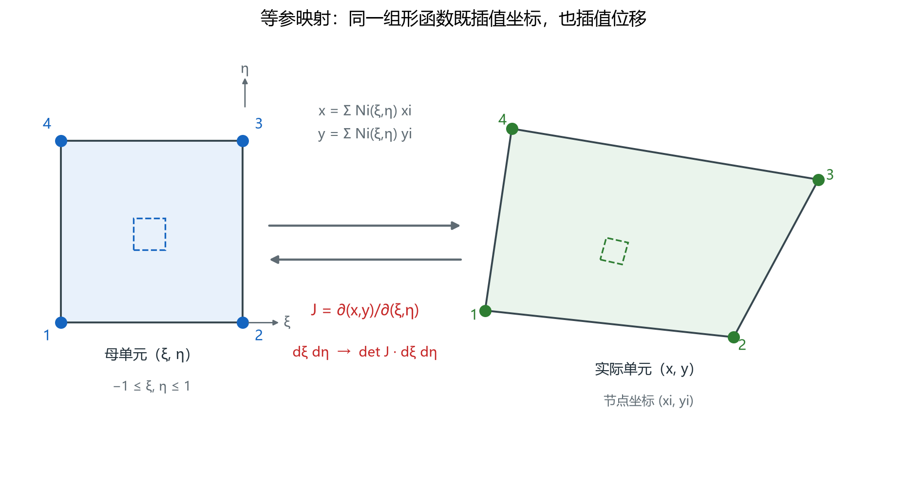
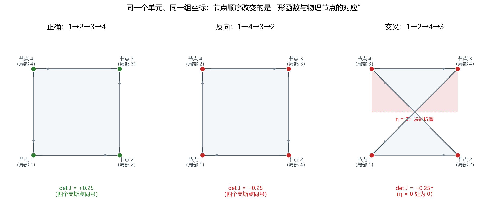

# 节点顺序、形函数与雅可比：为什么 detJ 不能为负

> 对应知识图谱节点：`M6-P2`
> 前置：[从语言到第一个程序](01-language-and-first-program.md)
> 后续：[组装与稀疏存储](03-assembly-and-sparse-storage.md)
> 原始推文：第 04–05 篇（见 [案例笔记](../../../cases/2026-11-12-fem-programming-series.md)）

---

## 0. 结论先行

1. **节点顺序**决定"第 $i$ 个形函数配哪个物理角点"。顺序错了，映射会折叠，
   单元刚度随之算错，但程序往往不报错。
2. **雅可比矩阵** $J=\partial(x,y)/\partial(\xi,\eta)$ 把母单元的导数换成物理导数，
   把面积元换成 $\mathrm{d}A=\det J\ \mathrm{d}\xi\mathrm{d}\eta$。
3. **detJ 必须处处为正**。负值表示映射翻转；零表示映射退化（两个物理点被映到同一点）。
   取绝对值只会掩盖错误，不会修复它。
4. 对一般四边形，detJ 不是常数，随 $(\xi,\eta)$ 线性变化；所以在高斯点上都要检查。

适用范围：二维等参单元，母单元取 $[-1,1]^2$，节点逆时针排列。

---

## 1. 前提与符号

- **母单元**： $(\xi,\eta)\in[-1,1]^2$ 的正方形，四个角点固定为
  $(-1,-1)$、 $(1,-1)$、 $(1,1)$、 $(-1,1)$。
- **实际单元**：由四个物理节点 $(x_i,y_i)$ 围成的四边形，可以是任意凸四边形。
- **等参**：几何插值与位移插值用同一组形函数。
- **节点顺序**：逆时针，从左下角起。下文所有"第 $i$ 个节点"都指这个顺序。

符号：

| 符号 | 含义 |
|---|---|
| $N_i(\xi,\eta)$ | 第 $i$ 个形函数 |
| $J$ | 雅可比矩阵， $2\times2$ |
| $\det J$ | 雅可比行列式，带符号 |
| $\mathrm{d}A$ | 物理面积元 |

---

## 2. 推导

### 2.1 形函数与"对应关系"

四个形函数：

$$
N_1=\tfrac14(1-\xi)(1-\eta),\qquad N_2=\tfrac14(1+\xi)(1-\eta)
$$

$$
N_3=\tfrac14(1+\xi)(1+\eta),\qquad N_4=\tfrac14(1-\xi)(1+\eta)
$$

它们满足 $N_i(\xi_j,\eta_j)=\delta_{ij}$。这句话的含义是：

> 母单元的第 $j$ 个角点上，只有第 $j$ 个形函数等于 1，其余为 0。

于是"第 $i$ 个形函数"与"实际单元的第 $i$ 个节点"通过**编号**绑定。
如果你把连接表写成 1→2→4→3，那么 $N_3$ 就会去乘物理节点 4 的坐标，
$N_4$ 去乘物理节点 3 的坐标——几何被"拧"了一次。

### 2.2 等参映射

$$
x(\xi,\eta)=\sum_{i=1}^{4}N_i(\xi,\eta)x_i,\qquad
y(\xi,\eta)=\sum_{i=1}^{4}N_i(\xi,\eta)y_i
$$

**依据**：双线性插值。四个角点的坐标确定一个双线性映射；
当四边形退化为平行四边形时，它进一步退化为仿射映射。



> 图 10：左边是母单元，右边是由四个物理节点围成的实际单元。
> 同一个 $(\xi,\eta)$ 在两边的位置由上式对应。
> 文件：`assets/figures/fig10-isoparametric-jacobian.png`

### 2.3 雅可比矩阵与面积元

对 $x,y$ 求偏导：

$$
J=
\begin{bmatrix}
\dfrac{\partial x}{\partial \xi} & \dfrac{\partial y}{\partial \xi}\\
\dfrac{\partial x}{\partial \eta} & \dfrac{\partial y}{\partial \eta}
\end{bmatrix}
$$

**步骤 1｜面积元。**

在母单元里取一个 $\mathrm{d}\xi\times\mathrm{d}\eta$ 的小矩形，它映射到物理平面上的
一个平行四边形，两条边向量为

$$
\mathbf{a}=\left(\frac{\partial x}{\partial \xi},\frac{\partial y}{\partial \xi}\right)\mathrm{d}\xi,\qquad
\mathbf{b}=\left(\frac{\partial x}{\partial \eta},\frac{\partial y}{\partial \eta}\right)\mathrm{d}\eta
$$

其面积为 $|\mathbf{a}\times\mathbf{b}|=|\det J|\ \mathrm{d}\xi\mathrm{d}\eta$。所以

$$
\boxed{\mathrm{d}A=\det J\ \mathrm{d}\xi\mathrm{d}\eta}
$$

**依据**：二维叉积的模等于行列式的绝对值。若 $\det J\gt 0$，面积元保向；
若 $\det J\lt 0$，面积元反向。

**步骤 2｜单位正方形的例子。**

四个节点 $(0,0)$、 $(1,0)$、 $(1,1)$、 $(0,1)$。代入映射：

$$
x=\tfrac12(1+\xi),\qquad y=\tfrac12(1+\eta)
$$

于是

$$
J=
\begin{bmatrix}
\tfrac12 & 0\\
0 & \tfrac12
\end{bmatrix},\qquad \det J=\tfrac14
$$

总面积 $=\int_{-1}^{1}\int_{-1}^{1}\tfrac14\ \mathrm{d}\xi\mathrm{d}\eta=1$。✓

### 2.4 导数变换：为什么不能直接用 $\partial N/\partial\xi$

链式法则：

$$
\begin{bmatrix}
\dfrac{\partial N_i}{\partial \xi}\\
\dfrac{\partial N_i}{\partial \eta}
\end{bmatrix}
= J
\begin{bmatrix}
\dfrac{\partial N_i}{\partial x}\\
\dfrac{\partial N_i}{\partial y}
\end{bmatrix}
$$

所以

$$
\boxed{
\begin{bmatrix}
N_{i,x}\\
N_{i,y}
\end{bmatrix}
= J^{-1}
\begin{bmatrix}
N_{i,\xi}\\
N_{i,\eta}
\end{bmatrix}}
$$

**依据**：导数的链式法则左乘雅可比的逆。只要 $\det J\ne0$， $J^{-1}$ 存在。
这一步是 $B$ 矩阵正确与否的分水岭：把 $N_{i,\xi}$ 直接当 $N_{i,x}$ 用，
在单位正方形上恰好只差一个因子 2，换到一般四边形就完全错了。

### 2.5 三种节点顺序，三种 detJ

仍取单位正方形的四个物理角点，只改连接顺序。

**（a）正确顺序 1→2→3→4。**

四个高斯点上 $\det J=+0.25$，处处为正。✓

**（b）反向顺序 1→4→3→2。**

局部节点 2 对应物理节点 4 $(0,1)$，局部节点 4 对应物理节点 2 $(1,0)$，
于是

$$
x=\tfrac12(1+\eta),\qquad y=\tfrac12(1+\xi)
$$

$$
J=
\begin{bmatrix}
0 & \tfrac12\\
\tfrac12 & 0
\end{bmatrix},\qquad \det J=-\tfrac14
$$

四个高斯点上 detJ 全是 $-0.25$。几何上单元被镜像翻转：
$x$ 和 $y$ 的角色互换，手性相反。

**（c）交叉顺序 1→2→4→3。**

把物理节点 4 放在局部节点 3 的位置、节点 3 放在局部节点 4 的位置：

$$
x=\tfrac12(1-\xi\eta),\qquad y=\tfrac12(1+\eta)
$$

求导：

$$
J=
\begin{bmatrix}
-\tfrac12\eta & 0\\
-\tfrac12\xi & \tfrac12
\end{bmatrix},\qquad
\boxed{\det J=-\tfrac14\eta}
$$

在 $\eta=0$ 处 $\det J=0$；在四个高斯点上分别为 $+0.1443$、 $-0.1443$、
$+0.1443$、 $-0.1443$。**同一个单元，一半高斯点正、一半负，中间还有零。**

几何上发生了什么？当 $\eta=0$ 时 $x=\tfrac12$ 是常数：
母单元整条中线被压到物理平面上的一点 $(0.5,0.5)$。映射不再是一一对应，
这就是"折叠"。



> 图 9：三种顺序的连线与 detJ。右图的红色区域是映射折叠区，
> 虚线 $\eta=0$ 上 detJ 为零。
> 文件：`assets/figures/fig09-node-ordering-detj.png`

### 2.6 程序里怎么检查

对每个单元、每个高斯点：

1. 算 $J$ 与 $\det J$；
2. 若 $\det J\le 0$，立即报错并输出单元号、高斯点坐标、 $\det J$；
3. 不要用 `abs(detJ)` 继续算——那会把折叠单元当成正常单元。

对双线性四边形， $\det J$ 是 $\xi,\eta$ 的线性函数，
所以检查四个高斯点与中心点就足够覆盖整个单元；
对更高阶单元，需要在更多点上检查。

---

## 3. 数值检验

### 3.1 三种顺序的 detJ 表

| 顺序 | GP1 $(-g,-g)$ | GP2 $(g,-g)$ | GP3 $(g,g)$ | GP4 $(-g,g)$ | $\eta=0$ |
|---|---|---|---|---|---|
| 1→2→3→4 | $+0.2500$ | $+0.2500$ | $+0.2500$ | $+0.2500$ | $+0.25$ |
| 1→4→3→2（单轴反向） | $-0.2500$ | $-0.2500$ | $-0.2500$ | $-0.2500$ | $-0.25$ |
| 1→2→4→3（交叉） | $+0.1443$ | $-0.1443$ | $+0.1443$ | $-0.1443$ | $0$ |

其中 $g=1/\sqrt3\approx0.5774$。第三行是"半正半负"的典型：
只要有一个高斯点 $\det J\le0$，这个单元就不能用。

### 3.2 面积核对：扭曲四边形

取一个明显不规则的四边形：

$$
(0,0),\ (2,0),\ (2.4,1.2),\ (0.1,0.9)
$$

四个高斯点上的 detJ 分别为

$$
0.4944,\quad 0.5810,\quad 0.6156,\quad 0.5290
$$

**不是常数**——这正是"一般四边形"与"平行四边形"的区别。
用 $2\times2$ 高斯积分求面积：

$$
A=\sum_{q=1}^{4}\det J_q\cdot 1\cdot1=2.2200
$$

用鞋带公式（多边形面积）独立核对：

$$
A=\tfrac12\left|\sum_i(x_i y_{i+1}-y_i x_{i+1})\right|=2.2200
$$

两者一致到 $10^{-12}$。这条核对说明：只要 detJ 算对，面积就不会错；
反过来，如果面积对不上，先查节点顺序与 detJ。

> 为什么 $2\times2$ 高斯就够？对双线性映射， $\det J$ 是 $\xi,\eta$ 的一次函数，
> 而 $2\times2$ 高斯对双线性多项式精确。

### 3.3 复算

```bash
py -3 tools/verify_fem_notes.py
```

脚本对三种顺序的 detJ、交叉顺序在 $\eta=0$ 的零值、扭曲四边形面积逐项断言。

---

## 4. 常见误解

**误解 1："detJ 为负，取绝对值就行。"**

为什么错：负 detJ 表示映射翻转，几何上对应"单元被翻面"。
取绝对值只是让积分继续算下去，得到的刚度矩阵对应一个不存在的几何。
更糟的是交叉顺序：detJ 一半正一半负，积分会相互抵消，结果看似"合理"却完全错误。

正确说法：detJ 为负或零，先改节点顺序或修网格，不能靠绝对值绕过。

**误解 2："detJ 在整个单元里是常数。"**

为什么错：只有平行四边形（仿射映射）才是常数。
一般四边形的 $\det J$ 随 $\xi,\eta$ 变化，扭曲越大变化越大。
若在某个高斯点为负，说明该区域已经折叠。

正确说法：对双线性四边形， $\det J$ 是线性函数；在四个高斯点加中心点检查即可。

**误解 3："节点顺序只影响后处理画图。"**

为什么错：顺序改变 $N_i$ 与物理角点的对应，直接改变 $x(\xi,\eta)$、 $J$、 $B$，
最终改变 $K_e$。画图只是最表面的影响。

正确说法：顺序是模型定义的一部分，必须与连接表、边界条件、材料分区一致。

**误解 4："只要四个角点的 detJ 为正，单元就没问题。"**

为什么错：交叉单元的四个角点 detJ 可能都为正，但边中点已经折叠；
积分点落在折叠区时仍然出错。

正确说法：检查所有高斯点；对高阶单元还要检查更多点。

---

## 5. 自测

1. 写出单位正方形在正确顺序下的 $J$，并说明为什么 $\det J=0.25$ 而不是 1。
2. 交叉顺序 1→2→4→3 的映射为 $x=\tfrac12(1-\xi\eta)$、 $y=\tfrac12(1+\eta)$。
   求 $\det J$，并指出它在哪条线上为零。
3. 一个四边形的四个高斯点 detJ 为 $0.3,0.3,-0.1,0.2$。这个单元能用吗？为什么？
4. 证明：若四个节点构成平行四边形，则 $\det J$ 为常数。
5. 把 $N_{i,\xi}$ 直接当 $N_{i,x}$ 用，在单位正方形上会差几倍？在一般四边形上为什么不能用一个常数因子修正？

<details>
<summary>参考答案</summary>

1. $x=\tfrac12(1+\xi)$、 $y=\tfrac12(1+\eta)$，故 $J=\mathrm{diag}(0.5,0.5)$， $\det J=0.25$。
   母单元面积是 4，物理面积是 1，面积缩放因子就是 $1/4$，所以 detJ 是 0.25，不是 1。
2. 该单元的雅可比第一行为 $(-\eta/2,\ 0)$、第二行为 $(-\xi/2,\ 1/2)$，故 $\det J=-\eta/4$。
   在 $\eta=0$（母单元水平中线）上为零，整条线映到同一点 $(0.5,0.5)$。
3. 不能用。有一个高斯点 detJ 为负，说明该区域映射翻转；积分会把正负贡献抵消，
   得到的刚度没有物理意义。必须改节点顺序或修网格。
4. 平行四边形满足 $\mathbf{x}_3=\mathbf{x}_2+\mathbf{x}_4-\mathbf{x}_1$。
   代入双线性映射后， $x,y$ 都退化为 $\xi,\eta$ 的仿射函数，
   其二阶混合项为零， $J$ 为常数矩阵，故 detJ 为常数。
5. 在单位正方形上 $N_{i,x}=2N_{i,\xi}$，差 2 倍。
   一般四边形上 $J$ 随位置变化， $J^{-1}$ 不是常数矩阵，
   不能用单一因子修正，必须逐点求 $J^{-1}$。

</details>

---

上一篇 ← [从语言到第一个程序](01-language-and-first-program.md)　|　下一篇 → [组装与稀疏存储](03-assembly-and-sparse-storage.md)
