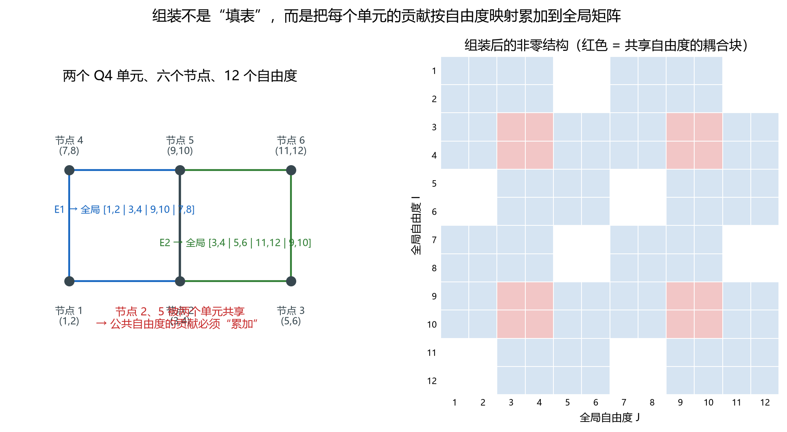
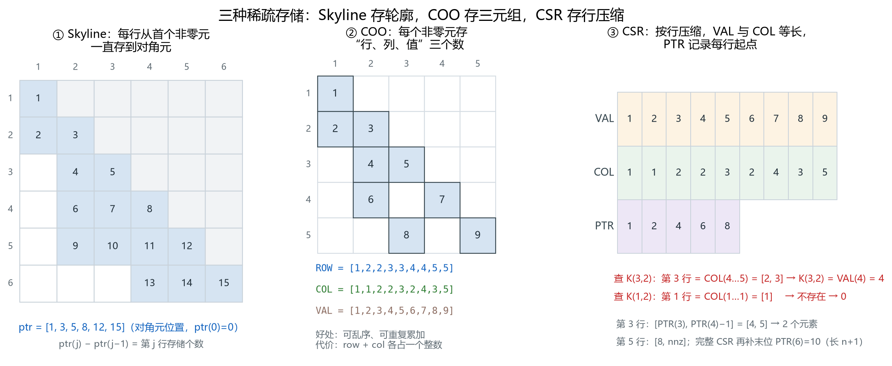

# 组装与稀疏存储：`+=` 背后的两件事

> 对应知识图谱节点：`M6-P3`
> 前置：[节点顺序、形函数与雅可比](02-node-ordering-and-jacobian.md)
> 后续：[约束与荷载](04-constraints-and-loads.md)
> 原始推文：第 06–07 篇（见 [案例笔记](../../../cases/2026-11-12-fem-programming-series.md)）

---

## 0. 结论先行

1. **组装不是"填表"，是按自由度映射的累加**： $K_{IJ}\mathrel{+}=K_e^{ab}$。
   共享节点处两个单元都有贡献，覆盖会丢掉一半刚度。
2. 线弹性刚度矩阵有三个结构性质：**对称、稀疏、带状**。
   存储格式省的是零元素，不是"把矩阵变小"。
3. 三种常用格式：
   - **Skyline**：每行从首个非零元存到对角元，适合中等规模、对称、直接法；
   - **COO**：存 $(I,J,V)$ 三元组，适合组装阶段乱序累加；
   - **CSR**：按行压缩， `VAL` 与 `COL` 等长， `PTR` 记录行起点，适合大规模求解。
4. 有限元程序的标准做法：**COO 组装 → 转 CSR 求解**。

适用范围：对称刚度矩阵；非对称问题（如孔压耦合、接触）需要存完整矩阵，
格式不变，但"只存一半"的优化不能再用。

---

## 1. 前提与符号

- 全局自由度 $n$；单元自由度 $8$（Q4）；单元数 $n_e$。
- 单元自由度到全局自由度的映射记为 $I=g_e(a)$。
- **非零元个数** $\mathrm{nnz}$：显式存储的数的个数（含对角）。
- **半带宽** $b$： $\max|I-J|$，满足 $K_{IJ}\ne0$。
- **稀疏度**： $\mathrm{nnz}/n^2$；二维问题通常 $\mathrm{nnz}\approx9n$，稀疏度约 $9/n$。

---

## 2. 推导

### 2.1 组装公式

单元平衡方程 $K_e d_e=f_e$ 是在**局部自由度** $a,b=1,\dots,8$ 下写的。
把它嵌入全局方程，只需把每个局部自由度换成全局编号：

$$
\boxed{K_{g_e(a), g_e(b)}\mathrel{+}=K_e^{ab}},\qquad
F_{g_e(a)}\mathrel{+}=f_e^{a}
$$

**依据**：虚功是可加的。单元 $e$ 对全局节点力向量第 $I$ 个分量的贡献，
等于它在局部第 $a$ 个自由度上的贡献，前提是 $I=g_e(a)$。

**为什么是累加？** 一个全局自由度可能被多个单元共享。以两个 Q4 为例，
节点 2、5 同时属于两个单元，它们的 4 个自由度各收到两份贡献。
若写成 `K(I,J) = Ke(a,b)`，后一个单元会把前一个覆盖掉。

### 2.2 对称性

$K_e$ 对称（因为 $D$ 对称），而全局 $K$ 是 $K_e$ 的"散射累加"：

$$
K=\sum_e G_e^{\mathrm{T}}K_e G_e
$$

其中 $G_e$ 是 $8\times n$ 的布尔映射矩阵。转置相乘保持对称性，求和也保持对称性。
所以 $K$ 对称，只需存上三角或下三角。

### 2.3 稀疏性与带宽

两个节点只有当它们属于**同一个单元**时才会耦合。因此：

- $K_{IJ}\ne0$ 的必要条件是节点 $I$、 $J$ 共单元；
- 二维网格中一个节点最多与周围 8 个节点共单元，加上自身，每行最多 9 个非零；
- 非零元集中在对角线附近，带宽由"编号最远的共单元节点"决定。

**带宽不是几何量，是编号量。** 同一个网格，换一种节点编号，带宽会变。
这也是为什么大型程序要做"重排序"（如 Reverse Cuthill–McKee）。



> 图 10：两个 Q4、六个节点、12 个自由度。左图是连接关系，
> 右图是组装后的非零结构；红色块是共享自由度造成的耦合。
> 文件：`assets/figures/fig10-assembly-scatter.png`

### 2.4 Skyline（轮廓）存储

对称矩阵的每一行，从**第一个非零元**到**对角元**之间可能有零，但把这些零也存下来，
换来"行内连续寻址"。

定义：

- `ptr(j)`：第 $j$ 行对角元在打包数组中的位置；
- `ptr(j)-ptr(j-1)`：第 $j$ 行存储的个数（含对角元）；
- 约定 `ptr(0)=0`。

对 6×6 的例子，每行存储个数为 $1,2,2,3,4,3$，于是

$$
\mathrm{ptr}=[1,\ 3,\ 5,\ 8,\ 12,\ 15]
$$

第 4 行从 `ptr(3)+1=6` 到 `ptr(4)=8`，共 3 个数。
**行内不再需要列号**，因为列号可以由"对角元位置减去偏移"反推。

### 2.5 COO（坐标）存储

三个等长数组：

- `ROW(k)`、 `COL(k)`：第 $k$ 个非零元的行、列；
- `VAL(k)`：数值。

优点：组装时可以乱序写入；重复的 $(I,J)$ 直接追加，最后求和。
缺点：每个非零元多存两个整数，内存开销大。

COO 的"重复项求和"恰好对应有限元的"共享自由度累加"：
组装阶段不需要查找已有位置，直接 push 三元组即可。

### 2.6 CSR（压缩稀疏行）存储

三个数组：

- `VAL`：按行优先排列的非零值；
- `COL`：与 `VAL` 等长的列号；
- `PTR`：第 $i$ 行的起始位置，**长度 $n+1$**，最后一位是哨兵 $\mathrm{nnz}+1$。

第 $i$ 行的范围：

$$
\boxed{k=\mathrm{PTR}(i),\ \dots,\ \mathrm{PTR}(i+1)-1}
$$

查找 $K_{ij}$：在第 $i$ 行的列号数组 `COL(PTR(i):PTR(i+1)-1)` 中找 $j$；
找到则取对应 `VAL`，找不到则为 0。

**关于 PTR 长度**：原始推文给的 `PTR(1:5)=[1,2,4,6,8]` 只有 $n$ 项，
按 `PTR(i+1)-1` 取第 5 行末位置会越界。完整写法要补 `PTR(6)=10`。
程序里通常分配 $n+1$ 项，最后一项固定为 $\mathrm{nnz}+1$。



> 图 11：三种格式并排。① Skyline 的对角元位置；② COO 的三元组；
> ③ CSR 的 `VAL`/`COL`/`PTR` 与两条查找示例。
> 文件：`assets/figures/fig11-sparse-storage.png`

### 2.7 三种格式的取舍

| 格式 | 存什么 | 组装 | 求解 | 适用 |
|---|---|---|---|---|
| Skyline | 行轮廓内的值 | 需预知轮廓 | 直接法方便 | 中等规模、对称 |
| COO | $(I,J,V)$ | 最方便，可重复 | 需转换 | 组装阶段 |
| CSR | 行压缩 | 需先统计每行个数 | 迭代法/直接法均可 | 大规模 |

工程上的常见流水线：**读网格 → 统计每行非零数 → 分配 CSR → 组装（COO 风格写入）
→ 施加约束 → 求解**。

---

## 3. 数值检验

### 3.1 两个 Q4 的组装规模

两个单元、六个节点、12 个自由度：

- 每个单元 $8\times8=64$ 个位置，两个共 128；
- 共享节点 2、5 的自由度有 4 个，重叠块 $4\times4=16$；
- 去重后 $\mathrm{nnz}=64+64-16=112$。

于是

$$
\text{稀疏度}=\frac{112}{12^2}=0.778,\qquad b=9
$$

77.8% 看起来"不稀疏"——因为只有 12 个自由度，玩具模型说明不了稀疏性的好处。
真实二维网格中 $\mathrm{nnz}\approx9n$，稀疏度约 $9/n$：
$n=10^4$ 时约 0.09%， $n=10^6$ 时约 0.0009%。

**带宽可以被编号改变**：把节点按列编号 $1,4,2,5,3,6$，
非零元个数仍是 112，半带宽从 9 降到 7。零元素没变，求解代价变了。

### 3.2 Skyline 的存储账

6×6 例子，每行存储个数 $1,2,2,3,4,3$：

$$
\text{存储量}=15,\qquad \text{完整矩阵}=36,\qquad \text{对称半阵}=21
$$

- 相对完整矩阵省 58.3%；
- 相对"只存一半"再省 28.6%（15 对 21）。

省下来的部分就是"轮廓内的零"。

### 3.3 COO 的存储账

5×5 例子有 9 个非零元：

$$
\text{COO 存 }3\times9=27\text{ 个数},\qquad \text{完整矩阵 }25\text{ 个数}
$$

在这个小例子里，COO 反而更费内存——因为 $27\gt25$。
只有 $\mathrm{nnz}\lt n^2/3$ 时 COO 才在"纯存储"上占优；
它的真正优势是**组装方便**，不是省内存。

### 3.4 CSR 的查找

沿用图 11 的数组：

```
VAL = [1, 2, 3, 4, 5, 6, 7, 8, 9]
COL = [1, 1, 2, 2, 3, 2, 4, 3, 5]
PTR = [1, 2, 4, 6, 8, 10]     # 最后一项是哨兵，nnz+1
```

- 查 $K_{3,2}$：第 3 行范围 $[4,5]$， `COL(4:5)=[2,3]`，找到 2，取 `VAL(4)=4`；✓
- 查 $K_{1,2}$：第 1 行范围 $[1,1]$， `COL(1)=1`，没有 2，故 $K_{1,2}=0$；✓
- 数值核对： $\sum \mathrm{VAL}=45$，与图中 9 个非零元之和一致。✓

> 这个 5×5 示例**不是对称矩阵**（存了 $K_{21}=2$，却没存 $K_{12}$）。
> 它只用来演示"数组怎么排"，不代表线弹性刚度矩阵。
> 真实刚度矩阵对称，实际只需存一半。

### 3.5 复算

```bash
py -3 tools/verify_fem_notes.py
```

脚本对 112 个非零元、带宽 9→7、Skyline 的 15 个数、COO 的值和逐项断言。

---

## 4. 常见误解

**误解 1："组装就是往矩阵里填数。"**

为什么错：一个自由度被多个单元共享，必须累加。
用赋值会丢掉先处理的单元贡献，结果偏软，但位移场仍然光滑，很难肉眼发现。

正确说法： `K(I,J) += Ke(a,b)`；并在组装后用"合力平衡"核对。

**误解 2："稀疏矩阵就是把完整矩阵存下来，计算时跳过零。"**

为什么错：完整存储 $n^2$ 个数， $n=10^6$ 时需要 $8\times10^{12}$ 字节，
根本放不下。稀疏存储的意义是**根本不分配零**。

正确说法：先用三元组统计非零，再按 CSR 分配；内存正比于 $\mathrm{nnz}$。

**误解 3："CSR 的 PTR 长度等于自由度个数。"**

为什么错：要表示第 $n$ 行的结束位置，必须访问 `PTR(n+1)`；
长度只有 $n$ 时会越界。标准 CSR 的 `PTR` 长度是 $n+1$，最后一项为 $\mathrm{nnz}+1$。

正确说法： `PTR(1)=1`， `PTR(n+1)=nnz+1`；第 $i$ 行范围为 `[PTR(i), PTR(i+1)-1]`。

**误解 4："刚度矩阵对称，所以存完整矩阵也不浪费。"**

为什么错：对称意味着 $K_{JI}=K_{IJ}$，存两份是纯冗余。
大规模问题中，省下一半内存往往就是"能不能算"的区别。

正确说法：对称矩阵只存上三角或下三角；Skyline 与 CSR 都可以只存一半。

**误解 5："COO 可以直接拿去解方程。"**

为什么错：COO 允许乱序与重复，求解器需要按行连续访问。
多数库会先把 COO 转成 CSR（或 CSC），再进行分解或迭代。

正确说法：COO 负责组装，CSR 负责求解；转换的代价远小于组装本身。

---

## 5. 自测

1. 两个 Q4 共享一条边，全局自由度 12。组装后非零元是多少？若共享的是整个单元呢？
2. 6×6 Skyline 例子中， `ptr=[1,3,5,8,12,15]`。第 5 行存了几个数？分别是哪几列？
3. 给出一组 CSR 的 `VAL`、 `COL`、 `PTR`，使 $K_{2,3}=7$，并写出查找过程。
4. 为什么"按列编号"能把半带宽从 9 降到 7？这个结论对 $100\times100$ 网格还成立吗？
5. 对称矩阵只存一半，组装时怎么保证不重复写入？请描述一种可行策略。

<details>
<summary>参考答案</summary>

1. 共享一条边：两个单元各 64 个位置，重叠 4 个自由度， $\mathrm{nnz}=64+64-16=112$。
   若两个单元完全重合（同一组节点），重叠 8 个自由度， $\mathrm{nnz}=64$。
2. 第 5 行从 `ptr(4)+1=9` 到 `ptr(5)=12`，共 4 个数。
   对角元在 12，列号从对角元反推：第 5 行首列 = $5-(12-9)=2$，故列为 2、3、4、5。
3. 例如 `VAL=[1,7,2]`、 `COL=[1,3,2]`、 `PTR=[1,2,4]`。
   第 2 行范围 `[2,3]`， `COL(2)=3` 命中，取 `VAL(2)=7`。
4. 按列编号让同一列上的节点在全局编号中相邻，共单元节点的编号差变小。
   对 $100\times100$ 网格同样成立：按列（或按行）连续编号，带宽约为 $\sqrt{n}$；
   跳跃式编号会让带宽退化为 $n$ 的量级。
5. 只在上三角（或下三角）写入：组装时先比较 $I\le J$，只保留一侧；
   或者组装完整 COO，转 CSR 时按 $I\le J$ 过滤。后者实现简单，代价是多存一份临时三元组。

</details>

---

上一篇 ← [节点顺序、形函数与雅可比](02-node-ordering-and-jacobian.md)　|　下一篇 → [约束与荷载](04-constraints-and-loads.md)
