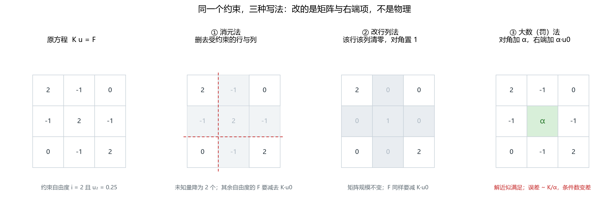
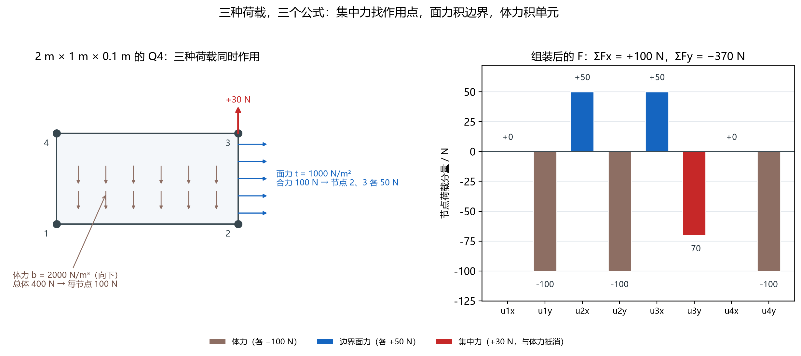

# 约束与荷载：把"已知"放到方程的正确位置

> 对应知识图谱节点：`M6-P4`
> 前置：[组装与稀疏存储](03-assembly-and-sparse-storage.md)
> 后续：[线性方程组的解法](05-linear-solvers.md)
> 原始推文：第 08–10 篇（见 [案例笔记](../../../cases/2026-11-12-fem-programming-series.md)）

---

## 0. 结论先行

1. 约束进入方程有三种写法：**消元、改行列、罚（大数）法**。
   改的是矩阵与右端项，物理没有变。
2. 消元与改行列给出**精确解**；罚法给出**近似解**，约束残差约等于"该自由度的反力除以罚参数"。
3. 罚参数每放大 10 倍，残差降 10 倍，条件数升 10 倍。
   它不是"越大越好"，而是在精度与病态之间取平衡。
4. 三类荷载各有公式：集中力直接加到对应自由度；面力按 $\int N^{\mathrm{T}}\mathbf{t}\ \mathrm{d}s$；
   体力按 $\int N^{\mathrm{T}}\mathbf{b}\ \mathrm{d}A$。
5. "每个节点平均分一份"只是**规则单元 + 常量荷载**的特例，不是普遍规律。
6. 装配完必须核对 $\sum F$ 等于外荷载合力；这一步能在求解之前抓住绝大多数漏边界、符号错。

适用范围：小变形、线弹性、单点约束（每个约束只涉及一个自由度）。
多点约束（MPC）、接触与周期性边界不属于本篇。

---

## 1. 前提与符号

- 全局方程 $K u=F$，自由度 $n$。
- 约束集合 $c$（已知位移），自由集合 $f$；自由度数 $n_f=n-|c|$。
- 约束值 $\bar u_i$（可以是 0，也可以非零）。
- 罚参数 $\alpha\gt0$，量纲与刚度相同（N/m）。
- 记号约定：厚度写作 $t$（斜体），面力写作 $\mathbf{t}$（粗体），二者不同。
- 荷载记号：

| 符号 | 含义 | 单位 | 进入方程的方式 |
|---|---|---|---|
| $\mathbf{P}$ | 集中力 | N | 直接加到节点 |
| $\mathbf{t}$ | 面力（单位面积力） | N/m² | 沿边界积分 |
| $\mathbf{b}$ | 体力（单位体积力） | N/m³ | 沿单元面积积分 |
| $N_a$ | 形函数 | — | 权函数 |

---

## 2. 推导

### 2.1 先把方程分块

把自由度重排成"自由在前、约束在后"：

$$
\begin{bmatrix}K_{ff} & K_{fc}\\ K_{cf} & K_{cc}\end{bmatrix}
\begin{bmatrix}u_f\\ u_c\end{bmatrix}
=
\begin{bmatrix}F_f\\ F_c\end{bmatrix}
$$

**依据**：这只是把方程按未知/已知分组，没有做任何近似。

展开成两行：

$$
K_{ff}u_f+K_{fc}u_c=F_f \qquad (1)
$$

$$
K_{cf}u_f+K_{cc}u_c=F_c \qquad (2)
$$

式 (1) 是**求解方程**：未知量只有 $u_f$。
式 (2) 是**反力方程**：求出 $u_f$ 后代回去，左边就是支反力。

$$
R_c=K_{cf}u_f+K_{cc}u_c-F_c
$$

注意符号： $R_c$ 是"支座施加给结构"的力，方向与位移约束一致；
它与外荷载满足 $R_c=-\sum F$ 的平衡关系（后面数值检验会核对）。

### 2.2 消元法：把已知项移到右边

由式 (1) 直接解出

$$
\boxed{u_f=K_{ff}^{-1}\left(F_f-K_{fc}\bar u_c\right)} \qquad (3)
$$

**依据**： $u_c=\bar u_c$ 已知， $K_{fc}\bar u_c$ 是一个已知向量，移到右边即可。
未知量从 $n$ 降到 $n_f$，矩阵从 $n\times n$ 降到 $n_f\times n_f$。

**代价**：自由度重新编号；解出的 $u_f$ 要"插回"原编号。
反力用式 (2) 回代，需要保留 $K_{cf}$。

### 2.3 改行列法：不改变矩阵规模

目标：让修改后的方程的第 $i$ 行直接读出 $u_i=\bar u_i$，同时不破坏对称性。

**步骤 1｜修改右端。** 对每个未约束的行 $j\ne i$，

$$
F_j\leftarrow F_j-K_{ji}\bar u_i \qquad (4)
$$

**依据**：原第 $j$ 行含 $K_{ji}u_i$；既然 $u_i$ 已知，就把它当作常数移到右边。
这一步必须在清零之前做，否则 $K_{ji}$ 已经变成 0，这一项就丢了。

**步骤 2｜清零第 $i$ 行与第 $i$ 列。**

$$
K_{ij}=K_{ji}=0\ (j\ne i),\qquad K_{ii}=1,\qquad F_i=\bar u_i \qquad (5)
$$

**依据**：第 $i$ 列清零，是因为 $u_i$ 不再是未知量，它的贡献已经并入右端；
第 $i$ 行清零并置对角为 1，是为了让第 $i$ 行恰好成为 $u_i=\bar u_i$。

**为什么保持对称**：第 $i$ 行与第 $i$ 列同时清零、对角同为 1，
所以修改后的矩阵仍然对称，仍可只存一半。

**代价**：第 $i$ 行被换掉了，原始 $K_{ij}$ 的信息丢失。
因此**不能**再用 $Ku-F$ 求反力，必须回到式 (2) 用未修改的矩阵回代。

### 2.4 罚法：加一根很硬的弹簧

在约束自由度上加一根刚度为 $\alpha$ 的弹簧，把它拉向 $\bar u_i$：

$$
\left(K+\alpha \mathbf{e}_i\mathbf{e}_i^{\mathrm{T}}\right)u_\alpha
=
F+\alpha \bar u_i \mathbf{e}_i \qquad (6)
$$

其中 $\mathbf{e}_i$ 是第 $i$ 个单位向量。矩阵只在 $(i,i)$ 位置加了 $\alpha$，右端只改了第 $i$ 项。

**为什么会有误差。** 设 $u$ 是式 (3) 的精确约束解，记该自由度的反力

$$
\lambda_i=(Ku)_i-F_i
$$

把式 (6) 与 $Ku=F$ 相减，令 $e=u_\alpha-u$：

$$
\left(K+\alpha\mathbf{e}_i\mathbf{e}_i^{\mathrm{T}}\right)e=-\lambda_i\mathbf{e}_i \qquad (7)
$$

**依据**： $Ku=F$ 对自由行成立；对第 $i$ 行不成立，差值正是反力 $\lambda_i$。

用 Sherman–Morrison 公式求逆：

$$
\left(K+\alpha\mathbf{e}_i\mathbf{e}_i^{\mathrm{T}}\right)^{-1}
=
K^{-1}-\frac{\alpha K^{-1}\mathbf{e}_i\mathbf{e}_i^{\mathrm{T}}K^{-1}}
{1+\alpha (K^{-1})_{ii}}
$$

代回式 (7)，得到两个分量：

$$
e_i=-\frac{\lambda_i c}{1+\alpha c},\qquad
e_j=-\frac{\lambda_i (K^{-1})_{ji}}{1+\alpha c},\quad j\ne i \qquad (8)
$$

其中 $c=(K^{-1})_{ii}$。

**读法**：

- 当 $\alpha c\gg1$， $e_i\approx-\lambda_i/\alpha$：**约束残差与反力成正比、与罚参数成反比**；
- 非约束自由度也被污染，量级相同，系数是柔度矩阵的元素；
- $\alpha\to\infty$ 时 $e\to0$，但矩阵条件数同时趋于无穷。

### 2.5 三种方法的对比

| 项 | 消元法 | 改行列法 | 罚法 |
|---|---|---|---|
| 解 | 精确 | 精确 | 近似，残差 $\sim\lvert\lambda_i\rvert/\alpha$ |
| 矩阵规模 | 变小 | 不变 | 不变 |
| 对称性 | 保持 | 保持 | 保持 |
| 稀疏结构 | 需重排 | 不变 | 不变 |
| 条件数 | 不变 | 不变 | 增大约 $\alpha$ 倍 |
| 反力 | 回代式 (2) | 回代式 (2)，需保留原矩阵 | 由 $\alpha(u_i-\bar u_i)$ 读出 |
| 实现难度 | 高（编号管理） | 低 | 最低 |

工程上的常见选择：**约束少且固定**时用改行列法；**约束随迭代变化**（接触）时用罚法；
**需要精确反力**（接触力、支反力校核）时用消元或改行列。

### 2.6 三类荷载的等效节点力

有限元只认节点力，所以任何分布荷载都必须化成节点力。统一出发点是虚功：

$$
\delta W=\int_\Omega \delta\mathbf{u}^{\mathrm{T}}\mathbf{b}\ \mathrm{d}\Omega
+\int_{\Gamma_t}\delta\mathbf{u}^{\mathrm{T}}\mathbf{t}\ \mathrm{d}\Gamma
=\sum_a \delta u_a f_a
$$

把 $\delta\mathbf{u}=N \delta d_e$ 代入，得到单元等效节点力：

$$
\boxed{f_e^{a}=\int_{A_e}N_a \mathbf{b} t\ \mathrm{d}A
+\int_{\Gamma_e}N_a \mathbf{t} t\ \mathrm{d}s} \qquad (9)
$$

集中力是式 (9) 的退化情形：作用点恰好是节点时， $f_a=\mathbf{P}$。

**为什么不能用"合力平均分"。** 式 (9) 里每个节点分到的是 $N_a$ 的加权积分，
不是常数。只有当 $N_a$ 在该荷载区域内为常数、且荷载均匀时，才恰好平均。

**Q4 的两个特例**（值得记住）：

1. **常量体力、矩形单元**： $\int N_a \mathrm{d}A=A/4$，四个节点各得 $bAt/4$；
2. **常量面力、直边**：沿边长为 $L$，两个端点各得 $tLt/2$（每个端点一半）。

**二次单元就不是这样**：三节点边的形函数在端点为 0、中点附近为 1，
积分结果是端点 $1/6$、中点 $4/6$。照搬"平均分"会低估中点、高估端点。

### 2.7 符号与单位的三条检查

1. **方向**：体力向下为负，面力沿外法向为正。写进 $F$ 之前统一成全局坐标。
2. **厚度**：平面问题里所有分布荷载都要乘厚度 $t$，否则量级差一个数量级。
3. **合力**：装配完立刻算 $\sum F_x$、 $\sum F_y$，与外荷载的合力对照。

---

## 3. 数值检验

### 3.1 一个 3×3 的约束算例

取

$$
K=\begin{bmatrix}2&-1&0\\-1&2&-1\\0&-1&2\end{bmatrix},\qquad
F=\begin{bmatrix}1\\0\\0\end{bmatrix}
$$

**无约束解**（可直接验证 $Ku=F$）：

$$
u=(0.75,\ 0.50,\ 0.25)
$$

现在规定 $u_2=0.25$（注意它不等于自由解的 0.50，所以约束真的起作用）。

**消元法**：删去第 2 行第 2 列，右端减去 $K_{f2}\bar u_2=(-1,0)^{\mathrm{T}}\times0.25$：

$$
\begin{bmatrix}2&0\\0&2\end{bmatrix}
\begin{bmatrix}u_1\\u_3\end{bmatrix}
=
\begin{bmatrix}1\\0\end{bmatrix}
-
\begin{bmatrix}-1\\0\end{bmatrix}\times0.25
=
\begin{bmatrix}1.25\\0.25\end{bmatrix}
$$

解得 $u_1=0.625$、 $u_3=0.125$。

**改行列法**：第 2 行第 2 列清零、对角置 1、 $F_2=0.25$；
其余行先减去 $K_{j2}\bar u_2$，得到同样的 $(0.625,\ 0.25,\ 0.125)$。

**罚法**（ $\alpha=10^2$）：解为

$$
u_\alpha=(0.62624,\ 0.25248,\ 0.12624)
$$

约束残差 $|u_{2,\alpha}-0.25|=2.475\times10^{-3}$。
解析式 (8) 给出 $e_2=-\lambda_2/(1+\alpha)$，其中 $\lambda_2=(Ku)_2-F_2=-0.25$、 $c=1$，
即 $0.25/101=2.475\times10^{-3}$，与数值完全一致。

### 3.2 罚法的精度–条件数权衡

| $\alpha$ | 约束残差 $\lvert u_2-\bar u_2\rvert$ | 条件数 $\kappa$ |
|---|---|---|
| $10^2$ | $2.475\times10^{-3}$ | $5.15\times10^{1}$ |
| $10^4$ | $2.500\times10^{-5}$ | $5.00\times10^{3}$ |
| $10^6$ | $2.500\times10^{-7}$ | $5.00\times10^{5}$ |
| $10^8$ | $2.500\times10^{-9}$ | $5.00\times10^{7}$ |
| $10^{10}$ | $2.500\times10^{-11}$ | $5.00\times10^{9}$ |

未加罚时 $\kappa=5.83$。两列都随 $\alpha$ 每十倍变一个数量级，方向相反。

**工程取值**： $\alpha$ 取"对角元量级的 $10^6$– $10^8$ 倍"。
再大不会更准——双精度只有约 16 位有效数字， $\kappa$ 到 $10^{10}$ 时已经丢掉 10 位。

### 3.3 三类荷载的装配



*图 12　同一个约束，三种写法。左一为原方程；中间两幅只改矩阵与右端项；
最右的罚法保留矩阵结构，但对角被 $\alpha$ 支配。*



*图 13　2 m × 1 m × 0.1 m 的 Q4，同时受体力、右边界面力与节点集中力。
左：物理分布；右：组装后的 8 个节点分量。*

算例参数： $E=300\ \mathrm{GPa}$、 $\nu=0.3$、 $t=0.1\ \mathrm{m}$。

- **体力**： $b=2000\ \mathrm{N/m^3}$ 向下， $A=2\ \mathrm{m^2}$，合力 $bAt=400\ \mathrm{N}$，
  四个节点各 $-100\ \mathrm{N}$（ $y$ 向）；
- **面力**：右边界面力 $1000\ \mathrm{N/m^2}$，边长 $1\ \mathrm{m}$，合力 $100\ \mathrm{N}$，
  节点 2、3 各 $+50\ \mathrm{N}$（ $x$ 向）；
- **集中力**：节点 3 向上 $30\ \mathrm{N}$。

组装结果：

$$
F=(0,\ -100,\ +50,\ -100,\ +50,\ -70,\ 0,\ -100)\ \mathrm{N}
$$

核对： $\sum F_x=+100\ \mathrm{N}$（面力合力），
$\sum F_y=-400+30=-370\ \mathrm{N}$（体力与集中力之和）。两个数都对得上。

### 3.4 用这套荷载解 Q4

固定节点 1、2，自由度 5–8 自由：

$$
u_3=(+4.7406\times10^{-9},\ -2.7709\times10^{-9})\ \mathrm{m},\qquad
u_4=(-0.6165\times10^{-9},\ -3.1893\times10^{-9})\ \mathrm{m}
$$

位移量级 $10^{-9}\ \mathrm{m}$ 是合理的：荷载约 $370\ \mathrm{N}$，
摊到 $0.2\ \mathrm{m^2}$ 的截面积上是 $\mathrm{kPa}$ 量级，
除以 $3\times10^{11}\ \mathrm{Pa}$ 得 $10^{-8}$ 量级的应变，再乘 2 m 的尺度。

反力（用未修改的 $K$ 回代）：

$$
R_1=(-14.68,\ +175.0)\ \mathrm{N},\qquad
R_2=(-85.32,\ +195.0)\ \mathrm{N}
$$

$$
\sum R=(-100,\ +370)\ \mathrm{N}=-\sum F
$$

平衡成立。注意 $u_3$ 的 $x$ 分量为正（向右）、 $u_4$ 的 $x$ 分量为负（向左）：
右边受拉向右，左边因泊松效应轻微回缩，方向与物理直觉一致。

### 3.5 复算

```bash
py -3 tools/verify_fem_notes.py
```

脚本对三种约束方法的解、五组罚法残差、荷载合力与 Q4 反力逐项断言。

---

## 4. 常见误解

**误解 1："施加约束就是把自由度删掉。"**

为什么错：只有**零位移**约束才等价于删去该自由度。
非零约束（支座沉降、指定位移、预张拉）必须先把它对相邻自由度的贡献移到右端，
否则相当于既要求它位移为 $\bar u$，又要求相邻节点不受影响。

正确说法：先按式 (4) 修改右端，再零化行或做消元。

**误解 2："改行列之后反力还能用 $Ku-F$ 算。"**

为什么错：求解时第 $i$ 行被换成了 $u_i=\bar u_i$，第 $i$ 列被清零，
原来的 $K_{ij}$ 已经不在矩阵里。再用修改后的矩阵算 $Ku-F$，第 $i$ 项恒为 0。

正确说法：反力必须用**未修改**的 $K$ 与式 (2) 回代；或者用罚法直接读 $\alpha(u_i-\bar u_i)$。

**误解 3："罚参数越大，结果越准。"**

为什么错：残差按 $1/\alpha$ 下降，条件数按 $\alpha$ 上升。
双精度下 $\kappa$ 超过 $10^{15}$ 左右时，舍入误差会把精度吃光；
而且 $\alpha$ 过大还会让迭代求解器收敛变慢、预条件失效。

正确说法： $\alpha$ 取对角元量级的 $10^6$– $10^8$ 倍，并用残差表核对。

**误解 4："节点荷载就是把合力平均分给节点。"**

为什么错：式 (9) 的权是形函数，不是常数。
只有"线性形函数 + 常量荷载 + 规则单元"三者同时成立时，平均分才对。

正确说法：一般情况按式 (9) 积分；二次单元要记住端点 $1/6$、中点 $4/6$。

**误解 5："面力合力等于 $\mathbf{t}$ 乘边长，与厚度无关。"**

为什么错：平面问题里应力、面力都是"每单位面积"，厚度方向没有离散，
必须乘厚度才得到"每单位厚度"之外的合力。

正确说法：合力 $=|\mathbf{t}|\times L\times t$；单位写全再代数。

**误解 6："约束反力可以从右端项直接读出来。"**

为什么错：改行列后 $F_i=\bar u_i$，它是位移值，不是力。
罚法下 $\alpha(u_i-\bar u_i)$ 才是力，但它是近似值。

正确说法：反力只有两个可靠来源——回代式 (2)，或罚法的弹簧力。

---

## 5. 自测

1. 3×3 算例中，若同时约束 $u_1=0$、 $u_3=0$，求 $u_2$ 与两个反力。
2. 改行列法中，为什么必须先修改右端再清零第 $i$ 列？交换顺序会丢掉哪一项？
3. 2 m × 1 m 的 Q4、厚度 0.1 m、均布体力 $2000\ \mathrm{N/m^3}$ 向下，每个节点分到多少？
   若单元被压成梯形（面积仍为 $2\ \mathrm{m^2}$），还能平均分吗？
4. 罚法取 $\alpha=10^{10}\ \mathrm{N/m}$，某约束自由度的精确反力为 $250\ \mathrm{N}$，估计约束残差。
5. 为什么"装配后核对 $\sum F$"能在求解前发现漏掉的边界？举一个会被它抓住的错误。

<details>
<summary>参考答案</summary>

1. 第 2 行给出 $2u_2=0$，故 $u_2=0$。
   反力 $R_1=(Ku)_1-F_1=-1\ \mathrm{N}$， $R_3=(Ku)_3-F_3=0$。
   物理上：节点 1 的荷载被支座完全承担，节点 3 没有外力、也没有位移，反力为零。
2. 必须先按式 (4) 把 $K_{ji}\bar u_i$ 移到右端，再清零。
   若先清零， $K_{ji}$ 已变成 0，右端少了 $-K_{ji}\bar u_i$ 这一项，
   相当于漏掉约束对相邻自由度的作用，解会偏向"没有约束"的结果。
3. 每个节点 $-100\ \mathrm{N}$（ $y$ 向）。
   梯形时不能平均分：四个节点分到的面积权重不同，必须按 $\int N_a \mathrm{d}A$ 积分；
   但总和仍是 $-400\ \mathrm{N}$，这一点与形状无关。
4. 残差约为 $|\lambda|/\alpha=250/10^{10}=2.5\times10^{-8}\ \mathrm{m}$。
   同时条件数会升到 $10^{10}$ 量级，双精度下只剩约 6 位有效数字。
5. 面力与体力的积分之和必须等于外荷载合力。
   例如漏掉右边界的面力： $\sum F_x$ 会从 $+100\ \mathrm{N}$ 变成 $0$，
   但求解本身仍能正常结束、位移场仍然光滑——只有核对合力才能发现。

</details>

---

上一篇 ← [组装与稀疏存储](03-assembly-and-sparse-storage.md)　|　下一篇 → [线性方程组的解法](05-linear-solvers.md)
