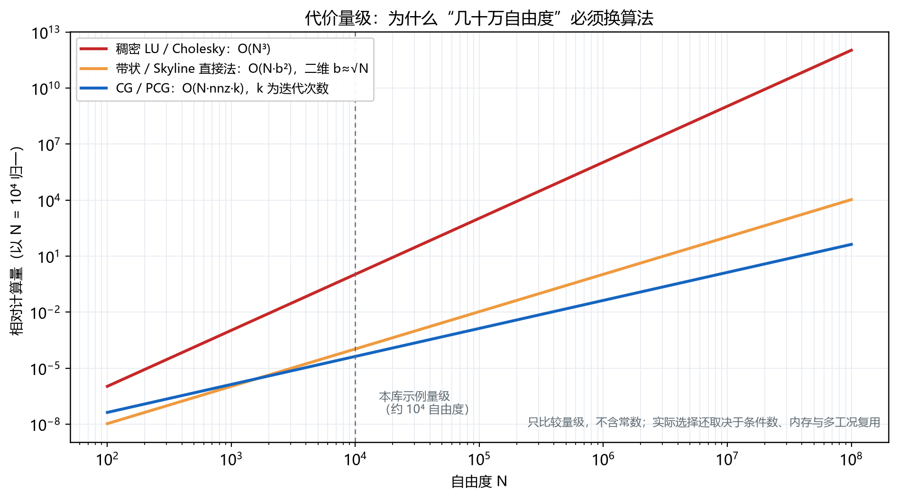
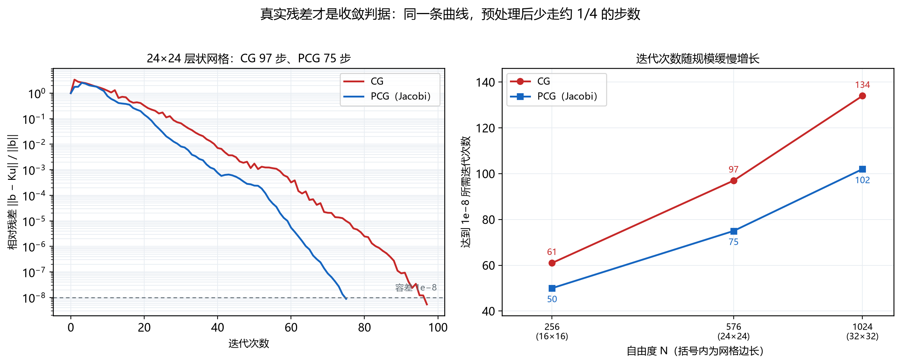

# 线性方程组的解法：直接法与迭代法的分水岭

> 对应知识图谱节点：`M6-P5`
> 前置：[约束与荷载](04-constraints-and-loads.md)
> 后续：[M6 数值方法](../../06-numerics/README.md)的耦合与断裂专题
> 原始推文：第 11 篇（见 [案例笔记](../../../cases/2026-11-12-fem-programming-series.md)）

---

## 0. 结论先行

1. 直接法（LU / Cholesky）**分解一次、回代多次**，代价 $O(N^3)$（稠密）或 $O(Nb^2)$（带状）。
2. 刚度矩阵对称正定，所以用 **Cholesky**：只需一半存储、约一半运算，且不必选主元。
   但主元一旦非正，说明模型有问题（约束不足或材料失稳），不是数值小事。
3. 迭代法（CG / PCG）每次只做矩阵–向量乘，代价 $O(\mathrm{nnz})$ 每步，
   适合 $N\ge10^5$ 的稀疏问题。
4. CG 的收敛速度由**条件数**决定。Jacobi 预条件把本例条件数从 372 降到 214，
   迭代数从 61/97/134 降到 50/75/102。
5. 收敛判据必须用**真实残差** $\lVert b-Ku\rVert/\lVert b\rVert$。
   CG 的残差**不单调**：本例最初几步从 1 涨到 3.4，然后才下降。
6. 选择原则：**小规模、多工况复用 → 直接法；大规模、单次求解 → 迭代法；条件数大 → 预条件**。

适用范围：对称正定、单场线弹性问题。孔压耦合与接触产生非对称矩阵，
需要对非对称求解器（如 BiCGSTAB / GMRES）或带主元的直接法。

---

## 1. 前提与符号

- 自由度 $N$，非零元个数 $\mathrm{nnz}$，半带宽 $b$。
- 条件数 $\kappa=\lambda_{\max}/\lambda_{\min}$（对称正定）。
- 直接法： $K=LL^{\mathrm{T}}$（Cholesky）或 $PA=LU$（选主元）。
- 迭代法：第 $k$ 步残差 $r_k=F-Ku_k$，搜索方向 $p_k$，步长 $\alpha_k$。
- 预条件：用 $M\approx K$ 把 $Mz=r$ 变成便宜的问题。

| 量 | 稠密 | 带状 | 稀疏（CSR） |
|---|---|---|---|
| 存储 | $N^2$ | $Nb$ | $\mathrm{nnz}$ |
| 分解代价 | $O(N^3)$ | $O(Nb^2)$ | 依赖填充（fill-in） |
| 典型场景 | $N\lesssim10^4$ | 二维规则网格 | 大规模、三维 |

---

## 2. 推导

### 2.1 直接法为什么是 $O(N^3)$

高斯消元第 $k$ 步，用第 $k$ 行消去其下方各行的第 $k$ 列。剩余子矩阵大小为 $(N-k)\times(N-k)$，
每一步的更新量约 $(N-k)^2$ 次乘加。求和：

$$
\sum_{k=1}^{N}(N-k)^2\approx\frac{N^3}{3}
$$

回代再加 $N^2/2$，所以 LU 总计约 $2N^3/3$。
Cholesky 利用对称性，只要一半： $\approx N^3/3$。

**带状矩阵的关键**：第 $k$ 步只需要更新带宽内的元素，每次约 $b^2$ 个，
所以

$$
\text{带状分解}\approx\sum_{k=1}^{N}b^2=Nb^2
$$

二维网格 $b\approx\sqrt{N}$，总代价 $O(N^2)$——比 $O(N^3)$ 好，但仍随规模平方增长。
三维网格 $b\approx N^{2/3}$，代价 $O(N^{8/3})$，恶化得更快。

### 2.2 对称正定：Cholesky 的推导

设 $K=LL^{\mathrm{T}}$， $L$ 为下三角。按元素展开：

$$
K_{ij}=\sum_{k=1}^{\min(i,j)}L_{ik}L_{jk}
$$

**步骤 1｜对角元。** 取 $i=j$：

$$
K_{ii}=\sum_{k=1}^{i-1}L_{ik}^2+L_{ii}^2
\quad\Longrightarrow\quad
L_{ii}=\sqrt{K_{ii}-\sum_{k=1}^{i-1}L_{ik}^2} \qquad (1)
$$

**步骤 2｜非对角元。** 取 $i\gt j$：

$$
K_{ij}=\sum_{k=1}^{j-1}L_{ik}L_{jk}+L_{ij}L_{jj}
\quad\Longrightarrow\quad
L_{ij}=\frac{1}{L_{jj}}\left(K_{ij}-\sum_{k=1}^{j-1}L_{ik}L_{jk}\right) \qquad (2)
$$

**依据**：式 (1) 的根号下是 Schur 补的对角元。 $K$ 正定时它恒为正，
所以 $L_{ii}$ 是实数，不需要选主元。

**工程含义**：如果式 (1) 出现负数开方，说明 $K$ 不是正定。
常见原因只有两类——**约束不足**（存在刚体位移，零特征值）或
**材料/几何失稳**（切线刚度出现负特征值）。这与有限元软件报的
"negative eigenvalue" 是同一件事，不要靠调容差掩盖。

### 2.3 迭代法：把求解变成一串矩阵–向量乘

直接法的问题是分解会引入**填充**：稀疏的 $K$ 分解后 $L$ 可能很稠密。
迭代法完全不做分解，只在每个迭代步乘一次 $K$。

以最速下降为起点：求 $u$ 使二次泛函最小，

$$
\Pi(u)=\tfrac12u^{\mathrm{T}}Ku-F^{\mathrm{T}}u
$$

其梯度是 $Ku-F=-r$。沿方向 $p$ 走一步，最优步长由 $\mathrm{d}\Pi/\mathrm{d}\alpha=0$ 给出：

$$
\alpha_k=\frac{r_k^{\mathrm{T}}p_k}{p_k^{\mathrm{T}}Kp_k} \qquad (3)
$$

最速下降每步都走"当前最陡"的方向，但相邻方向会重复，收敛很慢。
**共轭梯度**改为让搜索方向关于 $K$ 共轭（ $p_i^{\mathrm{T}}Kp_j=0$），
于是每个方向只走一次，理论上 $N$ 步内收敛：

$$
\begin{aligned}
\alpha_k&=\frac{r_k^{\mathrm{T}}z_k}{p_k^{\mathrm{T}}Kp_k}\\
u_{k+1}&=u_k+\alpha_k p_k\\
r_{k+1}&=r_k-\alpha_k Kp_k\\
\beta_k&=\frac{r_{k+1}^{\mathrm{T}}z_{k+1}}{r_k^{\mathrm{T}}z_k},\qquad
p_{k+1}=z_{k+1}+\beta_k p_k
\end{aligned}
$$

其中 $z_k=M^{-1}r_k$；取 $M=I$ 就是 CG，取 $M=\mathrm{diag}(K)$ 就是 Jacobi 预条件 CG。

**每个迭代步的代价**：一次矩阵–向量乘（ $2\times\mathrm{nnz}$ 次浮点运算）
加几次向量更新（ $O(N)$ ）。总代价 $O(\mathrm{nnz}\cdot k)$。

### 2.4 收敛速度与预条件

对对称正定矩阵，CG 的误差有上界：

$$
\frac{\lVert e_k\rVert_K}{\lVert e_0\rVert_K}
\le 2\left(\frac{\sqrt{\kappa}-1}{\sqrt{\kappa}+1}\right)^{k} \qquad (5)
$$

**读法**： $\kappa$ 越接近 1，括号越小，收敛越快。
本例 $n=24$ 时 $\kappa=372.3$，括号为 $0.9015$，要降到 $10^{-8}$ 需要约 180 步。
实际只用了 97 步——**上界是保守的**，但趋势是对的。

预条件的作用就是把 $\kappa$ 压小。Jacobi 预条件用对角阵缩放，
本例把 $\kappa$ 从 372.3 降到 213.7，迭代数从 97 降到 75。
更强的预条件（ILU、代数多重网格 AMG）能压得更多，但每次迭代更贵——
这是另一个"精度与代价"的平衡。

### 2.5 判据：只能看真实残差

$$
\frac{\lVert r_k\rVert}{\lVert F\rVert}
=\frac{\lVert F-Ku_k\rVert}{\lVert F\rVert}\lt\text{tol} \qquad (6)
$$

**为什么不能用"位移增量小"代替**：位移增量小可能只是步长被压小，
迭代停在离解很远的地方（停滞）。这在非线性问题里尤其常见。

**为什么不能假设残差单调**：CG 最小化的是误差的 $K$-范数，不是残差范数。
残差可以短暂上升——本例最初几步从 1 涨到 3.4，然后才稳定下降。
看到"残差变大"不要立刻判定发散，要看整体趋势和最终值。

### 2.6 怎么选：一张决策表

| 情形 | 推荐 | 理由 |
|---|---|---|
| $N\lesssim10^4$，多种荷载工况 | 直接法 | 分解一次，回代几乎免费 |
| 二维、 $N\sim10^5$、均匀材料 | 带状直接法或 PCG | 带宽 $\sim\sqrt{N}$，两者都可 |
| 三维、 $N\gtrsim10^6$ | PCG + 强预条件 | 分解的填充与内存不可承受 |
| 强非均质、薄层、近不可压 | 直接法或 AMG | 条件数极大，Jacobi 不够 |
| 非对称（孔压、接触、摩擦） | 非对称直接法 / GMRES | CG 的前提不成立 |

---

## 3. 数值检验

### 3.1 Cholesky 分解核对

对上篇的 $3\times3$ 刚度矩阵：

$$
K=\begin{bmatrix}2&-1&0\\
-1&2&-1\\
0&-1&2\end{bmatrix}
\quad\Longrightarrow\quad
L=\begin{bmatrix}
1.414214&0&0\\
-0.707107&1.224745&0\\
0&-0.816497&1.154701
\end{bmatrix}
$$

逐项验算： $L_{11}=\sqrt2$； $L_{21}=-1/\sqrt2$；
$L_{22}=\sqrt{2-0.5}=\sqrt{1.5}$； $L_{32}=-1/\sqrt{1.5}$；
$L_{33}=\sqrt{2-1/1.5}=\sqrt{4/3}$。

数值核对： $\max|LL^{\mathrm{T}}-K|=4.4\times10^{-16}$，在双精度舍入误差以内。

### 3.2 层状网格上的 CG 与 PCG



> 图 15：三种解法的运算量随自由度的增长（以 $N=10^4$ 归一）。
> 红线上翘最陡，蓝线最平；虚线处是当前示例的规模。
> 文件：`assets/figures/fig15-solver-cost.png`



> 图 16：左： $24\times24$ 层状网格的相对残差曲线，CG 97 步、PCG 75 步；
> 最初几步残差上升，之后才下降。右：三种规模下达到 $10^{-8}$ 所需迭代数。
> 文件：`assets/figures/fig16-cg-pcg-convergence.png`

测试问题： $n\times n$ 的层状五点差分矩阵（模拟非均质渗流/弹性），
右端除边界外全为 1，容差 $10^{-8}$。

| 网格 | $N$ | 稀疏度 | CG 步数 | PCG 步数 |
|---|---|---|---|---|
| $16\times16$ | 256 | 1.501% | 61 | 50 |
| $24\times24$ | 576 | 0.731% | 97 | 75 |
| $32\times32$ | 1024 | 0.430% | 134 | 102 |

- 稀疏度按 $\mathrm{nnz}/N^2$ 计，规模每翻倍、稀疏度大约减半——这正是稀疏性的意义；
- 迭代数随 $N$ 缓慢增长（约 $\sqrt{\kappa}$ 的量级），不是常数，也远不是 $N$；
- 预条件把迭代数降了约 23%（ $1-75/97$ ）；
- CG 解与直接解的相对差 $3.4\times10^{-10}$，小于容差 $10^{-8}$ 对应的误差量级。

### 3.3 代价量级表

按 $N$ 自由度、二维网格 $b=\sqrt{N}$、 $\mathrm{nnz}\approx9N$、CG 迭代 $k=200$ 估算：

| $N$ | 稠密 $2N^3/3$ | 带状 $2Nb^2$ | CG $2\times\mathrm{nnz}\times k$ |
|---|---|---|---|
| $10^4$ | $6.7\times10^{11}$ | $2.0\times10^{8}$ | $3.6\times10^{7}$ |
| $10^6$ | $6.7\times10^{17}$ | $2.0\times10^{12}$ | $3.6\times10^{9}$ |
| $10^8$ | $6.7\times10^{23}$ | $2.0\times10^{16}$ | $3.6\times10^{11}$ |

内存的差距同样关键：

- 稠密： $N^2\times8$ 字节， $N=10^4$ 时 0.8 GB， $N=10^6$ 时 8 TB（不可行）；
- 带状： $Nb\times8$ 字节， $N=10^6$、 $b=10^3$ 时 8 GB；
- 稀疏：约 $9N$ 个实数加整数， $N=10^6$ 时约 0.1 GB。

这就是"几十万自由度必须换算法"的算术依据：不是直接法不准，而是它算不动。

### 3.4 复算

```bash
py -3 tools/verify_fem_notes.py
```

脚本对 Cholesky 的 $L$、三组 CG/PCG 迭代数、条件数与 CG 解的相对误差逐项断言。

---

## 4. 常见误解

**误解 1："直接法是精确解，所以总是更好。"**

为什么错：直接法精确到**舍入误差**，但代价 $O(N^3)$ 或 $O(Nb^2)$，内存 $O(N^2)$ 或 $O(Nb)$。
$N=10^6$ 的稠密矩阵连存都存不下。而且 $\kappa$ 很大时，直接法同样丢有效数字。

正确说法：直接法的优势是"分解一次、多工况复用"和鲁棒；规模上去必须换迭代法。

**误解 2："迭代法算得不准。"**

为什么错：迭代法可以收敛到与直接法相同的解——本例相对差 $3.4\times10^{-10}$。
它的风险是**不收敛或收敛慢**，不是精度上限低。

正确说法：控制容差与最大迭代数，并监控真实残差；必要时换预条件。

**误解 3："残差应该单调下降，变大就是发散。"**

为什么错：CG 最小化的是误差的 $K$-范数，不是残差范数。
本例开头残差从 1 涨到 3.4，随后正常收敛。

正确说法：看整体趋势、最终残差与迭代数上限；单步上升不代表失败。

**误解 4："Jacobi 预条件总是有效。"**

为什么错：它只按对角缩放。对强各向异性、多层介质或近不可压材料，
对角信息不足以代表整个矩阵，改善有限，甚至可能变慢。

正确说法：先试 Jacobi，再考虑 ILU / AMG；比较"每次迭代的代价 × 迭代数"，而不是只看迭代数。

**误解 5："CG 可以解任何线性方程组。"**

为什么错：CG 要求矩阵**对称正定**。孔压耦合的耦合矩阵、接触与摩擦、对流项都会破坏对称性。

正确说法：非对称问题用 BiCGSTAB / GMRES，或直接用带主元的非对称求解器。

**误解 6："迭代到 $N$ 步一定收敛。"**

为什么错： $N$ 步收敛是**精确算术**下的结论。浮点运算中舍入误差累积，
共轭性会逐渐丢失，实际往往在第 $N$ 步之前就达到容差，也可能之后仍在徘徊。

正确说法：以残差判据为准，不以步数判据为准。

---

## 5. 自测

1. 对上面的 $3\times3$ 矩阵做 Cholesky，写出 $L$。若某个 $L_{ii}$ 算出来是负数的平方根，说明什么？
2. 为什么带状直接法从 $O(N^3)$ 降到 $O(Nb^2)$？二维网格下总代价随 $N$ 怎样增长？
3. 本例 CG 97 步、PCG 75 步，预条件省了约多少比例？若网格从 $24\times24$ 加密到 $48\times48$，迭代数大致怎么变？
4. 判断："迭代残差在某一步变大，说明程序有 bug。"
5. 一个三维模型 $N=2\times10^6$、材料均匀、只算一次。选直接法还是迭代法？给出两条理由。

<details>
<summary>参考答案</summary>

1. $L$ 见 §3.1。负主元意味着 $K$ 非正定：要么约束不足（存在刚体位移），
   要么材料/几何切线刚度出现负特征值。这是模型错误，不是数值精度问题。
2. 消元的每一步只影响带宽内的 $b^2$ 个元素，共 $N$ 步。
   二维网格 $b\approx\sqrt{N}$，故总代价 $O(N^2)$；三维 $b\approx N^{2/3}$，代价 $O(N^{8/3})$。
3. 省约 23%（ $1-75/97=0.227$ ）。
   迭代数大致按 $\sqrt{N}$ 增长，网格边长翻倍则迭代数约增 $\sqrt2$ 倍，
   估计在 190 步量级（参考 $24\times24$ 到 $32\times32$ 的 97 步增到 134 步，约 1.38 倍）。
4. 错。CG 不保证残差单调，本例开头从 1 升到 3.4。
   应看整体趋势与最终残差；只有"持续上升且不回落"才值得怀疑。
5. 选迭代法（PCG）。
   理由一： $N=2\times10^6$ 的稠密或带状分解在内存和运算上都不可承受；
   理由二：只算一次，直接法"分解一次多次回代"的优势用不上；
   材料均匀、条件数可控，Jacobi 或 AMG 预条件能有效工作。

</details>

---

上一篇 ← [约束与荷载](04-constraints-and-loads.md)　|　返回 → [有限元编程基础：导读](README.md)
