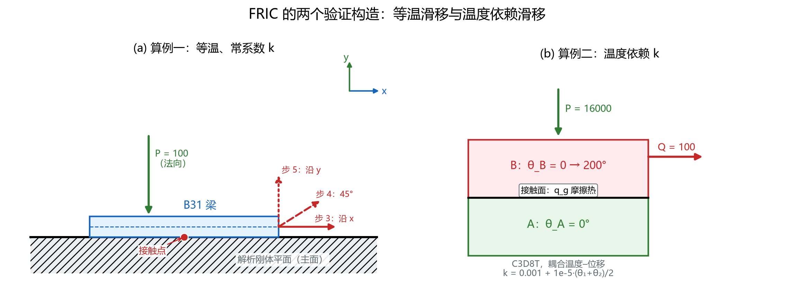
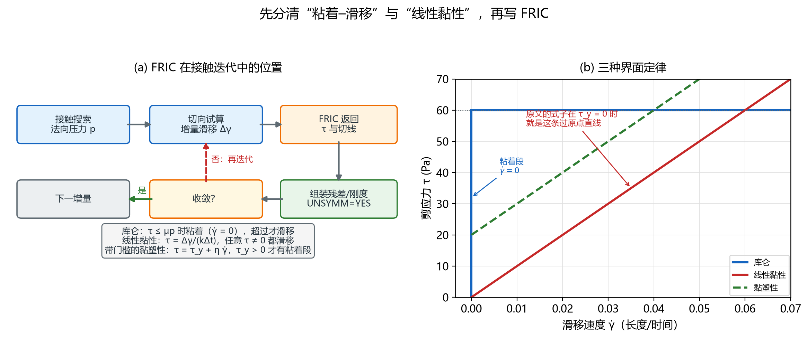
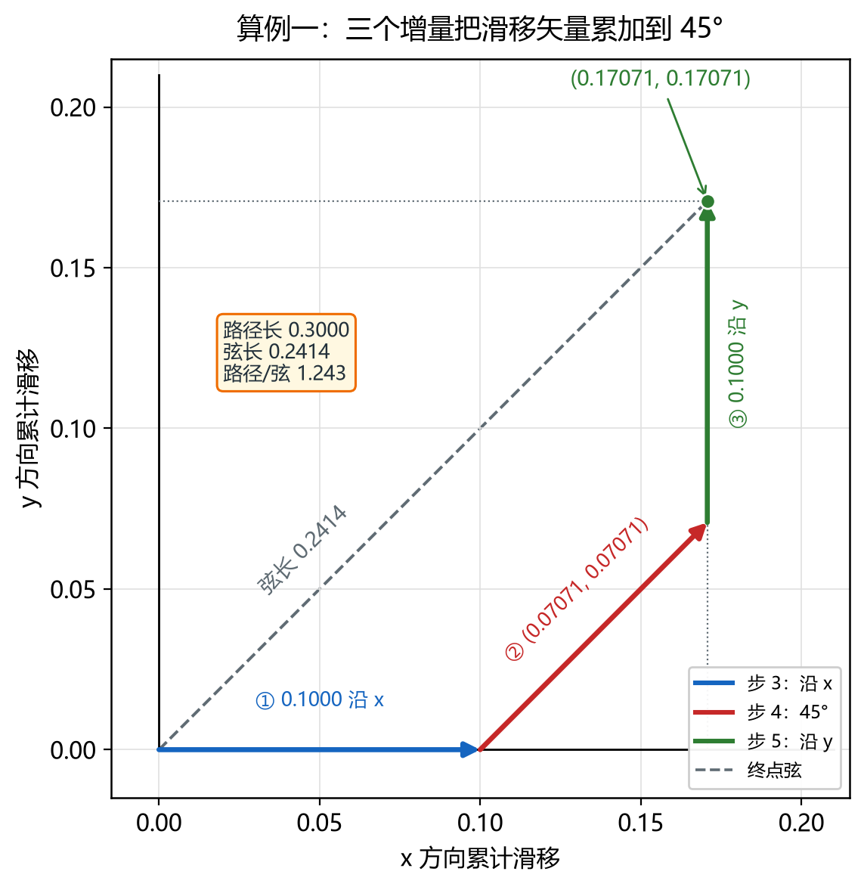
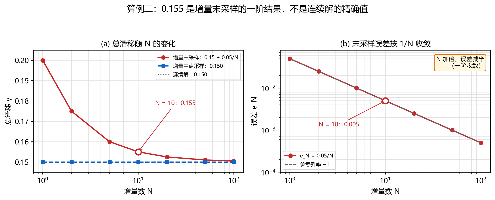
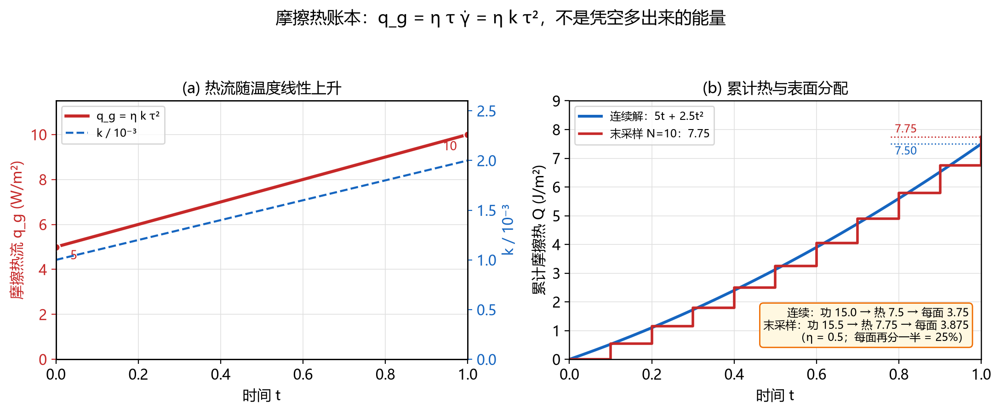

# 用户子程序 FRIC：把界面摩擦写成本构

> 对应知识图谱节点：`M6-09`
>
> 前置：[本构与强度](../03-constitutive/README.md)（库仑摩擦、接触面）、[有限元编程基础](fem-programming/README.md)（残差与切线）
>
> 相关：[单元类型](element-types.md)（B31 与 C3D8T 的自由度）、[变分近似](variational-approximation.md)（切线为什么决定收敛）
>
> 原始推文：《Abaqus 用户子程序 FRIC：用“黏塑性摩擦”替代库仑摩擦，两个算例带你验证》，公众号「ABAQUS仿真世界」，作者 云端082，2026-11-13（链接见文末来源）

---

## 0. 结论先行

1. FRIC 是 Abaqus 的**用户摩擦子程序**：接触搜索、法向压力、接触约束仍由 Abaqus 处理；FRIC 只在每个接触点、每个摩擦方向上，根据增量滑移、总滑移、温度与时间增量，返回剪应力与切线。它替换的是**切向本构**，不是整个接触算法。
2. 原文的 $\dot\gamma=k\tau$（常数 $k$）是**线性黏性（Newtonian）**，不是黏塑性。它没有屈服门槛，也没有真正的粘着状态：只要 $\tau\neq 0$ 就产生滑移。黏塑性至少要写成 $\tau=\tau\_y+\eta\dot\gamma$（ $\tau\_y>0$），或让 $k$ 依赖状态变量。
3. Abaqus 的 `DGAM` 与 `SLIP` 是**长度**，不是剪应变。严格写法是滑移速度 $\dot h=k\tau$，其中 $k$ 的单位是长度/(应力·时间)，例如 mm/(MPa·s) 或 m/(Pa·s)。若把 $k$ 当作 1/(Pa·s)，得到的是无量纲剪应变，必须再乘一个参考长度才回到 `DGAM` 的长度口径。
4. 算例一的三步增量都是 $k\tau\Delta t=0.1$，方向依次沿 x、45°、y。矢量终点是 $(0.17071,0.17071)$，**路径长** $0.3000$，**弦长** $0.2414$，路径/弦 $1.243$，终点方向 45°。
5. 路径与弦不是同一个量：Abaqus 的标量 `SLIP` 按增量幅值累加，是路径长 $0.3000$；把每个增量按方向投影再相加，才得到矢量终点与弦长 $0.2414$。依赖 `SLIP` 的状态律必须用路径；只关心净位移时才用弦。
6. 算例二的连续解是 $0.150$。若每个增量取**末时刻**温度， $N$ 等分的结果是 $0.15+0.05/N$， $N=10$ 得 $0.155$；取**中点**温度，任何 $N$ 都得 $0.150$；取**起点**温度，得 $0.15-0.05/N=0.145$。所以 $0.155$ 是右端点采样的一阶结果，不是连续解的精确值。
7. 误差是一阶的： $e\_N=0.05/N$， $N$ 加倍误差减半； $N=10$ 的相对误差是 3.33%。把 $N$ 从 10 加到 20，结果从 $0.155$ 降到 $0.1525$，不是模型变准了，而是离散误差变小了。
8. 摩擦热按 $q\_g=\eta\tau\dot h=\eta k\tau^2$ 计算。取 $\eta=0.5$，连续解累计 $7.5\ \mathrm{J/m^2}$；右端点 $N=10$ 为 $7.75\ \mathrm{J/m^2}$。若 Abaqus 把界面热平均分给两侧，每侧得到摩擦功的 25%：连续 $3.75$、离散 $3.875\ \mathrm{J/m^2}$。这个分配比例要在模型里核对，不能默认。
9. 切线 $\partial\tau/\partial\Delta\gamma=1/(k\Delta t)$ 与热切线 $\partial\tau/\partial\theta$ 都必须与返回的 $\tau$ 一致。温度耦合使全局切线非对称，应使用 `UNSYMM=YES`；否则 Newton 迭代会变慢，甚至不收敛。
10. 对石油系统，FRIC 的价值不在“换一种摩擦系数”，而在接入**速度依赖、温度依赖、状态变量依赖**的界面本构：断层率–状态摩擦、支撑剂/缝面摩擦、热采与 CO2 注入中的温度相关摩擦。用之前先校准单位与接触面积；线性黏性会让断层在任意小的剪应力下持续蠕滑，不能拿来表示“锁住的断层”。

适用范围：本文讨论小变形、接触面始终处于闭合状态、法向压力只通过库仑上限或状态变量间接影响切向的的情形。大变形、接触开合、磨损与化学–力学耦合不在本文范围内。除特别注明外，所有数值由 [`tools/fric_lib.py`](../../tools/fric_lib.py) 计算，[`tools/verify_fric_notes.py`](../../tools/verify_fric_notes.py) 断言（84 项）。

---

## 1. 前提与符号

### 1.1 FRIC 在接触迭代中的位置

Abaqus 的接触迭代可以粗分为四步：

1. 接触搜索：判断哪些从面节点进入接触，计算法向压力 $p$ 与接触面积；
2. 切向试算：给出当前迭代的增量滑移 $\Delta\gamma$ 与滑移方向；
3. 调用 FRIC：由 $\Delta\gamma$、总滑移、温度、时间增量返回 $\tau$ 与切线；
4. 组装残差与刚度：把 $\tau$ 的贡献加进切向残差，把 $\partial\tau/\partial\Delta\gamma$、 $\partial\tau/\partial\theta$ 加进刚度矩阵。

FRIC 看不到单元内部的应力，也不负责法向约束；它只回答一个问题：**在这个接触点、这个方向上，给定增量滑移与温度，切向应力是多少，切线是多少**。因此它既可以实现库仑摩擦的各种正则化，也可以实现完全不同的界面本构。



> 图 41：(a) B31 梁压在解析刚体平面上，法向力 $P=100$，切向力依次沿 x、45°、y；
> (b) 两块 C3D8T 上下接触，B 块温度从 0 升到 200°，A 块保持 0°，界面交换摩擦热 $q\_g$。
>
> 读图要点：两个算例都把“接触”简化成单位面积上的法向与切向力；FRIC 只接管切向，
> 法向压力与接触搜索仍由 Abaqus 完成。图中的 $P$、 $Q$ 是力还是应力，取决于接触面积，
> 这是原文没有交代、后文 §2.7 要补的口径。

### 1.2 两个验证算例

| 项目 | 算例一 | 算例二 |
|---|---|---|
| 模型 | B31 梁 + 解析刚体平面 | 两块 C3D8T，A 下 B 上 |
| 分析类型 | 静力、通用 | 耦合温度–位移 |
| 界面定律 | $k=0.001$，常数 | $k=0.001+10^{-5}(\theta\_1+\theta\_2)/2$ |
| 载荷 | $P=100$ 法向； $Q=100$ 沿 x、45°、y | $P=16000$ 法向； $Q=100$ 切向 |
| 时间 | 3 个增量，每个 $\Delta t=1$ | 1 个分析步，10 等分 |
| 温度 | 等温 | B 块 $0\to 200^\circ$，A 块 $0^\circ$ |
| 主要输出 | 滑移矢量、路径、弦 | 总滑移、摩擦热 |
| 预期 | 终点 $(0.17071,0.17071)$ | 连续 $0.150$；右端点 $N=10$ 为 $0.155$ |

两个算例都用同一条线性黏性定律：

$$
\tau=\frac{\Delta\gamma}{k\Delta t}
\qquad\Longleftrightarrow\qquad
\Delta\gamma=k\tau\Delta t
$$

其中 $\Delta\gamma$ 是当前方向上的增量滑移， $\Delta t$ 是时间增量。原文把它写成 $\dot\gamma=k\tau$，并把 $\dot\gamma$ 叫作剪应变率；这个叫法需要纠正，见 §2.1。

### 1.3 符号与单位

| 符号 | 含义 | 典型单位 |
|---|---|---|
| $\tau$ | 接触面剪应力 | MPa 或 Pa |
| $p$ | 接触面法向压力 | MPa 或 Pa |
| $\Delta\gamma$ | 当前方向上的增量滑移（Abaqus 的 `DGAM`） | mm 或 m |
| $\gamma$ | 累计滑移幅值（Abaqus 的 `SLIP`） | mm 或 m |
| $\dot h$ | 滑移速度， $\Delta\gamma/\Delta t$ | mm/s 或 m/s |
| $k$ | 线性黏性柔度系数 | mm/(MPa·s) 或 m/(Pa·s) |
| $\theta\_1,\theta\_2$ | 接触两侧温度 | °C |
| $\eta$ | 摩擦功转热比例 | 无量纲 |
| $q\_g$ | 单位面积摩擦热流 | W/m² |
| $N$ | 分析步的等分数 | 无量纲 |

关键的量纲关系是

$$
[\Delta\gamma]=[k]\ [\tau]\ [\Delta t]
\quad\Longrightarrow\quad
[k]=\frac{[L]}{[F/L^2][T]}=\frac{L^3}{F\ T}
$$

所以 $k$ 不是无量纲数。模型用 mm–MPa–s 时， $k$ 的单位是 mm/(MPa·s)；换成 m–Pa–s 时，同一个物理柔度要乘以 $10^{-9}$。后文 §2.7 给出换算。

---

## 2. 推导

### 2.1 从增量滑移到剪应力：本构的两种写法

FRIC 的输入是增量滑移，不是应变。设当前摩擦方向上的增量滑移为 $\Delta\gamma$，时间增量为 $\Delta t$，则线性黏性定律可以写成两种等价形式：

$$
\tau=\frac{\Delta\gamma}{k\Delta t}
\qquad\text{（以增量滑移为输入）}
$$

$$
\dot h=\frac{\Delta\gamma}{\Delta t}=k\tau
\qquad\text{（以滑移速度为输入）}
$$

这里 $\dot h$ 是**滑移速度**，单位是长度/时间；它不是剪应变率。若把 $\Delta\gamma$ 误当成剪应变 $\gamma$，则 $k$ 的单位变成 1/(应力·时间)，数值上会差一个参考长度：

$$
\gamma_{\text{无量纲}}=k\tau
\quad\Longrightarrow\quad
\Delta\gamma=L_{\text{ref}}\ k\tau
$$

只有当 $L\_{\text{ref}}=1$（在模型单位制下）时，无量纲剪应变与长度滑移的数值才相同。原文的 $0.1$、 $0.15$、 $0.155$ 之所以能同时被叫作“滑移”和“剪应变”，就是因为默认了单位参考长度；一旦模型长度不是 1，两个口径立刻分开。

**符号约定。** 本文按当前摩擦方向上的代数值写： $\Delta\gamma$ 与 $\tau$ 同号，反向滑移时两者同时变负。切线 $\partial\tau/\partial\Delta\gamma=1/(k\Delta t)$ 恒为正，不随方向反转改变符号。

### 2.2 线性黏性、库仑与黏塑性

三种界面定律的区别不在“有没有摩擦”，而在**零滑移附近的行为**：

| 定律 | 形式 | 粘着状态 | 零滑移时的 $\tau$ | 典型参数 |
|---|---|---|---|---|
| 库仑 | $|\tau|\le\mu p$；滑动时 $\tau=\mu p$ | 有， $|\tau|<\mu p$ 时 $\dot h=0$ | 可以是 $0$ 到 $\mu p$ 的任意值 | $\mu$ |
| 线性黏性 | $\tau=\dot h/k$ 或 $\dot h=k\tau$ | 无，任何 $\tau\neq0$ 都滑移 | $\tau=0$ | $k$ |
| 带门槛的黏塑性 | $\tau=\tau\_y+\eta\dot h$（ $\tau>\tau\_y$） | 有， $\tau\le\tau\_y$ 时 $\dot h=0$ | 可以是 $0$ 到 $\tau\_y$ 的任意值 | $\tau\_y,\eta$ |

原文的常数 $k$ 对应第二行：它是一条过原点的直线，没有屈服门槛，也没有真正的粘着。把它叫“黏塑性”会把两个最重要的物理特征——**门槛**与**粘着**——丢掉。若希望界面在低剪应力下不动、超过门槛才滑移，至少要用第三行，或让 $k$ 依赖状态变量并在 $\tau$ 很小时把 $k$ 推到零。



> 图 45：(a) FRIC 在接触迭代中的位置：接触搜索给法向压力，切向试算给增量滑移，
> FRIC 返回 $\tau$ 与切线，组装后判断收敛；(b) 三种界面定律的 $\tau$– $\dot h$ 曲线。
>
> 读图要点：库仑在 $\dot h=0$ 处是一条竖直线（粘着段， $|\tau|\le\mu p$），超过 $\mu p$ 才水平滑动；
> 线性黏性过原点、没有门槛；黏塑性从 $\tau\_y$ 起步。原文的式子在 $\tau\_y=0$ 时就是那条过原点的直线，
> 所以它是线性黏性，不是黏塑性。

### 2.3 算例一：三个增量与路径/弦

算例一每一步施加一个大小 100 的切向力，方向依次为 x、45°、y；法向力 100 只保证接触。按单位面积计，剪应力等于力，于是

$$
\Delta\gamma_i=k\tau_i\Delta t=0.001\times\tau_i\times1
$$

三个增量分别是

| 步 | 力的方向 | 力矢量 | 剪应力矢量 | 增量滑移矢量 | 累计滑移矢量 |
|---|---|---|---|---|---|
| 3 | 沿 x | $(100,0)$ | $(100,0)$ | $(0.1,0)$ | $(0.1,0)$ |
| 4 | 45° | $(70.7107,70.7107)$ | $(70.7107,70.7107)$ | $(0.0707107,0.0707107)$ | $(0.1707107,0.0707107)$ |
| 5 | 沿 y | $(0,100)$ | $(0,100)$ | $(0,0.1)$ | $(0.1707107,0.1707107)$ |

注意第 4 步的 100 是**合力大小**，所以两个分量各是 $100/\sqrt{2}=70.7107$；若误把它当成“两个分量各 100”，第 4 步的增量会变成 $(0.1,0.1)$，终点变成 $(0.2,0.2)$，与原文的 $(0.17071,0.17071)$ 不符。这个检查可以直接判断自己对“45° 力”的理解是否正确。

三个增量的模长都是 0.1，因此**路径长**是

$$
s=0.1+0.1+0.1=0.3000
$$

**矢量终点**是 $(0.1707107,0.1707107)$，**弦长**是

$$
c=\sqrt{0.1707107^2+0.1707107^2}=0.241421
$$

路径/弦为 $0.3000/0.241421=1.2426$，终点方向为 $\arctan(1)=45^\circ$。



> 图 42：蓝、红、绿三段分别是步 3、4、5 的增量滑移矢量；灰色虚线是终点弦。
> 路径长 0.3000，弦长 0.2414，路径/弦 1.243。
>
> 读图要点：三段首尾相接，方向依次转 45°、再转 45°，所以终点落在 45° 对角线上，
> 但走的路比直线长 24%。**路径与弦的差别来自方向改变，不来自滑移量算错。**

这里有一个容易混淆的输出口径。Abaqus 的标量 `SLIP` 是累计滑移**幅值**，按每个增量的 $|\Delta\gamma|$ 相加，得到 0.3000；矢量终点需要把每个增量按摩擦方向投影后再相加，得到 0.2414。若状态律只依赖 `SLIP`（例如磨损、率–状态摩擦的滑移历史），用 0.3000；若关心的是接触点净移动了多远，用 0.2414。两者不能互相替代。

### 2.4 算例二：温度依赖的 $k$ 与一阶误差

算例二中 B 块温度从 0 线性升到 200°，A 块保持 0°，所以接触面平均温度是

$$
\bar\theta(t)=\frac{\theta_A+\theta_B}{2}=100t,\qquad 0\le t\le1
$$

界面系数取

$$
k(t)=k_0+k_1\bar\theta=0.001+10^{-5}\times100t=0.001(1+t)
$$

切向力 100 按单位面积计为 $\tau=100$，连续解是

$$
\gamma(1)=\int_0^1 k(t)\tau\ \mathrm{d}t
=100\left(0.001+\frac{0.001}{2}\right)=0.150
$$

把 $[0,1]$ 等分成 $N$ 段，若每段用**右端点**温度 $t\_i=i/N$，则

$$
\gamma_N=\sum_{i=1}^{N}k(t_i)\tau\frac{1}{N}
=0.15+\frac{0.05}{N}
$$

若用**中点**温度 $t\_{i-1/2}=(i-1/2)/N$，因为 $k(t)$ 是线性的，中点法 exact：

$$
\gamma_N^{\text{mid}}=0.150\qquad\text{对任意 }N
$$

若用**左端点**温度 $t\_{i-1}=(i-1)/N$，则

$$
\gamma_N^{\text{left}}=0.15-\frac{0.05}{N}
$$

三个采样位置给出三个不同的离散结果，但都收敛到同一个连续解。 $N=10$ 时分别是 0.155、0.150、0.145；误差 $e\_N=0.05/N$， $N$ 加倍误差减半，是一阶格式。



> 图 43：(a) 总滑移随增量数 $N$ 的变化：右端点按 $0.15+0.05/N$ 下降，中点恒为 0.150，
> 连续解是 0.150；(b) 右端点误差在双对数坐标下按 $1/N$ 收敛，参考斜率 $-1$。
>
> 读图要点： $N=10$ 的 0.155 不是“算错了”，而是右端点采样的一阶离散结果；
> 把 $N$ 加到 20 得 0.1525，加到 100 得 0.1505。要判断本构是否正确，应该看收敛趋势，
> 而不是拿一个固定 $N$ 的结果和连续解逐位比较。

这里的 $P=16000$ 只用于保证接触，并不进入 $k$ 的表达式；在这条定律里，法向压力不影响切向滑移。若把 $P$ 改成别的值，只要接触仍然闭合且面积不变，0.155 不会变。这一点与库仑摩擦不同：库仑的上限 $\mu p$ 直接依赖法向压力。

### 2.5 切线：为什么必须 `UNSYMM=YES`

FRIC 不仅要返回 $\tau$，还要返回 $\tau$ 对输入变量的偏导。对本文的定律，

$$
\tau=\frac{\Delta\gamma}{k\Delta t},\qquad
k=k_0+\frac{k_1}{2}(\theta_1+\theta_2)
$$

有

$$
\frac{\partial\tau}{\partial\Delta\gamma}=\frac{1}{k\Delta t}
$$

$$
\frac{\partial\tau}{\partial\theta_1}
=\frac{\partial\tau}{\partial\theta_2}
=-\frac{k_1\Delta\gamma}{2k^2\Delta t}
$$

$$
\frac{\partial\tau}{\partial p}=0
$$

前两个切线一个进入切向刚度，一个进入热–力耦合块。温度耦合块与力学块不是转置关系，所以全局切线非对称；这就是原文要求 `UNSYMM=YES` 的原因。若把 $\partial\tau/\partial\theta$ 填成 0，Newton 迭代丢掉了“温度升高 → $k$ 变大 → 同样的 $\tau$ 产生更大滑移”的一阶信息，收敛会退化成割线迭代，温度增量越大越明显。

数值检查取 $k\_0=0.001$、 $k\_1=10^{-5}$、 $\bar\theta=150$、 $\Delta t=0.2$、 $\Delta\gamma=3\times10^{-4}$：

$$
k=0.0025,\qquad
\tau=\frac{3\times10^{-4}}{0.0025\times0.2}=0.6
$$

$$
\frac{\partial\tau}{\partial\Delta\gamma}=\frac{1}{0.0025\times0.2}=2000,\qquad
\frac{\partial\tau}{\partial\theta_1}
=-\frac{10^{-5}\times3\times10^{-4}}{2\times0.0025^2\times0.2}
=-0.0012
$$

### 2.6 摩擦热：从 $q\_g$ 到每面 25%

界面摩擦功的功率是 $\tau\dot h$。设其中比例 $\eta$ 转为热，则单位面积热流为

$$
q_g=\eta\tau\dot h=\eta k\tau^2
$$

在算例二中， $k(t)=0.001(1+t)$、 $\tau=100$、 $\eta=0.5$，所以

$$
q_g(t)=0.5\times0.001(1+t)\times100^2=5(1+t)\ \mathrm{W/m^2}
$$

$t=0$ 时 $5\ \mathrm{W/m^2}$， $t=1$ 时 $10\ \mathrm{W/m^2}$。连续累计热是

$$
Q_g=\int_0^1 5(1+t)\ \mathrm{d}t=7.5\ \mathrm{J/m^2}
$$

右端点 $N=10$ 的离散累计是 $7.75\ \mathrm{J/m^2}$；左端点是 $7.25$，中点是 $7.50$。对应的摩擦功是 $\tau\gamma$：连续 $15.0$、右端点 $15.5\ \mathrm{J/m^2}$。热/功之比恒为 $\eta=0.5$。

若 Abaqus 把 $q\_g$ 平均分给接触两侧，则每侧得到 $q\_g/2$，累计每侧是 $3.75$（连续）或 $3.875$（右端点）。相对于摩擦功，每侧的比例是 $0.5\times0.5=0.25$，即 25%。这个“先取 $\eta$、再两面各半”的顺序不能颠倒，也不能把 $q\_g$ 当成“每侧的热流”再分一次。



> 图 44：(a) 热流 $q\_g$ 随温度线性上升，从 5 到 $10\ \mathrm{W/m^2}$；右轴同时给出 $k/10^{-3}$；
> (b) 累计热：连续解 $5t+2.5t^2$，右端点 $N=10$ 的阶梯累计到 7.75，水平虚线标出 7.50 与 7.75。
>
> 读图要点：热不是“凭空多出来的能量”，它来自摩擦功； $\eta=0.5$ 表示一半摩擦功转热，
> 若界面热再平均分给两侧，每侧只拿到摩擦功的 25%。账本必须同时给出“功、热、每侧热”三个数，
> 只报一个 $q\_g$ 无法核对。

### 2.7 单位与力/应力口径

原文没有给单位，也没有给接触面积。这两个缺口会直接改变数值：

- 若 $P$、 $Q$ 是**力**，必须先除以接触面积 $A$ 才能得到应力： $\tau=Q/A$， $p=P/A$；
- 若 $P$、 $Q$ 已经是**应力**（或模型采用单位面积），则不需要再除；
- 若把 $k$ 从 mm–MPa–s 换到 m–Pa–s，数值要乘 $10^{-9}$，否则滑移会差九个数量级。

以算例一为例，若 $Q=100\ \mathrm{N}$、接触面积 $A=1\ \mathrm{mm^2}$，则 $\tau=100\ \mathrm{MPa}$；取 $k=0.001\ \mathrm{mm/(MPa\cdot s)}$、 $\Delta t=1\ \mathrm{s}$，得到 $\Delta\gamma=0.1\ \mathrm{mm}$。若面积是 $100\ \mathrm{mm^2}$，则 $\tau=1\ \mathrm{MPa}$， $\Delta\gamma=0.001\ \mathrm{mm}$，比前者小 100 倍。数值 0.1 只在“单位面积”或“力就是应力”的口径下成立。

| 口径 | $\tau$ | $k$ | $\Delta\gamma$（ $\Delta t=1$） |
|---|---|---|---|
| 单位面积，mm–MPa–s | 100 MPa | 0.001 mm/(MPa·s) | 0.1 mm |
| 面积 $100\ \mathrm{mm^2}$，mm–MPa–s | 1 MPa | 0.001 mm/(MPa·s) | 0.001 mm |
| 单位面积，m–Pa–s | 100 Pa | $10^{-9}$ m/(Pa·s) | 0.1 m |
| 面积 $1\ \mathrm{m^2}$，m–Pa–s | 100 Pa | 0.001 m/(Pa·s) | 0.1 m |

最后一行说明：**同样的数字 0.001 与 0.1，可以对应完全不同的物理尺度**。写 FRIC 时应在注释里写清单位与面积，否则别人无法复现。

### 2.8 从教学算例到石油系统

FRIC 的真正用途不是替换一个常数摩擦系数，而是接入 Abaqus 内置库仑模型没有的界面物理。下面四类场景可以直接映射到本文的框架：

| 场景 | 建议的界面定律 | 需要存的状态变量 | 关键检查 |
|---|---|---|---|
| 断层滑移、诱发地震 | 率–状态摩擦： $\tau=a\sigma\_n'\ln(V/V\_\ast)+b\sigma\_n'\ln(\theta/\theta\_\ast)$， $\dot\theta=1-V\theta/D\_c$ | $V$、 $\theta$ | 必须先有粘着/门槛；线性黏性会让断层一直蠕滑 |
| 压裂缝面、支撑剂层 | 库仑 + 速度弱化或损伤 | 累计滑移、损伤 | 缝宽与滤失口径；温度对 $k$ 的影响 |
| 热采、CO2 注入 | 温度依赖的 $\mu(T)$ 或 $k(T)$ | 温度 | `DDTDT` 必须与 $\tau$ 一致；`UNSYMM=YES` |
| 套管–水泥、射孔孔眼 | 库仑 + 黏结/损伤 | 滑移、法向压力 | 接触面积与单位；法向–切向耦合 |

共同点是：**先写清 $\tau$ 是 $\Delta\gamma$、 $\dot h$、 $\theta$、 $p$ 与状态变量的什么函数，再写切线，最后才写代码**。顺序反过来，通常会在收敛性和量纲上同时出问题。

---

## 3. 数值检验

以下数值全部由 [`tools/verify_fric_notes.py`](../../tools/verify_fric_notes.py) 复算；运行

```bash
py -3 tools/verify_fric_notes.py
```

应输出 84 行 `PASS` 和一行 `ALL CHECKS PASSED`。

### 3.1 算例一

| 检查 | 数值 |
|---|---|
| 步 3 增量 | $(0.1,0)$ |
| 步 4 增量 | $(0.070710678,0.070710678)$ |
| 步 5 增量 | $(0,0.1)$ |
| 终点 | $(0.170710678,0.170710678)$ |
| 路径长 | 0.300000 |
| 弦长 | 0.241421356 |
| 路径/弦 | 1.242641 |
| 终点方向 | 45.000° |
| 每步模长 | 0.1 |

### 3.2 算例二

| $N$ | 右端点 $0.15+0.05/N$ | 中点 | 左端点 $0.15-0.05/N$ | 右端点误差 |
|---:|---:|---:|---:|---:|
| 1 | 0.2000 | 0.1500 | 0.1000 | 0.0500 |
| 2 | 0.1750 | 0.1500 | 0.1250 | 0.0250 |
| 5 | 0.1600 | 0.1500 | 0.1400 | 0.0100 |
| 10 | 0.1550 | 0.1500 | 0.1450 | 0.0050 |
| 20 | 0.1525 | 0.1500 | 0.1475 | 0.0025 |
| 100 | 0.1505 | 0.1500 | 0.1495 | 0.0005 |

$N=10$ 的相对误差是 $0.005/0.15=0.0333$，即 3.33%； $e\_{10}/e\_{20}=2$，一阶收敛。

### 3.3 切线

取 $k\_0=0.001$、 $k\_1=10^{-5}$、 $\bar\theta=150$、 $\Delta t=0.2$、 $\Delta\gamma=3\times10^{-4}$：

| 量 | 解析值 | 有限差分 |
|---|---:|---:|
| $\tau$ | 0.6 | 0.6 |
| $\partial\tau/\partial\Delta\gamma$ | 2000 | 2000.000 |
| $\partial\tau/\partial\theta\_1$ | $-0.0012$ | $-0.001200$ |
| $\partial\tau/\partial\theta\_2$ | $-0.0012$ | $-0.001200$ |

### 3.4 热账本

| 量 | 连续 | 右端点 $N=10$ | 左端点 $N=10$ | 中点 $N=10$ |
|---|---:|---:|---:|---:|
| 摩擦功 $\tau\gamma$ | 15.0 | 15.5 | 14.5 | 15.0 |
| 转热 $\eta=0.5$ | 7.5 | 7.75 | 7.25 | 7.5 |
| 每侧（平均分） | 3.75 | 3.875 | 3.625 | 3.75 |
| 每侧/摩擦功 | 25% | 25% | 25% | 25% |

### 3.5 量纲与面积

| 检查 | 结果 |
|---|---|
| $0.1\ \mathrm{m}$ 换成 mm | 100 mm |
| 无量纲剪应变 0.1，参考长度 1 mm | 0.1 mm |
| $k=0.001\ \mathrm{mm/(MPa\cdot s)}$ 换成 m/(Pa·s) | $10^{-9}$ |
| 单位面积上 $\tau=100$，面积缩小到 $0.01$ | $\tau=10000$，滑移放大 100 倍 |
| 库仑上限 $\mu=0.6$、 $p=100$ | 60 |
| $\tau=40$ 时库仑 | 粘着 |
| $\tau=60$ 或 80 时库仑 | 滑移 |
| 线性黏性 $\tau=0$ | 滑移为 0 |
| 线性黏性 $\tau=10^{-9}$ | 仍有非零滑移（无粘着门槛） |

最后两行是本文最重要的判别：线性黏性没有“粘着”状态，任意非零剪应力都会产生滑移。

---

## 4. 常见误解

**误解 1：FRIC 就是“黏塑性摩擦”。**
错。常数 $k$ 的 $\dot h=k\tau$ 是线性黏性，没有屈服门槛，也没有粘着。黏塑性至少要写成 $\tau=\tau\_y+\eta\dot h$（ $\tau\_y>0$），或让 $k$ 依赖状态变量并在低应力下趋于零。原文的标题用了“黏塑性”，但代码对应的是一条过原点的直线。

**误解 2：`DGAM` 是剪应变。**
错。Abaqus 的 `DGAM` 是长度，`SLIP` 也是长度。把 $k$ 当成 1/(Pa·s) 时， $k\tau$ 是无量纲剪应变率；要变成 `DGAM`，必须乘参考长度。模型长度不是 1 时，两个口径相差一个长度因子。

**误解 3：0.155 是精确解，0.15 是理论值。**
反了。0.150 是连续解；0.155 是“每个增量取末时刻温度”的右端点一阶结果。取中点得 0.150，取左端点得 0.145。 $0.155$ 不是唯一的离散答案，它只说明采样位置在右端。

**误解 4：路径长等于弦长。**
不等。算例一的路径是 0.3000，弦是 0.2414，差 24%。路径是标量 `SLIP` 的累加，弦是矢量终点的模。依赖滑移历史的状态律用路径；只关心净位移时才用弦。

**误解 5：摩擦热 $q\_g$ 全部进入一个面。**
不一定。 $q\_g$ 是界面产生的总热流；若 Abaqus 平均分给两侧，每侧只得到 $q\_g/2$，相对于摩擦功是 25%（先 $\eta=0.5$ 转热，再两面各半）。不同版本或设置可能改变分配比例，必须核对，不能把 $q\_g$ 直接当成“每侧热流”。

**误解 6：切线可以填个近似值，反正会收敛。**
错。切线与返回的 $\tau$ 不一致时，Newton 迭代退化为割线迭代；温度耦合越强、增量越大，收敛越慢。 $\partial\tau/\partial\theta$ 填 0 是最常见的错误，它会让 `UNSYMM=YES` 的必要性看不出来。

**误解 7：法向力 $P=16000$ 会影响算例二的滑移。**
在这条定律里不会。 $k$ 只依赖温度， $\tau$ 由切向力 100 决定； $P$ 只保证接触闭合。若 $P$ 小到接触打开，或大到改变接触面积，才会间接影响结果。这一点与库仑摩擦不同。

**误解 8：单位不重要，只要数值对。**
错。 $k$ 的单位是长度/(应力·时间)。从 mm–MPa–s 换到 m–Pa–s，同一个物理柔度要乘 $10^{-9}$；保留 0.001 这个数字会改变物理问题。写子程序时应在注释里固定单位、面积与符号约定。

---

## 5. 自测

**题 1：** 取 $k=0.002$、 $\Delta t=0.1$、 $\Delta\gamma=2\times10^{-4}$，求 $\tau$ 与 $\partial\tau/\partial\Delta\gamma$。

**题 2：** 算例一第 4 步的力是“100 沿 45°”。为什么两个分量是 70.71，而不是 50？如果把 100 理解为“x、y 分量各 100”，终点会变成多少？

**题 3：** 算例二为什么右端点得 0.155、中点得 0.150？如果 $N=10$ 的结果是 0.145，最可能的原因是什么？

**题 4：** 算例一中 Abaqus 的 `SLIP` 与矢量终点分别是多少？哪一个适合作为磨损状态变量？

**题 5：** 一个断层在 $\tau=20\ \mathrm{MPa}$、 $\sigma\_n'=50\ \mathrm{MPa}$、 $\mu=0.6$ 下锁住。能否用常数 $k$ 的线性黏性 FRIC 让它保持锁住？应该换成什么形式？

**题 6：** 把 $k=0.001\ \mathrm{mm/(MPa\cdot s)}$ 换成 m/(Pa·s)，数值是多少？若模型长度从 mm 改成 m 但保留 $k=0.001$，滑移会差多少倍？

### 参考答案

**答 1：** $\tau=2\times10^{-4}/(0.002\times0.1)=1$； $\partial\tau/\partial\Delta\gamma=1/(0.002\times0.1)=5000$。

**答 2：** 因为 100 是合力大小，两个分量各是 $100/\sqrt{2}=70.71$。若把它当成两个分量各 100，第 4 步增量是 $(0.1,0.1)$，终点是 $(0.2,0.2)$，路径仍是 0.3，但弦变成 0.2828。

**答 3：** 右端点每段用 $t\_i=i/N$ 的温度， $k$ 随 $t$ 线性增大，右端点高估每段积分，总误差 $+0.05/N$；中点对线性 $k$ 精确，误差为 0。若 $N=10$ 得 0.145，说明用的是左端点（起点）温度，误差为 $-0.05/N$。

**答 4：** `SLIP` 是路径 0.3000；矢量终点是 $(0.17071,0.17071)$，弦 0.2414。磨损、滑移历史等状态变量应该用路径 0.3000；只关心净位移时用弦。

**答 5：** 不能。线性黏性在任意 $\tau\neq0$ 时都产生 $\dot h=k\tau$，断层会持续蠕滑。应换成带门槛的黏塑性（ $\tau\_y\ge20\ \mathrm{MPa}$）或库仑 + 粘着/率–状态摩擦，让 $|\tau|<\mu\sigma\_n'=30\ \mathrm{MPa}$ 时滑移速率为零。

**答 6：** $0.001\ \mathrm{mm/(MPa\cdot s)}=10^{-9}\ \mathrm{m/(Pa\cdot s)}$。若模型长度从 mm 改成 m 却保留 $k=0.001$， $k$ 的物理柔度放大 $10^9$ 倍，滑移也放大 $10^9$ 倍；除非同时把 $k$ 改成 $10^{-9}$，否则不是同一个问题。

---

## 来源

- 原文：《Abaqus 用户子程序 FRIC：用“黏塑性摩擦”替代库仑摩擦，两个算例带你验证》，微信公众号「ABAQUS仿真世界」，作者 云端082，2026-11-13。
  链接：[原文](https://mp.weixin.qq.com/s/RMaFyFgZrBbUSRpVjHdPXA)
- 本文为原文的独立改写与补充：线性黏性与黏塑性的区分、`DGAM`/`SLIP` 的长度口径、路径与弦、
  三种温度采样的一阶误差、切线推导、摩擦热账本与单位换算均为本库新增；原文的两个算例按原意转述并复算。
- **未复制原文任何图片**。原文 2 张插图的主题与远程地址登记在
  [案例拆解](../../cases/2026-11-13-fric-subroutine.md)；本库图 41–图 45 由
  [`tools/make_figures.py`](../../tools/make_figures.py) 生成，数值由
  [`tools/verify_fric_notes.py`](../../tools/verify_fric_notes.py) 复算。
- 原文版权归原作者；链接仅作引用与出处标注。
