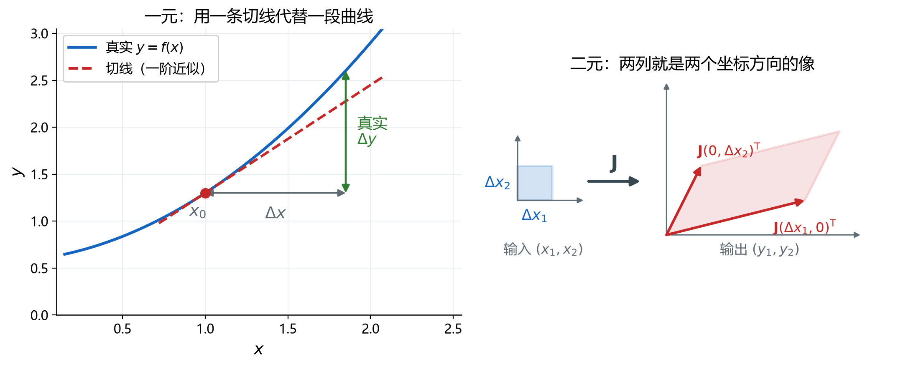
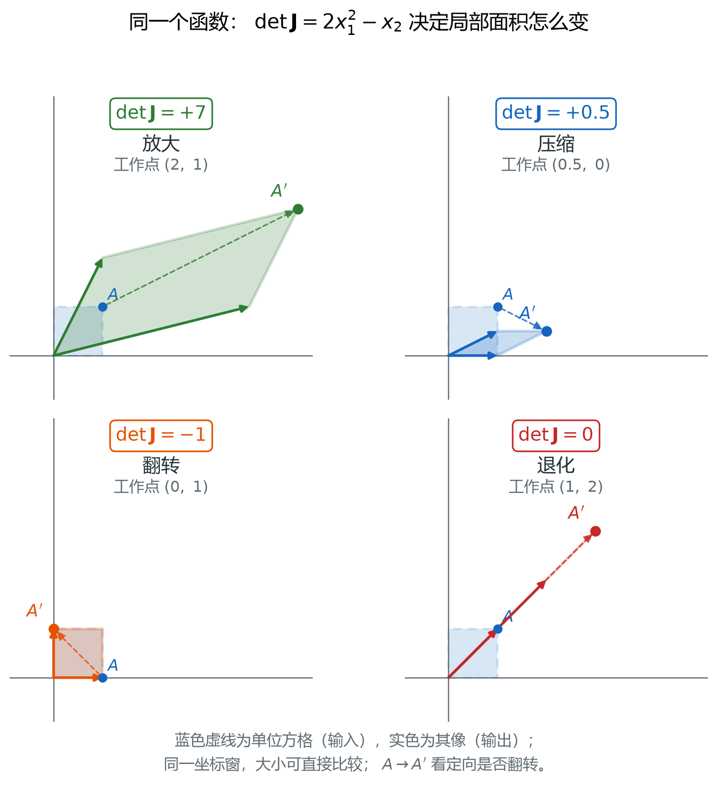
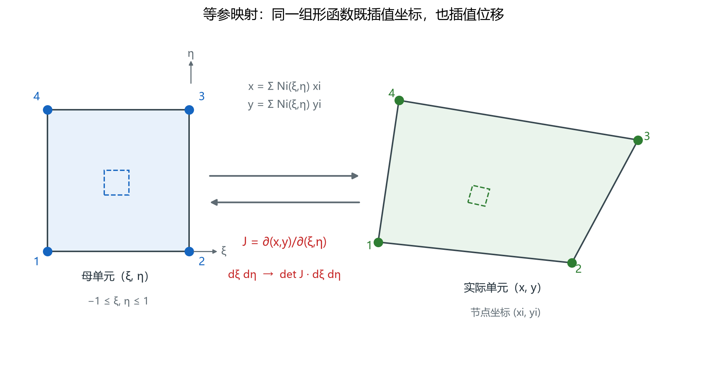
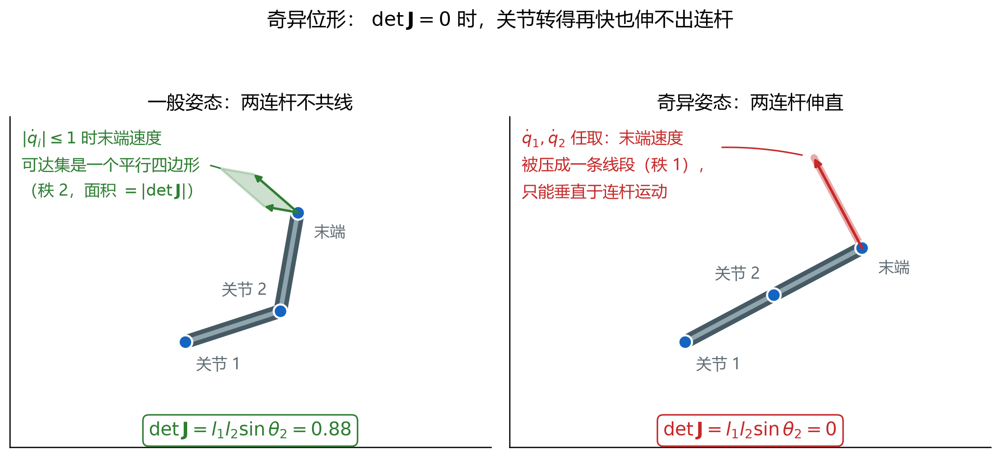

# 雅可比矩阵：多变量映射的局部线性化

> 对应知识图谱节点：`M6-06`
>
> 前置：[节点顺序、形函数与雅可比](fem-programming/02-node-ordering-and-jacobian.md)
>
> 相关：[M2 应变与变形](../02-strain/README.md)（变形梯度 $\mathbf{F}=\partial\mathbf{x}/\partial\mathbf{X}$ 就是雅可比）
>
> 原始推文：《理论剖析 || 雅可比矩阵：连接多变量世界的数学桥梁》（链接见文末来源）

---

## 0. 结论先行

1. **雅可比矩阵是多变量函数的导数**： $J_{ij}=\partial y_i/\partial x_j$，
   它把"一个输出对一个输入的敏感度"排成矩阵。
2. 它给出**局部线性化**：
   $\mathbf{f}(\mathbf{x}_0+\Delta\mathbf{x})\approx\mathbf{f}(\mathbf{x}_0)+J(\mathbf{x}_0)\Delta\mathbf{x}$，
   误差是 $O(\Vert\Delta\mathbf{x}\Vert^2)$。
3. 一维导数是**一个数**（斜率），多维导数是**一个矩阵**：
   它把输入的小方格线性地变成输出的平行四边形（图 17）。
4. $\det J$ 是**局部面积（体积）缩放因子**，带符号： $|\det J|$ 是倍数，
   符号表示朝向； $\det J=0$ 表示该点**降秩**，不是"缩得很小"。
5. 输入输出维数不同（ $m\neq n$）时没有行列式，要看**秩**与**奇异值**。
6. " $\det J\neq0$" 只保证**局部**可逆，不保证全局一一对应。

适用范围：映射 $\mathbf{f}$ 在讨论点的一个邻域内连续可微（ $C^1$）。

全文只用一个算例贯穿：

$$
y_1=x_1^2+x_2,\qquad y_2=x_1x_2
$$

它的雅可比矩阵与行列式是

$$
J(x_1,x_2)=
\begin{bmatrix}
2x_1 & 1\\
x_2 & x_1
\end{bmatrix},
\qquad
\det J=2x_1^2-x_2
$$

同一个函数在四个工作点上分别演示放大、压缩、翻转、退化（§2.5、图 18）。
用一个函数走到底，是为了让读者看清"变的是点，不是公式"。

---

## 1. 前提与符号

- **输入** $\mathbf{x}=(x_1,\dots,x_n)^{\mathrm T}\in\mathbb{R}^n$；
  **输出** $\mathbf{y}=(y_1,\dots,y_m)^{\mathrm T}\in\mathbb{R}^m$。
- **映射** $\mathbf{y}=\mathbf{f}(\mathbf{x})$ 在 $\mathbf{x}_0$ 的某个邻域内 $C^1$
  （偏导数连续）。本文不讨论 $C^1$ 不成立的点。
- 向量一律写成**列向量**； $J$ 是 $m\times n$ 矩阵。

| 符号 | 含义 |
|---|---|
| $J(\mathbf{x}_0)$ | 雅可比矩阵， $m\times n$，在 $\mathbf{x}_0$ 处取值 |
| $J_{ij}$ | 第 $i$ 行第 $j$ 列元素， $\partial y_i/\partial x_j$ |
| $\det J$ | 雅可比行列式（仅当 $m=n$），带符号 |
| $\mathrm{rank}J$ | 雅可比的秩， $\le\min(m,n)$ |
| $\sigma_{\max},\sigma_{\min}$ | 最大/最小奇异值（ $m\neq n$ 时的"拉伸倍数"） |
| $\kappa=\sigma_{\max}/\sigma_{\min}$ | 条件数，度量"反解误差放大多少倍" |
| $\mathbf{e}_j$ | 第 $j$ 个单位坐标向量 |
| $O(\cdot)$ | 同阶无穷小记号 |

**约定（重要）**：本库采用"**行是输出、列是输入**"的写法，
即 $J_{ij}=\partial y_i/\partial x_j$。部分教材（尤其机器人学）把下标反过来，
得到本文矩阵的**转置**。转置不改变行列式与秩，但会改变矩阵乘法的顺序；
抄公式前先看下标的位置，不要凭记忆。

---

## 2. 推导

### 2.1 一维：导数的两种说法

设 $f:\mathbb{R}\to\mathbb{R}$。以下两句等价：

- 存在数 $a$，使 $f(x_0+h)=f(x_0)+ah+o(h)$；
- 存在数 $a$，使 $\dfrac{|f(x_0+h)-f(x_0)-ah|}{|h|}\to0$（ $h\to0$）。

此时 $a=f'(x_0)$，而且这样的 $a$ **唯一**。几何上， $f$ 在 $x_0$ 附近被
一条直线（切线）代替， $a$ 是斜率。

**关键**：第二句没有用到"一维"。它只要求"存在一个**线性映射**"，
使一阶误差比步长更快地趋于零。把"数 $a$"换成"矩阵 $J$"，就得到多维情形。

### 2.2 多维：为什么导数必须是一个矩阵

**定义（Fréchet 可微）**。若存在 $m\times n$ 矩阵 $J$，使

$$
\frac{\bigl\Vert\mathbf{f}(\mathbf{x}_0+\Delta\mathbf{x})
-\mathbf{f}(\mathbf{x}_0)-J\Delta\mathbf{x}\bigr\Vert}
{\Vert\Delta\mathbf{x}\Vert}\longrightarrow 0
\qquad(\Delta\mathbf{x}\to\mathbf{0})
$$

则称 $\mathbf{f}$ 在 $\mathbf{x}_0$ 可微， $J$ 称为雅可比矩阵。

注意这个定义里**没有任何"偏导数排成表"的字样**。偏导数是从定义里推出来的：

**步骤 1｜求出第 $j$ 列。**
取 $\Delta\mathbf{x}=h\mathbf{e}_j$（ $h>0$，只让第 $j$ 个输入变化）。
代入定义：

$$
\frac{\bigl\Vert\mathbf{f}(\mathbf{x}_0+h\mathbf{e}_j)-\mathbf{f}(\mathbf{x}_0)-hJ\mathbf{e}_j\bigr\Vert}{h}\to0
$$

而 $J\mathbf{e}_j$ 恰好是 $J$ 的第 $j$ 列。两边除以 $h$ 取极限，得到

$$
J\mathbf{e}_j=\lim_{h\to0}\frac{\mathbf{f}(\mathbf{x}_0+h\mathbf{e}_j)-\mathbf{f}(\mathbf{x}_0)}{h}
=\frac{\partial\mathbf{f}}{\partial x_j}(\mathbf{x}_0)
$$

即：**雅可比的第 $j$ 列，就是"只让第 $j$ 个输入动"时输出的变化率。**
写成分量就是 $J_{ij}=\partial y_i/\partial x_j$。

**步骤 2｜拼出一般方向。**
一阶项对 $\Delta\mathbf{x}$ 是线性的，所以

$$
J\Delta\mathbf{x}=\sum_{j=1}^{n}\Delta x_j\ (J\mathbf{e}_j)
=\sum_{j=1}^{n}\Delta x_j\ \frac{\partial\mathbf{f}}{\partial x_j}
$$

读法：每个输入方向的敏感度乘上该方向的步长，再**叠加**。
这就是"矩阵乘法"在这里的全部含义。

**步骤 3｜唯一性。**
若 $J$ 与 $J'$ 都满足定义，令 $\Delta\mathbf{x}=h\mathbf{v}$（任意固定方向），
相减得 $\Vert(J-J')\mathbf{v}\Vert\ h/h\to0$，故 $(J-J')\mathbf{v}=\mathbf{0}$ 对一切 $\mathbf{v}$ 成立，
所以 $J=J'$。线性化矩阵是唯一的。

**结论**：

$$
\boxed{\ J_{ij}=\frac{\partial y_i}{\partial x_j},\qquad
\Delta\mathbf{y}\approx J(\mathbf{x}_0)\ \Delta\mathbf{x}\ }
$$

**依据**：可微定义。矩阵 $J$ 不是"把偏导数排成一张表"，
而是那个**唯一的**、使一阶误差比步长更快趋于零的线性映射；
排成表只是它在标准坐标下的写法。

代入本文算例：

$$
J=
\begin{bmatrix}
\dfrac{\partial y_1}{\partial x_1} & \dfrac{\partial y_1}{\partial x_2}\\
\dfrac{\partial y_2}{\partial x_1} & \dfrac{\partial y_2}{\partial x_2}
\end{bmatrix} =
\begin{bmatrix}
2x_1 & 1\\
x_2 & x_1
\end{bmatrix}
$$

### 2.3 行列怎么读：两列就是两个像

- **第 $j$ 列** $J\mathbf{e}_j=\partial\mathbf{f}/\partial x_j$：
  输入沿 $x_j$ 方向走一步，输出往哪里走。
- **第 $i$ 行**：输出 $y_i$ 对所有输入的敏感度。

在点 $(2,1)$：

$$
J=\begin{bmatrix}4&1\\
1&2\end{bmatrix},\qquad
J\mathbf{e}_1=\begin{pmatrix}4\\
1\end{pmatrix},\qquad
J\mathbf{e}_2=\begin{pmatrix}1\\
2\end{pmatrix}
$$

输入平面上以 $\mathbf{e}_1,\mathbf{e}_2$ 为边的单位方格，被 $J$ 线性地送到
以 $(4,1)^{\mathrm T}$、 $(1,2)^{\mathrm T}$ 为边的平行四边形。
**方格还是方格，只是被拉斜了、放大了**——这就是"局部线性化"最直观的样子。

### 2.4 一阶近似的几何：切线和平行四边形



> 图 17：左图是一维情形，曲线在 $x_0$ 附近被切线代替，绿色箭头是真实的 $\Delta y$，
> 它与切线预测的差是 $O(\Delta x^2)$；右图是二维情形，输入的小方格被 $J$ 线性地
> 送到输出的平行四边形，两条边正是 $J(\Delta x_1,0)^{\mathrm T}$ 与 $J(0,\Delta x_2)^{\mathrm T}$。
> 文件：`assets/figures/fig17-jacobian-tangent-and-map.png`

三点必须说清：

1. **误差是二阶的**： $\Delta\mathbf{y}=J\Delta\mathbf{x}+O(\Vert\Delta\mathbf{x}\Vert^2)$。
   所以 $\Delta\mathbf{x}$ 减半，**绝对误差**大约降到 $1/4$，**相对误差**只降到 $1/2$。
2. **$J$ 随点变化**： $J=J(\mathbf{x}_0)$ 是在**哪个点**上算的，必须写清楚。
   同一个函数在 $(2,1)$ 与 $(1,2)$ 的 $J$ 完全不同，后者甚至奇异。
3. **只在局部有效**： $\Delta\mathbf{x}$ 大到 $J$ 本身明显变化时，线性化就失效。
   §3.3 给出这条误差随 $h$ 变化的实测数据。

### 2.5 行列式：局部面积（体积）缩放

**二维。** 单位方格 $[0,1]^2$ 的四个顶点是 $\mathbf{0}$、 $\mathbf{e}_1$、
$\mathbf{e}_1+\mathbf{e}_2$、 $\mathbf{e}_2$。线性映射把顶点送到 $\mathbf{0}$、 $J\mathbf{e}_1$、
$J\mathbf{e}_1+J\mathbf{e}_2$、 $J\mathbf{e}_2$，围成一个平行四边形。
以 $J\mathbf{e}_1$、 $J\mathbf{e}_2$ 为列组成的矩阵恰好就是 $J$ 本身：

$$
\bigl[J\mathbf{e}_1\ \ J\mathbf{e}_2\bigr]=J\bigl[\mathbf{e}_1\ \ \mathbf{e}_2\bigr]=J
$$

而"两列张成的平行四边形面积"等于这两列组成的矩阵的行列式的绝对值，于是

$$
\boxed{\ \text{面积比}=\left|\det J\right|\ }
$$

**一般区域。** 把输入区域切成边长 $h$ 的小方格：每个小方格面积 $h^2$，
映射后近似是平行四边形，面积 $|\det J|h^2$。求和取 $h\to0$，
就得到换元公式的几何证明：

$$
\mathrm{d}A_y=\left|\det J\right|\ \mathrm{d}A_x
$$

**三维与 $n$ 维。** 三条像向量 $J\mathbf{e}_1,J\mathbf{e}_2,J\mathbf{e}_3$ 张成的
平行六面体体积等于三者的混合积，即 $|\det J|$。 $n$ 维同理。

**符号的含义。** 行列式带符号： $|\det J|$ 是倍数，符号是**朝向**。

- $\det J>0$：保向，局部像与输入"同手性"；
- $\det J<0$：翻转，相当于做了奇数次镜像（图 18 左下）；
- $\det J=0$：至少有一个输入方向被压成零长度，面积变成零，映射**降秩**。

**为什么 $J$ 会随点变化。** 只有仿射映射（线性映射加平移）的 $J$ 才是常数。
本文算例是非线性的，所以 $\det J=2x_1^2-x_2$ 逐点不同——这与
[第 2 章](fem-programming/02-node-ordering-and-jacobian.md)里
"一般四边形的 $\det J$ 随 $(\xi,\eta)$ 变化、只有平行四边形才是常数"是同一件事。

### 2.6 四个工作点：放大、压缩、翻转、退化



> 图 18：四个工作点，坐标窗完全一致，大小可直接比较。虚线是输入侧的单位方格，
> 实线是映射后的像； $A\to A'$ 标出同一个角点的去向，用来判断朝向是否翻转。
> 四个徽标给出该点的 $\det J$。
> 文件：`assets/figures/fig18-jacobian-det-cases.png`

| 工作点 | $\det J$ | 局部行为 |
|---|---|---|
| $A=(2,1)$ | $+7$ | 面积放大 7 倍，朝向不变 |
| $B=(0.5,0)$ | $+0.5$ | 面积压缩到一半，朝向不变 |
| $C=(0,1)$ | $-1$ | 两个输出分量互换，面积不变、朝向翻转 |
| $D=(1,2)$ | $0$ | 两行相同，局部像集是一条直线 |

四个点的雅可比依次是

$$
J_A=\begin{bmatrix}4&1\\
1&2\end{bmatrix},\qquad
J_B=\begin{bmatrix}1&1\\
0&0.5\end{bmatrix},\qquad
J_C=\begin{bmatrix}0&1\\
1&0\end{bmatrix},\qquad
J_D=\begin{bmatrix}2&1\\
2&1\end{bmatrix}
$$

逐点核对：

- $A$： $\det=4\times2-1\times1=7$。
- $B$： $\det=1\times0.5-1\times0=0.5$。
- $C$： $J$ 把 $(y_1,y_2)$ 换成 $(y_2,y_1)$，是关于直线 $y_1=y_2$ 的镜像，
  面积不变，但绕向反了，所以 $\det=-1$。
- $D$：两行完全相同，说明 $\Delta y_1=\Delta y_2$ 对**一切**一阶扰动成立，
  即输出的变化永远落在直线 $y_1-y_2=\text{常数}$ 上。在该点
  $y_1-y_2=3-2=1$，所以局部像集是直线 $y_1-y_2=1$。

$D$ 是最容易被忽视的一个：它**不是**"缩小到零倍"，而是"把二维压成一维"。
下一节会看到，这个区别决定了"能不能反解"。

### 2.7 链式法则：雅可比相乘，顺序不能换

设 $\mathbf{h}(\mathbf{x})=\mathbf{g}\bigl(\mathbf{f}(\mathbf{x})\bigr)$，且 $\mathbf{f}$ 在
$\mathbf{x}_0$、 $\mathbf{g}$ 在 $\mathbf{f}(\mathbf{x}_0)$ 处可微。则

$$
\boxed{\ J_{\mathbf{h}}(\mathbf{x}_0)=J_{\mathbf{g}}\bigl(\mathbf{f}(\mathbf{x}_0)\bigr)\ J_{\mathbf{f}}(\mathbf{x}_0)\ }
$$

**推导。** 记 $\mathbf{y}_0=\mathbf{f}(\mathbf{x}_0)$， $\delta=\mathbf{f}(\mathbf{x}_0+\Delta\mathbf{x})-\mathbf{y}_0$。

1. 由 $\mathbf{f}$ 可微： $\delta=J_{\mathbf{f}}\Delta\mathbf{x}+O(\Vert\Delta\mathbf{x}\Vert^2)$，
   特别地 $\Vert\delta\Vert=O(\Vert\Delta\mathbf{x}\Vert)$。
2. 由 $\mathbf{g}$ 在 $y_0$ 处可微：增量等于 $J_{\mathbf{g}}\delta+O(\lVert\delta\rVert^2)$。
3. 代入： $=J_{\mathbf{g}}J_{\mathbf{f}}\Delta\mathbf{x}+O(\Vert\Delta\mathbf{x}\Vert^2)$。

按定义，一阶项的系数矩阵就是 $J_{\mathbf{h}}$，故结论成立。 ∎

**依据**：可微定义的复合。注意两点：

- **顺序不能交换**： $J_{\mathbf{g}}J_{\mathbf{f}}\neq J_{\mathbf{f}}J_{\mathbf{g}}$，
  矩阵乘法一般不交换；维数不匹配时后者甚至没有定义。
- **$\det$ 可以相乘**：方阵情形 $\det J_{\mathbf{h}}=\det J_{\mathbf{g}}\cdot\det J_{\mathbf{f}}$，
  这与"面积比相乘"完全一致：先放大 3 倍再放大 2 倍，总放大 6 倍。

### 2.8 同一个 $J$ 在有限元里：等参映射



> 图 10：左边是母单元，右边是由四个物理节点围成的实际单元。
> 同一个 $(\xi,\eta)$ 在两边的位置由等参映射对应。
> 文件：`assets/figures/fig10-isoparametric-jacobian.png`

有限元里的坐标映射 $\mathbf{x}(\xi,\eta)=\sum_i N_i(\xi,\eta)\mathbf{x}_i$
就是一个 $\mathbb{R}^2\to\mathbb{R}^2$ 的映射，它的雅可比是 $\partial(x,y)/\partial(\xi,\eta)$。
由此直接得到三件事：

1. **面积元**： $\mathrm{d}A=\det J\ \mathrm{d}\xi\ \mathrm{d}\eta$（§2.5）。
2. **导数变换**：由链式法则， $\nabla_{\xi}N=J^{\mathrm T}\nabla_{x}N$，
   故 $\nabla_{x}N=J^{-\mathrm T}\nabla_{\xi}N$；
   只要 $\det J\neq0$， $J$ 可逆，变换成立。
3. **单元合法性**： $\det J\le0$ 说明映射翻转或折叠（节点顺序错或网格畸变），
   此时"逆矩阵"要么不存在、要么对应一个不存在的几何。

**一个必须说明的转置问题。** 本库第 2 章把雅可比写成

$$
J_{\text{ch2}}=
\begin{bmatrix}
\partial x/\partial\xi & \partial y/\partial\xi\\
\partial x/\partial\eta & \partial y/\partial\eta
\end{bmatrix}
$$

按本文"行是输出"的约定，它其实是 $\bigl(\partial(x,y)/\partial(\xi,\eta)\bigr)^{\mathrm T}$。
两者互为转置：**行列式相同、秩相同**，所以面积元与奇异性的结论完全一致；
但 $\nabla_{\xi}N=J_{\text{ch2}}\nabla_xN$ 与 $\nabla_{\xi}N=J^{\mathrm T}\nabla_xN$
是同一个式子的两种写法。看教材时先确认它把"输出"放在行还是列，
再决定用 $J$ 还是 $J^{\mathrm T}$ 去乘。

### 2.9 当 $m\neq n$：秩取代行列式

若 $\mathbf{f}:\mathbb{R}^n\to\mathbb{R}^m$ 且 $m\neq n$， $J$ 是长方形矩阵，
**没有行列式**。此时一阶信息由**秩**与**奇异值**描述：

| 情形 | 含义 |
|---|---|
| $\mathrm{rank}J=n$（列满秩） | 局部**单射**：不同的 $\Delta\mathbf{x}$ 给出不同的 $\Delta\mathbf{y}$，输入可以局部反推 |
| $\mathrm{rank}J<n$ | 存在非零 $\Delta\mathbf{x}$ 使 $J\Delta\mathbf{x}=\mathbf{0}$：某个输入方向"看不见" |
| $m>n$ 且列满秩 | 像是 $\mathbb{R}^m$ 中的一个 $n$ 维曲面， $\mathbf{y}$ 不能取遍整个空间 |
| $m<n$ | 不可能单射，必然多对一 |

**奇异值的读法**：把单位球面映成一个椭球， $\sigma_{\max}$ 是最长半轴（最大拉伸），
$\sigma_{\min}$ 是最短半轴（最小拉伸）。 $\sigma_{\min}=0$ 等价于降秩；
条件数 $\kappa=\sigma_{\max}/\sigma_{\min}$ 越大，反解 $\Delta\mathbf{x}\approx J^{+}\Delta\mathbf{y}$
对数据误差越敏感——误差会被放大最多 $\kappa$ 倍。这是"病态"的定量含义。

### 2.10 同一件事的三个名字

| 场景 | 映射 | 雅可比 | 行列式的意义 |
|---|---|---|---|
| 等参单元 | $(\xi,\eta)\mapsto(x,y)$ | $\partial(x,y)/\partial(\xi,\eta)$ | 面积元缩放； $\le0$ 为非法单元 |
| 有限变形 | $\mathbf{X}\mapsto\mathbf{x}$ | 变形梯度 $\mathbf{F}=\partial\mathbf{x}/\partial\mathbf{X}$ | 体积比； $\det\mathbf{F}\le0$ 表示物质翻转/穿透 |
| 机器人 | $\mathbf{q}\mapsto\mathbf{x}_{\text{末端}}$ | $\partial\mathbf{x}_{\text{末端}}/\partial\mathbf{q}$ | 奇异位形；为 0 时末端失去某个方向的运动能力 |

三者的数学是同一套；变的只是"输入"和"输出"叫什么。
连续介质力学里习惯把 $\det\mathbf{F}$ 直接记作 $J$，与"雅可比矩阵 $J$"同名，
读文献时要靠上下文区分：**一个是矩阵，一个是它的行列式**。本库为避免混淆，
前者写 $J$ 或 $\mathbf{F}$，后者一律写 $\det\mathbf{F}$。

---

## 3. 数值检验

以下数值全部由 `tools/verify_jacobian_note.py` 复算并断言。

### 3.1 四个工作点的行列式

| 工作点 | $\det J$（手算） | $\det J$（脚本） |
|---|---|---|
| $(2,1)$ | $4\times2-1\times1=7$ | $7$ |
| $(0.5,0)$ | $1\times0.5-0=0.5$ | $0.5$ |
| $(0,1)$ | $0-1\times1=-1$ | $-1$ |
| $(1,2)$ | $2\times1-2\times1=0$ | $0$ |

### 3.2 面积比：把 $\det J$ "测"出来

做法：以工作点为角点取 $h\times h$ 的小方格，用原函数映射四个顶点，
再用鞋带公式算像的面积，除以 $h^2$。

| $h$ | $(2,1)$， $\det=7$ | $(0.5,0)$， $\det=0.5$ | $(0,1)$， $\det=-1$ | $(1,2)$， $\det=0$ |
|---|---|---|---|---|
| $10^{-1}$ | $7.355$ | $0.555$ | $1.045$ | $0.155$ |
| $10^{-2}$ | $7.0351$ | $0.50505$ | $1.00495$ | $0.01505$ |
| $10^{-3}$ | $7.0035$ | $0.5005$ | $1.0005$ | $0.0015005$ |
| $10^{-4}$ | $7.00035$ | $0.50005$ | $1.00005$ | $0.000149925$ |

三列有同一个规律：**面积比 $\to|\det J|$，且误差与 $h$ 成正比**。
第一列每缩小 10 倍，误差从 $0.355$ 降到 $0.035$、 $0.0035$、 $0.00035$。
这是"一阶近似 + 面积型误差"的标准表现。

第四列完全不同：比值本身 $\to0$，每缩小 10 倍就缩小约 10 倍（ $0.155\to0.015\to0.0015$），
也就是说**面积按 $h^3$ 缩小**，而 $h^2$ 是输入面积。这正是 $\det J=0$ 的数值签名：
像被压成一条线，面积是"线宽乘线长"的量级，比输入面积高两阶。

**注意**：面积比只反映 $|\det J|$。第三行（ $(0,1)$， $\det=-1$）的比值是 $1.045>1$，
从面积上看不出方向翻转——翻转必须靠给角点编号（图 18 的 $A\to A'$）才看得见。
这就是为什么"负的 det"不能靠面积测量发现，只能靠朝向判断。

### 3.3 一阶近似的误差

在 $(2,1)$ 沿 $x_1$ 方向走一步， $\Delta\mathbf{x}=(h,0)^{\mathrm T}$，
比较真实增量与 $J\Delta\mathbf{x}$：

| $h$ | $\Vert J\Delta\mathbf{x}\Vert$ | 真实误差 | 相对误差 |
|---|---|---|---|
| $10^{-1}$ | $4.1231\times10^{-1}$ | $1.0000\times10^{-2}$ | $2.43\times10^{-2}$ |
| $10^{-2}$ | $4.1231\times10^{-2}$ | $1.0000\times10^{-4}$ | $2.43\times10^{-3}$ |
| $10^{-3}$ | $4.1231\times10^{-3}$ | $1.0000\times10^{-6}$ | $2.43\times10^{-4}$ |
| $10^{-4}$ | $4.1231\times10^{-4}$ | $1.0000\times10^{-8}$ | $2.43\times10^{-5}$ |

手算核对： $y_1(2+h,1)-y_1(2,1)=(2+h)^2+1-5=4h+h^2$，而 $J\Delta\mathbf{x}$ 给出 $4h$，
误差是 $h^2$； $y_2$ 的一阶项恰好精确。相对误差
$=h^2/(h\sqrt{4^2+1^2})=h/\sqrt{17}\approx0.2425\ h$。表中 $2.43\times10^{-2}$
对应 $h=0.1$，与 $1/\sqrt{17}=0.2425$ 一致。

**教学要点**：相对误差随 $h$ **线性**下降，而不是平方下降。
"二阶精度"说的是绝对误差；写成相对误差就降一阶。这一点在调参时常被混淆。

### 3.4 退化点的局部像集

在 $D=(1,2)$ 附近取 $\mathbf{x}=(1+u,\ 2+v)$，直接计算：

$$
y_1-y_2=\bigl(3+2u+u^2+v\bigr)-\bigl(2+2u+v+uv\bigr)=1+u^2-uv
$$

偏离常数 1 的量是 $O(h^2)$，而 $y_1,y_2$ 本身的变化是 $O(h)$。
所以局部像集**收敛到一条直线**，而不是"一个小区域"。

### 3.5 机器人算例： $\det J=l_1l_2\sin\theta_2$



> 图 19：左图是一般姿态，关节速度在单位方格内任取时，末端速度可达集是一个
> 平行四边形（秩 2）；右图两连杆伸直， $\det J=0$，可达集被压成一条线段（秩 1），
> 末端只能垂直于连杆运动，沿连杆方向的速度无论关节转多快都为零。
> 文件：`assets/figures/fig19-jacobian-singular-arm.png`

平面两连杆（ $l_1=l_2=1$，关节角 $\theta_1,\theta_2$）的末端位置

$$
x=l_1\cos\theta_1+l_2\cos(\theta_1+\theta_2),\qquad
y=l_1\sin\theta_1+l_2\sin(\theta_1+\theta_2)
$$

对 $\theta_1,\theta_2$ 求偏导：

$$
J=
\begin{bmatrix}
-l_1\sin\theta_1-l_2\sin(\theta_1+\theta_2) & -l_2\sin(\theta_1+\theta_2)\\
\ \ l_1\cos\theta_1+l_2\cos(\theta_1+\theta_2) & \ \ l_2\cos(\theta_1+\theta_2)
\end{bmatrix}
$$

展开：记 $s_1=\sin\theta_1$、 $c_1=\cos\theta_1$、 $s_{12}=\sin(\theta_1+\theta_2)$、
$c_{12}=\cos(\theta_1+\theta_2)$，则

$$
\begin{aligned}
\det J
&=(-l_1s_1-l_2s_{12})(l_2c_{12})-(-l_2s_{12})(l_1c_1+l_2c_{12})\\
&=-l_1l_2s_1c_{12}-l_2^2s_{12}c_{12}+l_1l_2c_1s_{12}+l_2^2s_{12}c_{12}\\
&=l_1l_2\bigl(c_1s_{12}-s_1c_{12}\bigr)\\
&=l_1l_2\sin\bigl((\theta_1+\theta_2)-\theta_1\bigr)\\
&=l_1l_2\sin\theta_2
\end{aligned}
$$

**依据**：最后两步用了和角公式 $\sin(A-B)=\sin A\cos B-\cos A\sin B$，
取 $A=\theta_1+\theta_2$、 $B=\theta_1$。数值核对：

| 姿态 | $\theta_1$ | $\theta_2$ | $\det J$ |
|---|---|---|---|
| 一般 | $18^\circ$ | $62^\circ$ | $0.8829$ |
| 伸直 | $28^\circ$ | $0^\circ$ | $0$ |

伸直时 $\det J=0$：两连杆的角速度对末端速度的贡献方向重合（都垂直于连杆），
所以"沿连杆方向伸长"这个自由度**不存在**——这不是"速度不够快"，
而是几何上根本没有这个方向。

### 3.6 复算

```bash
py -3 tools/verify_jacobian_note.py
```

脚本断言：四个工作点的 $\det J$、四组面积比、一阶相对误差与 $h/\sqrt{17}$ 的一致性、
退化点的 $O(h^2)$ 偏差、两连杆的 $\det J=l_1l_2\sin\theta_2$。

---

## 4. 常见误解

**误解 1："雅可比就是偏导数表，行和列怎么排都行。"**

为什么错：转置是**另一个线性映射**。 $J\Delta\mathbf{x}$ 与 $J^{\mathrm T}\Delta\mathbf{x}$
的维数都可能不同（ $m\neq n$ 时直接无定义），方阵时结果也不同。
行列式与秩对转置不变，所以"面积/奇异性"的结论不受影响；
但乘法 $\Delta\mathbf{y}=J\Delta\mathbf{x}$ 一写错，整个线性化就错了。

正确说法：先确认约定的下标顺序（本库 $J_{ij}=\partial y_i/\partial x_j$，行是输出），
再动手乘。

**误解 2：** $\det J$ 为负没有意义，取绝对值就行。

为什么错：负号是**朝向**信息。面积用 $|\det J|$ 是对的，但"翻没翻"必须保留符号。
在有限元里 $\det J<0$ 说明节点顺序错、单元被翻面（第 2 章）；
在有限变形里 $\det\mathbf{F}<0$ 表示物质翻转，是非物理的。
取绝对值会让程序"算得下去"，但结果对应一个不存在的几何。

正确说法：计算面积/积分时用 $|\det J|$，做合法性检查时用 $\det J$ 的**符号**。

**误解 3：** $\det J=0$ 表示缩放因子很小。

为什么错：零不是"小"，是**降维**。 $\det J=0$ 时局部像集少一维
（图 18 右下、§3.4）：二维输入被压成一条线，面积按 $h^3$ 而不是 $h^2$ 缩小。
"缩放很小"对应的是一般的 $|\det J|\ll1$ 但非零，两者在数值上表现完全不同。

正确说法：看 $\det J$ 是否为零判断**秩**，看 $|\det J|$ 的大小判断**缩放**。

**误解 4：** $\det J\neq0$，所以整个映射可逆。

为什么错：可微只保证**局部**线性化可逆。反例一：极坐标
$x=r\cos\theta$、 $y=r\sin\theta$， $\det J=r$，除原点外处处非零，
但 $(x,y)$ 与 $(x,y+2\pi)$ 是同一个点，映射全局多对一。
反例二：本文算例 $y_1=x_1^2+x_2$、 $y_2=x_1x_2$，给定 $(y_1,y_2)$ 消去 $x_2$ 得
$x_1^3-y_1x_1+y_2=0$，三次方程最多有三个实根——同一个输出可能对应多个输入。

正确说法： $\det J\neq0$ 是**局部**可逆的充分必要条件（在 $C^1$ 前提下），
全局一一对应要另外证明。

**误解 5："用任意一个点算 $\det J$ 都能演示'面积缩放'。"**

为什么错：原始推文的算例把 $(1,2)$ 当作"敏感度"的演示点，而该点
$\det J=0$——它演示的是**退化**，不是缩放。用奇异点讲缩放，结论会刚好相反：
学生会以为"面积变成了零倍"是正常的极限情形。

正确说法：演示缩放要选 $\det J\neq0$ 的点；本文把四个点分开，
分别对应放大、压缩、翻转、退化（§2.6）。

**误解 6：** $m\neq n$ 时也能算行列式。

为什么错：行列式只对方阵有定义。长方形雅可比没有 det，
"可逆性"由秩/奇异值描述（§2.9）； $m>n$ 时像只是高维空间中的一张曲面，
$m<n$ 时必然多对一。

正确说法：方阵看 $\det$，长方形看 $\mathrm{rank}$ 与 $\sigma_{\min}$。

---

## 5. 自测

1. 求 $y_1=x_1x_2$、 $y_2=x_1^2-x_2^2$ 的雅可比与 $\det J$，并指出哪些点奇异。
2. 用本文算例在 $(1,1)$ 处的一阶近似，估算 $\mathbf{f}(1.01,\ 0.99)$，
   并与真值比较误差。
3. 极坐标 $x=r\cos\theta$、 $y=r\sin\theta$ 的雅可比是什么？ $\det J$ 说明原点附近发生了什么？
4. 两连杆 $l_1=l_2=1$： $\theta_2=90^\circ$ 与 $\theta_2=180^\circ$ 时 $\det J$ 各是多少？
   为什么伸直时末端"伸不出去"？
5. 为什么等参单元检查的是 $\det J>0$，而不是 $|\det J|>0$？
6. 一个 $3\times2$ 的雅可比列满秩，说明映射的什么性质？它能"取遍" $\mathbb{R}^3$ 吗？

### 参考答案

**第 1 题。** 雅可比为

$$
J=\begin{bmatrix}x_2&x_1\\
2x_1&-2x_2\end{bmatrix}
$$

故 $\det J=-2x_2^2-2x_1^2=-2(x_1^2+x_2^2)\le0$，只在原点为零。
即除原点外处处局部可逆（但注意：这只是局部结论）。

**第 2 题。** 在 $(1,1)$ 处

$$
J(1,1)=\begin{bmatrix}2&1\\
1&1\end{bmatrix}
$$

取 $\Delta\mathbf{x}=(0.01,-0.01)$，
线性预测 $(2.01,\ 1.00)$；真值 $(1.0201,\ 0.9999)$，
$y_1$ 的误差为 $1\times10^{-4}$，量级正是 $O(\lVert\Delta\mathbf{x}\rVert^2)$。

**第 3 题。** 极坐标的雅可比为

$$
J=\begin{bmatrix}\cos\theta&-r\sin\theta\\
 \sin\theta&r\cos\theta\end{bmatrix},
\qquad \det J=r
$$

原点处 $\det J=0$，所有 $\theta$ 映到同一点，映射在原点降秩、不可逆；
平面上其余点局部可逆，但 $\theta$ 与 $\theta+2\pi$ 给出同一像，全局多对一。

**第 4 题。** $\det J=\sin\theta_2$： $90^\circ$ 时为 $1$， $180^\circ$ 时为 $0$。
伸直时两关节对末端速度的贡献都垂直于连杆，沿连杆方向的速度分量恒为零，
所以"伸出去"这个方向不存在。

**第 5 题。** $\det J<0$ 表示映射翻转（节点顺序错或网格折叠），
积分会把正负贡献相互抵消，得到的刚度矩阵对应一个不存在的几何。
取绝对值只是让程序继续跑，掩盖了错误。面积元本身用 $|\det J|$，合法性检查用符号。

**第 6 题。** 列满秩说明局部单射：二维输入的不同变化给出不同的三维输出，
输入可以局部反推。但像是 $\mathbb{R}^3$ 中的一张二维曲面，
不能取遍整个 $\mathbb{R}^3$。

---

上一篇 ← [线性方程组求解](fem-programming/05-linear-solvers.md)　|　返回 → [M6 数值方法](README.md)

---

## 来源

- 原始推文：《理论剖析 || 雅可比矩阵：连接多变量世界的数学桥梁》，
  微信公众号文章（2026-11）。原文的公式为图片，本库逐式转写为 LaTeX 并重算数值。
- 原文的算例（ $y_1=x_1^2+x_2$、 $y_2=x_1x_2$）本文沿用，但把"敏感度演示点"
  从奇异的 $(1,2)$ 改为四个分别对应放大/压缩/翻转/退化的点（§2.6、§4 误解 5）。
- 等参映射部分与[第 2 章](fem-programming/02-node-ordering-and-jacobian.md)、
  图 10 相互印证；机器人部分对应图 19。
- 本库正文为独立撰写，推导与数值均重新完成，图件为自绘。
