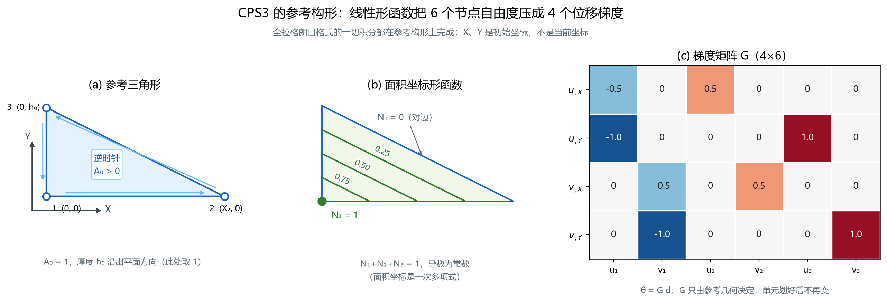
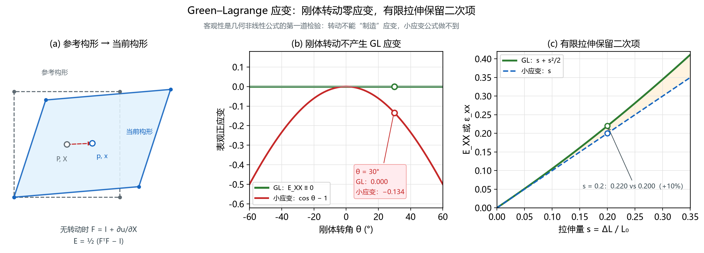
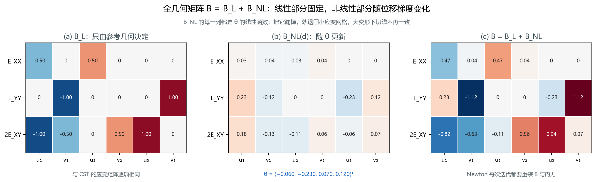
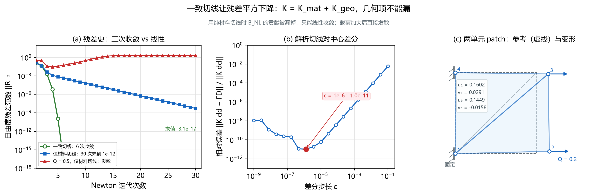

# 完全拉格朗日格式：CPS3 的公式推导与离散化

> 对应知识图谱节点：`M6-10`
>
> 前置：[有限元编程基础](fem-programming/README.md)（形函数、B 矩阵、组装与 Newton 迭代）、[单元类型](element-types.md)（CPS3 与平面应力）
>
> 相关：[变分近似](variational-approximation.md)（虚功与弱形式）、[雅可比矩阵](jacobian-and-mapping.md)（局部线性化）
>
> 原始推文：《完全拉格朗日格式的求解流程（一）：公式推导与离散化》，公众号「仿真札记」，2026-11-16（链接见文末来源）

---

## 0. 结论先行

1. **完全拉格朗日（Total Lagrangian，TL）** 不是一种材料模型，而是一种**描述方式**：所有积分、导数和构形都在初始构形上取，未知量仍然是当前位移。材料可以线弹性，也可以超弹性；几何非线性来自应变度量与平衡方程，而不是来自"材料变复杂了"。
2. CPS3 是三节点平面应力三角形。它的形函数是线性的，因此**位移梯度在单元内是常数**：位移梯度 $\theta$ 由 6 个节点位移线性映射得到，映射矩阵 $\mathbf{G}$ 只由参考几何决定。
3. 几何非线性全部藏在两个地方：Green–Lagrange 应变

$$
\mathbf{E}=\frac{1}{2}(\mathbf{F}^{\mathsf T}\mathbf{F}-\mathbf{I})
$$

   与应变–位移矩阵的分解

$$
\mathbf{B}=\mathbf{B}_L+\mathbf{B}_{NL}(\mathbf{d})
$$

   其中线性部分 $\mathbf{B}\_L$ 与常应变三角形（CST）逐项相同，非线性部分随当前位移梯度变化。
4. 平面应力 St. Venant–Kirchhoff 材料写作 $\mathbf{S}=\mathbf{C}\mathbf{E}$。若应变向量第三项取**工程剪应变** $\gamma\_{XY}=2E\_{XY}$，则弹性矩阵的剪切项是 $G=E/[2(1+\nu)]$；若取**张量剪应变** $E\_{XY}$，同一位置要写 $2G$。混用会让剪切刚度差一倍，是这类代码最常见的错误（图 49）。
5. 单元内力由虚功得到：

$$
\mathbf{f}_{\mathrm{int}}=V_0\mathbf{B}^{\mathsf T}\mathbf{S}
$$

   切线刚度分两项：

$$
\mathbf{K}=V_0\mathbf{B}^{\mathsf T}\mathbf{C}\mathbf{B}
+V_0\mathbf{G}^{\mathsf T}\mathbf{M}\mathbf{G}
=\mathbf{K}_{\mathrm{mat}}+\mathbf{K}_{\mathrm{geo}}
$$

   第一项是材料刚度，第二项是几何刚度。**漏掉几何刚度，Newton 迭代退化为线性收敛，载荷稍大就发散**（图 50）。
6. 客观性检验是最好用的一道闸门：刚体转动 30°，Green–Lagrange 应变的最大分量是 $2.8\times 10^{-17}$，而小应变公式给出 $-0.133975$。后者会把"纯转动"误判成 13 % 的压缩（图 48）。
7. 适用范围：St. Venant–Kirchhoff 适合**小应变、大转动**（例如橡胶的小应变剪切、岩土的卸荷回弹、结构的几何失稳）。它不适合拉伸超过 10 % 量级的问题：应力会非物理地持续增大，某些变形模式下还会软化。CPS3 是常应变单元，弯曲问题需要加密网格或改用更高阶单元。
8. 本文的参考实现是 [`tools/tl_cps3_lib.py`](../../tools/tl_cps3_lib.py)，全部数字由 [`tools/verify_tl_cps3.py`](../../tools/verify_tl_cps3.py) 复算，末尾打印 `ALL CHECKS PASSED`。

---

## 1. 前提与符号

### 1.1 两种拉格朗日描述

大变形有限元有两种记账方式：

| 项目 | 完全拉格朗日（TL） | 更新拉格朗日（UL） |
|---|---|---|
| 参考构形 | 初始构形，固定不变 | 上一个收敛增量步的构形 |
| 自变量 | 初始坐标 $X$ | 当前坐标 $x$ |
| 应变度量 | Green–Lagrange 应变 $E$ | 增量应变（如对数应变率） |
| 应力度量 | 第二类 Piola–Kirchhoff 应力 $S$ | Cauchy 应力 $\sigma$ |
| 积分域 | 始终是初始体积 $V\_0$ | 每步更新为当前体积 |
| 优点 | 参考几何只算一次；能量形式干净 | 本构直接接 Cauchy 应力；适合路径相关材料 |
| 缺点 | 大拉伸时 $S$ 的物理意义不直观；本构要换成率形式 | 每步都要更新几何与形函数导数 |

本文选 TL，是因为它把"几何非线性"与"材料非线性"分得最清楚：即使材料是线弹性的，只要应变度量是 Green–Lagrange，几何非线性就已经完整存在。教学上先看这一层，再看塑性、损伤与接触，不会把两个来源混在一起。

### 1.2 参考构形与当前构形

用一个二维三角形说明。参考构形中的点是 $X=(X,Y)$，当前构形中的点是 $x=(x,y)$，位移是

$$
\mathbf{u}(X)=\mathbf{x}(X)-X
$$

在 TL 中，形函数、导数、积分点全部用 $X$ 表示；当前构形只在计算变形梯度 $\mathbf{F}$ 时出现。这一点与"把网格跟着变形走"的 UL 完全不同。

### 1.3 CPS3 的几何与形函数

CPS3 是 3 节点、每个节点 2 个平动自由度的平面应力三角形。节点必须**逆时针**编号，参考面积为正：

$$
A_0=\frac{1}{2}\left[(X_2-X_1)(Y_3-Y_1)-(X_3-X_1)(Y_2-Y_1)\right]
$$

面积坐标为

$$
N_a(X,Y)=\frac{a_a+b_aX+c_aY}{2A_0},\qquad a=1,2,3
$$

其中

$$
b_1=Y_2-Y_3,\quad b_2=Y_3-Y_1,\quad b_3=Y_1-Y_2
$$

$$
c_1=X_3-X_2,\quad c_2=X_1-X_3,\quad c_3=X_2-X_1
$$

形函数对参考坐标的导数是常数：

$$
N_{a,X}=\frac{b_a}{2A_0},\qquad N_{a,Y}=\frac{c_a}{2A_0}
$$

这就是"常应变三角形"的来源：位移是 $X,Y$ 的一次函数，一阶导数不变，应变在单元内不变。几何非线性不会改变这一点：$\mathbf{B}$ 仍然在单元内为常数，只是这个常数随当前位移更新。

> 图 47：(a) 参考三角形与节点编号；(b) 面积坐标形函数的等值线，导数为常数；
> (c) 位移梯度映射矩阵 $\mathbf{G}$，4 行 6 列，只由参考几何决定。
>
> 读图要点：CPS3 只有 6 个节点自由度，却被压缩成 4 个位移梯度分量。
> 这个"6 到 4"的映射是后面所有公式的起点。
>
> 文件：`assets/figures/fig47-cps3-geometry.png`，由 `tools/make_figures.py` 生成。

### 1.4 符号表

| 符号 | 含义 | 维度 |
|---|---|---|
| $\mathbf{d}$ | 单元节点位移向量 | 6×1 |
| $\theta$ | 位移梯度 $[u\_{,X},u\_{,Y},v\_{,X},v\_{,Y}]^{\mathsf T}$ | 4×1 |
| $\mathbf{G}$ | 位移梯度映射，$\theta=\mathbf{G}\mathbf{d}$ | 4×6 |
| $\mathbf{F}$ | 变形梯度 $\mathbf{I}+\partial\mathbf{u}/\partial X$ | 2×2 |
| $\mathbf{E}$ | Green–Lagrange 应变，Voigt 记为 $[E\_{XX},E\_{YY},\gamma\_{XY}]^{\mathsf T}$ | 3×1 |
| $\mathbf{S}$ | 第二类 Piola–Kirchhoff 应力，Voigt 记为 $[S\_{XX},S\_{YY},S\_{XY}]^{\mathsf T}$ | 3×1 |
| $\mathbf{C}$ | 平面应力材料矩阵 | 3×3 |
| $\mathbf{B}$ | 应变–位移矩阵，$\delta\mathbf{E}=\mathbf{B}\delta\mathbf{d}$ | 3×6 |
| $\mathbf{B}\_L$ | $\mathbf{B}$ 中与位移无关的部分（CST 矩阵） | 3×6 |
| $\mathbf{B}\_{NL}$ | $\mathbf{B}$ 中随 $\theta$ 变化的部分 | 3×6 |
| $\mathbf{K}\_{\mathrm{mat}}$ | 材料切线刚度 | 6×6 |
| $\mathbf{K}\_{\mathrm{geo}}$ | 几何切线刚度 | 6×6 |
| $V\_0$ | 参考体积，二维取 $A\_0h\_0$ | 标量 |

### 1.5 假设与失效模式

1. **二维平面应力**：假设 $S\_{ZZ}=0$。注意这不等于 $E\_{ZZ}=0$；厚度方向可以自由收缩，后面的 §2.4 会算它。若真实结构厚度方向受约束（例如长坝段、隧道衬砌），应该用平面应变。
2. **小应变、大转动**：St. Venant–Kirchhoff 的能量是应变的二次函数，适合应变在几个百分点以内的情形。拉伸 20 % 时它仍能算，但应力–应变曲线已经不代表真实橡胶或金属。
3. **恒定厚度**：CPS3 的厚度是输入常数。若 $E\_{ZZ}$ 引起明显厚度变化，体积与压力载荷会受影响；需要精确更新厚度时，应改用壳或三维单元。
4. **死载荷**：本文的外力 $\mathbf{f}\_{\mathrm{ext}}$ 不随变形转动。压力随法向转动的问题需要额外的载荷刚度项，本文不展开。
5. **单一材料、无接触**：材料均匀，单元之间共节点。接触、摩擦与多材料界面属于另一层，不改变本文的 $\mathbf{B}$ 与 $\mathbf{K}$ 结构。

---

## 2. 推导

### 2.1 从节点位移到位移梯度

单元内的位移用形函数插值：

$$
u(X,Y)=\sum_{a=1}^{3}N_a(X,Y)u_a,\qquad
v(X,Y)=\sum_{a=1}^{3}N_a(X,Y)v_a
$$

对 $X,Y$ 求导，利用 $N\_a$ 导数在单元内为常数：

$$
u_{,X}=\sum_{a=1}^{3}N_{a,X}u_a,\qquad
u_{,Y}=\sum_{a=1}^{3}N_{a,Y}u_a
$$

对 $v$ 同理。把四个导数按 $[u\_{,X},u\_{,Y},v\_{,X},v\_{,Y}]^{\mathsf T}$ 排成向量 $\theta$，就得到

$$
\theta=\mathbf{G}\mathbf{d}
$$

其中

$$
\mathbf{G}=
\begin{bmatrix}
N_{1,X} & 0 & N_{2,X} & 0 & N_{3,X} & 0\\
N_{1,Y} & 0 & N_{2,Y} & 0 & N_{3,Y} & 0\\
0 & N_{1,X} & 0 & N_{2,X} & 0 & N_{3,X}\\
0 & N_{1,Y} & 0 & N_{2,Y} & 0 & N_{3,Y}
\end{bmatrix}
$$

**这一步只做了一件事：把"对坐标求导"换成"对节点位移乘常数矩阵"。** 因为形函数是线性的，$\mathbf{G}$ 不含 $X,Y$，也不含当前位移，所以它在整个分析中只组装一次。后面所有几何非线性都通过 $\theta$ 进入，而不是通过重新计算 $\mathbf{G}$。

### 2.2 变形梯度与 Green–Lagrange 应变

变形梯度定义为

$$
\mathbf{F}=\mathbf{I}+\frac{\partial\mathbf{u}}{\partial\mathbf{X}}
=
\begin{bmatrix}
1+u_{,X} & u_{,Y}\\
v_{,X} & 1+v_{,Y}
\end{bmatrix}
$$

它把参考构形中的一根线元 $\mathrm{d}\mathbf{X}$ 映到当前构形的 $\mathrm{d}\mathbf{x}=\mathbf{F}\mathrm{d}\mathbf{X}$。长度平方的变化是

$$
\mathrm{d}\mathbf{x}\cdot\mathrm{d}\mathbf{x}-\mathrm{d}\mathbf{X}\cdot\mathrm{d}\mathbf{X}
=\mathrm{d}\mathbf{X}^{\mathsf T}(\mathbf{F}^{\mathsf T}\mathbf{F}-\mathbf{I})\mathrm{d}\mathbf{X}
$$

括号里的张量就是 Green–Lagrange 应变的两倍。定义

$$
\mathbf{E}=\frac{1}{2}(\mathbf{F}^{\mathsf T}\mathbf{F}-\mathbf{I})
$$

它只依赖 $\mathbf{F}^{\mathsf T}\mathbf{F}$，因此**对刚体转动不敏感**：若 $\mathbf{F}=\mathbf{R}$ 是正交阵，则 $\mathbf{R}^{\mathsf T}\mathbf{R}=\mathbf{I}$，应变为零。这一点在 §3.3 用 30° 转动做了数值核对。

把分量写开。记四个位移梯度为

$$
\theta_1=u_{,X},\quad \theta_2=u_{,Y},\quad \theta_3=v_{,X},\quad \theta_4=v_{,Y}
$$

则

$$
E_{XX}=\theta_1+\frac{1}{2}(\theta_1^2+\theta_3^2)
$$

$$
E_{YY}=\theta_4+\frac{1}{2}(\theta_2^2+\theta_4^2)
$$

$$
\gamma_{XY}=2E_{XY}
=\theta_2+\theta_3+\theta_1\theta_2+\theta_3\theta_4
$$

前两项各有一个"线性项 + 二次项"。二次项不是修正项：当 $\theta$ 达到 0.1 时，它贡献 0.005 的应变，相当于 5 % 的相对误差；当 $\theta$ 达到 0.3 时，贡献 0.045，已经与小应变本身同量级。**判断能否用小应变，不能只看位移大小，要看位移梯度的平方是否可忽略。**

> 图 48：(a) 参考构形到当前构形的映射，$\mathbf{F}=\mathbf{I}+\partial\mathbf{u}/\partial X$；
> (b) 刚体转动 60° 范围内 GL 应变恒为零，小应变公式给出 $\cos\theta-1$；
> (c) 单轴拉伸下 GL 应变是 $s+s^2/2$，小应变只保留 $s$。
>
> 读图要点：客观性不是"精度高低"的问题，而是"是否把转动误认为变形"的问题。
> 30° 转动时小应变公式的假压缩达到 13.4 %，这已经不能用"近似"解释。
>
> 文件：`assets/figures/fig48-green-lagrange.png`，由 `tools/make_figures.py` 生成。

### 2.3 应变–位移矩阵 B

虚功需要应变的变化量。对 $\mathbf{E}(\mathbf{d})$ 取微分：

$$
\delta\mathbf{E}=\frac{\partial\mathbf{E}}{\partial\mathbf{d}}\delta\mathbf{d}
=\mathbf{B}\delta\mathbf{d}
$$

因为 $\mathbf{E}$ 对 $\mathbf{d}$ 是二次的，$\mathbf{B}$ 对 $\mathbf{d}$ 是线性的。逐行求导，按节点 $a$ 分块：

$$
\mathbf{B}_a=
\begin{bmatrix}
(1+u_{,X})N_{a,X} & v_{,X}N_{a,X}\\
u_{,Y}N_{a,Y} & (1+v_{,Y})N_{a,Y}\\
(1+u_{,X})N_{a,Y}+u_{,Y}N_{a,X} & v_{,X}N_{a,Y}+(1+v_{,Y})N_{a,X}
\end{bmatrix}
$$

把 $1$ 与位移梯度分开：

$$
\mathbf{B}_{L,a}=
\begin{bmatrix}
N_{a,X} & 0\\
0 & N_{a,Y}\\
N_{a,Y} & N_{a,X}
\end{bmatrix}
$$

$$
\mathbf{B}_{NL,a}=
\begin{bmatrix}
u_{,X}N_{a,X} & v_{,X}N_{a,X}\\
u_{,Y}N_{a,Y} & v_{,Y}N_{a,Y}\\
u_{,X}N_{a,Y}+u_{,Y}N_{a,X} & v_{,X}N_{a,Y}+v_{,Y}N_{a,X}
\end{bmatrix}
$$

于是

$$
\mathbf{B}=\mathbf{B}_L+\mathbf{B}_{NL}(\mathbf{d})
$$

**线性部分就是小应变 CST 的 B 矩阵**，它只认参考几何；非线性部分每一列都是 $\theta$ 的线性组合，随当前位移更新。三行分别对应 $E\_{XX}$、$E\_{YY}$ 与 $\gamma\_{XY}$，第三行的两项容易漏：$u\_{,Y}N\_{a,X}$ 来自 $\theta\_1\theta\_2$ 对 $u\_a$ 的求导，$v\_{,Y}N\_{a,X}$ 来自 $\theta\_3\theta\_4$ 对 $v\_a$ 的求导。

> 图 49：同一单元、同一变形状态下三张热图：(a) $\mathbf{B}\_L$ 只含参考几何；
> (b) $\mathbf{B}\_{NL}(\mathbf{d})$ 随位移梯度变化；(c) $\mathbf{B}=\mathbf{B}\_L+\mathbf{B}\_{NL}$。
>
> 读图要点：$\mathbf{B}\_{NL}$ 的数值通常比 $\mathbf{B}\_L$ 小一个量级，
> 但它在 Newton 迭代中决定切线是否一致；不能"先按小应变算，最后再加修正"。
>
> 文件：`assets/figures/fig49-B-matrix.png`，由 `tools/make_figures.py` 生成。

### 2.4 平面应力 St. Venant–Kirchhoff 材料

St. Venant–Kirchhoff 材料假设应变能密度是应变的二次函数：

$$
W=\frac{1}{2}\mathbf{E}:\mathbb{C}:\mathbf{E}
$$

对应力取偏导：

$$
\mathbf{S}=\frac{\partial W}{\partial\mathbf{E}}
=\mathbb{C}:\mathbf{E}
$$

平面应力下 $S\_{ZZ}=0$，消去法向应变后，面内关系仍可写成

$$
\mathbf{C}=\frac{E}{1-\nu^2}
\begin{bmatrix}
1 & \nu & 0\\
\nu & 1 & 0\\
0 & 0 & (1-\nu)/2
\end{bmatrix}
$$

这里的应变向量是 $[E\_{XX},E\_{YY},\gamma\_{XY}]^{\mathsf T}$，应力向量是 $[S\_{XX},S\_{YY},S\_{XY}]^{\mathsf T}$。第三项配对的是**工程剪应变**，所以

$$
S_{XY}=G\gamma_{XY},\qquad G=\frac{E}{2(1+\nu)}
$$

**这是本文最需要提醒的一处口径。** 如果代码把应变向量写成 $[E\_{XX},E\_{YY},E\_{XY}]^{\mathsf T}$（张量剪应变），那么同一行必须写 $2G$，否则剪切刚度只有正确值的一半。两种写法都对，混用才错。

平面应力不等于"厚度方向没有应变"。由三维 St. Venant–Kirchhoff 关系令 $S\_{ZZ}=0$，可得

$$
E_{ZZ}=-\frac{\nu}{1-\nu}(E_{XX}+E_{YY})
$$

代入后，面内的 $\mathbf{C}$ 与上式完全一致。也就是说，这个 3×3 矩阵对 St. Venant–Kirchhoff 平面应力是**精确的**，不是小应变近似；被消去的是 $E\_{ZZ}$，不是 $S\_{ZZ}$。CPS3 不跟踪厚度变化，所以 $E\_{ZZ}$ 只影响厚度与体积，不进入面内刚度。

### 2.5 虚功与单元内力

TL 的虚功在参考构形上写：

$$
\delta W_{\mathrm{int}}
=\int_{V_0}\mathbf{S}:\delta\mathbf{E}\ \mathrm{d}V_0
$$

对 CPS3，$\mathbf{B}$ 与 $\mathbf{S}$ 在单元内为常数，积分退化为乘法：

$$
\delta W_{\mathrm{int}}
=V_0\mathbf{S}:\delta\mathbf{E}
=V_0\mathbf{S}^{\mathsf T}\mathbf{B}\delta\mathbf{d}
=\mathbf{f}_{\mathrm{int}}^{\mathsf T}\delta\mathbf{d}
$$

因此

$$
\mathbf{f}_{\mathrm{int}}=V_0\mathbf{B}^{\mathsf T}\mathbf{S}
$$

这一步没有假设小变形：$\mathbf{S}$ 是第二类 Piola–Kirchhoff 应力，$\mathbf{E}$ 是 Green–Lagrange 应变，两者在参考构形上功共轭。若换成 Cauchy 应力，积分域与应力度量都要跟着换，不能直接套这个式子。

平衡条件是残量为零：

$$
\mathbf{R}(\mathbf{d})=\mathbf{f}_{\mathrm{ext}}-\mathbf{f}_{\mathrm{int}}(\mathbf{d})=\mathbf{0}
$$

### 2.6 切线刚度：材料项与几何项

对内力求导：

$$
\mathbf{K}=\frac{\partial\mathbf{f}_{\mathrm{int}}}{\partial\mathbf{d}}
=V_0\frac{\partial}{\partial\mathbf{d}}\left(\mathbf{B}^{\mathsf T}\mathbf{S}\right)
$$

乘积法则给出两项：

$$
\mathbf{K}=V_0\mathbf{B}^{\mathsf T}\mathbf{C}\mathbf{B}
+V_0\left(\frac{\partial\mathbf{B}^{\mathsf T}}{\partial\mathbf{d}}\mathbf{S}\right)
$$

第一项是材料刚度：

$$
\mathbf{K}_{\mathrm{mat}}=V_0\mathbf{B}^{\mathsf T}\mathbf{C}\mathbf{B}
$$

它用的是**当前**的 $\mathbf{B}$，因此已经包含 $\mathbf{B}\_{NL}$ 的贡献；"只算材料项"不等于"退回小应变"。

第二项是几何刚度。因为 $\mathbf{B}\_{NL}$ 对 $\mathbf{d}$ 线性，$\partial\mathbf{B}^{\mathsf T}/\partial\mathbf{d}$ 是常数；把 $\theta=\mathbf{G}\mathbf{d}$ 代进去，可以得到一个非常紧凑的形式：

$$
\mathbf{K}_{\mathrm{geo}}=V_0\mathbf{G}^{\mathsf T}\mathbf{M}\mathbf{G}
$$

其中 $\mathbf{M}$ 是 $4\times 4$ 的分块矩阵：

$$
\mathbf{M}=
\begin{bmatrix}
S_{XX} & S_{XY} & 0 & 0\\
S_{XY} & S_{YY} & 0 & 0\\
0 & 0 & S_{XX} & S_{XY}\\
0 & 0 & S_{XY} & S_{YY}
\end{bmatrix}
$$

也就是两个相同的 $2\times 2$ 块 $\mathbf{S}\_0$ 放在对角线上：

$$
\mathbf{S}_0=
\begin{bmatrix}
S_{XX} & S_{XY}\\
S_{XY} & S_{YY}
\end{bmatrix}
$$

**用一个分量核对这个形式。** 取 $u\_a$ 与 $u\_b$ 两个自由度。由 §2.3，$\mathbf{B}$ 的三行对 $u\_b$ 的导数分别是

$$
N_{b,X}N_{a,X},\qquad N_{b,Y}N_{a,Y},\qquad
N_{b,X}N_{a,Y}+N_{b,Y}N_{a,X}
$$

乘上对应的应力并求和：

$$
K_{\mathrm{geo}}^{u_au_b}=V_0\left[
S_{XX}N_{a,X}N_{b,X}
+S_{YY}N_{a,Y}N_{b,Y}
+S_{XY}(N_{a,X}N_{b,Y}+N_{a,Y}N_{b,X})
\right]
$$

把右边写成矩阵，正好是

$$
V_0
\begin{bmatrix}N_{a,X} & N_{a,Y}\end{bmatrix}
\mathbf{S}_0
\begin{bmatrix}N_{b,X}\\ N_{b,Y}\end{bmatrix}
$$

与 $\mathbf{G}^{\mathsf T}\mathbf{M}\mathbf{G}$ 的第 $(u\_a,u\_b)$ 项一致。其他三个块同理；$u$ 与 $v$ 的交叉块为零，因为 $\mathbf{M}$ 不与 $\theta\_1,\theta\_2$ 和 $\theta\_3,\theta\_4$ 交叉耦合。

几何刚度有三个性质值得记住：

- **应力为零时为零**。参考构形无应力，$\mathbf{K}\_{\mathrm{geo}}=\mathbf{0}$，切线退化为材料项。数值核对见 §3.5。
- **压应力会软化，拉应力会刚化**。这不是"数值不稳定"，而是几何非线性的物理内容：受压构件在侧向变形时会失去刚度，最终对应屈曲。
- **它使切线保持对称**。$\mathbf{M}$ 对称，$\mathbf{G}^{\mathsf T}\mathbf{M}\mathbf{G}$ 对称；若材料切线也对称，整体切线对称。若采用了非对称的本构（如某些摩擦或损伤模型），才需要非对称求解器。

### 2.7 Newton–Raphson 流程

平衡方程是非线性的，用 Newton 迭代求解：

1. 以当前位移 $\mathbf{d}$ 组装 $\mathbf{B}$、$\mathbf{S}$ 与内力 $\mathbf{f}\_{\mathrm{int}}$。
2. 计算残量 $\mathbf{R}=\mathbf{f}\_{\mathrm{ext}}-\mathbf{f}\_{\mathrm{int}}$。若范数小于容差，收敛，退出。
3. 组装切线 $\mathbf{K}=\mathbf{K}\_{\mathrm{mat}}+\mathbf{K}\_{\mathrm{geo}}$。
4. 解线性方程 $\mathbf{K}\Delta\mathbf{d}=\mathbf{R}$。
5. 更新 $\mathbf{d}\leftarrow\mathbf{d}+\Delta\mathbf{d}$，回到第 1 步。

写成公式是

$$
\mathbf{R}(\mathbf{d})=\mathbf{f}_{\mathrm{ext}}-\mathbf{f}_{\mathrm{int}}(\mathbf{d})
$$

$$
\mathbf{K}(\mathbf{d})\Delta\mathbf{d}=\mathbf{R},\qquad
\mathbf{d}\leftarrow\mathbf{d}+\Delta\mathbf{d}
$$

**"一致切线"指的就是第 3 步必须包含 $\mathbf{K}\_{\mathrm{geo}}$，并且 $\mathbf{B}$ 必须用当前位移。** 若只用 $\mathbf{K}\_{\mathrm{mat}}$，残差不再按平方下降；若连 $\mathbf{B}\_{NL}$ 也漏掉，等于每一步都在解小应变问题，收敛解本身就不对。

> 图 50：(a) 一致切线与仅材料切线的残差史；载荷 0.5 时仅材料切线发散；
> (b) 解析切线对中心差分的相对误差，最小点约为 $10^{-11}$；
> (c) 两单元 patch 的参考构形与变形构形。
>
> 读图要点：一致切线在 6 次迭代内把残差从 $10^{-1}$ 降到 $10^{-17}$；
> 仅材料切线 30 次仍停在 $10^{-9}$。这不是"多迭代几次"的问题，而是收敛阶的不同。
>
> 文件：`assets/figures/fig50-tangent-newton.png`，由 `tools/make_figures.py` 生成。

### 2.8 能量与客观性核对

均匀拉伸状态取 $u=sX$、$v=0$，则

$$
E_{XX}=s+\frac{s^2}{2},\qquad E_{YY}=0,\qquad \gamma_{XY}=0
$$

应力为

$$
S_{XX}=\frac{E}{1-\nu^2}\left(E_{XX}+\nu E_{YY}\right),\qquad
S_{YY}=\nu S_{XX}
$$

取 $s=0.2$、$E=70$ GPa、$\nu=0.33$，得到 $E\_{XX}=0.22$、$S\_{XX}=17.2820$ GPa、$S\_{YY}/S\_{XX}=0.33$、应变能密度 $W=1901.0212$ MJ/m³。这些数字在 §3.4 复算。

能量核对用虚功恒等式：

$$
\mathbf{f}_{\mathrm{int}}\cdot\delta\mathbf{d}
=V_0\mathbf{S}:\delta\mathbf{E}
$$

在均匀拉伸状态下，取 $\delta\mathbf{d}$ 与 $\mathbf{d}$ 成比例，左右两边应逐位相等。脚本核对的比值是 1.000000，相对偏差小于 $10^{-13}$。若 $\mathbf{B}$ 的某一行漏项，这个恒等式会立刻破掉，比逐个分量对公式更快。

---

## 3. 数值检验

全部数字由 `py -3 tools/verify_tl_cps3.py` 复算，末尾打印 `ALL CHECKS PASSED`。参考单元取右手三角形 $(0,0)$、$(2,0)$、$(0,1)$，$A\_0=1$、$V\_0=0.5$、$h\_0=1$。

### 3.1 几何与形函数

| 检查项 | 结果 |
|---|---|
| 参考面积 $A\_0$ | 1.000000 |
| 参考体积 $V\_0$ | 0.500000 |
| 三个形函数之和 | 与 1 的偏差小于 $10^{-14}$ |
| $N\_{a,X}$ | $[-0.5,0.5,0]$ |
| $N\_{a,Y}$ | $[-1,0,1]$ |

### 3.2 B 矩阵的自洽性

| 检查项 | 结果 |
|---|---|
| $\mathbf{B}(\mathbf{d}=\mathbf{0})$ 与 $\mathbf{B}\_L$ 的最大差 | 0 |
| 有限差分 $\partial\mathbf{E}/\partial\mathbf{d}$ 与 $\mathbf{B}$ 的最大差 | $1.19\times 10^{-10}$ |
| 差分步长 | $10^{-7}$ |

第二项用中心差分独立计算应变对位移的导数，再与解析 $\mathbf{B}$ 比较。两者一致，说明 §2.3 的三行没有漏项。

### 3.3 客观性：刚体转动 30°

| 量 | 数值 |
|---|---|
| Green–Lagrange 应变最大分量 | $2.78\times 10^{-17}$ |
| 小应变公式的 $E\_{XX}$ | $-0.133975$ |
| 理论值 $\cos 30^\circ-1$ | $-0.133975$ |

GL 应变在机器精度内为零；小应变公式把纯转动误判为 13.4 % 的压缩。这一条检验不需要任何材料参数，是几何非线性代码的第一道闸门。

### 3.4 均匀拉伸状态

| 量 | 数值 |
|---|---|
| $s$ | 0.2 |
| $E\_{XX}=s+s^2/2$ | 0.220000 |
| $S\_{XX}$ | 17.2820 GPa |
| $S\_{YY}/S\_{XX}$ | 0.33 |
| 节点内力之和 | 0（机器精度） |
| 虚功比值 | 1.000000 |
| 应变能密度 $W$ | 1901.0212 MJ/m³ |

节点内力之和为零，说明单元在均匀状态下自平衡；虚功比值为 1，说明 $\mathbf{f}\_{\mathrm{int}}=V\_0\mathbf{B}^{\mathsf T}\mathbf{S}$ 与能量路径一致。

### 3.5 切线刚度

取一个有限变形状态，用中心差分核对解析切线。三组算例的位移幅值不同，位移方向与差分方向都由固定随机种子生成。

| 组别 | 位移梯度范数 | 相对误差 |
|---|---|---|
| 1 | 约 0.04 | $1.63\times 10^{-10}$ |
| 2 | 约 0.03 | $1.99\times 10^{-12}$ |
| 3 | 约 0.12 | $2.96\times 10^{-11}$ |
| 切线对称性 $\lvert K\_{ij}-K\_{ji}\rvert$ | —— | 小于 $10^{-12}$ |
| 零应力时 $\mathbf{K}\_{\mathrm{geo}}$ 的范数 | —— | 0 |

### 3.6 Newton 收敛与 patch 检验

两单元正方形 patch、左边界固定、右边界受均布拉力 $Q$。材料 $E=1$、$\nu=0.3$，单位为无量纲。

| 迭代 | 一致切线残差 | 仅材料切线残差 |
|---|---|---|
| 1 | $1.41\times 10^{-1}$ | $1.41\times 10^{-1}$ |
| 2 | $4.53\times 10^{-2}$ | $4.53\times 10^{-2}$ |
| 3 | $2.03\times 10^{-3}$ | $4.58\times 10^{-3}$ |
| 4 | $6.99\times 10^{-6}$ | $1.27\times 10^{-3}$ |
| 5 | $1.12\times 10^{-10}$ | $6.97\times 10^{-4}$ |
| 6 | $3.13\times 10^{-17}$ | $4.33\times 10^{-4}$ |
| 30 | —— | $5.23\times 10^{-9}$ |

一致切线的残差按平方下降：每步大约把上一步的残差平方再乘一个常数。仅材料切线的残差近似按固定比例下降，30 次仍未到 $10^{-12}$。把载荷从 0.2 加到 0.5，仅材料切线直接发散，残差停在 2.10 附近。

载荷 0.2 时右边界节点的位移是：下节点 $u=0.160188$、上节点 $u=0.144902$、上节点 $v=-0.015833$。下节点还有 $v=0.029050$。上下节点的 $u$ 不相等，是因为两个三角形的斜边方向不同，右边界并不是均匀应变状态；这不是程序错误。

---

## 4. 常见误解

**误解 1：TL 是一种材料非线性。**
TL 只是"在初始构形上记账"的描述方式。材料完全可以线弹性：本文的 St. Venant–Kirchhoff 就是超弹性材料，但它的几何非线性来自 Green–Lagrange 应变与参考构形上的平衡。把 TL 当成"材料变复杂"，会在只需要几何非线性的问题上过度设计本构。

**误解 2：小应变公式加一个大转动矩阵就够了。**
先算小应变再叠加转动，等价于把转动从变形中"事后扣掉"，但小应变本身已经在转动中产生了假应变。30° 转动时假压缩是 13.4 %；先产生再扣除，不能恢复为零。正确做法是从一开始就用 $\mathbf{F}^{\mathsf T}\mathbf{F}$ 度量长度变化。

**误解 3：$\mathbf{B}\_{NL}$ 可以最后再加。**
$\mathbf{B}\_{NL}$ 随当前位移变化，必须在每次 Newton 迭代中重新组装。若先按 $\mathbf{B}\_L$ 算到底，再把 $\mathbf{B}\_{NL}$ 当修正项加一次，得到的不是同一个非线性问题的解；充其量是一次初值修正。

**误解 4：几何刚度只是小修正，可以忽略。**
在压应力下 $\mathbf{K}\_{\mathrm{geo}}$ 会抵消材料刚度，接近屈曲时它主导整个切线。忽略它不只是"收敛慢"：在屈曲附近，材料切线给出完全错误的方向，迭代可能收敛到非物理的解，或者直接发散。本文的 patch 在 $Q=0.5$ 时就是这个下场。

**误解 5：平面应力就是厚度方向应变为零。**
平面应力是 $S\_{ZZ}=0$，厚度方向可以自由收缩；平面应变才是 $E\_{ZZ}=0$。本文的 St. Venant–Kirchhoff 平面应力中，$E\_{ZZ}=-\nu(E\_{XX}+E\_{YY})/(1-\nu)$，取 $\nu=0.3$、$E\_{XX}=0.22$ 时它等于 $-0.0943$，绝对不小。把平面应力当成"厚度不变"，会低估厚度变化与体积变化。

**误解 6：St. Venant–Kirchhoff 可以算任意大拉伸。**
它是超弹性的，能量正定、切线对称，数学上很干净；但它的应力随拉伸持续增大，不能描述橡胶的链段极限与金属的屈服。拉伸超过 10 % 量级时，应换成 Neo-Hookean、Mooney–Rivlin 或弹塑性模型。本文的数值算例只到 $s=0.2$，用于核对公式，不代表材料模型在该应变下仍然真实。

**误解 7：CPS3 精度低，所以没有教学价值。**
CPS3 是常应变单元，弯曲问题确实需要很多单元；但它的 $\mathbf{B}$、$\mathbf{K}\_{\mathrm{geo}}$ 与 patch 检验都可以手算，是理解 TL 的最短路径。真正做工程时，平面问题用 CPS4/CPS6，三维用 C3D8/C3D10；但那些单元的几何非线性公式与本文同构，只是多了形函数与积分点。

**误解 8：工程剪应变与张量剪应变可以混用。**
$\gamma\_{XY}=2E\_{XY}$。若应变向量用 $\gamma$，弹性矩阵的剪切项是 $G$；若用 $E\_{XY}$，同一位置是 $2G$。混用会让剪切刚度差一倍，而且不会报错，只会让位移与应力系统性偏离。检查方法：取纯剪状态，比较 $S\_{XY}$ 与 $G\gamma\_{XY}$。

---

## 5. 自测

**题 1：** 对参考三角形 $(0,0)$、$(2,0)$、$(0,1)$，写出 $\mathbf{G}$ 矩阵。若节点位移为 $\mathbf{d}=[0.1,0,0.2,0,0,0]^{\mathsf T}$，求 $\theta$ 与 $E\_{XX}$。

**题 2：** 刚体转动 90°，分别用 GL 应变与小应变公式计算 $E\_{XX}$，并解释差别。

**题 3：** 写出 $\mathbf{B}\_{NL}$ 第三行对 $u\_a$ 的表达式，并说明其中每一项来自哪个二次项。

**题 4：** 已知某状态 $\mathbf{S}\_0=\begin{bmatrix}10&2\\2&5\end{bmatrix}$ MPa，节点 $a$ 的形函数梯度为 $(N\_{a,X},N\_{a,Y})=(0.5,0)$。求 $\mathbf{K}\_{\mathrm{geo}}$ 的 $(u\_a,u\_a)$ 项（取 $V\_0=1$）。

**题 5：** 为什么仅材料切线在载荷 0.2 时还能慢慢收敛，在载荷 0.5 时却发散？用残差与切线的关系解释。

### 参考答案

**答 1：** 由 §1.3，$N\_{1,X}=-0.5$、$N\_{1,Y}=-1$、$N\_{2,X}=0.5$、$N\_{2,Y}=0$、$N\_{3,X}=0$、$N\_{3,Y}=1$。按 §2.1 的排法，

$$
\mathbf{G}=
\begin{bmatrix}
-0.5 & 0 & 0.5 & 0 & 0 & 0\\
-1 & 0 & 0 & 0 & 0 & 1\\
0 & -0.5 & 0 & 0.5 & 0 & 0\\
0 & -1 & 0 & 0 & 0 & 1
\end{bmatrix}
$$

代入 $\mathbf{d}$ 得 $\theta=[-0.05,-0.1,0.1,0]^{\mathsf T}$。于是

$$
E_{XX}=-0.05+\frac{1}{2}\left[(-0.05)^2+(0.1)^2\right]
=-0.04375
$$

注意 $E\_{XX}$ 是负的：$u$ 在 $X$ 方向缩短，同时 $v\_{,X}=0.1$ 产生正的二次项，但不足以抵消线性压缩。

**答 2：** GL 应变为零，因为 $\mathbf{F}=\mathbf{R}$ 是正交阵，$\mathbf{R}^{\mathsf T}\mathbf{R}=\mathbf{I}$。小应变公式给出 $\cos 90^\circ-1=-1$，即 100 % 的假压缩。差别来自小应变公式的线性化：它把转动的一阶项当成了应变，而 GL 用 $\mathbf{F}^{\mathsf T}\mathbf{F}$ 把转动自动消掉。

**答 3：** 第三行对 $u\_a$ 的项是

$$
u_{,X}N_{a,Y}+u_{,Y}N_{a,X}
$$

第一项来自 $\theta\_1\theta\_2$ 对 $u\_a$ 的求导：$\theta\_1=u\_{,X}$ 贡献 $N\_{a,X}$，$\theta\_2=u\_{,Y}$ 保持；第二项来自同一个二次项的另一半：$\theta\_2$ 贡献 $N\_{a,Y}$，$\theta\_1$ 保持。两项合起来正好是乘积法则，不能只写一半。

**答 4：** 由 §2.6 的分量式，

$$
K_{\mathrm{geo}}^{u_au_a}
=V_0\left(S_{XX}N_{a,X}^2
+2S_{XY}N_{a,X}N_{a,Y}
+S_{YY}N_{a,Y}^2\right)
$$

代入 $N\_{a,X}=0.5$、$N\_{a,Y}=0$、$S\_{XX}=10$ MPa、$V\_0=1$，得 $K=2.5$ MPa。若 $N\_{a,Y}\neq 0$，交叉项 $2S\_{XY}N\_{a,X}N\_{a,Y}$ 不能漏；它正是 $\mathbf{M}$ 的非对角块在起作用。

**答 5：** 仅材料切线相当于用 $\mathbf{K}\_{\mathrm{mat}}$ 近似真实切线 $\mathbf{K}\_{\mathrm{mat}}+\mathbf{K}\_{\mathrm{geo}}$。在载荷 0.2 时，几何刚度还小，近似切线仍是正定且方向大致正确，迭代像线性收敛一样慢慢逼近。载荷 0.5 时，压应力使 $\mathbf{K}\_{\mathrm{geo}}$ 足够大，真实切线接近奇异；材料切线给出的方向严重偏离，残差不再下降，最终发散。判断标准不是"迭代次数多不多"，而是"残差是否按平方下降"。

---

## 来源

- 原文：《完全拉格朗日格式的求解流程（一）：公式推导与离散化》，微信公众号「仿真札记」，2026-11-16。
  链接：[原文](https://mp.weixin.qq.com/s/vI0594vlIQejX1JZdO1Ftw)
- 本文为原文的独立改写与补充：CPS3 的几何、形函数、$\mathbf{G}$ 矩阵、$\mathbf{B}$ 矩阵逐项推导、
  St. Venant–Kirchhoff 平面应力的 $E\_{ZZ}$ 消去、$\mathbf{K}\_{\mathrm{geo}}$ 的分量核对、
  Newton 收敛数值实验与误差表均为本库新增。
- **未复制原文任何图片**。原文 6 张插图的主题与远程地址登记在
  [案例拆解](../../cases/2026-11-16-total-lagrangian-cps3.md)；
  本库图 47–图 50 由 [`tools/make_figures.py`](../../tools/make_figures.py) 生成，
  数值由 [`tools/tl_cps3_lib.py`](../../tools/tl_cps3_lib.py) 与
  [`tools/verify_tl_cps3.py`](../../tools/verify_tl_cps3.py) 复算。
- 原文版权归原作者；链接仅作引用与出处标注。