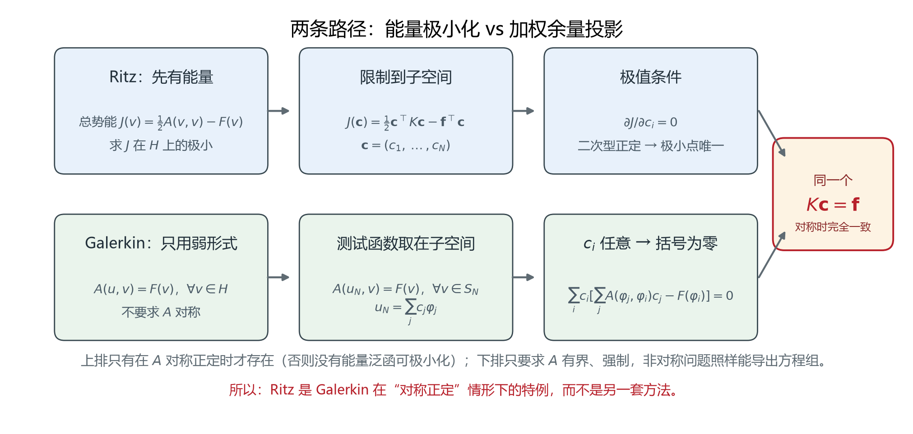
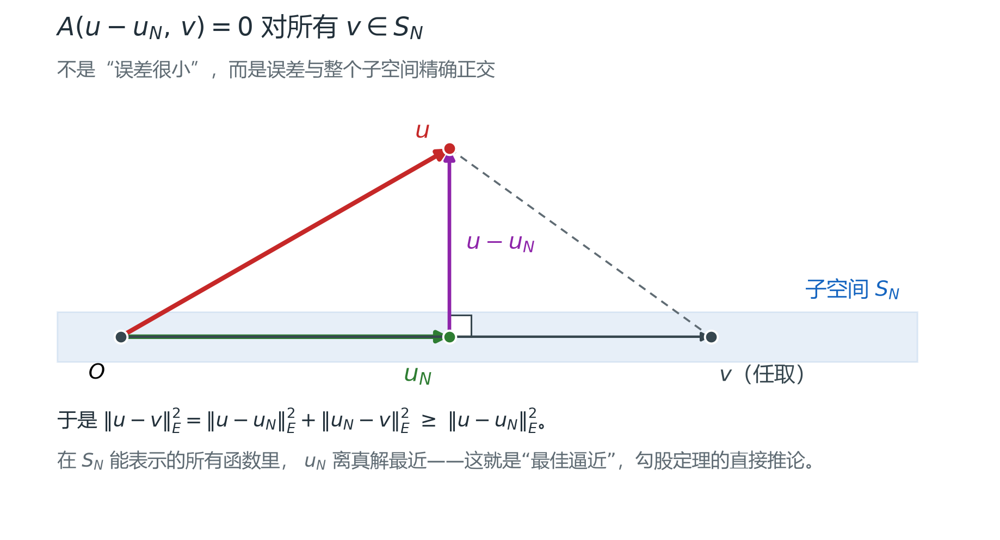
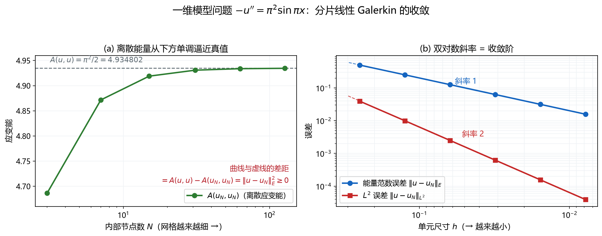
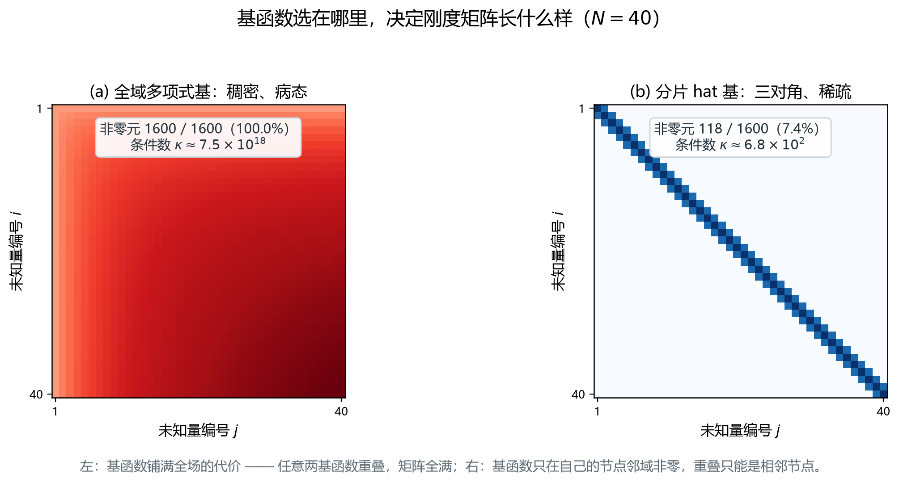

# 变分近似：Ritz、Galerkin 与正交投影

> 对应知识图谱节点：`M6-07`
>
> 前置：[有限元编程基础](fem-programming/README.md)（第 1 章的四步流程、第 3 章的组装）
>
> 相关：[雅可比矩阵](jacobian-and-mapping.md)（单元内的坐标变换，同样是"局部线性化"）
>
> 原始推文：《变分问题与变分方程的近似求解：从离散投影到现代有限元理论》（链接见文末来源）

---

## 0. 结论先行

1. 有限元方程 $K\mathbf{c}=\mathbf{f}$ **不是凑出来的**。它来自一次投影：
   把弱形式限制到一个有限维子空间上，再要求它对子空间内的每个测试函数都成立。
2. 通往同一个方程有两条路。**Ritz 法**先写出总势能 $J$，在子空间里求极小；
   **Galerkin 法**不提能量，只要求弱形式在子空间内成立。
   $A$ 对称正定时，两者给出**完全一样**的方程组。
3. 离散解 $u_N$ 是精确解 $u$ 在子空间上的**能量正交投影**：
   误差与子空间里的每个函数都正交（图 21）。
4. 由此得到**最佳逼近**：在子空间能表示的所有函数中， $u_N$ 的误差能量范数最小。
5. 由此还得到**能量恒等式** $A(u,u)-A(u_N,u_N)=\lVert u-u_N\rVert_E^2$。
   离散应变能永远**不超过**真实应变能，差多少就是误差的平方——这是"刚度偏硬"的严格含义。
6. 收敛靠"子空间越来越接近全空间"。收敛阶由基函数的次数和解的光滑性决定：
   分片线性基在能量范数下是 $O(h)$，在 $L^2$ 范数下是 $O(h^2)$。
7. 古典方法的两个死穴：全域基函数难构造、刚度矩阵稠密且病态。
   有限元的全部贡献，就是用**分片、紧支**的基函数把这两条同时解决（图 23）。

适用范围： $A$ 有界、强制（对称情形）或满足 inf-sup 条件（非对称情形）， $F$ 有界。
本文只讨论线性问题；非线性问题每一增量步内线性化后，结论逐字适用。

---

## 1. 前提与符号

### 1.1 空间与算子

设 $H$ 是 Hilbert 空间，内积 $\langle\cdot,\cdot\rangle$，范数 $\lVert\cdot\rVert$。
本节的模型问题取 $H=H_0^1(0,1)$，即一阶导数平方可积、在两端为零的函数。

给定双线性型 $A(\cdot,\cdot)$ 与线性泛函 $F(\cdot)$，并假设：

- **有界**： $|A(u,v)|\le M\lVert u\rVert\ \lVert v\rVert$；
- **对称**： $A(u,v)=A(v,u)$（非对称问题见 §2.4）；
- **强制**（椭圆性）： $A(v,v)\ge\alpha\lVert v\rVert^2$， $\alpha>0$。

强制的几何含义：能量不会在非零函数上塌到零，所以"能量最小"才有意义。

### 1.2 符号表

| 符号 | 含义 |
|---|---|
| $A(u,v)$ | 双线性型（刚度算子），对称、有界、强制 |
| $F(v)$ | 线性泛函（荷载），有界 |
| $J(v)$ | 总势能 $=\tfrac12A(v,v)-F(v)$ |
| $H$ | 精确解所在的全空间 |
| $\lbrace\varphi_i\rbrace$ | 有限元基函数（形函数），线性无关 |
| $S_N$ | 子空间 $\mathrm{span}\lbrace\varphi_i\rbrace_{i=1}^{N}$ |
| $u$ | 精确解： $A(u,v)=F(v)$ 对所有 $v\in H$ |
| $u_N$ | 离散解： $A(u_N,v)=F(v)$ 对所有 $v\in S_N$ |
| $K,\mathbf{f}$ | 刚度矩阵 $K_{ij}=A(\varphi_i,\varphi_j)$、荷载向量 $f_i=F(\varphi_i)$ |
| $\lVert\cdot\rVert_E$ | 能量范数 $\lVert v\rVert_E=\sqrt{A(v,v)}$ |

### 1.3 全文贯穿的模型问题

一维 Poisson 方程，边界齐次：

$$
-u''(x)=f(x),\quad x\in(0,1),\qquad u(0)=u(1)=0
$$

取精确解 $u(x)=\sin\pi x$，于是 $f(x)=\pi^2\sin\pi x$。选择这个算例有两个理由：

- 精确解、精确能量都能写成封闭形式，任何数值结果都能对着真值核对；
- 它是"光滑解"的最简单代表，收敛阶不会被解本身的奇性干扰。

它对应的弱形式与能量是

$$
A(u,v)=\int_0^1 u'v'\ \mathrm{d}x,\qquad
F(v)=\int_0^1 fv\ \mathrm{d}x,\qquad
J(v)=\frac12\int_0^1 (v')^2\ \mathrm{d}x-\int_0^1 fv\ \mathrm{d}x
$$

精确能量 $A(u,u)=\int_0^1\pi^2\cos^2\pi x\ \mathrm{d}x=\pi^2/2=4.9348022$。
后面所有的数值检验都围着这个数转。

---

## 2. 推导

### 2.1 第一步：把微分方程换成弱形式

取任意测试函数 $v$，满足 $v(0)=v(1)=0$，用 $v$ 乘方程两端并积分：

$$
\int_0^1(-u'')v\ \mathrm{d}x=\int_0^1 fv\ \mathrm{d}x
$$

对左端分部积分：

$$
\int_0^1(-u'')v\ \mathrm{d}x
=\underbrace{\big[-u'v\big]_0^1}_{=0}+\int_0^1 u'v'\ \mathrm{d}x
$$

边界项为零，是因为 $v$ 在两端取零（若 $u$ 的端点值已知，则是把已知值挪到右端）。
于是得到**弱形式**：

$$
\text{求 }u\in H,\ \text{使}\quad A(u,v)=F(v),\quad\forall v\in H
$$

三个要点：

1. **"弱"在哪里**：原方程要求 $u$ 二阶可导；弱形式只要求 $u'$ 平方可积。
   二阶导数被"转移"到测试函数身上——这正是能容忍折线、尖角的原因，
   也是有限元可以用分片多项式的前提。
2. **它并不更宽松**：只要 $u$ 足够光滑，弱形式与原方程等价（再分部积分一次即可倒推）。
3. **它是积分形式**：所以在每个单元上积分、再相加，是合法的——这是"组装"的全部合法性来源。

### 2.2 第二步：弱形式 = 能量最小（Ritz 的起点）

定义总势能

$$
J(v)=\frac12A(v,v)-F(v)
$$

**定理。** 若 $u$ 满足弱形式，则 $J$ 在 $H$ 上于 $u$ 取全局极小。

**证明。** 任取 $w\in H$，令 $v=u+w$。利用 $A$ 的双线性与对称性：

$$
\begin{aligned}
J(u+w)-J(u)
&=\tfrac12A(u+w,u+w)-F(u+w)-\tfrac12A(u,u)+F(u)\\
&=\tfrac12\big[A(u,u)+2A(u,w)+A(w,w)\big]-A(u,w)-\tfrac12A(u,u)\\
&=\tfrac12A(w,w)
\end{aligned}
$$

其中用到了 $F(w)=A(u,w)$（ $w$ 也是合法的测试函数）。因为 $A$ 强制，
$A(w,w)\ge\alpha\lVert w\rVert^2>0$（只要 $w\neq0$），所以

$$
J(u+w)-J(u)=\tfrac12A(w,w)>0
$$

即 $u$ 是**严格**极小点，且极小值 $J(u)=-\tfrac12A(u,u)$。

反过来，若 $u$ 使 $J$ 取极小，考察 $v=u+\varepsilon w$ 对 $\varepsilon$ 的导数：

$$
\left.\frac{\mathrm{d}}{\mathrm{d}\varepsilon}J(u+\varepsilon w)\right|_{\varepsilon=0}
=A(u,w)-F(w)=0,\quad\forall w\in H
$$

正是弱形式。**两个方向都成立**：弱形式 ⟺ 能量极小。
这就是把"解方程"翻译成"找最小值"的桥。

### 2.3 Ritz 法：把极小问题限制到子空间

既然在全空间 $H$ 里找不到，就退到有限维子空间

$$
S_N=\mathrm{span}\lbrace\varphi_1,\dots,\varphi_N\rbrace\subset H
$$

并只在这个子空间里找极小点：

$$
u_N=\sum_{j=1}^N c_j\varphi_j
$$

代回 $J$，注意 $A$ 的双线性：

$$
J(\mathbf{c})=\frac12\sum_{i=1}^N\sum_{j=1}^N A(\varphi_i,\varphi_j)c_ic_j
-\sum_{i=1}^N F(\varphi_i)c_i
=\frac12\mathbf{c}^{\mathrm T}K\mathbf{c}-\mathbf{f}^{\mathrm T}\mathbf{c}
$$

其中

$$
K_{ij}=A(\varphi_i,\varphi_j),\qquad f_i=F(\varphi_i)
$$

一个二次函数的最小值，求偏导即可：

$$
\frac{\partial J}{\partial c_i}
=\sum_{j=1}^N K_{ij}c_j-f_i=0,\qquad i=1,\dots,N
$$

写成矩阵就是

$$
K\mathbf{c}=\mathbf{f}
$$

**唯一性**： $A$ 强制 ⟹ $K$ 正定 ⟹ 二次型严格凸 ⟹ 极小点唯一。
（这一步常被略过，但它决定了"解线性方程组"能不能替代"求极小"。）

### 2.4 Galerkin 法：不提能量，只用弱形式

Ritz 法有个隐藏前提：**必须有能量泛函**。而能量泛函存在，要求 $A$ 对称。
流体对流项、孔压耦合中的非对称项，都让这个前提不成立。
Galerkin 法绕开它，直接从弱形式出发：

$$
\text{求 }u_N\in S_N,\ \text{使}\quad A(u_N,v)=F(v),\quad\forall v\in S_N
$$

取 $v=\varphi_i$（ $N$ 个方程），代入 $u_N$ 的展开：

$$
\sum_{j=1}^N A(\varphi_j,\varphi_i)c_j=F(\varphi_i),\qquad i=1,\dots,N
$$

这就是同一个 $K\mathbf{c}=\mathbf{f}$，只是**推导过程不看能量**。
注意这里用到了" $c_i$ 任意"：把 $v=\sum_i c_i\varphi_i$ 代入后得到
$\sum_i c_i\big[\cdots\big]=0$，因为每个 $c_i$ 都可以独立变动，括号必须为零。

**两法的关系。**

- $A$ 对称时：Ritz 的驻值条件 $\partial J/\partial c_i=0$ 逐字就是 $A(u_N,\varphi_i)=F(\varphi_i)$，
  两法给出同一个方程组。
- $A$ 非对称时：可以人为把 $A$ 对称化成 $\tfrac12(A+A^{\mathsf T})$ 再套 Ritz，
  但那时求的是"另一个问题"的解，与 Galerkin 解不同（§3.6 的 $2\times2$ 反例差 $0.0896$）。
- 非对称且强制不成立时，适定性要靠 inf-sup 条件（Babuška–Lax–Milgram），
  这已经超出本文范围，但"投影到子空间"的思路一字不变。

> 图 20：上排是 Ritz 的路线——先有总势能，再限制到子空间求极小；
> 下排是 Galerkin 的路线——只有弱形式，要求它在子空间内成立。
> 两条路最后汇到同一个 $K\mathbf{c}=\mathbf{f}$；上排的存在性依赖 $A$ 对称正定。
> 文件：`assets/figures/fig20-ritz-galerkin-two-roads.png`

### 2.5 第三步：误差与子空间正交

这是整篇的核心一句话。对任意 $v\in S_N$，两个方程都成立：

$$
A(u,v)=F(v)\quad(\text{精确解，}v\text{ 也是 }H\text{ 的元素}),\qquad
A(u_N,v)=F(v)\quad(\text{Galerkin 方程})
$$

相减：

$$
A(u-u_N,\ v)=0,\qquad\forall v\in S_N
$$

用能量内积记作 $[u-u_N,v]_E=0$。
**误差与整个子空间正交**，不是"大致垂直"，是精确垂直（图 21）。

> 图 21：子空间画成一条带， $u_N$ 是 $u$ 在带上的"正投影"，误差 $u-u_N$
> 与带内任何方向都垂直；带内任取另一点 $v$，由勾股定理立刻得到最佳逼近。
> 文件：`assets/figures/fig21-energy-orthogonal-projection.png`

为什么这一句这么重要？因为它把一个**无穷维的逼近问题**，变成了
一个**几何投影问题**——而投影有现成的勾股定理可用。

### 2.6 第四步：最佳逼近（Céa 引理）

在子空间里任取另一个候选 $v$，把误差拆成两段：先到 $u_N$，再从 $u_N$ 到 $v$。

$$
\begin{aligned}
\lVert u-v\rVert_E^2
&=A(u-v,u-v)\\
&=A\big[(u-u_N)+(u_N-v),\ (u-u_N)+(u_N-v)\big]\\
&=\lVert u-u_N\rVert_E^2
+2\underbrace{A(u-u_N,\ u_N-v)}_{=0\ \text{（}u_N-v\in S_N\text{）}}
+\lVert u_N-v\rVert_E^2
\end{aligned}
$$

中间项为零，正是 §2.5 的正交性。于是

$$
\lVert u-v\rVert_E^2=\lVert u-u_N\rVert_E^2+\lVert u_N-v\rVert_E^2
\ \ge\ \lVert u-u_N\rVert_E^2
$$

两边开方：

$$
\lVert u-u_N\rVert_E=\inf_{v\in S_N}\lVert u-v\rVert_E
$$

**结论**：在 $S_N$ 能表示的所有函数里， $u_N$ 离真解最近（在能量范数意义下）。
这不是"恰好还不错"，而是**最优**。

对称情形下这个结论是精确的；非对称情形下会多出一个常数因子（ $M/\alpha$），
但"先投影、再谈误差"的逻辑不变。

### 2.7 第五步：能量恒等式与"刚度偏硬"

现在算一下离散能量与真实能量差多少。设 $e=u-u_N$：

$$
\begin{aligned}
A(u,u)-A(u_N,u_N)
&=A(u-u_N,\ u+u_N)\\
&=A(e,e)+2A(e,u_N)\\
&=\lVert e\rVert_E^2+0
\end{aligned}
$$

最后一步用到 $A(e,u_N)=0$（ $u_N\in S_N$）。所以

$$
A(u,u)-A(u_N,u_N)=\lVert u-u_N\rVert_E^2\ \ge 0
$$

这个式子比" $\ge0$"强得多：**能量差恰好等于误差的平方**，不多不少。

物理解释：把解限制在子空间里，等于给结构**额外加了约束**，它不能像真实结构那样自由变形。
约束越多，结构越"硬"，储存的应变能越少。所以

> 有限元的应变能永远**从下方**逼近真值。

这条性质在工程上是可用的自检：如果算出的应变能比理论下界还大，程序一定错了。
图 22(a) 用本节的模型问题把这条曲线画了出来。

### 2.8 第六步：收敛性与收敛阶

**收敛**。若子空间序列 $\lbrace S_N\rbrace$ 在 $H$ 中渐进稠密（任何 $H$ 中的函数都能被任意逼近），
由 §2.6 的最佳逼近性质

$$
\lVert u-u_N\rVert_E=\inf_{v\in S_N}\lVert u-v\rVert_E\le\lVert u-I_Nu\rVert_E\to0
$$

其中 $I_Nu$ 是 $u$ 在子空间中的某个插值。**最佳逼近把收敛性问题转化成了插值误差问题**——
这是有限元误差分析的标准套路。

**阶**。分片线性（P1）基函数在一维网格 $h$ 上满足

$$
\lVert u-I_hu\rVert_E=\lVert (u-I_hu)'\rVert_{L^2}\le Ch\ |u|_{H^2}
$$

要求 $u\in H^2$（二阶导数平方可积）。于是

$$
\lVert u-u_h\rVert_E\le Ch|u|_{H^2}=O(h)
$$

再用对偶技巧（Aubin–Nitsche）可以把 $L^2$ 误差提高一阶：

$$
\lVert u-u_h\rVert_{L^2}\le Ch^2|u|_{H^2}=O(h^2)
$$

对应的实测斜率见图 22(b)：能量范数误差每加密一倍降一半， $L^2$ 误差降四分之三。
**注意**：应力是位移的导数，P1 单元的应力误差与能量范数同阶（ $O(h)$），
不会因为 $L^2$ 是二阶就跟着变准——这是"位移看着很准、应力却很毛"的根源。

### 2.9 第七步：为什么必须"分片"——古典方法的两个死穴

Ritz 与 Galerkin 在 20 世纪初就有了，但有限元要到 1960 年代才成气候。
差别只在**基函数选在哪里**。

**死穴一：全域基函数难构造。** 古典方法要求 $\varphi_i$ 在整个区域上光滑，
还要逐点满足边界条件。一个带孔的板、一个复杂曲面，构造一组全域解析基函数几乎不可能。

**死穴二：刚度矩阵稠密且病态。** 基函数铺满全场，任意两个都有重叠，
$K_{ij}\neq0$ 几乎处处成立。以一维多项式基 $\varphi_k=x^k$ 为例：

$$
K_{ij}=\int_0^1 i x^{i-1}\ j x^{j-1}\ \mathrm{d}x=\frac{ij}{i+j-1}
$$

这是一个 Hilbert 型矩阵： $N=40$ 时条件数已达 $7.5\times10^{18}$（图 23a），
双精度下求逆毫无意义。而且稠密矩阵的存储是 $N^2$、分解是 $N^3$。

**有限元的答案**：把区域剖分成单元，基函数只在**相邻几个单元**上非零（紧支集）。
一维 hat 函数 $\varphi_i$ 只在 $[x_{i-1},x_{i+1}]$ 上非零，于是

$$
K_{ij}=\int \varphi_i'\varphi_j'=0\quad\text{只要 }|i-j|\ge2
$$

刚度矩阵变成三对角：非零元 $3N-2$，占比 $3N/N^2=3/N$；条件数只有 $O(N^2)$
（ $N=40$ 时 $\kappa\approx6.8\times10^2$，见图 23b）。
$N=999$ 时密度 $0.30\%$、非零元 2995 个——这就是"能算大问题"的全部秘密。

**代价**：分片基函数的逼近能力弱于全域光滑基函数（同样自由度下精度低）。
但工程上自由度可以加，稠密矩阵的病态却救不回来——这笔账非常划算。

---

## 3. 数值检验

全部数字由 `py -3 tools/verify_variational_note.py` 复算，脚本对每一项做断言。

### 3.1 离散格式

区间分成 $N+1$ 段， $h=1/(N+1)$，内部节点 $x_i=ih$，基函数是 hat 函数。
单元刚度矩阵（ $2\times2$）与组装后的整体矩阵（三对角）：

$$
K^{e}=\frac1h\begin{bmatrix}1&-1\\
-1&1\end{bmatrix},\qquad
K=\frac1h\begin{bmatrix}2&-1&&\\
-1&2&-1&\\
&\ddots&\ddots&-1\\
&&-1&2\end{bmatrix}
$$

荷载向量 $f_i=\int f\varphi_i$ 用每单元 8 点 Gauss 积分得到（光滑被积函数，精度到机器 eps）。

### 3.2 Ritz：极小点确实是 $K\mathbf{c}=\mathbf{f}$

取 $N=7$。逐一核对：

| 检查项 | 结果 |
|---|---|
| $K$ 对称 | $\max\lvert K-K^{\mathsf T}\rvert=0$ |
| $K$ 正定 | 最小特征值 $1.2179>0$ |
| 线性方程组残差 | $\lVert K\mathbf{c}-\mathbf{f}\rVert=1.9\times10^{-15}$ |
| 200 个随机扰动是否都使 $J$ 增大 | 是，最小增量 $5.19\times10^{-6}>0$ |
| $J$ 在极小点是否等于 $-A(u_N,u_N)/2$ | 是， $-2.43585496$ |

最后一行验证的是 §2.2 的推论 $J(u)=-\tfrac12A(u,u)$。

### 3.3 Galerkin：对子空间内**任意**测试函数都成立

仅验证 $N$ 个基函数还不够，因为" $c_i$ 任意"意味着任意组合。
于是取随机系数向量 $w$，构造 $v_N=\sum_i w_i\varphi_i$，直接积分核对

$$
\big|A(u_N,v_N)-F(v_N)\big|\Big/\big(|A(u_N,v_N)|+|F(v_N)|\big)
$$

$N=3,7,31$ 各取 3 组随机 $w$，九个相对残差全部 $\le9.2\times10^{-15}$。
这说明解出的 $\mathbf{c}$ 满足的是**整个子空间**上的平衡，而不只是采样点。

### 3.4 能量恒等式与下界

$$
A(u,u)-A(u_N,u_N)=\lVert u-u_N\rVert_E^2
$$

右端用逐单元 Gauss 积分独立算出（被积函数是分片常数，必须按单元积分，
跨节点的粗积分会引入 $10^{-8}$ 量级的假误差），两端对比：

| $N$ | $A(u_N,u_N)$ | 真值 $A(u,u)$ | 差值 | 误差能量平方（独立积分） |
|---|---|---|---|---|
| 3 | 4.68629150 | 4.93480220 | 0.24851070 | 0.24851070 |
| 7 | 4.87170992 | 4.93480220 | 0.06309228 | 0.06309228 |
| 31 | 4.93083989 | 4.93480220 | 0.00396231 | 0.00396231 |

三对数字在 $10^{-9}$ 内一致，且 $A(u_N,u_N)$ 全部**小于**真值。
"刚度偏硬"在数值上是一条恒等式，不是类比。

### 3.5 正交性与最佳逼近

$N=15$，逐个基函数算 $A(u-u_N,\varphi_i)$：

- 最大绝对值 $4.6\times10^{-15}$——在机器精度内为零，正交性成立。
- 再取 100 个随机扰动 $\mathbf{c}+10^{-3}\boldsymbol{\xi}$，能量误差**无一例外**变大，
  最小增量 $1.08\times10^{-4}$。最佳逼近不是"平均意义上最好"，而是**严格最小**。

### 3.6 收敛表

| $N$ | $h$ | $A(u_N,u_N)$ | 能量范数误差 | 比值 | $L^2$ 误差 | 比值 |
|---|---|---|---|---|---|---|
| 3 | 0.250000 | 4.686291501 | 4.985e-01 | — | 3.928e-02 | — |
| 7 | 0.125000 | 4.871709919 | 2.512e-01 | 1.985 | 9.921e-03 | 3.960 |
| 15 | 0.062500 | 4.918968217 | 1.258e-01 | 1.996 | 2.487e-03 | 3.990 |
| 31 | 0.031250 | 4.930839888 | 6.295e-02 | 1.999 | 6.220e-04 | 3.997 |
| 63 | 0.015625 | 4.933811384 | 3.148e-02 | 2.000 | 1.555e-04 | 3.999 |
| 127 | 0.007812 | 4.934554481 | 1.574e-02 | 2.000 | 3.888e-05 | 4.000 |

两件事同时被验证：

1. 能量列**单调上升**，逼近 $4.9348022$，从下方（§2.7）。
2. 误差比值分别锁定在 2 与 4，即 $O(h)$ 与 $O(h^2)$（§2.8）。

> 图 22：左图是离散应变能随网格加密的变化，虚线是精确值 $\pi^2/2$，
> 曲线与虚线的差距恰为误差能量平方，永远非负；右图是双对数坐标下的
> 能量范数误差与 $L^2$ 误差，虚线是斜率 1 与斜率 2 的参考线。
> 文件：`assets/figures/fig22-galerkin-convergence.png`

### 3.7 非对称反例：Ritz 与 Galerkin 真的不等价

取一个 $2\times2$ 的玩具问题：

$$
A=\begin{bmatrix}2&1\\
0&3\end{bmatrix},\qquad F=(1,0)^{\mathsf T}.
$$

- **Galerkin**：解 $A\mathbf{c}=F$，得 $\mathbf{c}=(0.5,\ 0)^{\mathsf T}$。
- **对称化后套 Ritz**：解 $\tfrac12(A+A^{\mathsf T})\mathbf{c}=F$，得
  $\mathbf{c}=(12/23,\ -2/23)^{\mathsf T}\approx(0.521739,\ -0.086957)^{\mathsf T}$。

两解相差 $\lVert\Delta\mathbf{c}\rVert_2=0.089633$，第二个分量甚至换了符号。
所以"Ritz 与 Galerkin 等价"这句话**只在 $A$ 对称时成立**；
把非对称矩阵偷偷对称化，等于解了另一道题。

### 3.8 稀疏性与条件数

| 规模 $N$ | hat 基非零元 $3N-2$ | 密度 | 多项式基密度 |
|---|---|---|---|
| 31 | 91 | 9.47% | 100% |
| 99 | 295 | 3.01% | 100% |
| 999 | 2995 | 0.300% | 100% |

同样 $N=40$：hat 基条件数 $6.8\times10^2$，多项式基 $7.5\times10^{18}$。

> 图 23：左图是全域多项式基的刚度矩阵，1600 个元素无一为零，条件数 $10^{18}$ 量级；
> 右图是分片 hat 基，只有三对角上的 118 个非零元（7.4%），条件数 $10^2$ 量级。
> 颜色为 $|K_{ij}|$ 的压缩显示，仅为看清结构，不是数值大小。
> 文件：`assets/figures/fig23-dense-vs-banded-stiffness.png`

---

## 4. 常见误解

**误解 1：Ritz 法和 Galerkin 法是两种不同的方法。**
它们是同一个投影的两个入口。 $A$ 对称时给出逐字相同的方程组；
只有 $A$ 非对称、能量泛函不存在时，Galerkin 才"多出来"。
§3.7 的反例说明：此时强行对称化，解的是另一道题，不是同一个解。

**误解 2：既然有限元来自最小势能原理，没有能量泛函就不能用有限元。**
不对。非对称问题（对流扩散、孔压耦合中的非对称项、接触的摩擦贡献）
照样用 Galerkin 离散，只是失去"最小"这层解释，适定性改由 inf-sup 保证。
工程上的后果是：矩阵非对称，必须用非对称求解器——这也是 Soils 步为什么贵。

**误解 3：离散应变能比真值小，说明结果"偏软"。**
恰恰相反。能量小是因为解被约束在子空间里，变形自由度被削减，结构更"硬"。
"刚度偏硬"是有限元的普遍特征；位移偏小、频率偏高都源于此。

**误解 4：误差小就等于算对了。**
能量范数小只保证"能量意义下"的误差小。点值、应力、缝尖强度因子都是高阶量，
可能差得多。P1 单元位移 $O(h^2)$ 而应力 $O(h)$，就是典型例子。

**误解 5：网格加密一定收敛。**
需要三个条件：子空间渐进稠密、单元形状正则（不能无限畸变）、
系数足够光滑。若解本身有奇点（角点、裂纹尖端、材料界面），
均匀加密只能得到低于理论阶的收敛率，必须局部加密或改用特殊单元。

**误解 6：基函数越光滑越好。**
全域光滑基函数精度高，但刚度矩阵稠密且病态到无法求解。
有限元故意选"不光滑"的分片多项式，换来稀疏、良态、可组装——这笔账才是工程正解。

**误解 7：最佳逼近就是逐点最接近。**
是**能量范数**意义下最接近，加权的是应变能密度。
在应力集中处权重自动变大，所以 $u_N$ 可能在某点看起来"不准"，但能量误差仍是最优的。

---

## 5. 自测

**第 1 题。** 写出模型问题 $-u''=f,\ u(0)=u(1)=0$ 的弱形式，并说明边界项为什么消失。

**第 2 题。** 证明：若 $A(u,v)=F(v)$ 对所有 $v\in H$ 成立，则 $J(v)=\tfrac12A(v,v)-F(v)$
在 $u$ 处取严格极小，且极小值为 $-\tfrac12A(u,u)$。

**第 3 题。** 由 $A(u_N,v)=F(v)$（ $v\in S_N$）推导 $K\mathbf{c}=\mathbf{f}$，
写出 $K_{ij}$ 与 $f_i$ 的表达式。

**第 4 题。** 证明误差正交性 $A(u-u_N,v)=0$，并由它推出最佳逼近不等式。

**第 5 题。** 证明 $A(u,u)-A(u_N,u_N)=\lVert u-u_N\rVert_E^2$，并解释"刚度偏硬"。

**第 6 题。** 一维 hat 基下，刚度矩阵为什么是三对角？给出非零元个数与密度的公式。
若 $N=999$，密度是多少？

**第 7 题。** $2\times2$ 例子 $A$（第 1 行 $(2,1)$， 第 2 行 $(0,3)$）、 $F=(1,0)^{\mathsf T}$，
分别用 Galerkin 与对称化 Ritz 求解，说明两解为何不同。

### 参考答案

**第 1 题。** 用 $v$（ $v(0)=v(1)=0$）乘方程并积分，分部积分得

$$
\int_0^1 u'v'\ \mathrm{d}x=\int_0^1 fv\ \mathrm{d}x,\quad\forall v\in H_0^1
$$

边界项 $[-u'v]_0^1$ 消失是因为 $v$ 在两端为零；这正是把边界条件"吸收"进试探空间的做法。

**第 2 题。** 令 $v=u+w$，展开得 $J(u+w)-J(u)=\tfrac12A(w,w)$，
用到 $F(w)=A(u,w)$。由强制性 $A(w,w)\ge\alpha\lVert w\rVert^2>0$，故严格极小。
代 $w=0$ 得 $J(u)=\tfrac12A(u,u)-A(u,u)=-\tfrac12A(u,u)$。

**第 3 题。** 代入 $u_N=\sum_j c_j\varphi_j$，取 $v=\varphi_i$：
$\sum_j A(\varphi_j,\varphi_i)c_j=F(\varphi_i)$。
由对称性 $A(\varphi_j,\varphi_i)=A(\varphi_i,\varphi_j)=K_{ij}$，故 $K\mathbf{c}=\mathbf{f}$，
其中 $K_{ij}=A(\varphi_i,\varphi_j)$、 $f_i=F(\varphi_i)$。

**第 4 题。** 两式相减即得正交性。再写

$$
\lVert u-v\rVert_E^2=\lVert u-u_N\rVert_E^2+\lVert u_N-v\rVert_E^2
$$

中间交叉项因正交为零，于是 $\lVert u-u_N\rVert_E\le\lVert u-v\rVert_E$ 对一切 $v\in S_N$ 成立，
取下确界得最佳逼近。

**第 5 题。** 由双线性，

$$
A(u,u)-A(u_N,u_N)=A(u-u_N,u+u_N)=\lVert u-u_N\rVert_E^2+2A(u-u_N,u_N)
$$

而 $u_N\in S_N$，正交性使第二项为零。
能量差等于误差平方，非负；物理解释见 §2.7：子空间限制了变形自由度，结构变硬，储能变少。

**第 6 题。** $\varphi_i$ 的支集是 $[x_{i-1},x_{i+1}]$，两个基函数只有在节点相邻时支集才重叠，
故 $|i-j|\ge2$ 时 $K_{ij}=0$。非零元 $3N-2$，密度 $(3N-2)/N^2\approx3/N$。
$N=999$ 时 $2995/998001=0.300\%$。

**第 7 题。** Galerkin 解 $A\mathbf{c}=F$ 得 $\mathbf{c}=(0.5,0)$；
对称化 $A_s=\tfrac12(A+A^{\mathsf T})$ 解 $A_s\mathbf{c}=F$ 得 $\mathbf{c}=(12/23,-2/23)$。
差异来自"对称化改变了下标配对方式"：Galerkin 要求残差在
每个测试基上为零，对称化则把这个要求替换成了一个不存在的最小化问题的最优性条件。
两者只在 $A$ 本身对称时重合。

---

## 来源

- 原始推文：《变分问题与变分方程的近似求解：从离散投影到现代有限元理论》，
  https://mp.weixin.qq.com/s/geBNoFWLMIAlEv6UVcKNnw
- S. C. Brenner, L. R. Scott, *The Mathematical Theory of Finite Element Methods*，
  第 2 章（Ritz–Galerkin 框架）、第 4 章（Céa 引理与 Aubin–Nitsche）。
- G. Strang, G. J. Fix, *An Analysis of the Finite Element Method*，
  第 1 章（变分原理与投影）。
- T. J. R. Hughes, *The Finite Element Method: Linear Static and Dynamic Analysis*，
  第 1–2 章（弱形式、Galerkin 加权余量）。
- 本库：[有限元编程基础](fem-programming/README.md)（组装与求解的工程实现）、
  [雅可比矩阵](jacobian-and-mapping.md)（单元映射）。
