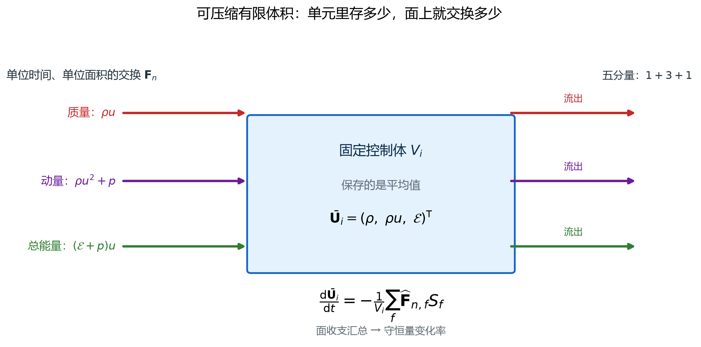
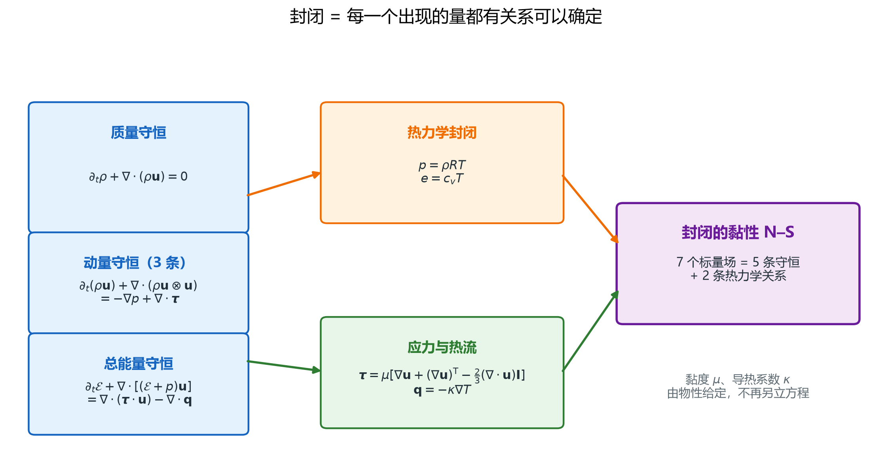

# 可压缩 N–S 方程：五个守恒量与两个状态关系

> 对应知识图谱节点：`M7-01`
>
> 前置：[M0 符号与约定](../00-notation/symbols-and-conventions.md)（张量、散度、量纲）
>
> 相关：[M6 数值方法](../06-numerics/README.md)（离散与线性化）、[03 面通量与时间推进](03-fluxes-and-time-stepping.md)
>
> 原始推文：《从不可压缩到可压缩：N–S 方程与求解流程有哪些改变？》（链接见文末来源）

---

## 0. 结论先行

1. **可压缩与不可压缩的分界，不是"密度会不会变"，而是"密度是不是独立的热力学变量"。**
   可压缩流中密度由连续方程演化、压力由状态方程诊断；不可压缩流中密度给定，
   压力退化为维持连续性约束的 Lagrange 乘子。
2. 可压缩 N–S 有 **7 个未知量**：密度、三个速度分量、压力、温度、比内能；
   只有 **5 个方程**（质量 1、动量 3、总能量 1），必须补 **2 个状态关系**才封闭（图 25）。
3. 五个守恒量排成向量 $\mathbf U=(\rho,\rho u,\rho v,\rho w,\mathcal E)^{\mathsf T}$。
   用守恒量而不是原始量，是因为**激波处只有守恒形式才有意义**：跳跃条件由守恒律的积分形式给出。
4. 黏性应力张量在 Stokes 假设下迹为零，其散度为

   $$\nabla\cdot\boldsymbol\tau=\mu\nabla^2\mathbf u+\frac{\mu}{3}\nabla(\nabla\cdot\mathbf u).$$

   **第二项只在可压缩时出现**，这是"从不可压缩到可压缩"的第一处结构性改变。
5. 能量方程多了三件事：压力功、黏性耗散、热传导。用内能写是

   $$\rho\frac{De}{Dt}=-p\nabla\cdot\mathbf u+\boldsymbol\tau:\nabla\mathbf u-\nabla\cdot\mathbf q.$$

   不可压缩流常把能量方程丢掉；可压缩流不能，因为压力功与耗散都会改变温度，
   温度又通过状态方程反过来改变压力。
6. 声速 $c=\sqrt{\gamma p/\rho}$ 是**状态量**，不是流速。它决定马赫数、
   边界上特征线的方向，以及显式时间步的上限。
7. **石油系统接口**：真正需要 N–S 的是井筒瞬变、地面管线、裂缝内高速流与超临界 CO2；
   储层尺度的渗流由 Darcy 定律控制，不能把 N–S 直接套上去（§4 误解 6）。

适用范围：连续介质、Newton 流体、Fourier 热传导、Stokes 假设、定比热理想气体、
无体积力与化学反应。真实气体只需把两个状态关系换掉，守恒形式与通量结构不变。

---

## 1. 前提与符号

### 1.1 假设

- **连续介质**：Knudsen 数足够小，速度、温度在控制体内可定义。
- **Newton 流体**：黏性应力与应变率线性相关，比例系数为动力黏度 $\mu$。
- **Fourier 热传导**：热流与温度梯度成正比， $\mathbf q=-\kappa\nabla T$。
- **Stokes 假设**：体积黏度 $\lambda=-2\mu/3$，使黏性应力张量的迹为零。
- **定比热理想气体**：状态方程 $p=\rho RT$ 与内能式 $e=c_vT$ 都成立，
  且各比热与比热比都是常数。
- 无体积力、无化学反应、无相变；这些会在 M7-06 再补。

### 1.2 符号表

| 符号 | 含义 | 单位（SI） |
|---|---|---|
| $\rho$ | 密度 | kg/m³ |
| $\mathbf u=(u,v,w)$ | 速度 | m/s |
| $p$ | 热力学压力 | Pa |
| $T$ | 温度 | K |
| $e$ | 比内能（单位质量） | J/kg |
| $\mathcal E$ | 总能量密度 $\rho(e+\lVert\mathbf u\rVert^2/2)$ | J/m³ |
| $\boldsymbol\tau$ | 黏性应力张量（偏量部分） | Pa |
| $\boldsymbol\sigma$ | 总应力张量 $-p\mathbf I+\boldsymbol\tau$ | Pa |
| $\mathbf q$ | 热流密度 | W/m² |
| $\mu$ | 动力黏度 | Pa·s |
| $\kappa$ | 导热系数 | W/(m·K) |
| $c_p,c_v$ | 定压、定容比热 | J/(kg·K) |
| $\gamma$ | 比热比 $c_p/c_v$ | — |
| $R$ | 气体常数 $c_p-c_v$ | J/(kg·K) |
| $c$ | 声速 | m/s |
| $\mathrm{Ma}$ | 马赫数 $\lVert\mathbf u\rVert/c$ | — |

### 1.3 两个贯穿全文的算例

**算例 A（有量纲气体）**：空气， $\gamma=1.4$， $R=287$ J/(kg·K)， $T=300$ K， $p=101325$ Pa；
甲烷， $\gamma=1.31$， $R=518$ J/(kg·K)， $T=380$ K， $p=30$ MPa。
用来核对状态量与声速。

**算例 B（无量纲激波管）**： $\gamma=1.4$， $R=1$， $c_v=2.5$，计算域 $0\le x\le1$，
隔膜在 $x=0.5$。左态 $(\rho,p,u)=(1,1,0)$，右态 $(0.125,0.1,0)$。
它是第 2–4 篇共用的算例，本文先用它核对一维通量。

---

## 2. 推导

### 2.1 从控制体到守恒形式

取固定控制体 $V$，外法向 $\mathbf n$。对任意守恒量，雷诺输运给出

$$
\frac{d}{dt}\int_V \mathbf U\ dV
=-\oint_{\partial V}\mathbf F\cdot\mathbf n\ dS
+\int_V \mathbf S\ dV .
$$

右端第一项是穿过表面的通量，第二项是源项。若被积函数连续，用 Gauss 公式把面积分
化为体积分，再令 $V$ 任意小，得到微分形式

$$
\frac{\partial\mathbf U}{\partial t}+\nabla\cdot\mathbf F=\mathbf S .
$$

**这一步是后面所有离散的源头。** 有限体积并不直接离散微分形式，
而是回到积分形式：单元内状态取平均，物理只通过面上的通量交换（图 24）。

图中控制体有六个面，每个面都同时交换质量、动量与能量；把六个面的通量相加，
就是单元内守恒量的变化率。可压缩与不可压缩的差别，就藏在"密度也是一个独立的守恒量"里。

> 文件：`assets/figures/fig24-compressible-control-volume.png`

### 2.2 质量守恒

取 $\mathbf U=\rho$，通量 $\mathbf F=\rho\mathbf u$，源项为零：

$$
\frac{\partial\rho}{\partial t}+\nabla\cdot(\rho\mathbf u)=0 .
$$

展开散度可得非守恒形式

$$
\frac{D\rho}{Dt}+\rho\nabla\cdot\mathbf u=0,
\qquad
\frac{D}{Dt}=\frac{\partial}{\partial t}+\mathbf u\cdot\nabla .
$$

两式等价，但只有守恒形式能跨越激波。原因是激波是间断，微分在间断处不存在，
而积分形式仍然成立；把积分形式作用在一个跨激波的扁平控制体上，
就得到 Rankine–Hugoniot 跳跃条件。

### 2.3 动量守恒

动量密度是 $\rho\mathbf u$，对流通量是 $\rho\mathbf u\otimes\mathbf u$（并矢），
表面力由总应力张量给出：

$$
\frac{\partial(\rho\mathbf u)}{\partial t}
+\nabla\cdot(\rho\mathbf u\otimes\mathbf u)
=\nabla\cdot\boldsymbol\sigma+\rho\mathbf b .
$$

应力张量分成各向同性的压力与偏量的黏性应力：

$$
\boldsymbol\sigma=-p\mathbf I+\boldsymbol\tau .
$$

无体积力时

$$
\frac{\partial(\rho\mathbf u)}{\partial t}
+\nabla\cdot(\rho\mathbf u\otimes\mathbf u)
=-\nabla p+\nabla\cdot\boldsymbol\tau .
$$

**符号约定**：本书固体部分用拉为正，流体部分用压为正；两者相差一个负号。
读文献时先看它把 $\boldsymbol\sigma$ 写成 $-p\mathbf I+\boldsymbol\tau$ 还是 $p\mathbf I-\boldsymbol\tau$。

### 2.4 黏性应力与 Stokes 假设

对 Newton 流体，最一般的线性各向同性关系是

$$
\boldsymbol\tau
=\mu\left[\nabla\mathbf u+(\nabla\mathbf u)^{\mathsf T}\right]
+\lambda(\nabla\cdot\mathbf u)\mathbf I ,
$$

其中 $\lambda$ 是体积黏度。取迹：

$$
\mathrm{tr}\ \boldsymbol\tau
=(2\mu+3\lambda)\nabla\cdot\mathbf u .
$$

Stokes 假设令 $\mathrm{tr}\ \boldsymbol\tau=0$，于是 $\lambda=-2\mu/3$，

$$
\boldsymbol\tau
=\mu\left[\nabla\mathbf u+(\nabla\mathbf u)^{\mathsf T}
-\frac{2}{3}(\nabla\cdot\mathbf u)\mathbf I\right].
$$

这个形式有一个直接的物理含义：**纯膨胀不产生黏性应力**。
取 $\mathbf u=(ax,ay,az)$，则 $\nabla\mathbf u=aI$， $\nabla\cdot\mathbf u=3a$，

$$
\boldsymbol\tau=\mu\left[2a\mathbf I-2a\mathbf I\right]=\mathbf 0 .
$$

各向同性的膨胀只改变密度，不改变形状；黏性只抵抗形状改变。
剪切流动则相反： $\mathbf u=(u(y),0,0)$ 时 $\nabla\cdot\mathbf u=0$，
$\tau_{xy}=\mu\ du/dy$，与不可压缩情形完全一致。

求散度。记 $\nabla^2\mathbf u$ 为逐分量拉普拉斯，利用 $\nabla\cdot(\nabla\mathbf u)^{\mathsf T}=\nabla(\nabla\cdot\mathbf u)$：

$$
\nabla\cdot\boldsymbol\tau
=\mu\nabla^2\mathbf u
+\frac{\mu}{3}\nabla(\nabla\cdot\mathbf u).
$$

不可压缩时 $\nabla\cdot\mathbf u=0$，第二项消失，只剩 $\mu\nabla^2\mathbf u$。
这就是"可压缩多出来的一项"。

### 2.5 总能量守恒

总能量密度

$$
\mathcal E=\rho\left(e+\frac{1}{2}\lVert\mathbf u\rVert^2\right).
$$

能量方程的通量由三部分组成：对流带走的 $\mathcal E\mathbf u$、压力做的功 $p\mathbf u$、
黏性应力做的功 $\boldsymbol\tau\cdot\mathbf u$；表面还有热传导 $- \mathbf q$。
合起来

$$
\frac{\partial\mathcal E}{\partial t}
+\nabla\cdot\left[(\mathcal E+p)\mathbf u\right]
=\nabla\cdot(\boldsymbol\tau\cdot\mathbf u)-\nabla\cdot\mathbf q .
$$

用内能写更看得清物理。把动量方程点乘 $\mathbf u$ 得到机械能方程，再从总能量中减去：

$$
\rho\frac{De}{Dt}
=-p\nabla\cdot\mathbf u+\boldsymbol\tau:\nabla\mathbf u-\nabla\cdot\mathbf q .
$$

右端三项分别是**压缩功**（可逆，可正可负）、**黏性耗散**（不可逆，恒为正，
是气动加热的来源）、**热传导**（可逆，重新分配能量）。

不可压缩流中 $\nabla\cdot\mathbf u=0$，压缩功消失；耗散通常远小于对流，
能量方程常常解耦。可压缩流中三项都不能丢：压缩功改变温度，
温度通过状态方程改变压力，压力又回到动量方程。

### 2.6 封闭：5 个方程，7 个未知量

把未知量列出来：

| 未知量 | 个数 |
|---|---:|
| 密度 $\rho$ | 1 |
| 速度 $\mathbf u$ | 3 |
| 压力 $p$ | 1 |
| 温度 $T$ | 1 |
| 比内能 $e$ | 1 |
| **合计** | **7** |

方程只有 5 个：质量 1、动量 3、总能量 1。差 2 个，正好由两个状态关系补上：

$$
p=\rho RT,\qquad e=c_vT .
$$

配合 $R=c_p-c_v$ 与比热比的定义，可以把它改写成只含 $p,\rho$ 的形式：

$$
e=\frac{p}{(\gamma-1)\rho},
\qquad
\mathcal E=\frac{p}{\gamma-1}+\frac{1}{2}\rho\lVert\mathbf u\rVert^2 .
$$

这就是后面"从守恒量恢复压力"的全部依据。**少一个关系解不出来，多一个关系过约束。**

图中左侧是 5 个方程，右侧是 7 个未知量，中间两条状态关系把缺口补上；
下方是有限体积实际使用的路径：先存守恒量，再按代数关系恢复原始量。

> 文件：`assets/figures/fig25-ns-closure-map.png`

### 2.7 声速从哪里来

声速定义为等熵条件下压力对密度的导数：

$$
c^2=\left(\frac{\partial p}{\partial\rho}\right)_s .
$$

理想气体的等熵关系是 $p\rho^{-\gamma}=\mathrm{const}$。两边取对数再微分：

$$
\frac{dp}{p}-\gamma\frac{d\rho}{\rho}=0
\quad\Longrightarrow\quad
\frac{dp}{d\rho}=\gamma\frac{p}{\rho}.
$$

所以

$$
c=\sqrt{\frac{\gamma p}{\rho}}=\sqrt{\gamma RT}.
$$

它只依赖状态，不依赖流速。静止的空气里也有声速；这正是"声速不是流速"的意思。
在数值格式里，声速决定最快的特征速度 $|u_n|+c$，从而决定显式步长（第 3 篇）。

### 2.8 不可压缩极限改变了什么

把速度、长度、密度、压力无量纲化：

$$
\mathbf u=U\mathbf u',\qquad x=Lx',\qquad
\rho=\rho_0\rho',\qquad p=p_0+p',\qquad p_0=\rho_0U^2 .
$$

连续方程变成

$$
\mathrm{Ma}^2\frac{\partial\rho'}{\partial t'}
+\nabla'\cdot(\rho'\mathbf u')=0 .
$$

令 $\mathrm{Ma}\to0$，得到 $\nabla'\cdot\mathbf u'=0$：速度场无散。
压力不再由状态方程诊断，而由动量方程的散度给出压力泊松方程

$$
\nabla^2p'=-\rho_0\ \partial_i u_j\ \partial_j u_i .
$$

压力成了维持无散约束的 Lagrange 乘子。能量方程中的压缩功与耗散都乘了 $\mathrm{Ma}^2$，
在极限下解耦；温度变成被动输运的量（若保留浮力则另说）。

**这就是两种模型的真正差别**：不是"密度能不能变"，而是
"密度是不是独立未知量、压力是不是状态量"。

### 2.9 一维 Euler 与有限体积的入口

忽略黏性与热传导，一维守恒形式是

$$
\frac{\partial\mathbf U}{\partial t}
+\frac{\partial\mathbf F}{\partial x}=0,
\qquad
\mathbf U=
\begin{pmatrix}
\rho\\
\rho u\\
\mathcal E
\end{pmatrix},
\qquad
\mathbf F=
\begin{pmatrix}
\rho u\\
\rho u^2+p\\
(\mathcal E+p)u
\end{pmatrix}.
$$

三个分量依次是质量、动量、总能量通量。
第 3 篇将从这个形式出发，定义面上的数值通量；第 4 篇用它算完整个激波管。

---

## 3. 数值检验

### 3.1 两种气体的状态量与声速

空气： $\rho=p/(RT)=101325/(287\times300)=1.1768$ kg/m³，

$$
c=\sqrt{\gamma RT}=\sqrt{1.4\times287\times300}=347.2\ \mathrm{m/s}.
$$

甲烷： $\rho=30\times10^6/(518\times380)=152.41$ kg/m³，

$$
c=\sqrt{1.31\times30\times10^6/152.41}=507.8\ \mathrm{m/s}.
$$

若甲烷在管道内以 $u=15$ m/s 流动， $\mathrm{Ma}=15/507.8=0.0295$。
这个数在 §3.2 会用来判断能否按不可压缩处理。

### 3.2 不可压缩判据的量化

等熵滞止关系给出密度变化：

$$
\frac{\rho_0}{\rho}
=\left(1+\frac{\gamma-1}{2}\mathrm{Ma}^2\right)^{1/(\gamma-1)} .
$$

| $\mathrm{Ma}$ | 密度增加 | 常见处理 |
|---:|---:|---|
| 0.03 | 0.045% | 可视为不可压缩 |
| 0.30 | 4.56% | 临界，按需选择 |
| 0.60 | 18.98% | 必须可压缩 |

工程上常把 $\mathrm{Ma}<0.3$ 当作不可压缩的分界，对应的密度误差约 5%。
这不是物理突变，而是误差预算的选择。

水在 20 °C 的体积模量约 2.2 GPa，密度 998 kg/m³，

$$
c=\sqrt{K/\rho}=\sqrt{2.2\times10^9/998}=1484.7\ \mathrm{m/s}.
$$

即使水流速 1 m/s， $\mathrm{Ma}=6.7\times10^{-4}$。但水击问题中压力波速正是这个 $c$，
不能因为马赫数小就把声波丢掉——这是"低马赫"与"不可压缩"的另一个区别。

### 3.3 纯膨胀的零黏性应力

取 $\mathbf u=(ax,ay,az)$， $a=2\ \mathrm{s^{-1}}$， $\mu=1.8\times10^{-5}$ Pa·s（空气）。
$\nabla\cdot\mathbf u=3a=6\ \mathrm{s^{-1}}$，

$$
\boldsymbol\tau
=1.8\times10^{-5}\left[2(2)\mathbf I-\frac{2}{3}(6)\mathbf I\right]
=\mathbf 0 .
$$

若没有 Stokes 假设中的 $2/3$，会得到非零的各向同性黏性应力，
纯膨胀就会被错误地阻尼。这是 $2/3$ 的物理来源。

再看剪切： $\mathbf u=(u(y),0,0)$， $u(y)=2y$ m/s，则
$\tau_{xy}=1.8\times10^{-5}\times2=3.6\times10^{-5}$ Pa，
$\nabla\cdot\boldsymbol\tau=\mathbf 0$（线性剪切无净黏性力）。
只有速度剖面弯曲时才有净黏性力，这与 $\mu\nabla^2\mathbf u$ 一致。

### 3.4 声速的数值微分校核

对 $p=\rho^\gamma$（ $R=1$，等熵），在 $\rho=1$ 处

$$
c^2=\frac{dp}{d\rho}=\gamma\rho^{\gamma-1}=1.4
\quad(\rho=1),
\qquad c=1.183216 .
$$

这正是激波管左态的声速。右态 $\rho=0.125$， $p=0.1$，

$$
c_R=\sqrt{1.4\times0.1/0.125}=1.058301 .
$$

### 3.5 一维初始通量

激波管两态的初始速度都为零，因此

$$
\mathbf F_L=
\begin{pmatrix}
0\\
1\\
0
\end{pmatrix},
\qquad
\mathbf F_R=
\begin{pmatrix}
0\\
0.1\\
0
\end{pmatrix}.
$$

质量和能量通量为零，动量通量等于压力。这不是"流体没动所以没有通量"，
而是"没有对流，但压力仍然通过面传递动量"。下一章的两单元更新会看到，
正是这两个压力把气体从静止推开。

---

## 4. 常见误解

**误解 1：可压缩就是密度会变。**
错。不可压缩流中密度也会随温度或组分变化（Boussinesq 近似就是这样处理的）。
可压缩的严格含义是：密度是独立的热力学变量，压力由状态方程给出；
不可压缩则给定密度（或只随温度变而不随压力变），压力由约束方程给出。

**误解 2：五个方程解五个未知量。**
错。未知量有 7 个，必须补 2 个状态关系。只数方程个数、不数未知量，
是初学 CFD 最常见的封闭性错误。

**误解 3：不可压缩 N–S 只是可压缩 N–S 令 $\nabla\cdot\mathbf u=0$。**
不完全是。压力角色变了：从状态量变成 Lagrange 乘子，需要解压力泊松方程；
能量方程解耦；时间推进从双曲型变成椭圆型约束。数值上，
压力基方法的核心就是这条泊松方程。

**误解 4：黏性只影响动量。**
可压缩时黏性耗散进入能量方程，是高速飞行器表面气动加热的主要来源。
忽略它会把壁温算低几百开尔文。

**误解 5：声速是流体速度。**
声速是状态量。静止空气中的声速约 347 m/s，而空气本身速度为零。
只有在数值格式里，声速才与流速相加，组成最快的特征速度。

**误解 6：这套方程可以直接算油藏。**
错。油藏尺度的流动由 Darcy 定律控制，孔隙尺度远小于连续介质假设要求的尺度，
雷诺数也极小。N–S 适用于井筒、管线、裂缝内高速流；储层渗流是另一套方程。

---

## 5. 自测

**题 1** 写出总能量密度 $\mathcal E$ 的定义，并说明为什么能量方程用总能量而不是内能。

**题 2** 空气 $T=300$ K、 $p=101325$ Pa，求密度与声速；
若流速 $u=100$ m/s，判断能否按不可压缩处理。

**题 3** 证明纯膨胀 $\mathbf u=(ax,ay,az)$ 的黏性应力为零，
并说明 Stokes 假设中的 $2/3$ 起什么作用。

**题 4** 为什么激波处不能直接用微分形式的 N–S 方程？

**题 5** 判断：不可压缩流的压力也由 $p=\rho RT$ 给出，只是密度取常数。
说明理由。

---

### 参考答案

**答 1** $\mathcal E=\rho(e+\lVert\mathbf u\rVert^2/2)$。总能量守恒是孤立的：
它不依赖动量方程；若只用内能，必须先把动量方程的机械能部分算出来再相减，
在激波处这个相减不可交换（耗散是测度）。总能量形式让跳跃条件可以直接写出。

**答 2** $\rho=101325/(287\times300)=1.1768$ kg/m³，
$c=347.2$ m/s， $\mathrm{Ma}=100/347.2=0.288$。
密度增加约 4.2%，接近 5% 的临界，按 5% 误差预算可以近似不可压缩；
若关心声学或压力波，仍需可压缩模型。

**答 3** $\nabla\mathbf u=a\mathbf I$， $\nabla\cdot\mathbf u=3a$，
代入 $\boldsymbol\tau=\mu[2a\mathbf I-(2/3)(3a)\mathbf I]=\mathbf 0$。
$2/3$ 使黏性应力张量的迹为零，从而纯膨胀不产生黏性阻力；
没有它，各向同性膨胀会被错误阻尼。

**答 4** 激波是间断面，速度、压力、密度在面上跳跃，导数不存在。
微分形式在间断处失效；守恒律的积分形式仍然成立，
它给出 Rankine–Hugoniot 跳跃条件。数值格式必须离散积分形式（有限体积），
才能正确捕捉激波。

**答 5** 错。不可压缩流的压力不是热力学状态量，而是维持 $\nabla\cdot\mathbf u=0$
的 Lagrange 乘子；它由压力泊松方程决定，不由状态方程决定。
用 $p=\rho RT$ 反算温度会得到一个与能量方程无关的温度场。

---

## 来源

- 原始推文：《从不可压缩到可压缩：N–S 方程与求解流程有哪些改变？》，
  微信公众号文章，链接见
  [`cases/2026-11-13-compressible-ns.md`](../../cases/2026-11-13-compressible-ns.md)。
- 本文的推导、算例与图件均为独立完成；原文公式为图片，本库逐式转写并重算，
  未复制原文文字与图片。
- 图 24、图 25 由 [`tools/make_figures.py`](../../tools/make_figures.py) 生成。
- 状态量与声速的数值可用 `py -3 tools/verify_fluid_notes.py` 复算（第 1、6 部分）。
