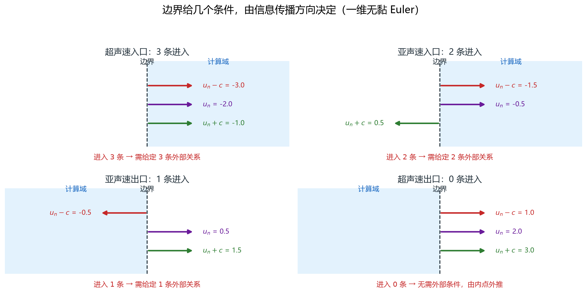
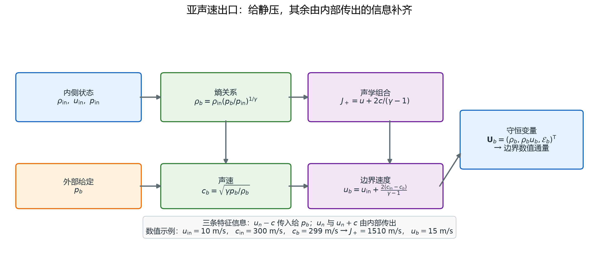

# 状态与边界：守恒量、原始量与特征线

> 对应知识图谱节点：`M7-02`
>
> 前置：[01 控制方程与封闭](01-governing-equations.md)（五个守恒量、状态关系、声速）
>
> 相关：[03 面通量与时间推进](03-fluxes-and-time-stepping.md)（边界通量用的就是同一套数值通量）
>
> 原始推文：《从不可压缩到可压缩：N–S 方程与求解流程有哪些改变？》（链接见文末来源）

---

## 0. 结论先行

1. 有限体积存的是**守恒量的单元平均** $\bar{\mathbf U}$；原始量
   $\mathbf W=(\rho,\mathbf u,p,T)$ 是给人看的。两者是**代数互换**，不是解方程。
2. 恢复顺序固定：先由动量密度除以密度得速度，再减动能得内能，再乘 $\gamma-1$ 得压力，
   最后由状态方程得温度。**先减动能**这一步不能省。
3. **单元平均不能先平均再恢复**。压力的平均不等于平均状态的压力；
   一阶格式用 $\bar{\mathbf U}$ 直接恢复只差 $O(h^2)$，高阶重构必须用面状态，不能用单元平均。
4. 边界条件不是"给个值"，而是**数进入计算域的特征线**。
   外法向约定下，一维无黏 Euler 的三条特征速度分别是法向速度减声速、法向速度本身、
   法向速度加声速；负值表示进入。
5. 一维四类边界的进入条数固定为：超声速入口 3、亚声速入口 2、亚声速出口 1、超声速出口 0。
   二维、三维还要加剪切特征：亚声速入口分别需要 3、4 条。
6. 亚声速出口只进入 1 条，通常给外部压力 $p_b$，其余由内部黎曼不变量外推（图 27）。
7. 总压总温与静压静温不是一回事：

   $$T_0=T+\frac{\lVert\mathbf u\rVert^2}{2c_p},
   \qquad
   p_0=p\left(\frac{T_0}{T}\right)^{\gamma/(\gamma-1)} .$$

   储罐、压缩机给的是总压；静止时两者才相等。
8. 边界通量必须走**与内部相同的数值通量**。把边界单元的值直接改成 $p_b$，
   会在边界制造一个假间断，把出射波反射回计算域。
9. **石油系统接口**：井口节流、管线出口接大容器、压缩机入口给总压、井底给流量或压力；
   这些边界条件的选择直接决定压力波会不会反射，进而决定井筒瞬变的计算是否可信。

适用范围：本文数特征线时用一维无黏 Euler 与理想气体；黏性边界在 §2.8 单独说明。
特征线计数对定常与非定常都成立，但"进入条数"是非定常问题的提法；
定常问题用入口/出口的提法，结论一致。

---

## 1. 前提与符号

### 1.1 约定

- **外法向**：边界面或单元面的法向 $\mathbf n_f$ 一律指向计算域外。
- **法向速度**：速度在外法向上的投影，记作 $u_n$；正值表示流出，负值表示流入。
- **一维模型**：除特别说明，特征线计数用一维无黏 Euler；二维、三维的补充在 §2.4。
- **理想气体**：状态方程与声速都按理想气体计算，且 $R=c_p-c_v$。

### 1.2 符号表

| 符号 | 含义 |
|---|---|
| $\mathbf U$ | 守恒量 $(\rho,\rho\mathbf u,\mathcal E)^{\mathsf T}$ |
| $\bar{\mathbf U}$ | 单元平均守恒量 |
| $\mathbf W$ | 原始量 $(\rho,\mathbf u,p,T)$ |
| $\mathbf n_f$ | 面的外法向单位向量 |
| $u_n$ | 法向速度 $\mathbf u\cdot\mathbf n_f$ |
| $\lambda_k$ | 特征速度 |
| $J_-$ | 黎曼不变量 $u_n-2c/(\gamma-1)$ |
| $J_+$ | 黎曼不变量 $u_n+2c/(\gamma-1)$ |
| $T_0,p_0$ | 总温、总压 |
| $p_b$ | 边界上给定的外部压力 |
| $\mathbf H$ | 数值通量（面上） |

### 1.3 贯穿算例

无量纲理想气体， $\gamma=1.4$， $R=1$， $c_v=2.5$。
内部状态取 $\rho=1$， $p=1$，则 $c=1.183216$。
第 3 篇的隔膜通量与本篇的边界通量都用这个状态。

---

## 2. 推导

### 2.1 守恒量与原始量的互换

一维情形，守恒量 $\mathbf U=(\rho,\rho u,\mathcal E)^{\mathsf T}$。由守恒量到原始量：

$$
\rho=U_1,\qquad
u=\frac{U_2}{U_1},\qquad
p=(\gamma-1)\left(U_3-\frac{U_2^2}{2U_1}\right),
\qquad
T=\frac{p}{\rho R}.
$$

反方向：

$$
\mathbf U=
\begin{pmatrix}
\rho\\
\rho u\\
\dfrac{p}{\gamma-1}+\dfrac{1}{2}\rho u^2
\end{pmatrix}.
$$

两个方向都是代数运算，不需要迭代。只要 $\rho>0$ 且 $p>0$，映射是一一的；
若恢复出 $p\le0$，说明离散状态已经越界，不能用"把压力截断到小正数"掩盖。

三维情形把 $U_2$ 换成动量向量 $\rho\mathbf u$，动能项换成
$\lVert\rho\mathbf u\rVert^2/(2\rho)$，其余不变。

### 2.2 单元平均的两个陷阱

**陷阱一：先平均再恢复。**
有限体积存的是单元平均 $\bar{\mathbf U}$。真实压力是

$$
\bar p=(\gamma-1)\left(\bar{\mathcal E}
-\frac{1}{2}\overline{\frac{\lVert\mathbf m\rVert^2}{\rho}}\right),
\qquad \mathbf m=\rho\mathbf u .
$$

但计算时只能用 $\frac{1}{2}\lVert\bar{\mathbf m}\rVert^2/\bar\rho$。
由 Cauchy–Schwarz 不等式，

$$
\overline{\frac{\lVert\mathbf m\rVert^2}{\rho}}
\ge \frac{\lVert\bar{\mathbf m}\rVert^2}{\bar\rho},
$$

所以直接恢复会**高估**压力，差额是亚网格动能。光滑区这个差额是 $O(h^2)$，
一阶格式可以接受；高阶格式或强压缩区必须用重构后的面状态，而不是单元平均。

**陷阱二：恢复顺序。**
必须先减动能再乘 $\gamma-1$。若先乘再减，得到的是
$(\gamma-1)\mathcal E-\frac{1}{2}\rho u^2$，量纲都不对。
高速流动中这个错误很大： $\rho=1$ kg/m³、 $u=300$ m/s、 $p=10^5$ Pa 时，
动能密度 $4.5\times10^4$ J/m³ 占总能量的 15%，忘了减就会把压力高估 18%。

### 2.3 一维特征线与进入条数

把一维 Euler 写成原始量的线性化形式。令 $\mathbf W=(\rho,u,p)^{\mathsf T}$，

$$
\frac{\partial\mathbf W}{\partial t}
+\mathbf A\frac{\partial\mathbf W}{\partial x}=0,
\qquad
\mathbf A=
\begin{pmatrix}
u & \rho & 0\\
0 & u & 1/\rho\\
0 & \gamma p & u
\end{pmatrix}.
$$

特征值是

$$
\lambda_1=u-c,\qquad \lambda_2=u,\qquad \lambda_3=u+c .
$$

它们分别是左行声波、熵波/接触波、右行声波的速度。
在边界上取外法向，把 $u$ 换成 $u_n$：**特征值为负，信息从外部进入计算域；
为正，信息从内部流出**。进入的条数就是必须给定的外部条件数。

| 类型 | 条件 | 特征值 1 | 特征值 2 | 特征值 3 | 进入条数 |
|---|---|---:|---:|---:|---:|
| 超声速入口 | $u_n<-c$ | − | − | − | 3 |
| 亚声速入口 | $-c<u_n<0$ | − | − | + | 2 |
| 亚声速出口 | $0<u_n<c$ | − | + | + | 1 |
| 超声速出口 | $u_n>c$ | + | + | + | 0 |

四个面板对应四类边界：箭头方向由外法向与特征速度的符号共同决定，
红色数字是进入计算域的条数。超声速入口三条全进，超声速出口一条不进。

> 文件：`assets/figures/fig26-characteristic-boundaries.png`

### 2.4 二维、三维多了什么

二维 Euler 有 4 个方程，特征值是法向速度减声速、法向速度（二重）、法向速度加声速。
多出来的一重是**剪切波**：它把切向速度差以法向速度输运，不改变压力。
三维再多一重，共三重（熵波加两个剪切波）。

于是：

| 类型 | 二维进入条数 | 三维进入条数 |
|---|---:|---:|
| 超声速入口 | 4 | 5 |
| 亚声速入口 | 3 | 4 |
| 亚声速出口 | 1 | 1 |
| 超声速出口 | 0 | 0 |

亚声速入口的两个声学条件通常给总压与总温（或来流速度与温度），
剪切条件给来流方向。出口只给一个压力，其余外推。

### 2.5 总温总压与静温静压

沿一条定常、绝热、无黏的流线，滞止焓守恒：

$$
h+\frac{1}{2}\lVert\mathbf u\rVert^2=h_0,
\qquad h=c_pT .
$$

所以

$$
T_0=T+\frac{\lVert\mathbf u\rVert^2}{2c_p}.
$$

若流线还是等熵的， $p\rho^{-\gamma}=\mathrm{const}$ 与 $T\rho^{1-\gamma}=\mathrm{const}$
给出

$$
\frac{p_0}{p}=\left(\frac{T_0}{T}\right)^{\gamma/(\gamma-1)},
\qquad
\frac{\rho_0}{\rho}=\left(\frac{T_0}{T}\right)^{1/(\gamma-1)} .
$$

储罐里的气是静止的，罐内参数就是总参数；管道里的参数是静参数。
把总压当静压用，会在 $Ma=0.3$ 时高估压力 6.4%，在 $Ma=0.6$ 时高估 27.6%。

### 2.6 亚声速出口的构造

出口外法向指向域外，流动处于亚声速：只有一条特征线进入，
给一个外部压力 $p_b$ 就够。
其余两条由内部状态沿出射特征线外推。对理想气体等熵流动，黎曼不变量是

$$
J_+=u_n+\frac{2c}{\gamma-1}=\mathrm{const}
\quad\text{沿 } \lambda_3=u_n+c \text{ 特征线},
$$

$$
J_-=u_n-\frac{2c}{\gamma-1}=\mathrm{const}
\quad\text{沿 } \lambda_1=u_n-c \text{ 特征线}.
$$

出口只让最右的特征线出射，所以 $J_+$ 从内部带出；
回到边界的那一条由外部压力决定。四步构造：

1. 由内部状态算声速与不变量：

   $$c_{in}=\sqrt{\gamma p_{in}/\rho_{in}},
   \qquad
   J_+=u_{in}+\frac{2c_{in}}{\gamma-1}.$$

2. 由外部压力与等熵关系算边界声速：

   $$c_b=c_{in}\left(\frac{p_b}{p_{in}}\right)^{(\gamma-1)/(2\gamma)}.$$

3. 由 $J_+$ 算边界速度：

   $$u_b=J_+-\frac{2c_b}{\gamma-1}.$$

4. 由等熵关系算密度，再组装能量：

   $$\rho_b=\rho_{in}\left(\frac{p_b}{p_{in}}\right)^{1/\gamma},
   \qquad
   \mathcal E_b=\frac{p_b}{\gamma-1}+\frac{1}{2}\rho_b u_b^2.$$

得到 $\mathbf U_b=(\rho_b,\rho_bu_b,\mathcal E_b)^{\mathsf T}$ 后，
**不要把它写进边界单元**，而是用它和内部状态算同一个数值通量：

$$
\mathbf H_b=\mathbf H(\mathbf U_{in},\mathbf U_b;\mathbf n_b).
$$

这样出射波会正常离开，不会反射。

图中从内部状态出发，先用 $J_+$ 与外部压力定出边界声速与速度，
再把边界状态送进与内部相同的数值通量；右侧标注了"不要直接覆盖单元值"。

> 文件：`assets/figures/fig27-subsonic-outlet-construction.png`

### 2.7 壁面

**无黏壁面**：法向速度为零， $u_n=0$。质量通量为零，能量通量中的对流与压力功也为零，
只剩压力对动量的作用：

$$
\mathbf F\cdot\mathbf n_f=
\begin{pmatrix}
0\\
p\ \mathbf n_f\\
0
\end{pmatrix}.
$$

注意**动量通量不为零**。两端压力不同时，整个计算域的动量不守恒：

$$
\frac{d\mathcal P}{dt}=p_L-p_R .
$$

这不是程序错误，而是壁面压力对流体做的净力。

**黏性壁面**：除法向速度为零外，还要切向无滑移，以及热边界条件
（绝热，或给定壁温/换热系数）。此时壁面还有剪应力与热流，通量不再是纯压力。

### 2.8 边界条件的统一写法

把上面几类边界写成同一句话：

> 边界上的**外部状态**由进入的特征线决定，**出射的特征线**由内部状态外推；
> 两者一起送进数值通量。

- 超声速入口：三条全进，外部状态全部给定， $\mathbf U_b=\mathbf U_\infty$；
- 亚声速入口：两条进，给总压总温（或 $p,u$），剪切方向给定；
- 亚声速出口：一条进，给外部压力，其余由内部不变量外推；
- 超声速出口：零条进， $\mathbf U_b=\mathbf U_{in}$，直接外推；
- 壁面： $u_n=0$，通量取纯压力形式。

---

## 3. 数值检验

### 3.1 恢复的往返

激波管两态：

| 状态 | $\rho$ | $u$ | $p$ | $T$ | $\mathcal E$ |
|---|---:|---:|---:|---:|---:|
| 左 | 1 | 0 | 1 | 1 | 2.5 |
| 右 | 0.125 | 0 | 0.1 | 0.8 | 0.25 |

由 $\mathbf U$ 恢复再反算，误差在 $10^{-16}$ 量级（浮点舍入）。
以第 3 篇更新后的左态 $(\rho,\rho u,\mathcal E)=(0.948234,0.045,2.366888)$ 为例：

$$
u=\frac{0.045}{0.948234}=0.047457,
$$

$$
p=0.4\left(2.366888-\frac{0.045^2}{2\times0.948234}\right)=0.946328,
\qquad
T=\frac{0.946328}{0.948234}=0.997990 .
$$

顺序错误的对照：若忘了减动能，压力会算成 $0.4\times2.366888=0.946755$，
比正确值高 $4.3\times10^{-4}$。本例速度小，差别不大；速度 300 m/s 时差别是 18%。

### 3.2 亚声速出口的四步构造

内部状态取密度 1、压力 1、速度 0.5，外部压力取 $p_b=0.924385$。

| 步骤 | 量 | 数值 |
|---|---|---:|
| 1 | $c_{in}$ | 1.183216 |
| 1 | $J_+$ | 6.416080 |
| 2 | $c_b$ | 1.170000 |
| 3 | $u_b$ | 0.566080 |
| 4 | $\rho_b$ | 0.945386 |
| 4 | $\mathcal E_b$ | 2.462435 |

边界通量（取外法向为正）：

$$
\mathbf H_b=
\begin{pmatrix}
0.564989\\
1.208142\\
2.005968
\end{pmatrix}.
$$

对照边界状态自身的物理通量 $\rho_bu_b=0.535164$，数值通量的质量分量大了 0.029825。
这部分正是 Rusanov 的数值扩散：它把边界状态往内部状态拉。

若直接把边界单元改成边界状态，质量通量会是 0.535164，
与内部的 0.5 不连续，出射波会在边界反射。

### 3.3 总静关系

| $\mathrm{Ma}$ | 总温比 | 总压比 | 总密度比 |
|---:|---:|---:|---:|
| 0.3 | 1.018000 | 1.064430 | 1.045609 |
| 0.6 | 1.072000 | 1.275504 | 1.189836 |

$\mathrm{Ma}=0.3$ 时总压比静压高 6.4%；把总压当静压，等于凭空给流场加了 6% 的压力。

### 3.4 四类边界的特征值

取 $\rho=1$、 $p=1$， $c=1.183216$，只改法向速度：

| 法向速度 | 减声速 | 本身 | 加声速 | 类型 | 进入条数 |
|---:|---:|---:|---:|---|---:|
| 1.5 | 0.316784 | 1.5 | 2.683216 | 超声速出口 | 0 |
| 0.5 | −0.683216 | 0.5 | 1.683216 | 亚声速出口 | 1 |
| −0.5 | −1.683216 | −0.5 | 0.683216 | 亚声速入口 | 2 |
| −1.5 | −2.683216 | −1.5 | −0.316784 | 超声速入口 | 3 |

这张表就是"数负号"的全部操作。二维、三维把 $u_n$ 的重复次数加上即可。

### 3.5 壁面的动量收支

激波管两端若按壁面处理，左右壁压力取 $(p_L,p_R)=(1,0.1)$，
则 $d\mathcal P/dt=0.9$，到 $t=0.2$ 时全域动量为 0.18。
这与第 4 篇的开边界结果相同，因为波还没传到边界；
但机制不同：开边界是数值通量带进动量，壁面是压力直接作用。

---

## 4. 常见误解

**误解 1：边界条件给得越多越准。**
错。每条进入计算域的特征线需要一个条件，多给一个就过约束，
离散系统会变得刚性或直接把波反射回来。出口给速度和压力两个条件，是典型错误。

**误解 2：出口给压力，就是把边界单元的压力改成 $p_b$。**
错。覆盖单元值等于在边界制造一个间断，出射波会反射。
正确做法是用这个外部压力构造边界状态，再走数值通量（§2.6）。

**误解 3：总压就是静压。**
静止时相等；流动时差 $\frac{1}{2}\rho u^2$ 量级。 $\mathrm{Ma}=0.3$ 时差 6.4%，
$\mathrm{Ma}=0.6$ 时差 27.6%。储罐、压缩机铭牌给的是总压。

**误解 4：壁面只要法向速度为零。**
无黏可以；黏性还必须切向无滑移与热边界条件。
只给 $u_n=0$ 会让壁面剪应力为零，边界层完全算不出来。

**误解 5：特征速度就是流速。**
特征速度是法向速度减去声速、法向速度本身、法向速度加上声速。
声速项决定波的传播，低马赫时它仍可能远大于流速。

**误解 6：先平均再恢复与先恢复再平均一样。**
不一样。压力是守恒量的非线性函数，由 Jensen 不等式，
先平均再恢复会高估压力。一阶格式误差是 $O(h^2)$，高阶格式必须用面状态。

---

## 5. 自测

**题 1** 二维亚声速入口需要几个边界条件？分别对应什么物理量？

**题 2** 写出从守恒量恢复原始量的顺序，并说明为什么必须先减动能。

**题 3** $\mathrm{Ma}=0.5$ 时总压是静压的多少倍？取 $\gamma=1.4$。

**题 4** 判断：超声速出口必须给外部压力，否则解不唯一。

**题 5** 取 $\rho=1$、 $p=1$、 $c=1.183216$，分别判断 $u_n=-1.5$、 $-0.5$、 $0.5$、 $1.5$
属于哪类边界，各需几个条件。

---

### 参考答案

**答 1** 三个：两条声学条件（通常给总压与总温，或来流速度与温度）加一条剪切条件
（来流方向）。二维的特征值里 $u_n$ 是二重的，其中一重是剪切波。

**答 2** 先算 $u=m/\rho$，再算 $p=(\gamma-1)(\mathcal E-\lVert\mathbf m\rVert^2/(2\rho))$，
再由 $T=p/(\rho R)$ 算温度。先减动能是因为总能量里包含机械能，
而状态方程只认内能；顺序反了量纲都不对。

**答 3** 总温比为 1.05，总压比为 $1.05^{3.5}=1.186$，即高 18.6%。

**答 4** 错。超声速出口三条特征线全部出射，不需要任何外部条件，
边界状态直接由内部外推。给压力反而过约束。

**答 5** 依次是超声速入口（3 条）、亚声速入口（2 条）、
亚声速出口（1 条）、超声速出口（0 条）。判据是三个特征值的负号个数。

---

## 来源

- 原始推文：《从不可压缩到可压缩：N–S 方程与求解流程有哪些改变？》，
  微信公众号文章，链接见
  [`cases/2026-11-13-compressible-ns.md`](../../cases/2026-11-13-compressible-ns.md)。
- 本文的推导、算例与图件均为独立完成；原文公式为图片，本库逐式转写并重算，
  未复制原文文字与图片。
- 图 26、图 27 由 [`tools/make_figures.py`](../../tools/make_figures.py) 生成。
- 边界构造与恢复的数值可用 `py -3 tools/verify_fluid_notes.py` 复算（第 3、6 部分）。
