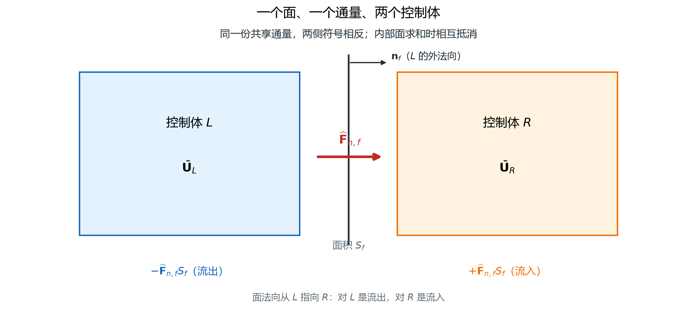
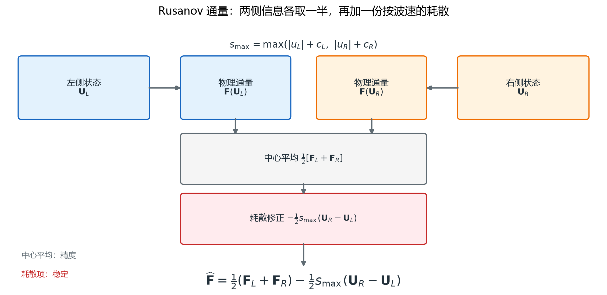
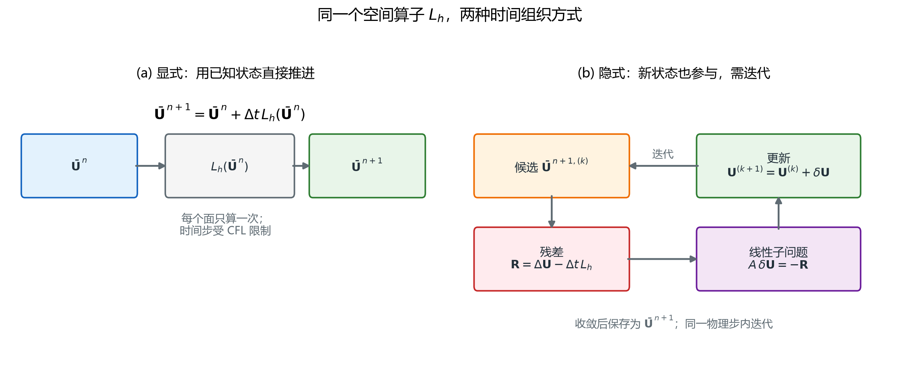
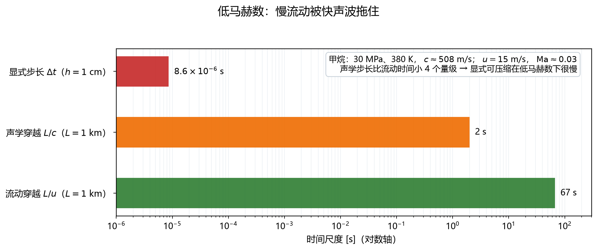

# 面通量与时间推进：有限体积的全部物理

> 对应知识图谱节点：`M7-03`
>
> 前置：[01 控制方程与封闭](01-governing-equations.md)、[02 状态与边界](02-states-and-boundaries.md)
>
> 相关：[M6 数值方法](../06-numerics/README.md)（线性方程组与收敛判据）
>
> 原始推文：《从不可压缩到可压缩：N–S 方程与求解流程有哪些改变？》（链接见文末来源）

---

## 0. 结论先行

1. 有限体积的半离散形式只有一句话：

   $$\frac{d\bar{\mathbf U}_i}{dt}
   =-\frac{1}{V_i}\sum_f\mathbf H_f\ S_f .$$

   所有物理都集中在面通量 $\mathbf H_f$ 里：单元内部不积分，只交换面通量。
2. 无黏物理通量是物理通量在面法向上的投影；黏性再补动量和能量两项，
   其中含黏性应力与热流。无黏时能量通量含压力功，不能被漏掉。
3. 面上左右两个状态不相等，必须用**数值通量**。Rusanov（局部 Lax–Friedrichs）是

   $$\mathbf H=\frac{1}{2}(\mathbf F_L+\mathbf F_R)
   -\frac{1}{2}s_{\max}(\mathbf U_R-\mathbf U_L),
   \qquad
   s_{\max}=\max(|u_{n,L}|+c_L,\ |u_{n,R}|+c_R).$$

   中心平均加数值扩散，两项缺一不可（图 29）。
4. 耗散项正比于状态跳跃。在接触间断上它会把密度跳跃抹宽，
   这是一阶格式的固有代价，不是程序错误。
5. 显式 Euler 的稳定性要求

   $$\Delta t\le C_{\mathrm{CFL}}\frac{h}{\max(|\mathbf u|+c)} .$$

   黏性另有 $\Delta t\lesssim h^2/(2\nu)$ 的限制；两者取小。
   对气体和常规网格，声学限制几乎总是更严。
6. 隐式用 backward Euler + Newton + Krylov；双时间步把"物理时间精度"与
   "伪时间稳态"分开，是定常问题的常用写法。
7. **密度基与压力基不是两种物理，而是两种求解组织**。低马赫时密度基的刚性比约为 $1/\mathrm{Ma}$，
   压力基把声学约束吸收进压力泊松方程（图 31）。
8. 正性保持不是可选项。重构与限制器必须保证 $\rho>0$、 $p>0$；
   出现负值说明格式或步长已经越界，截断只是把错误藏起来。
9. **石油系统接口**：井筒瞬变与管线水击是一维可压缩管流，
   面通量与 CFL 的框架完全适用；气液两相要扩展成多组分/两相模型，
   但"面通量 + 时间推进 + 守恒审计"的骨架不变。

适用范围：单元中心有限体积，一阶精度用于手算；高阶重构只改面状态，不改半离散形式。
本文数值用一维理想气体，三维只多一个面循环。

---

## 1. 前提与符号

### 1.1 约定

- **单元中心**：守恒量存在单元形心，单元内分片常数。
- **外法向**： $\mathbf n_f$ 从单元指向外，相邻单元看到的法向相反。
- **一阶**：面左右状态取相邻单元的平均值，不做重构。
- **理想气体**： $p=(\gamma-1)(\mathcal E-\frac{1}{2}\rho\lVert\mathbf u\rVert^2)$。

### 1.2 符号表

| 符号 | 含义 |
|---|---|
| $V_i$ | 第 $i$ 个单元的体积（一维时就是 $h$） |
| $S_f$ | 面的面积（一维时为 1） |
| $\mathbf n_f$ | 面的外法向 |
| $\mathbf U_L,\mathbf U_R$ | 面左、面右的守恒量 |
| $\mathbf F(\mathbf U)$ | 物理通量向量 |
| $\mathbf H$ | 数值通量 |
| $s_{\max}$ | 面最大特征速度 |
| $C_{\mathrm{CFL}}$ | 安全系数，常取 0.3–0.5 |
| $\nu$ | 运动黏度 $\mu/\rho$ |
| $\alpha$ | 热扩散率 $\kappa/(\rho c_p)$ |
| $\Delta\tau$ | 伪时间步 |

### 1.3 贯穿算例

无量纲理想气体， $\gamma=1.4$， $R=1$， $c_v=2.5$。隔膜两侧取

$$
\mathbf U_L=(1,0,2.5)^{\mathsf T},
\qquad
\mathbf U_R=(0.125,0,0.25)^{\mathsf T}.
$$

本文手算这一个面的通量与两个单元的更新；第 4 篇把它算到 $t=0.2$。

---

## 2. 推导

### 2.1 半离散守恒

对第 $i$ 个单元积分守恒律：

$$
\frac{d}{dt}\int_{V_i}\mathbf U\ dV
+\sum_f\int_{S_f}\mathbf F\cdot\mathbf n_f\ dS=0 .
$$

单元内取平均值，面上假设状态均匀，得到

$$
\frac{d\bar{\mathbf U}_i}{dt}
=-\frac{1}{V_i}\sum_f\mathbf H_fS_f .
$$

一维均匀网格上，单元长度与面积分别为 $h$ 与 1：

$$
\frac{d\bar{\mathbf U}_i}{dt}
=-\frac{\mathbf H_{i+1/2}-\mathbf H_{i-1/2}}{h}.
$$

**离散守恒是自动的**：把所有单元相加，内部面通量成对抵消，只剩边界项。
这就是第 4 篇能做"总量变化等于边界交换"审计的原因。

图中两个相邻单元共享一个面：左单元看到的外法向朝右，右单元看到的外法向朝左；
同一个数值通量在两边符号相反，相加时正好抵消。外侧两个面仍与外部交换。

> 文件：`assets/figures/fig28-face-flux-two-cells.png`

### 2.2 物理通量与法向通量

三维无黏通量是一个张量：质量通量是向量 $\rho\mathbf u$，
动量通量是并矢 $\rho\mathbf u\otimes\mathbf u+p\mathbf I$，能量通量是向量 $(\mathcal E+p)\mathbf u$。
投影到面法向：

$$
\mathbf F(\mathbf U)\cdot\mathbf n_f=
\begin{pmatrix}
\rho u_n\\
\rho\mathbf u\ u_n+p\ \mathbf n_f\\
(\mathcal E+p)u_n
\end{pmatrix},
\qquad u_n=\mathbf u\cdot\mathbf n_f .
$$

一维、法向取正时就是

$$
\mathbf F=
\begin{pmatrix}
\rho u\\
\rho u^2+p\\
(\mathcal E+p)u
\end{pmatrix}.
$$

### 2.3 为什么需要数值通量

面上左右两个状态一般不相等。物理通量在面上没有定义（间断），
必须构造一个**数值通量**，它同时看两侧状态与面的法向。
它至少要满足三条：

1. **一致性**： $\mathbf H(\mathbf U,\mathbf U;\mathbf n_f)=\mathbf F(\mathbf U)\cdot\mathbf n_f$；
2. **守恒性**：左右单元用同一个 $\mathbf H$，符号相反；
3. **稳定性**：足够耗散，不产生非物理振荡。

Rusanov 通量同时满足这三条，形式最简单。

### 2.4 Rusanov 通量

$$
\mathbf H=\frac{1}{2}(\mathbf F_L+\mathbf F_R)
-\frac{1}{2}s_{\max}(\mathbf U_R-\mathbf U_L).
$$

第一项是中心平均，第二项是数值扩散。 $s_{\max}$ 取两侧最大特征速度：

$$
s_{\max}=\max(|u_{n,L}|+c_L,\ |u_{n,R}|+c_R).
$$

若 $\mathbf U_L=\mathbf U_R$，第二项为零，回到物理通量，一致性成立。
若两侧差别很大，第二项把通量往"平均"拉，抑制振荡。

**它为什么稳定**：把通量代入一维更新，可以把格式写成
"中心差分 + 拉普拉斯耗散"的形式，耗散系数正比于最大特征速度。
只要这个速度不小于真实值，离散就不能把新极值推出旧极值范围。
对线性对流 $f=au$，Rusanov 退化为

$$
H=\frac{a}{2}(u_L+u_R)-\frac{|a|}{2}(u_R-u_L)
=\begin{cases}
au_L, & a>0,\\
au_R, & a<0,
\end{cases}
$$

正好是一阶迎风。

上半部分是中心平均，下半部分是数值扩散；两者相加得到共享通量。
扩散项前面的 $s_{\max}$ 由两侧声速与法向速度共同决定。

> 文件：`assets/figures/fig29-rusanov-flux.png`

### 2.5 黏性通量

黏性项不能写成状态的点函数，因为它含梯度。面上需要

$$
\mathbf F_v\cdot\mathbf n_f=
\begin{pmatrix}
0\\
\boldsymbol\tau\cdot\mathbf n_f\\
(\boldsymbol\tau\cdot\mathbf u-\mathbf q)\cdot\mathbf n_f
\end{pmatrix},
\qquad
\mathbf q=-\kappa\nabla T .
$$

面上的 $\boldsymbol\tau$ 与 $\nabla T$ 由相邻单元的中心差分或辅助面重构得到。
总通量是 $\mathbf F_c-\mathbf F_v$，更新时两项一起进面循环。

一阶有限体积里，黏性通量常被写成"面两侧差除以面间距"：
$\mu(u_R-u_L)/\delta$。这样离散后，扩散算子的稳定性限制是 $\Delta t\lesssim h^2/(2\nu)$。

### 2.6 显式时间推进与 CFL

前向 Euler：

$$
\mathbf U_i^{n+1}
=\mathbf U_i^n-\frac{\Delta t}{V_i}\sum_f\mathbf H_f^nS_f .
$$

稳定性由**依赖域**给出：一个时间步内，信息最多传播 $ (|u_n|+c)\Delta t$；
它不能超过一个单元，否则新时刻的单元值会依赖上一步还不存在的信息。于是

$$
\Delta t\le C_{\mathrm{CFL}}\frac{h}{\max(|\mathbf u|+c)} .
$$

一维线性对流 $a>0$ 的迎风格式给出更精确的条件 $a\Delta t/h\le1$；
$C_{\mathrm{CFL}}$ 是安全系数，常取 0.3–0.5。多维时按面求和：

$$
\Delta t\le\frac{1}{\displaystyle\sum_f\frac{(|u_n|+c)S_f}{V_i}} .
$$

笛卡尔网格上就是

$$
\frac{1}{\Delta t}\ge\frac{|u|+c}{h_x}+\frac{|v|+c}{h_y}+\frac{|w|+c}{h_z}.
$$

### 2.7 黏性步长

扩散方程的显式稳定性是 $\Delta t\le h^2/(2\nu)$。热扩散另有一条
$\Delta t\le h^2/(2\alpha)$， $\alpha=\kappa/(\rho c_p)$。取两者较小。

两条限制的比值是

$$
\frac{\Delta t_{\mathrm{visc}}}{\Delta t_{\mathrm{acoustic}}}
\approx\frac{hc}{2C_{\mathrm{CFL}}\nu} .
$$

它随 $h$ **线性下降**：网格越细，黏性限制相对越严。交点大约在 $h\sim2C_{\mathrm{CFL}}\nu/c$。
对常压空气，这个交点是几十纳米；对水是纳米量级。
所以在气体和水的常规网格上，**声学限制几乎总是更严**。
只有在网格极细、黏性极大，或者不可压缩（没有声学限制）时，黏性才成为主要限制。

### 2.8 隐式、Newton–Krylov 与双时间步

Backward Euler：

$$
\frac{\mathbf U^{n+1}-\mathbf U^n}{\Delta t}
=\mathbf L_h(\mathbf U^{n+1}).
$$

它是隐式的，每个时间步要解一个非线性方程组。Newton 线性化：

$$
\left[\frac{\mathbf I}{\Delta t}
-\frac{\partial\mathbf L_h}{\partial\mathbf U}\right]\delta\mathbf U
=-\mathbf R(\mathbf U),
\qquad
\mathbf U\leftarrow\mathbf U+\delta\mathbf U .
$$

线性系统用 GMRES/BiCGSTAB 解；Jacobian 可以不显式组装（矩阵自由），
用有限差分近似 Jacobian–向量乘积。隐式的优点是稳定性不限制步长；
实际步长受**精度**与 Newton 收敛限制，不是"想取多大就取多大"。

定常问题常用双时间步：

$$
\frac{\partial\mathbf U}{\partial\tau}
+\frac{\mathbf U-\mathbf U^n}{\Delta t}
=\mathbf L_h(\mathbf U).
$$

 $\tau$ 是伪时间， $\Delta t$ 是物理时间步。伪时间推到稳态后，
第一项消失，正好是 backward Euler。这样可以用局部时间步加速收敛，
同时保持物理时间精度。

左侧显式：每步便宜，但步长受 CFL 限制，步数多；右侧隐式：每步要解线性系统，
但步长可以大得多。选择取决于问题的时间尺度与可用的线性求解器。

> 文件：`assets/figures/fig30-explicit-vs-implicit.png`

### 2.9 密度基、压力基与低马赫刚性

两种组织方式解的是同一套方程：

- **密度基**：以 $\mathbf U$ 为主变量，压力由状态方程诊断。适合高马赫、激波、可压缩性主导的问题。
- **压力基**：以 $p$ 为主变量，质量通量由动量方程给出，压力由泊松型方程解出。适合低马赫、接近不可压缩的问题。

低马赫时，声学特征速度 $c$ 远大于对流速度 $u$，特征值比约为 $1/\mathrm{Ma}$。
显式密度基格式的步长被声学项卡住，而物理上声波几乎不携带能量，
这就是**刚性**。预处理（preconditioning）或压力基方法把声学项从时间推进中分离出去，
使步长回到对流量级。

图中红色是对流穿越一个单元的时间，灰色是声学穿越时间；
马赫数越低，两者差得越多。显式格式必须按灰色选步长，代价就是步数。

> 文件：`assets/figures/fig31-low-mach-timescales.png`

### 2.10 正性保持

密度和压力必须为正。一阶 Rusanov 在足够小的 CFL 下是正性保持的；
高阶重构（MUSCL、WENO）需要正性保持限制器，否则会在强膨胀或强激波附近产生负密度。

出现负值时，正确做法是**减小步长或降低重构阶数**，而不是把负值截断到一个小正数。
截断会破坏守恒，也会把误差藏起来，让后续的通量计算失去意义。

---

## 3. 数值检验

### 3.1 隔膜上的共享通量

两态初始速度为零，物理通量为

$$
\mathbf F_L=
\begin{pmatrix}0\\1\\0\end{pmatrix},
\qquad
\mathbf F_R=
\begin{pmatrix}0\\0.1\\0\end{pmatrix}.
$$

两侧声速分别为 $1.183216$ 与 $1.058301$，所以 $s_{\max}=1.183216$。代入 Rusanov：

$$
\widehat F_\rho
=\frac{0+0}{2}-\frac{1.183216}{2}(0.125-1)
=0.517657,
$$

$$
\widehat F_{\rho u}
=\frac{1+0.1}{2}-\frac{1.183216}{2}(0-0)
=0.550000,
$$

$$
\widehat F_{\mathcal E}
=\frac{0+0}{2}-\frac{1.183216}{2}(0.25-2.5)
=1.331118 .
$$

合起来

$$
\widehat{\mathbf F}
=(0.517657,\ 0.550000,\ 1.331118)^{\mathsf T}.
$$

中心平均部分是 $(0,0.55,0)$：质量和能量通量**全部来自数值扩散**。
这不是普遍规律，而是因为两侧初始速度都为零，对流项没有贡献。

精确解在隔膜位置的质量通量是 $\rho_{*L}u_*=0.395391$，
数值值 0.517657 比它高约 31%。单步 Rusanov 的耗散很大，
这个数不能当作收敛后的界面通量；它只用来说明通量的算法。

### 3.2 两单元更新

取 $\Delta t/h=0.1$，对应 $\mathrm{CFL}=1.183216\times0.1=0.1183$。
左单元：

$$
\mathbf U_L^{\mathrm{new}}
=\mathbf U_L-0.1(\widehat{\mathbf F}-\mathbf F_L)
=\begin{pmatrix}
0.948234\\
0.045000\\
2.366888
\end{pmatrix}.
$$

右单元：

$$
\mathbf U_R^{\mathrm{new}}
=\mathbf U_R-0.1(\mathbf F_R-\widehat{\mathbf F})
=\begin{pmatrix}
0.176766\\
0.045000\\
0.383112
\end{pmatrix}.
$$

恢复原始量：

| 量 | 左单元 | 右单元 |
|---|---:|---:|
| $\rho$ | 0.948234 | 0.176766 |
| $u$ | 0.047457 | 0.254574 |
| $p$ | 0.946328 | 0.150954 |
| $T$ | 0.997990 | 0.853975 |

质量与能量守恒： $0.948234+0.176766=1.125$，
$2.366888+0.383112=2.75$，正好等于更新前的两单元总量。
动量两边都增加 0.045，合计 0.09：因为这两个单元的外侧仍有压力差，
共享面通量在相加时抵消，外侧通量给出净力
$0.1\times(1-0.1)=0.09$。

### 3.3 步长比较

甲烷： $c=507.8$ m/s， $u=15$ m/s， $h=1$ cm。

$$
\Delta t_{\mathrm{acoustic}}
=\frac{0.45\times0.01}{507.8+15}
=8.61\times10^{-6}\ \mathrm{s}.
$$

运动黏度 $\nu=\mu/\rho\approx1.2\times10^{-5}/152.4=7.9\times10^{-8}$ m²/s，

$$
\Delta t_{\mathrm{visc}}\approx\frac{h^2}{2\nu}
=\frac{10^{-4}}{1.58\times10^{-7}}
\approx6.3\times10^{2}\ \mathrm{s}.
$$

声学限制比黏性限制严约七个数量级。这不是说黏性不重要，
而是说**显式可压缩格式的步长几乎总是由声速决定**。

### 3.4 低马赫的步数代价

同一甲烷算例， $\mathrm{Ma}=0.0295$。对流穿越一个单元需要

$$
\Delta t_{\mathrm{conv}}=\frac{h}{u}=\frac{0.01}{15}=6.67\times10^{-4}\ \mathrm{s}.
$$

显式格式走完这段时间需要

$$
\frac{\Delta t_{\mathrm{conv}}}{\Delta t_{\mathrm{acoustic}}}
=\frac{6.67\times10^{-4}}{8.61\times10^{-6}}
\approx77.5
$$

步。若物理时间 1 s，显式要约 11.6 万步，而对流只需 1500 步。
这就是压力基与预处理存在的理由。

### 3.5 正性与守恒

第 4 篇的 200/400/800 单元算例中，所有单元的密度与压力始终为正，
未做任何截断；全域质量、动量、能量与边界通量累计的差小于 $5\times10^{-15}$。
这两项一起说明：格式没有靠"修补"维持稳定，守恒也不是碰巧。

---

## 4. 常见误解

**误解 1：Rusanov 里的 $s_{\max}$ 是最大流速。**
错。它是最大**特征速度**，等于法向速度绝对值加声速。低马赫时声速远大于流速，
用流速估步长会大到不稳定。

**误解 2：数值扩散是程序写错了。**
错。一阶格式的数值扩散是稳定性与单调性的代价。去掉它，激波附近会出现振荡。
要减小扩散，应该提高重构阶数，而不是把耗散项删掉。

**误解 3：CFL 是精度条件。**
不准确。CFL 首先是显式格式的**稳定性**条件；满足 CFL 只保证不发散，
精度还要看空间重构阶数与时间积分阶数。

**误解 4：隐式可以取任意大的时间步。**
错。隐式稳定性不限制步长，但精度与 Newton 收敛限制步长。
步长太大时 Newton 不收敛，或者把非定常过程算成一条直线。

**误解 5：密度基和压力基是两种不同的方程。**
错。它们解的是同一套守恒方程，只是主变量与线性化方式不同。
高马赫用密度基更自然，低马赫用压力基更高效。

**误解 6：低马赫就可以不管声速。**
错。声速仍是状态量，仍决定显式步长与边界特征线。
低马赫只意味着声波的**能量贡献**小，不意味着它可以从模型里删掉。

---

## 5. 自测

**题 1** 取隔膜两侧状态

$$
\mathbf U_L=(1,0,2.5),
\qquad
\mathbf U_R=(0.125,0,0.25),
$$

写出 $s_{\max}$ 与 Rusanov 通量的三个分量。

**题 2** 若 $\Delta t/h=0.2$，上述算例的 CFL 是多少？是否稳定？

**题 3** 判断：把 $s_{\max}$ 取成两侧流速绝对值的较大者，也能保证稳定。

**题 4** 为什么黏性通量不能像无黏通量那样写成状态的点函数？

**题 5** 双时间步里的两个时间分别是什么？各起什么作用？

---

### 参考答案

**答 1** 两侧声速分别为 1.183216 与 1.058301，所以 $s_{\max}=1.183216$；
数值通量为 $(0.517657,0.550000,1.331118)^{\mathsf T}$。

**答 2** $\mathrm{CFL}=1.183216\times0.2=0.2366$，小于 1，一维显式稳定。
多维还要按面求和判断，不能只看一维。

**答 3** 错。低马赫时声速远大于流速，用流速估的最大特征速度太小，
耗散不足，格式会不稳定。必须用法向速度绝对值加声速。

**答 4** 黏性通量含速度梯度与温度梯度，是状态的导数，不是状态的点函数。
面上必须用相邻单元差分或辅助重构来近似梯度。

**答 5** $\tau$ 是伪时间，用来把定常解推到收敛； $\Delta t$ 是物理时间步，
保非定常过程的精度。伪时间稳态后，双时间步退化为 backward Euler。

---

## 来源

- 原始推文：《从不可压缩到可压缩：N–S 方程与求解流程有哪些改变？》，
  微信公众号文章，链接见
  [`cases/2026-11-13-compressible-ns.md`](../../cases/2026-11-13-compressible-ns.md)。
- 本文的推导、算例与图件均为独立完成；原文公式为图片，本库逐式转写并重算，
  未复制原文文字与图片。
- 图 28–图 31 由 [`tools/make_figures.py`](../../tools/make_figures.py) 生成。
- 隔膜通量、两单元更新与步长的数值可用 `py -3 tools/verify_fluid_notes.py` 复算（第 2、3、5、6 部分）。
