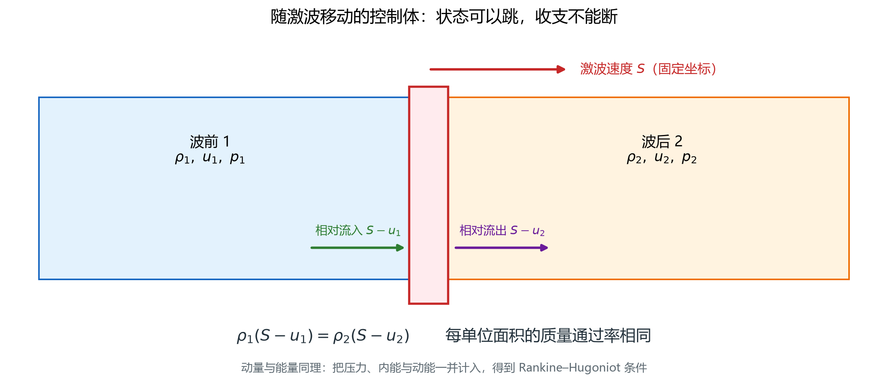
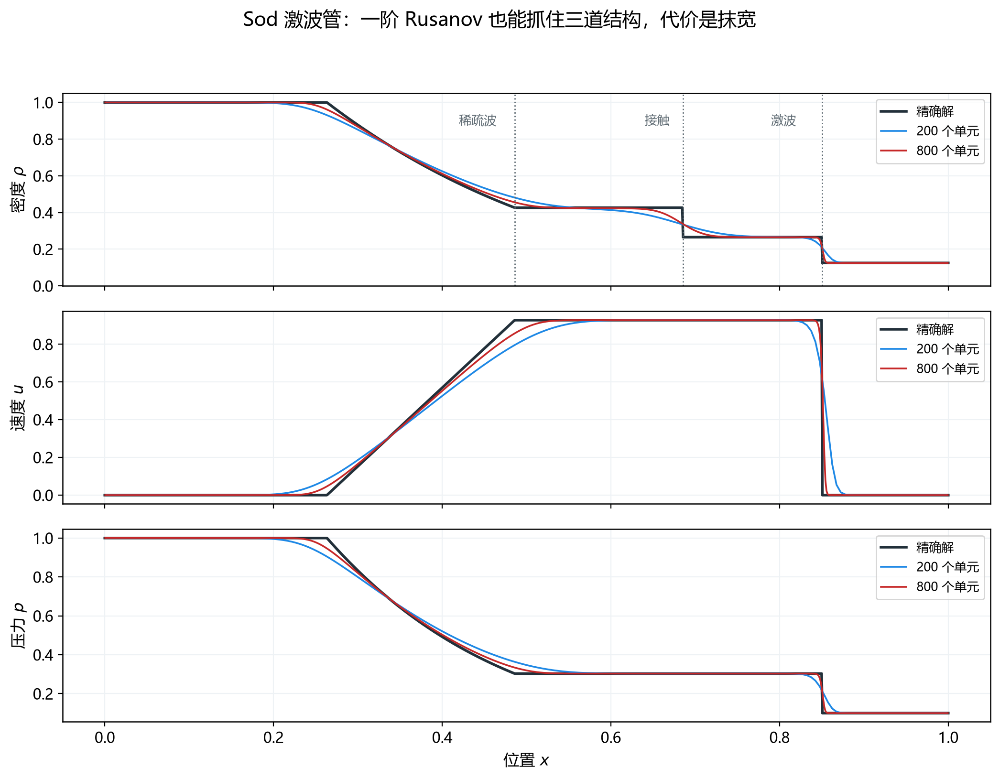

# Sod 激波管：从初始间断到三道波

> 对应知识图谱节点：`M7-04`
>
> 前置：[01 控制方程与封闭](01-governing-equations.md)、[02 状态与边界](02-states-and-boundaries.md)、[03 面通量与时间推进](03-fluxes-and-time-stepping.md)
>
> 相关：[M6 数值方法](../06-numerics/README.md)（收敛阶与守恒审计的一般做法）
>
> 原始推文：《从不可压缩到可压缩：N–S 方程与求解流程有哪些改变？》（链接见文末来源）

---

## 0. 结论先行

1. Sod 激波管是可压缩求解器的"Hello World"：一根管、一个隔膜、两组状态，
   解出**左稀疏波、接触间断、右激波**三道结构。
2. 本文的无量纲设置： $\gamma=1.4$， $R=1$， $c_v=2.5$，计算域 $0\le x\le1$，隔膜在 $x=0.5$。
   左态 $(\rho,p,u)=(1,1,0)$，右态 $(0.125,0.1,0)$。
3. 精确黎曼解给出中间压力与速度：

   $$p_*=0.303130,\qquad u_*=0.927453 .$$

   接触间断两侧密度分别为 0.426319 与 0.265574，压力、速度连续。
4. $t=0.2$ 时四道结构的位置是 0.263357（稀疏波头）、0.485945（稀疏波尾）、
   0.685491（接触间断）、0.850431（激波）。都还在计算域内。
5. 200、400、800 个单元的密度积分误差是 0.016646、0.010890、0.006978，
   观测收敛阶 0.61、0.64。**低于一阶不是程序错**：间断处的误差主导，
   不能拿它推断光滑区精度。
6. 全域守恒审计：质量 0.5625、能量 1.375 不变；动量从 0 增到 0.18，
   正好等于两端压差乘时间 $(p_L-p_R)t$。总量变化与边界通量累计之差最大约 $2\times10^{-16}$。
7. 激波速度 1.752、波后气体速度 0.927、前方声速 1.058，是三个不同的速度。
   把激波速度当成气体速度，是最常见的读图错误。
8. **石油系统接口**：这个算例验证的是无黏 Euler 求解器。
   井筒气侵、段塞、泄压波是它的多组分/两相扩展，验证顺序完全相同：
   先对精确解或解析解，再做守恒审计，最后看网格收敛。

适用范围：一维、无黏、定比热理想气体、无体积力。
黏性与传热要在第 3 篇的通量上再加项，波结构会多出边界层与热波，但审计方法不变。

---

## 1. 前提与符号

### 1.1 无量纲化

取参考长度、密度、压力都为 1（即 $L=\rho_0=p_0=1$），并令 $R=1$。
于是温度与声速都是无量纲量：

$$
T=\frac{p}{\rho},\qquad
c=\sqrt{\gamma\frac{p}{\rho}},\qquad
c_v=\frac{R}{\gamma-1}=2.5 .
$$

时间单位是 $L/\sqrt{p_0/\rho_0}=1$。本文所有数都在这套单位下。

### 1.2 符号表

| 符号 | 含义 |
|---|---|
| $\mathbf U$ | 守恒量 $(\rho,\rho u,\mathcal E)^{\mathsf T}$ |
| $\mathbf F$ | 物理通量 $(\rho u,\rho u^2+p,(\mathcal E+p)u)^{\mathsf T}$ |
| $p_*,u_*$ | 中间压力、中间速度 |
| $\rho_{*L},\rho_{*R}$ | 接触间断左、右密度 |
| $c_*$ | 中间声速 |
| $S$ | 激波速度 |
| $h$ | 单元长度 $1/N$ |
| $\varepsilon_\rho$ | 密度积分绝对误差 |

### 1.3 初始数据

$$
\mathbf U(x,0)=
\begin{cases}
(1,\ 0,\ 2.5)^{\mathsf T}, & 0\le x<0.5,\\
(0.125,\ 0,\ 0.25)^{\mathsf T}, & 0.5<x\le1.
\end{cases}
$$

初始速度为零，所以初始质量与能量通量都为零；
动量通量等于压力，左 1、右 0.1。

---

## 2. 推导

### 2.1 为什么是三道波

两侧压力比 $p_L/p_R=10$，密度比 8。隔膜一破，左侧高压气体向右膨胀，
右侧气体被压缩。一维 Euler 的波族只有三类：

- **稀疏波**：压力下降，气体加速，波区连续展开；
- **接触间断**：压力、速度连续，密度和熵跳跃，随流体运动；
- **激波**：压力、密度、速度都跳跃，相对于前方气体超音速传播。

Sod 问题的解是"左稀疏波—接触间断—右激波"的组合。
若压力比再大，可能出现真空；若很小，两侧都可能是稀疏波。
判断依据是中间压力落在两侧压力的哪一侧。

### 2.2 压力函数

设中间压力为 $p$。左侧若是稀疏波（中间压力低于左压），黎曼不变量
$J_+=u+2c/(\gamma-1)$ 在全扇区守恒。把左态的速度与声速代入，

$$
u_*=\frac{2(c_L-c_*)}{\gamma-1},
\qquad
c_*=c_L\left(\frac{p}{p_L}\right)^{(\gamma-1)/(2\gamma)} .
$$

定义

$$
f_L(p)=\frac{2c_L}{\gamma-1}
\left[\left(\frac{p}{p_L}\right)^{(\gamma-1)/(2\gamma)}-1\right],
$$

则 $u_*=-f_L(p)$。

右侧是激波（ $p>p_R$）。Rankine–Hugoniot 关系给出

$$
f_R(p)=(p-p_R)\frac{\sqrt{2/((\gamma+1)\rho_R)}}
{\sqrt{p+\frac{\gamma-1}{\gamma+1}p_R}},
$$

且 $u_*=f_R(p)$。两式相等：

$$
f_L(p)+f_R(p)=0 .
$$

这个方程没有解析解，用 Brent 法或二分法求根，得到中间压力 0.303130，
代回得中间速度 0.927453。校验：两个压力函数分别为 −0.927453 与 +0.927453，
和为 $10^{-16}$ 量级。

### 2.3 中间状态与波速

左星区是等熵的：

$$
\rho_{*L}=\rho_L\left(\frac{p_*}{p_L}\right)^{1/\gamma}=0.426319,
\qquad
c_*=c_L\left(\frac{p_*}{p_L}\right)^{(\gamma-1)/(2\gamma)}=0.997725 .
$$

右星区跨激波，用 Rankine–Hugoniot 的密度比：

$$
\rho_{*R}=\rho_R
\frac{\dfrac{p_*}{p_R}+\dfrac{\gamma-1}{\gamma+1}}
{\dfrac{\gamma-1}{\gamma+1}\dfrac{p_*}{p_R}+1}
=0.265574 .
$$

激波速度（右态静止）：

$$
S=c_R\sqrt{\frac{\gamma+1}{2\gamma}\frac{p_*}{p_R}
+\frac{\gamma-1}{2\gamma}}
=1.752156 .
$$

### 2.4 波的位置

$t$ 时刻，以隔膜为原点：

$$
x_{\mathrm{head}}=0.5-c_Lt,
\qquad
x_{\mathrm{tail}}=0.5+(u_*-c_*)t,
$$

$$
x_{\mathrm{contact}}=0.5+u_*t,
\qquad
x_{\mathrm{shock}}=0.5+St .
$$

$t=0.2$ 时依次为 0.263357、0.485945、0.685491、0.850431。
最右的激波还没到 $x=1$，最左的稀疏波头还没到 $x=0$，
所以两端仍保持初始状态，守恒审计特别干净。

### 2.5 数值方法

- 一维均匀网格，单元中心有限体积；
- 分片常数（一阶），面状态取相邻单元平均；
- Rusanov 通量， $s_{\max}$ 取两侧最大特征速度；
- 前向 Euler， $\mathrm{CFL}=0.45$；
- 两端零梯度外推：边界面的通量取相邻单元的物理通量；
- 计算到 $t=0.2$。

单元更新就是第 3 篇的公式：

$$
\mathbf U_i^{n+1}
=\mathbf U_i^n-\frac{\Delta t}{h}
\left(\mathbf H_{i+1/2}-\mathbf H_{i-1/2}\right).
$$

### 2.6 误差与收敛阶

精确解是逐点的；数值解是单元平均。比较前要把精确解在同一个单元上积分平均：

$$
\bar\rho_{i,\mathrm{exact}}
=\frac{1}{h}\int_{x_{i-1/2}}^{x_{i+1/2}}\rho_{\mathrm{exact}}(x,t)\ dx .
$$

误差取积分绝对误差：

$$
\varepsilon_\rho=\sum_i h\left|\bar\rho_i-\bar\rho_{i,\mathrm{exact}}\right| .
$$

网格减半时，观测阶

$$
r=\log_2\frac{\varepsilon_\rho(h)}{\varepsilon_\rho(h/2)} .
$$

### 2.7 守恒审计

全域总量应满足

$$
\mathcal M(t)=\mathcal M(0)+\int_0^t\left(F_{\rho,L}-F_{\rho,R}\right)dt,
$$

动量和能量同理。这里 $F_L,F_R$ 是两端边界面的通量（沿 $+x$ 方向）。
数值上把每一步的边界通量累加，再与末态总量相减，就得到收支误差。
它检查的是**离散守恒**，与"数值解接近精确解"是两件事。

图中跨激波取一个扁平控制体：左侧流入、右侧流出，通量差等于控制体内守恒量的变化率。
把这一步写成跳跃条件，就是 Rankine–Hugoniot 关系。

> 文件：`assets/figures/fig33-shock-jump-control-volume.png`

---

## 3. 数值检验

### 3.1 初始状态与初始通量

| 量 | 左态 | 右态 |
|---|---:|---:|
| $\rho$ | 1 | 0.125 |
| $u$ | 0 | 0 |
| $p$ | 1 | 0.1 |
| $T$ | 1 | 0.8 |
| $\mathcal E$ | 2.5 | 0.25 |
| $c$ | 1.183216 | 1.058301 |
| $\mathbf F$ | $(0,1,0)$ | $(0,0.1,0)$ |

### 3.2 单步两单元更新

取 $\Delta t/h=0.1$，隔膜通量 $\widehat{\mathbf F}=(0.517657,0.550000,1.331118)$，
更新结果：

| 量 | 左单元 | 右单元 |
|---|---:|---:|
| $\rho$ | 0.948234 | 0.176766 |
| $\rho u$ | 0.045000 | 0.045000 |
| $\mathcal E$ | 2.366888 | 0.383112 |
| $u$ | 0.047457 | 0.254574 |
| $p$ | 0.946328 | 0.150954 |
| $T$ | 0.997990 | 0.853975 |

质量与能量在两单元间精确平衡；动量合计增加 0.09，来自两个单元外侧的压力差。
这一步只验证"当前状态—共享通量—新状态—恢复"的算术链，不代表整体精度。

### 3.3 精确解

| 量 | 数值 |
|---|---:|
| $p_*$ | 0.303130 |
| $u_*$ | 0.927453 |
| $\rho_{*L}$ | 0.426319 |
| $\rho_{*R}$ | 0.265574 |
| $c_*$ | 0.997725 |
| $S$ | 1.752156 |

$t=0.2$ 时的波位置：

| 结构 | 位置 |
|---|---:|
| 稀疏波头 | 0.263357 |
| 稀疏波尾 | 0.485945 |
| 接触间断 | 0.685491 |
| 激波 | 0.850431 |

### 3.4 三组网格

| 单元数 | 实际步数 | 密度积分误差 | 观测阶 |
|---:|---:|---:|---:|
| 200 | 190 | 0.016646 | — |
| 400 | 385 | 0.010890 | 0.61 |
| 800 | 774 | 0.006978 | 0.64 |

上排是密度、速度、压力三条剖面，灰色是精确解，彩色是 200/400/800 单元的计算结果；
下排是密度误差随网格的变化。加密后三道结构都变陡，误差单调下降。

> 文件：`assets/figures/fig32-sod-shocktube.png`

### 3.5 剖面怎么读

- **稀疏波**：从 0.263357 到 0.485945，密度、压力、速度都连续变化；
  数值解在扇区边缘被抹平，这是数值扩散。
- **接触间断**：0.685491 处，压力与速度连续，密度从 0.426319 跳到 0.265574。
  数值解把跳跃抹成一条斜线，但**只抹密度，不抹压力与速度**——这正是识别接触间断的依据。
- **激波**：0.850431 处，密度、压力、速度同时跳跃；数值解同样抹宽，但跳跃中心位置与精确解一致。

### 3.6 守恒审计

| 量 | 初始 | $t=0.2$ | 边界累计 | 收支误差 |
|---|---:|---:|---:|---:|
| 质量 | 0.5625 | 0.5625 | 0 | $1.1\times10^{-16}$ |
| 动量 | 0 | 0.18 | 0.18 | $1.4\times10^{-16}$ |
| 能量 | 1.375 | 1.375 | 0 | $2.2\times10^{-16}$ |

三组网格的结果相同（差别在浮点舍入）。动量增量为什么是 0.18？

$$
\mathcal P(0.2)=\mathcal P(0)+(p_L-p_R)t
=0+(1-0.1)\times0.2=0.18 .
$$

两端气体在 $t=0.2$ 时仍未受扰动，速度为零，所以质量与能量没有穿过边界；
但压力始终存在，动量通量不为零。**"边界没有质量交换"不等于"边界没有动量交换"。**

### 3.7 三种速度

| 速度 | 数值 | 含义 |
|---|---:|---|
| 激波前沿 $S$ | 1.752 | 间断面的传播速度 |
| 波后气体 $u_*$ | 0.927 | 气体本身的运动速度 |
| 前方声速 $c_R$ | 1.058 | 未扰动气体中的声速 |
| 波后声速 $c_*$ | 0.998 | 星区中的声速 |

激波相对于前方气体是超音速的，这是它能形成间断的原因：
$S$ 比右态声速大，所以波前气体来不及用声波预警。
波后气体速度则小于当地声速，所以接触间断附近的流动是亚声速的。
三个速度各有物理含义，不能互相替代。

### 3.8 再加密会怎样

若观测阶保持在 0.64 附近，1600 个单元的误差约为

$$
\varepsilon_\rho(1600)\approx\frac{0.006978}{2^{0.64}}
\approx0.00448 .
$$

这是外推，不是验证。真要下结论，必须再算一组 1600 单元，
并检查观测阶是否稳定；若阶数继续下降，说明间断仍在主导，不能外推。

### 3.9 这个算例没有验证什么

它只验证了无黏 Euler 的质量、动量、能量守恒与波结构。
它**没有**验证黏性应力、热传导、黏性壁面、湍流、多组分或相变。
要验证完整的可压缩 N–S，还需要：

- 平板边界层或库埃特流，对照 Blasius 解或解析剪应力；
- 一维热传导，对照误差函数解；
- 激波–边界层干扰，对照实验或高精度解。

---

## 4. 常见误解

**误解 1：一阶格式的收敛阶应该是一阶。**
不完整。光滑区是一阶；含激波、接触间断的算例，积分误差的观测阶可以低于一阶。
本算例的 0.61、0.64 是三道波共同作用的结果，不能据此判断光滑区精度。

**误解 2：接触间断就是激波。**
不是。接触间断两侧压力、速度连续，只有密度（和熵）跳跃；
激波两侧压力、密度、速度都跳跃。数值解里两者都被抹宽，但看压力和速度是否连续就能区分。

**误解 3：总动量应该守恒为零。**
错。两端压力不同，边界面对流体有净作用力，总动量按 $(p_L-p_R)t$ 增加。
只有两端压力相等时，总动量才保持不变。

**误解 4：离散守恒就说明数值解正确。**
错。离散守恒只说明"总量变化等于边界交换"，它不衡量波形误差。
一个完全错误的格式也可能守恒。必须同时做精确解比较与网格收敛。

**误解 5：激波速度等于波后气体速度。**
错。本算例激波速度 1.752，波后气体速度 0.927，差近一倍。
激波是间断面在介质中的传播速度，不是介质本身的速度。

**误解 6：网格减半，误差就减半。**
不一定。本算例从 400 到 800，误差只降到 0.64 次方。
误差阶由格式与解的光滑性共同决定，不是由网格数单独决定。

---

## 5. 自测

**题 1** 为什么 $p_*$ 要迭代求解？能否直接写出解析表达式？

**题 2** 用 $u_*=0.927453$ 估算 $t=0.3$ 时接触间断的位置。

**题 3** 解释为什么 $t=0.2$ 时全域动量是 0.18，而质量与能量不变。

**题 4** 判断：若把两端改成固壁， $t=0.2$ 时全域动量仍然是 0.18。

**题 5** 已知 400 单元误差 0.010890、观测阶 0.64，估算 1600 单元的误差；
说明这个估算为什么不能当作验证。

---

### 参考答案

**答 1** 因为中间压力满足一个两侧压力函数之和为零的方程，
其中左侧是幂函数、右侧是根式，一般没有初等闭式解（除少数特殊状态）。
工程上用 Brent 法或二分法，精度可到机器 epsilon。

**答 2** $x=0.5+0.927453\times0.3=0.778236$。
此时激波在 $0.5+1.752156\times0.3=1.025647$，已经出了右边界，
所以 $t=0.3$ 不能再按"两端未扰动"做简单审计。

**答 3** 两端速度为零，质量与能量通量为零；但压力不为零，动量通量为 $p$。
左端流入、右端流出，净流入 $p_L-p_R=0.9$，乘以 0.2 得 0.18。

**答 4** 对。波还没传到两端，边界是壁面还是开边界不影响 $t=0.2$ 的内部解；
壁面的动量通量同样是压力，净力仍为 $p_L-p_R$。
若时间更长，波会反射，结果就不同了。

**答 5** 从 400 到 1600，网格缩小 4 倍；阶为 0.64 时误差乘以 $4^{-0.64}=2^{-1.28}=0.411$，
估算值是 $0.010890\times0.411=0.00448$。
它不是验证：观测阶可能随网格变化，必须实算 1600 单元并检查阶数是否稳定。

---

## 来源

- 原始推文：《从不可压缩到可压缩：N–S 方程与求解流程有哪些改变？》，
  微信公众号文章，链接见
  [`cases/2026-11-13-compressible-ns.md`](../../cases/2026-11-13-compressible-ns.md)。
- 本文的推导、算例与图件均为独立完成；原文公式为图片，本库逐式转写并重算，
  未复制原文文字与图片。
- 图 32、图 33 由 [`tools/make_figures.py`](../../tools/make_figures.py) 生成。
- 全部数值可用 `py -3 tools/verify_fluid_notes.py` 复算（第 4、5 部分）；
  精确解与有限体积参考实现见 `tools/fluid_lib.py`。
