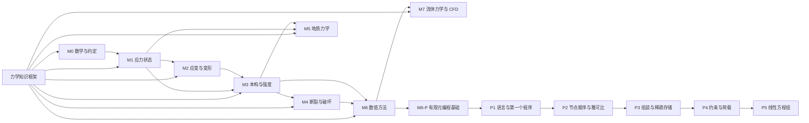
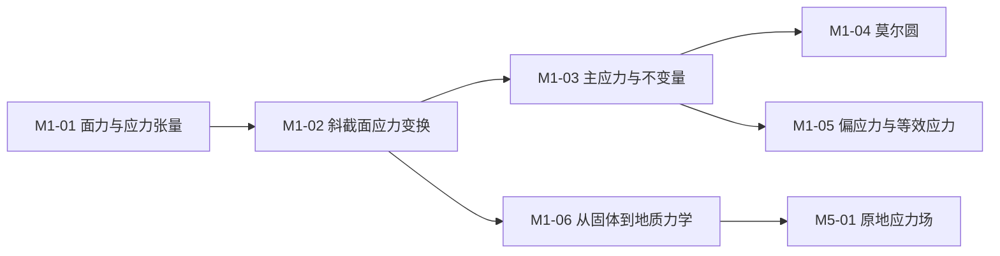

# 力学知识图谱

这张图的用途只有一个：**让学生一眼看出"先学什么、后学什么"**，并且每个节点都能点进对应的笔记。

- 交互页面：[`index.html`](index.html) —— 双击即可离线打开，无需服务器
- 机器可读数据：[`graph.json`](graph.json) —— 节点、关系、状态、路径
- 页面数据：[`graph-data.js`](graph-data.js) —— 由脚本从 JSON 生成，不要手改

---

## 1. 怎么打开

直接双击 `index.html`。页面通过 `<script src="graph-data.js">` 读取数据，
因此在 `file://` 协议下也能正常工作，不需要 `python -m http.server`。

> 为什么不用 `fetch("graph.json")`？浏览器的 CORS 策略会拦截 `file://` 下的
> fetch 请求，但允许加载同目录的脚本。脚本生成 `graph-data.js` 就是为了绕开这一点，
> 同时保持 `graph.json` 是唯一数据源。

---

## 2. 图例

| 元素 | 含义 |
|---|---|
| 深色圆角块 | 总框架（根节点） |
| 带白色底色的模块块 | 八个一级模块 M0–M7 |
| 白色小卡片 | 模块内的知识点 |
| 金色虚线框 | 案例拆解，指向它覆盖的模块 |
| 灰色竖线 | 包含关系（模块 → 知识点） |
| 实线箭头 | 先修关系（箭头指向后续内容） |
| 虚线折线（跨模块上方） | 跨模块的远距离先修关系，避免穿过卡片 |
| 虚线（实心边框 / 灰色文字） | 仅提纲，推导待补 |
| 蓝色描边加粗 | 当前选中的节点 |

颜色按模块区分：M0 灰蓝、M1 蓝、M2 青、M3 琥珀、M4 红、M5 绿、M6 紫、M7 靛蓝。
同一颜色只表示"属于同一模块"，不表示难度。

---

## 3. 模块级框架



读法：从左上往右下。M1 是整张图的枢纽——它同时是 M2、M3、M5 的前置；
M3 是第二个枢纽，向上支撑 M4、M5、M6；M6 又为 M7 提供离散与线性代数基础。

---

## 4. M1 内部链路（已完成的样板）



这条链是后续所有模块的写作模板：**先定义对象，再谈变换，再谈不变量，
最后才是强度与工程应用**。

---

## 5. 数据格式

`graph.json` 的顶层只有三项：

```json
{
  "meta":  { "title": "...", "subtitle": "...", "version": "0.1.0", "updated": "2026-11-10" },
  "nodes": [ ... ],
  "edges": [ ... ]
}
```

### 节点

| 字段 | 类型 | 说明 |
|---|---|---|
| `id` | string | 唯一标识；模块用 `M0`–`M7`，知识点用 `M1-03`，子模块用 `M6-P`，案例用 `C1` |
| `label` | string | 卡片上的文字，控制在 12 个汉字以内 |
| `type` | `root` / `module` / `topic` / `case` | 决定卡片尺寸与样式 |
| `status` | `done` / `planned` | `done` 表示六节结构已写全 |
| `doc` | string | **相对仓库根目录**的笔记路径，可带 `#锚点` |
| `summary` | string | 选中时显示在右侧面板，一到两句 |
| `col` | int | 列号，M0–M6 依次为 1–7；子模块 M6-P 在 8；M7 在 9 |
| `row` | int | 行号；根为 −1，模块为 0，知识点从 1 开始 |

### 关系

```json
{ "from": "M1-03", "to": "M1-04", "kind": "precedes" }
```

`kind` 只有三种：

- `contains`：父节点包含子节点（根 → 模块 → 知识点）；
- `precedes`：先修关系，`from` 必须在 `to` 之前学；
- `case`：案例指向它拆解的模块。

---

## 6. 修改流程

```bash
# 1. 编辑 graph.json
# 2. 校验并生成页面数据
py -3 tools/build_graph_data.py
# 3. 刷新 index.html
```

脚本会检查五件事，任何一项失败都会给出节点 id 并中止：

1. 节点 id 不重复；
2. 每条边的两端都存在，且没有重复边；
3. 每个 `doc` 路径在仓库里真实存在（忽略 `#锚点`）；
4. `status`、`type`、`kind` 都是允许的取值；
5. `(col,row)` 不冲突——静态布局不能有两个卡片压在一起。

### 新增一个知识点

以"应变莫尔圆"为例：

1. 在 `docs/02-strain/` 下写笔记，六节结构齐全后把 `status` 设为 `done`；
2. 在 `nodes` 里追加：

   ```json
   {
     "id": "M2-02b",
     "label": "应变莫尔圆",
     "type": "topic",
     "status": "done",
     "col": 3,
     "row": 5,
     "doc": "docs/02-strain/02b-strain-mohr-circle.md",
     "summary": "与应力莫尔圆同构，但纵轴是 γ/2；用于求主应变与最大剪应变。"
   }
   ```

3. 追加先修关系：`M2-02 → M2-02b`、`M2-02b → M2-03`；
4. 行号冲突时，把后面的节点整体下移，或把新节点插入到空行；
5. 运行 `py -3 tools/build_graph_data.py`，刷新页面。

### 写作原则

- **一个节点 = 一次课能讲透的一个概念**（30–90 分钟），不要把"主应力"和"莫尔圆"塞进同一个节点。
- **先修关系必须有理由**：如果学生不学 A 也能看懂 B，就不要连这条边。
- **跨级先修**（如 M1 → M5）在图上用虚线绕行，表示"模块级依赖"，不要拆成十几条知识点连线。
- `status: done` 是承诺：六节结构齐全、数值算例可复核、图件可复现。

---

## 7. 覆盖情况

| 模块 | 节点数 | 已完成 | 状态 |
|---|---:|---:|---|
| 根节点 | 1 | 1 | ✅ |
| M0 数学与约定 | 4 | 4 | ✅ |
| M1 应力状态 | 7 | 7 | ✅ |
| M2 应变与变形 | 5 | 0 | 🚧 提纲 |
| M3 本构与强度 | 7 | 0 | 🚧 提纲 |
| M4 断裂与破坏 | 6 | 0 | 🚧 提纲 |
| M5 地质力学 | 6 | 0 | 🚧 提纲 |
| M6 数值方法 | 14 | 8 | 🚧 提纲（编程基础、雅可比 ✅） |
| M7 流体力学与 CFD | 5 | 5 | ✅ |
| C1–C3 案例 | 3 | 3 | ✅ |
| **合计** | **58** | **28** | |

---

## 8. 交互说明

- 单击节点：右侧显示摘要、所属模块、前置与后续；
- 双击（或选中后按 <kbd>O</kbd>）：在新标签页打开笔记；
- <kbd>Tab</kbd> / <kbd>Shift+Tab</kbd>：逐个浏览节点，<kbd>Enter</kbd> 选中；
- 顶部搜索框：按 id、标题、摘要过滤；
- 状态筛选：只看已完成 / 只看计划中；
- URL 带 `#M1-04` 可直接定位到某个节点，方便课堂投屏和讲义引用。

---

## 9. 已知限制

- 采用**静态布局**，节点位置由 `col`/`row` 决定，不依赖力导向算法。好处是每次打开图都一样，
  适合课堂；代价是新增节点后需要手工安排空行。
- 目前 58 个节点、9 列。页面按 `viewBox` 等比缩放，1366 px 宽的投影仍能完整显示，
  但 9 列时卡片文字比 7 列小约 15%；更窄的屏幕建议直接放大浏览器或投屏到 1080p。
- 跨模块的远距离先修关系用折线绕到模块上方，节点再多时这一带会变拥挤，
  届时应拆分为"子图 + 模块间箭头"两级视图。
